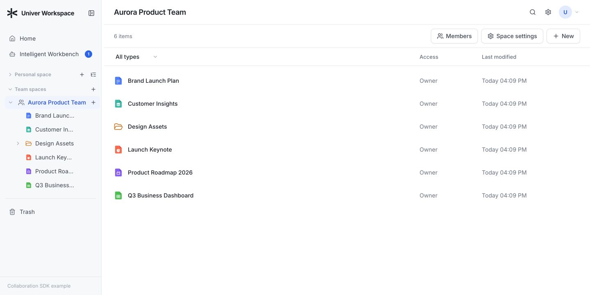
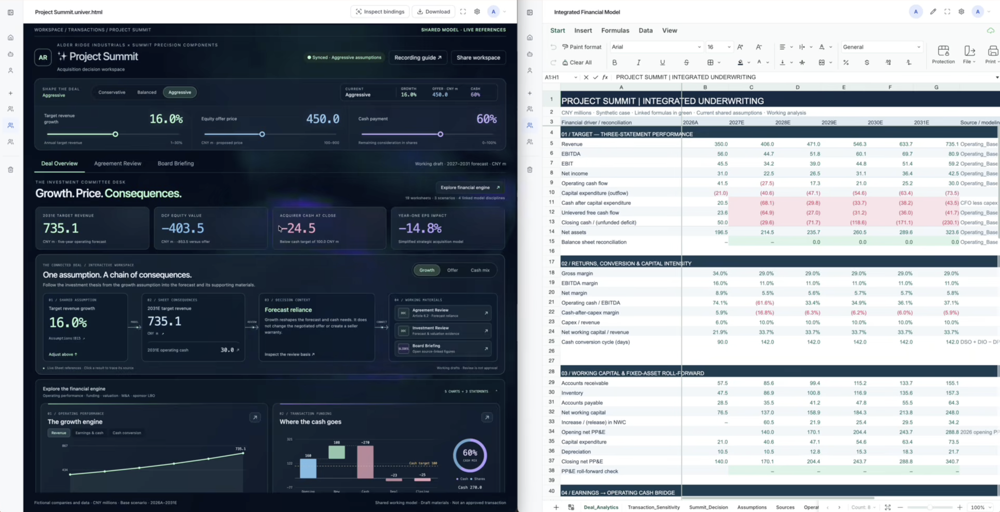
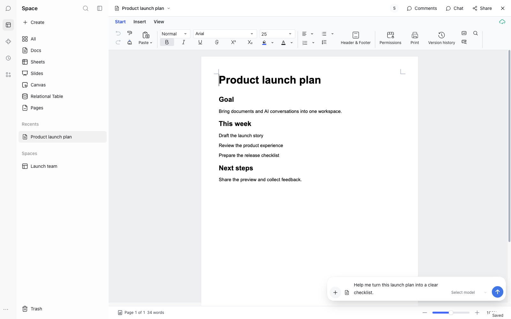
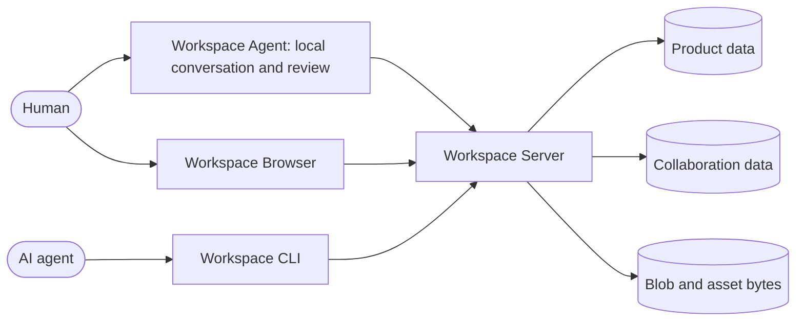

<div align="center">

# Univer Workspace

**An open-source Office workspace where people and AI agents create, collaborate, and review together.**

[Univer Docs](https://docs.univer.ai/) · [Server SDK](https://docs.univer.ai/server) · [CLI guide](apps/cli/README.md) · [Workspace Agent](apps/agent/README.md) · [Issues](https://github.com/dream-num/univer-workspace/issues)

[](LICENSE)
[](package.json)
[](package.json)

English | [简体中文](README.zh-CN.md)

</div>

Univer Workspace is a deployable knowledge and collaboration workspace built on the
[Univer Office SDK](https://github.com/dream-num/univer). It brings Sheets, Docs, Slides,
relational tables, canvases, and more into one shared runtime, with data and
references staying connected across artifacts as the workspace changes.

Choose the Workspace Browser for direct editing, Workspace Agent for document
conversations and change review, or the CLI for automation. All three connect to
the Workspace Server, which owns document storage and permissions. Agents work in
isolated Worktrees, verify their changes, and hand the result to a person for
review. Humans can continue editing and stay in control of what gets merged.



## Why Univer Workspace

| For people                                                                          | For agents                                                        | For operators                                                        |
| ----------------------------------------------------------------------------------- | ----------------------------------------------------------------- | -------------------------------------------------------------------- |
| Organize content in Personal and Team Spaces                                        | Create and edit rich Office content through the Univer Facade API | Deploy one Browser and Server application                            |
| Co-edit Sheets, Docs, Slides, Bases, and Boards                                     | Inspect data, render screenshots/PDFs, and run layout checks      | Keep product, collaboration, and Blob data under application control |
| Share content with role- and node-aware access control, including anonymous viewing | Discover version-matched Skills and APIs offline                  | Integrate password, GitHub, Discord, or application OAuth login      |
| Use Recent, Trash, file import/export, and review views                             | Work through multiple rounds without changing trunk               | Operate a documented HTTP API with explicit recovery boundaries      |

## Spreadsheet-based mini-apps · [Watch the demo](https://youtu.be/4PBVltY_WEc)

- Agents can generate spreadsheet-based mini-apps, such as decision-making dashboards, interactive reports, and business dashboards.
- Metrics, charts, and controls on the web page are bound to cells, supporting data reads, writes, and collaborative updates.
- See the [HTML View showcase](docs/html-view-showcase.md) for ten page styles, live editing, and public sharing with visitor trials.

[](https://youtu.be/4PBVltY_WEc)

## Choose your entry point

| Entry point           | Use it for                                                                                                         | Get started                                                              |
| --------------------- | ------------------------------------------------------------------------------------------------------------------ | ------------------------------------------------------------------------ |
| **Workspace Browser** | Edit documents directly, collaborate, organize Spaces, and review changes                                          | [Start Workspace](#quick-start)                                          |
| **Workspace Agent**   | Chat with an agent beside your documents, reference local or remote files and folders, and review Worktree changes | [Install and use Agent](apps/agent/README.md#installation-and-first-use) |
| **Workspace CLI**     | Automate document tasks from a terminal, scripts, or an existing agent environment                                 | [CLI installation and usage](apps/cli/README.md)                         |
| **Workspace MCP**     | Let Claude, ChatGPT, Cursor, VS Code, Codex, and other AI assistants work in Workspace with one URL                 | [Connect an AI assistant](#connect-an-ai-assistant-mcp)                  |

Workspace Agent is a local web application built on DSH (DeepSeek Harness). Its
local file references point to the machine running Agent; Workspace documents
remain on the connected service. Both Agent and CLI can connect to your existing
Workspace deployment or one you start locally.

## Connect an AI assistant (MCP)

Workspace runs a remote [MCP](https://modelcontextprotocol.io) server. An assistant connected to it can find
your files, open a pull request, edit Sheets, Docs, and Slides, read the result back, and mark the pull request
ready for you to review in the browser. Nothing is installed on your machine.

[](https://cursor.com/install-mcp?name=univer-workspace&config=eyJ1cmwiOiJodHRwczovL3NwYWNlLnVuaXZlci5haS9tY3AifQ%3D%3D)
[](https://vscode.dev/redirect/mcp/install?name=univer-workspace&config=%7B%22type%22%3A%22http%22%2C%22url%22%3A%22https%3A%2F%2Fspace.univer.ai%2Fmcp%22%7D)

| Setting    | Value                                                                                                                                      |
| ---------- | ------------------------------------------------------------------------------------------------------------------------------------------ |
| Server URL | `https://space.univer.ai/mcp`. For your own deployment, use `https://<your-workspace>/mcp` ([MCP server guide](apps/mcp/README.md)) |
| Transport  | Streamable HTTP                                                                                                                            |
| Sign-in    | OAuth in your browser. The consent page lists `read`, `write`, `publish`, and `worktree:merge`; uncheck anything you do not want to grant |
| Toolsets   | `core` by default. Add `?toolsets=core,files` for Blob, Asset, Markdown, Typst, SVG, and HTML View tools, `admin` for repository and label management, or `all` |

A client that cannot run OAuth can send a personal access token as `Authorization: Bearer <token>`. Create one
from **Access tokens** in the Workspace account menu. On `space.univer.ai`, editing tools (`execute`, `inspect`,
import, and export) are currently enabled only for invited accounts; every account can browse, search, and manage
issues and pull requests.

<details>
<summary><b>Claude Code</b></summary>

```bash
claude mcp add --transport http univer-workspace https://space.univer.ai/mcp
```

Run `/mcp` in a Claude Code session, select `univer-workspace`, and sign in. Add `--scope user` to use it in every
project. Claude Code skips OAuth when an `Authorization` header is configured, so do not set one together with it.

</details>

<details>
<summary><b>Claude.ai and Claude Desktop</b></summary>

Open **Customize → Connectors**, choose **+ Add → Add custom connector**, enter `Univer Workspace` and
`https://space.univer.ai/mcp`, then sign in. Claude Desktop uses the same connector list. On Team and Enterprise
plans an owner adds the connector under **Organization settings → Connectors** first, and members click
**Connect**. These connectors connect from Anthropic's cloud, so a self-hosted Workspace must be reachable from
the internet.

</details>

<details>
<summary><b>ChatGPT</b></summary>

In ChatGPT on the web, open the apps settings (labelled **Apps**, **Plugins**, or **Connectors** depending on your
version), turn on **Developer mode** if your plan requires it, and create a custom MCP app with
`https://space.univer.ai/mcp` and OAuth. Select it with `@` in a new chat. Availability depends on the plan;
Business and Enterprise admins may need to allow custom MCP apps first.

</details>

<details>
<summary><b>Codex</b></summary>

```bash
codex mcp add univer-workspace --url https://space.univer.ai/mcp
codex mcp login univer-workspace
```

`codex mcp add` may start the sign-in by itself. The CLI, IDE extension, and desktop app share
`~/.codex/config.toml`:

```toml
[mcp_servers.univer-workspace]
url = "https://space.univer.ai/mcp"
```

</details>

<details>
<summary><b>Cursor</b></summary>

Use the button above, or add this to `~/.cursor/mcp.json` (or `.cursor/mcp.json` in a project). Cursor asks you to
sign in the first time it connects.

```json
{
  "mcpServers": {
    "univer-workspace": { "url": "https://space.univer.ai/mcp" }
  }
}
```

</details>

<details>
<summary><b>VS Code (GitHub Copilot)</b></summary>

Use the button above, or run:

```bash
code --add-mcp '{"name":"univer-workspace","type":"http","url":"https://space.univer.ai/mcp"}'
```

Then run **MCP: List Servers**, start `univer-workspace`, and sign in in the browser. Remote OAuth needs VS Code
1.101 or later. For a single workspace, put the server in `.vscode/mcp.json` under `servers` with `"type": "http"`.

</details>

<details>
<summary><b>Gemini CLI</b></summary>

```bash
gemini mcp add --transport http --scope user univer-workspace https://space.univer.ai/mcp
```

Run `/mcp auth univer-workspace` to sign in. In `settings.json`, Streamable HTTP servers use `httpUrl`; `url` means
SSE.

</details>

<details>
<summary><b>opencode</b></summary>

```bash
opencode mcp add univer-workspace --url https://space.univer.ai/mcp --global
opencode mcp auth univer-workspace
```

</details>

<details>
<summary><b>Windsurf</b></summary>

Open the MCP config file from Windsurf Settings (**Add Server** or **Open MCP config file**), add the server, and
refresh. Windsurf asks you to sign in when it connects.

```json
{
  "mcpServers": {
    "univer-workspace": { "serverUrl": "https://space.univer.ai/mcp" }
  }
}
```

</details>

<details>
<summary><b>WorkBuddy</b></summary>

Open **Connectors → Custom Connector → Configure MCP**, add the server, save, and enable it. When it shows
"Authentication required", click **Connect** and sign in.

```json
{
  "mcpServers": {
    "univer-workspace": { "type": "streamableHttp", "url": "https://space.univer.ai/mcp" }
  }
}
```

</details>

<details>
<summary><b>Grok</b></summary>

On [grok.com](https://grok.com), open **Connectors → New Connector → Custom**, enter
`https://space.univer.ai/mcp`, and sign in. Grok connects from xAI's cloud, so a self-hosted Workspace must be
reachable from the internet.

</details>

<details>
<summary><b>Other clients</b></summary>

Any client that supports Streamable HTTP and OAuth 2.1 can use the server URL directly. Workspace supports Client
ID Metadata Documents and dynamic client registration. A client that only runs local stdio servers can use a
bridge such as `npx -y mcp-remote https://space.univer.ai/mcp`.

</details>

If a client keeps asking you to sign in, sign out of the server in that client (for example
`claude mcp logout univer-workspace`, `opencode mcp logout univer-workspace`, or `/mcp auth` in Gemini CLI) and
sign in again. If a tool you expect is missing, check the `?toolsets=` part of the URL.

## Space Preview

Space is a proof-of-concept plugin for Univer Workspace that you install in official
DeepSeek Harness (DSH). It connects to your Workspace service so you can browse files,
edit Univer Docs and Sheets, and chat with an AI alongside an open document.



See the [Space plugin guide](apps/space-plugin/README.md) for the package, installation
steps, and known limitations. Space is optional and does not replace Workspace Agent.
Use non-critical documents while evaluating this preview.

## How it works



The Browser is the direct editing and collaboration surface. Workspace Agent
combines a conversation with document previews and Worktree review. The CLI gives
agents a structured way to load, understand, edit, validate, and render the same
content. The Server resolves authoritative identity and permissions, owns
Workspace product workflows, and composes the Univer Collaboration SDK.

Worktree turns agent editing into an explicit review workflow:

```text
create Worktree
→ agent edits and verifies an isolated draft
→ Ready
→ human reviews in the Browser or Workspace Agent
→ Merge or Reopen
→ trunk
```

Intermediate changes remain isolated from shared content until a person accepts
them. See the [CLI guide](apps/cli/README.md) for the complete product workflow.

## Quick start

These commands start the Workspace service and Browser. To add the conversation
interface, follow the [Workspace Agent guide](apps/agent/README.md#installation-and-first-use).

### Requirements

- Node.js 24 or newer
- pnpm 11

Install dependencies and prepare the application configuration:

```bash
pnpm install
cp apps/workspace/.env.example apps/workspace/.env
```

Start the Server:

```bash
pnpm workspace:dev:server
```

In another terminal, start the Browser development server:

```bash
pnpm workspace:dev:web
```

Open <http://127.0.0.1:5173>. Vite provides hot module replacement and proxies API
and WebSocket traffic to the Server at <http://127.0.0.1:3020>.

The Server can also serve the latest built Browser from port 3020 when
`apps/workspace/dist/public` exists. Its product API is available at
<http://127.0.0.1:3020/api-docs> and
<http://127.0.0.1:3020/openapi.yaml>.

Configuration, authentication, storage, Docker, and database migration details live
in the [Workspace application guide](apps/workspace/README.md).

## One-Click Deploy

[](https://repocloud.io/details/Univer%20Workspace/)

## Use Workspace Agent

Workspace Agent is a desktop app built on DSH for Univer Workspace. Reference Workspace files with `@`, create and edit documents through conversation, then review changes and choose whether to merge or discard them.

The [Agent guide](apps/agent/README.md#installation-and-first-use)
includes a prompt you can give a coding agent before cloning the repository, as
well as manual setup and usage instructions. It walks through choosing or starting
your own Workspace service, registering the OAuth callback, configuring model
credentials, and opening the complete token URL printed by the local launcher.

Desktop Agent packaging and manual CI are described in the
[desktop guide](apps/agent/desktop/README.md). Downloads use GitHub Releases;
Agent release tags never trigger automatic publication.

## Use the Workspace CLI

To use Workspace with an existing agent such as Claude, Codex, or Kimi Work, install the CLI and [Workspace CLI Skill](skills/univer-workspace-cli/SKILL.md) in the environment where the agent runs:

```bash
npm install --global univer-workspace-cli@latest
npx skills add dream-num/univer-workspace --skill univer-workspace-cli -g
```

Point the CLI at your own Workspace deployment, then begin browser-approved login:

```bash
uvw config set workspace.origin <origin>
uvw auth login
```

After the user approves the displayed URL and verification code, complete the
one-time exchange:

```bash
uvw auth login --complete
```

The installed package includes version-matched Skills, structured JSON output,
Facade API discovery, content inspection, PNG/PDF rendering, Office exchange, and Worktree
workflows. See the [CLI guide](apps/cli/README.md) for the complete usage and login
contract.

## Repository layout

```text
apps/workspace                 Workspace Browser, Server, HTTP contract, and deployment app
apps/cli                       Agent-ready remote Workspace automation application
apps/mcp                       Private MCP gateway, Stage A local development authentication
apps/agent                     Workspace Agent application for document conversations and review
packages/client-core           Private Node-hosted Workspace Agent Client capabilities
packages/reference-provider   Private Browser-only referenced-Unit policy
packages/workspace-html-viewer Private shared HTML View sandbox and binding host
packages/workspace-markdown-viewer Private shared read-only Markdown preview
packages/dsh-univer-workspace-plugin        Workspace Agent Workspace capabilities and browser UI
packages/dsh-univer-workspace-skin-plugin   Workspace Agent Workspace visual skin
scripts                       SDK version and local CLI release tooling
```

This repository is the product composition root, not a replacement for the upstream
SDKs. Univer Runtime owns the Unit model, rendering, Facade APIs, and Office content
capabilities. Univer Collaboration SDK owns snapshots, revisions, OT, realtime
collaboration, and Worktree protocol contracts. Univer CLI SDK owns the reusable
headless runtime, execution, inspection, and rendering capabilities.

Workspace owns product identity, Spaces, hierarchy, ACLs, sharing, Trash, Recent,
Blob storage policy, remote workflows, and deployment. Client Core shares storage-neutral authentication,
Workspace workflows, local Node-hosted Blob/Asset transfer, and the worker-backed content runtime between
repository applications, including Node-hosted Office exchange, Markdown compile/create/native-readback/update, Typst compile/materialize/apply, render Unit
assembly, screenshots, PNG/PDF output, Slide layout lint, the render-page source, and the SVG
compile/measure/apply workflow; the reference-provider package remains Browser-only.
Both are private implementation modules, not additional public applications or SDKs.

## Architecture principles

- **One authoritative Server.** Client-provided users, roles, Resources, Units,
  Worktrees, and revisions are never trusted as authority.
- **Separate storage boundaries.** Product data, collaboration state, and Blob bytes
  have distinct owners and are coordinated through durable, idempotent operations.
- **Published SDK contracts only.** The repository consumes public package exports and
  never depends on adjacent source checkouts.
- **One exact SDK baseline.** Version-coupled `@univer-cli/*`, `@univerjs/*`, and
  `@univerjs-pro/*` packages always move together.
- **Contract-first HTTP.** OpenAPI source, generated types, Server routes, Browser, and
  CLI must describe the same behavior.

Read the [technical architecture](apps/workspace/docs/architecture.md),
[application design](apps/workspace/docs/application-design.md), and
[data model](apps/workspace/docs/data-model.md) before changing these boundaries.

## Development and verification

Run the smallest relevant check while iterating. Before opening a PR, run the same
verification entry used by CI on Linux or macOS:

```bash
pnpm verify
pnpm verify --stage test-mcp
```

The six stages are `static`, `test-workspace`, `test-cli`, `test-mcp`, `test-rest`
and `package`. They include HTTP contract generation verification, typechecks,
SDK dependency and type-identity checks against installed published packages,
all workspace tests, builds, an isolated installation of the actual CLI tarball,
and Workspace production import/migration checks. `pnpm check` remains the shorter
typecheck/test loop.

An existing installation can hide dependency-resolution problems. To verify a
committed change with a fresh dependency graph and build state, use Node 24 and
the pinned pnpm version in a separate worktree:

```bash
git worktree add --detach ../univer-ci-check HEAD
cd ../univer-ci-check
node scripts/verify.mjs --install
```

`--install` records `pnpm install --frozen-lockfile` before verification. CI uses
this entry in its fresh checkout. The worktree recipe checks `HEAD`; uncommitted
changes in the original directory are not included. A normal local run records
whether its source tree is dirty and does not claim a clean installation.

Reports live in `.verification/`. Each invocation keeps separate command logs,
process exit codes/signals, structured Vitest and node:test results, and a summary
with commit, attempt, stage, file and test. A failed process remains a failure even
if its test report is missing. CI uploads each stage under a distinct run/attempt
artifact name for 30 days, including failed runs. Rerunning does not overwrite the
first attempt. Setup failures before the verification entry and forcibly terminated
runners may have incomplete artifacts; their workflow status still counts.

With `gh` authenticated, inspect recent first-attempt outcomes and recurring
failures:

```bash
pnpm ci:reliability --limit 20
```

The first-pass denominator excludes cancelled and unfinished first attempts.
Signature analysis covers failed first attempts. Its coverage is reported separately
because older or expired artifacts cannot identify individual failing tests. Reports can contain test fixture data;
keep them within the repository's existing access boundary.

Update every version-coupled Univer dependency and the lockfile with the repository
script rather than editing individual manifests:

```bash
pnpm update:univer-sdk --sdk_version <exact-sdk-version>
```

## Delivery model

The CLI and Workspace deployment are delivered independently from the same source:

- Manually dispatch the CLI release workflow on a stable `vX.Y.Z` tag contained in
  `main` and explicitly set `dry_run=false` to publish `univer-workspace-cli@X.Y.Z`.
  Creating or pushing tags never triggers CI or publication.
- Workspace deployment is a separate manual workflow. It builds either an existing
  stable tag or an exact commit as `sha-<commit>`. Pushing a release tag does not
  deploy the Server.

Stable CLI releases validate the repository-wide SDK baseline and test
the actual package artifact before publication.

## Documentation

| Resource                                                            | Scope                                                                           |
| ------------------------------------------------------------------- | ------------------------------------------------------------------------------- |
| [Univer Web SDK documentation](https://docs.univer.ai/guides)       | Browser Runtime, presets, plugins, Facade API, and editor capabilities          |
| [Univer Server SDK documentation](https://docs.univer.ai/server)    | Server SDK: collaboration, import and export, deployment, and license           |
| [Workspace application guide](apps/workspace/README.md)             | Configuration, authentication, storage, Docker, and upgrades                    |
| [Workspace CLI guide](apps/cli/README.md)                           | Installation, login, agent workflows, and package contract                      |
| [Workspace Agent guide](apps/agent/README.md)                       | Local profile, browser OAuth, sessions, files, Worktree, and identity switching |
| [Client Core package](packages/client-core/README.md)               | Private Node-hosted client capability boundary                                  |
| [Technical architecture](apps/workspace/docs/architecture.md)       | Browser, Server, storage, OpenAPI, and module boundaries                        |
| [HTTP contract](apps/workspace/contracts/http/README.md)            | Product API source and generation workflow                                      |
| [Reference-provider package](packages/reference-provider/README.md) | Private Browser referenced-Unit policy                                          |

## Contributing

Issues and pull requests are welcome. Before changing code, read [AGENTS.md](AGENTS.md)
and the README or design document closest to the target. Preserve unrelated changes,
do not edit generated files by hand, and include the verification required by the
affected boundary.

## Runtime development license

The Browser, Workspace server, CLI and DSH plugin contain synchronized copies of the
approved runtime development credential for local use. It rotates every 90 days and is
not the repository software license. The server-side Collaboration and Exchange SDKs
also verify it with a license key; without both they fall back to the free tier. Set
`VITE_UNIVER_LICENSE` for Browser builds, or `UNIVER_LICENSE` together with
`UNIVER_LICENSE_KEY` for the server and CLI, to override it. Rotate every copy at once
with the generated-file script:

```bash
pnpm update:univer-license --license <license.txt> --license-key <licenseKey.txt>
```

## License

Univer Workspace is licensed under [Apache-2.0](LICENSE).

Space 和原 Workspace Agent 共用 `packages/workspace-agent-runtime` 的既有 Headless Facade / Worktree changeset 实现。它只负责内容 worker，不提供另一个 DSH Runtime。先运行 `pnpm --filter @univerjs/univer-workspace-agent-runtime build`，再构建相应消费者；Space 将该公开入口与 worker 内联/复制到自己的安装包，不把 file: 开发依赖带入 Host。
