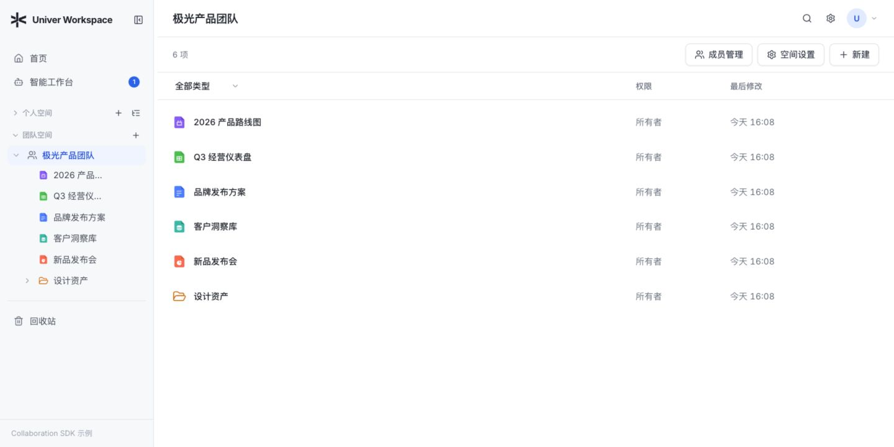
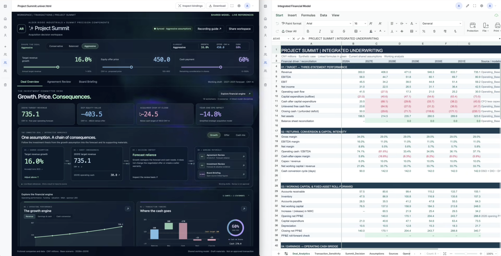
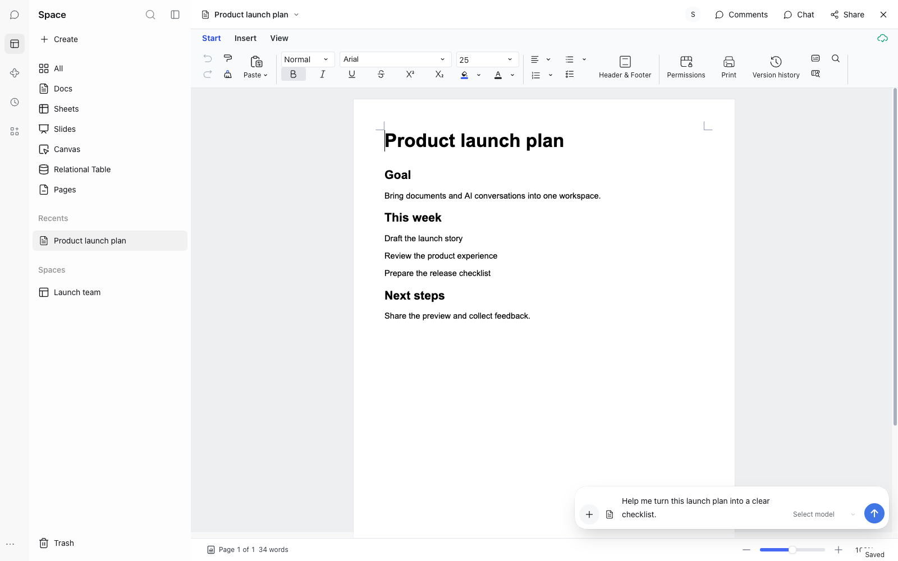
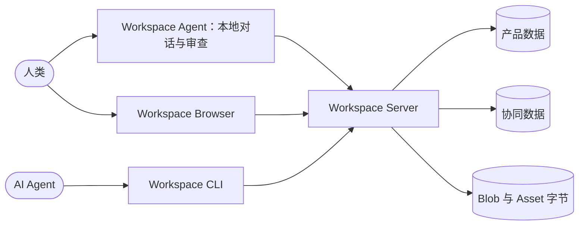

<div align="center">

# Univer Workspace

**一个让人类与 AI Agent 共同创作、协作和审阅的开源 Office 工作空间。**

[Univer 文档](https://docs.univer.ai/) · [Server SDK 文档](https://docs.univer.ai/zh-CN/server) · [CLI 指南](apps/cli/README.md) · [Workspace Agent](apps/agent/README.zh-CN.md) · [Issues](https://github.com/dream-num/univer-workspace/issues)

[](LICENSE)
[](package.json)
[](package.json)

[English](README.md) | 简体中文

</div>

Univer Workspace 是一个基于 [Univer Office SDK](https://github.com/dream-num/univer) 构建、可独立部署的知识管理与
团队协作产品。你可以使用 Workspace Browser 直接编辑，通过 Workspace Agent 对话并审查变更，
也可以使用 CLI 自动化处理任务。三个入口连接同一个负责文档存储和权限的 Workspace Server，
让人类与 AI Agent 共同处理 Sheet、Doc、Slide、Base 与 Board。

Agent 在隔离的 Worktree 中工作、验证修改，再把结果交给人类审阅；只有经过确认的内容才会合入
共享 trunk。



## 为什么选择 Univer Workspace

| 面向人类                                     | 面向 Agent                                          | 面向运维                                    |
| -------------------------------------------- | --------------------------------------------------- | ------------------------------------------- |
| 使用个人与团队 Space 组织内容                | 通过 Univer Facade API 创建、修改丰富的 Office 内容 | 部署一套 Browser 与 Server 应用             |
| 共同编辑 Sheet、Doc、Slide、Base 与 Board    | 检查数据、渲染截图/PDF 并执行布局检查               | 自主管理产品数据、协同数据与 Blob 数据      |
| 通过角色与 Node 级权限控制分享和访问         | 离线发现版本匹配的 Skill 与 API                     | 接入密码、GitHub、Discord 或应用 OAuth 登录 |
| 使用最近访问、回收站、文件导入导出与审阅视图 | 多轮修改而不影响 trunk                              | 运行具备明确恢复边界、文档完备的 HTTP API   |

## 基于电子表格的 Mini App · [观看演示](https://youtu.be/4PBVltY_WEc)

- Agent 可以生成基于电子表格的 Mini App，例如决策看板、交互式报告和业务看板。
- 网页上的指标、图表和控件与单元格绑定，支持数据读取、写入和协同更新。

[](https://youtu.be/4PBVltY_WEc)

## 选择操作入口

| 入口                  | 适用场景                                                              | 开始使用                                                      |
| --------------------- | --------------------------------------------------------------------- | ------------------------------------------------------------- |
| **Workspace Browser** | 直接编辑文档、协同、组织 Space 和审阅变更                             | [启动 Workspace](#快速开始)                                   |
| **Workspace Agent**   | 在文档旁与 Agent 对话、引用本地或远程文件与文件夹、审查 Worktree 变更 | [安装和使用 Agent](apps/agent/README.zh-CN.md#安装与首次使用) |
| **Workspace CLI**     | 从终端、脚本或已有 Agent 环境自动化处理文档                           | [CLI 安装与使用](apps/cli/README.md)                          |
| **Workspace MCP**     | 用一个 URL 让 Claude、ChatGPT、Cursor、VS Code、Codex 等 AI 助手操作 Workspace | [连接 AI 助手](#连接-ai-助手mcp)                              |

Workspace Agent 是基于 DSH（DeepSeek Harness）的本地 Web 应用。
它的本地文件引用指向运行 Agent 的机器，Workspace 文档仍由连接的服务管理。
Agent 和 CLI 都可以连接现有的 Workspace 部署，或在本地启动的 Workspace。

## 连接 AI 助手（MCP）

Workspace 提供远程 [MCP](https://modelcontextprotocol.io) 服务。连上它的 AI 助手可以查找你的文件、开 PR、编辑 Sheet、Doc 和 Slide、
读回结果，再把 PR 标记为 ready，交给你在浏览器里审阅。本机不需要安装任何东西。

[](https://cursor.com/install-mcp?name=univer-workspace&config=eyJ1cmwiOiJodHRwczovL3NwYWNlLnVuaXZlci5haS9tY3AifQ%3D%3D)
[](https://vscode.dev/redirect/mcp/install?name=univer-workspace&config=%7B%22type%22%3A%22http%22%2C%22url%22%3A%22https%3A%2F%2Fspace.univer.ai%2Fmcp%22%7D)

| 项目     | 值                                                                                                                       |
| -------- | ------------------------------------------------------------------------------------------------------------------------ |
| 服务 URL | `https://space.univer.ai/mcp`。自己部署时为 `https://<你的 Workspace>/mcp`（见 [MCP 服务说明](apps/mcp/README.md)）    |
| 传输方式 | Streamable HTTP                                                                                                          |
| 登录     | 在浏览器中完成 OAuth。同意页列出 `read`、`write`、`publish` 和 `worktree:merge`，不想授予的可以取消勾选                    |
| toolset  | 默认 `core`。加 `?toolsets=core,files` 启用 Blob、Asset、Markdown、Typst、SVG、HTML View 工具，`admin` 用于仓库与 Label 管理，`all` 启用全部 |

不支持 OAuth 的客户端可以把个人访问令牌放在 `Authorization: Bearer <token>` 中发送，令牌在 Workspace 账号菜单的
**访问令牌**里创建。`space.univer.ai` 目前只对受邀账号开放编辑类工具（`execute`、`inspect`、导入和导出），所有账号都可以浏览、
搜索、管理 Issue 和 PR。

<details>
<summary><b>Claude Code</b></summary>

```bash
claude mcp add --transport http univer-workspace https://space.univer.ai/mcp
```

在 Claude Code 会话中运行 `/mcp`，选择 `univer-workspace` 并登录。加 `--scope user` 可在所有项目中使用。配置了 `Authorization`
请求头时 Claude Code 不会走 OAuth，两者不要同时设置。

</details>

<details>
<summary><b>Claude.ai 与 Claude Desktop</b></summary>

打开 **Customize → Connectors**，选择 **+ Add → Add custom connector**，填入 `Univer Workspace` 和
`https://space.univer.ai/mcp`，然后登录。Claude Desktop 使用同一个连接器列表。Team 与 Enterprise 方案需要 Owner 先在
**Organization settings → Connectors** 中添加，成员再点 **Connect**。这类连接器从 Anthropic 的云端发起连接，自己部署的
Workspace 需要能从公网访问。

</details>

<details>
<summary><b>ChatGPT</b></summary>

在网页版 ChatGPT 中打开应用设置（不同版本显示为 **Apps**、**Plugins** 或 **Connectors**），方案需要时先开启
**Developer mode**，再用 `https://space.univer.ai/mcp` 和 OAuth 创建自定义 MCP 应用。新对话里用 `@` 选中它。
是否可用取决于方案，Business 与 Enterprise 可能需要管理员先允许自定义 MCP 应用。

</details>

<details>
<summary><b>Codex</b></summary>

```bash
codex mcp add univer-workspace --url https://space.univer.ai/mcp
codex mcp login univer-workspace
```

`codex mcp add` 可能会自动开始登录。CLI、IDE 插件和桌面应用共用 `~/.codex/config.toml`：

```toml
[mcp_servers.univer-workspace]
url = "https://space.univer.ai/mcp"
```

</details>

<details>
<summary><b>Cursor</b></summary>

点上面的按钮，或在 `~/.cursor/mcp.json`（项目内为 `.cursor/mcp.json`）中加入下面的配置。Cursor 首次连接时会提示登录。

```json
{
  "mcpServers": {
    "univer-workspace": { "url": "https://space.univer.ai/mcp" }
  }
}
```

</details>

<details>
<summary><b>VS Code（GitHub Copilot）</b></summary>

点上面的按钮，或运行：

```bash
code --add-mcp '{"name":"univer-workspace","type":"http","url":"https://space.univer.ai/mcp"}'
```

然后运行 **MCP: List Servers**，启动 `univer-workspace`，在浏览器中登录。远程 OAuth 需要 VS Code 1.101 或更高版本。
只在一个工作区使用时，把服务写进 `.vscode/mcp.json` 的 `servers`，并设置 `"type": "http"`。

</details>

<details>
<summary><b>Gemini CLI</b></summary>

```bash
gemini mcp add --transport http --scope user univer-workspace https://space.univer.ai/mcp
```

运行 `/mcp auth univer-workspace` 登录。在 `settings.json` 中，Streamable HTTP 服务使用 `httpUrl`，`url` 表示 SSE。

</details>

<details>
<summary><b>opencode</b></summary>

```bash
opencode mcp add univer-workspace --url https://space.univer.ai/mcp --global
opencode mcp auth univer-workspace
```

</details>

<details>
<summary><b>Windsurf</b></summary>

在 Windsurf Settings 中打开 MCP 配置文件（**Add Server** 或 **Open MCP config file**），加入下面的服务后刷新。连接时 Windsurf
会提示登录。

```json
{
  "mcpServers": {
    "univer-workspace": { "serverUrl": "https://space.univer.ai/mcp" }
  }
}
```

</details>

<details>
<summary><b>WorkBuddy</b></summary>

打开 **连接器 → 自定义连接器 → 配置 MCP**，加入下面的服务，保存并启用。显示需要认证时点 **连接** 并登录。

```json
{
  "mcpServers": {
    "univer-workspace": { "type": "streamableHttp", "url": "https://space.univer.ai/mcp" }
  }
}
```

</details>

<details>
<summary><b>Grok</b></summary>

在 [grok.com](https://grok.com) 打开 **Connectors → New Connector → Custom**，填入 `https://space.univer.ai/mcp` 并登录。
Grok 从 xAI 的云端发起连接，自己部署的 Workspace 需要能从公网访问。

</details>

<details>
<summary><b>其他客户端</b></summary>

支持 Streamable HTTP 和 OAuth 2.1 的客户端都可以直接使用服务 URL。Workspace 支持 Client ID Metadata Documents
和动态客户端注册。只能运行本地 stdio 服务的客户端可以通过 `npx -y mcp-remote https://space.univer.ai/mcp` 之类的桥接使用。

</details>

客户端反复要求登录时，先在该客户端中退出这个服务（例如 `claude mcp logout univer-workspace`、
`opencode mcp logout univer-workspace`，或 Gemini CLI 中的 `/mcp auth`），再重新登录。缺少预期的工具时，检查 URL 中的
`?toolsets=`。

## Space Preview（预览版）

Space 是面向 Univer Workspace 的概念验证插件，安装在官方 DeepSeek Harness（DSH）中。
它连接你的 Workspace 服务，让你浏览文件、编辑 Univer Docs 与 Sheets，并在打开的文档
旁边与 AI 对话。



安装包、安装步骤与已知限制见 [Space 插件指南](apps/space-plugin/README.zh-CN.md)。
Space 是可选的，不替代 Workspace Agent。评估此预览版期间请使用非关键文档。

## 工作原理



Browser 提供直接编辑和协同界面；Workspace Agent 将对话、文档预览和 Worktree 审查放在一起；
CLI 为 Agent 提供加载、理解、修改、验证和渲染同一份内容的结构化入口。
Server 解析权威身份与权限、拥有 Workspace 产品 workflow，并组合 Univer Collaboration SDK。

Worktree 将 Agent 编辑转化为边界清晰的审阅流程：

```text
创建 Worktree
→ Agent 编辑并验证隔离草稿
→ Ready
→ 人类在 Browser 或 Workspace Agent 中审阅
→ Merge 或 Reopen
→ trunk
```

在人类接受之前，中间修改不会进入共享内容。完整产品 workflow 见
[CLI 指南](apps/cli/README.md)。

## 快速开始

以下命令启动 Workspace 服务与 Browser。如需对话界面，继续按照
[Workspace Agent 指南](apps/agent/README.zh-CN.md#安装与首次使用)安装。

### 环境要求

- Node.js 24 或更高版本
- pnpm 11

安装依赖并准备应用配置：

```bash
pnpm install
cp apps/workspace/.env.example apps/workspace/.env
```

启动 Server：

```bash
pnpm workspace:dev:server
```

在另一个终端启动 Browser 开发服务器：

```bash
pnpm workspace:dev:web
```

打开 <http://127.0.0.1:5173>。Vite 提供热更新，并将 API 与 WebSocket 流量代理到
<http://127.0.0.1:3020> 的 Server。

当 `apps/workspace/dist/public` 存在时，Server 也可以在 3020 端口提供最近一次构建的 Browser。
产品 API 文档位于 <http://127.0.0.1:3020/api-docs> 和
<http://127.0.0.1:3020/openapi.yaml>。

配置、认证、存储、Docker 与数据库迁移的详细说明见
[Workspace 应用指南](apps/workspace/README.md)。

## 一键部署

[](https://repocloud.io/details/Univer%20Workspace/)

## 使用 Workspace Agent

Workspace Agent 是基于 DSH、专为 Univer Workspace 构建的桌面应用。通过 `@` 引用 Workspace 文件，在对话中创建和编辑文档，审核改动并决定合入或丢弃。

[Agent 指南](apps/agent/README.zh-CN.md#安装与首次使用)提供可以直接交给编程 Agent 的安装提示词，
尚未克隆仓库也能使用，同时包含手动安装与使用说明。
指南会引导你选择或启动自己的 Workspace 服务、注册 OAuth 回调、配置模型凭据，
并打开本地启动器打印的完整 token URL。

## 使用 Workspace CLI

如果想配合 Claude、Codex、Kimi Work 等现有 Agent 软件使用，请在 Agent 的运行环境中安装 CLI 和 [Workspace CLI Skill](skills/univer-workspace-cli/SKILL.md)：

```bash
npm install --global univer-workspace-cli@latest
npx skills add dream-num/univer-workspace --skill univer-workspace-cli -g
```

先把 CLI 指向你自己的 Workspace 部署，再开始需要 Browser 确认的登录流程：

```bash
uvw config set workspace.origin <origin>
uvw auth login
```

用户确认命令输出的 URL 与验证码后，完成一次性交换：

```bash
uvw auth login --complete
```

安装包包含版本匹配的 Skill、结构化 JSON 输出、Facade API 发现、内容检查、PNG/PDF 渲染、Office
文件交换与 Worktree workflow。完整用法和登录合同见 [CLI 指南](apps/cli/README.md)。

## 仓库结构

```text
apps/workspace                 Workspace Browser、Server、HTTP contract 与部署应用
apps/cli                       面向 Agent 的远程 Workspace 自动化应用
apps/agent                     用于文档对话与 Worktree 审查的 Workspace Agent 应用
packages/client-core           私有的 Node-hosted Workspace Agent Client 能力
packages/reference-provider   仅供 Browser 使用的私有 referenced-Unit policy
packages/dsh-univer-workspace-plugin        Workspace Agent 的 Workspace 能力与浏览器 UI
packages/dsh-univer-workspace-skin-plugin   Workspace Agent 的 Workspace 视觉皮肤
scripts                       SDK 版本与 CLI 本地发布工具
```

本仓库是产品的 composition root，不重新实现上游 SDK。Univer Runtime 拥有 Unit 模型、渲染、
Facade API 与 Office 内容能力；Univer Collaboration SDK 拥有 snapshot、revision、OT、实时协同与
Worktree 协议合同；Univer CLI SDK 拥有可复用的 headless runtime、执行、检查与渲染能力。

Workspace 拥有产品身份、Space、目录层级、ACL、分享、回收站、最近访问、Blob 存储策略、远程
workflow 与部署。Client Core 在仓库应用之间共享存储无关的认证、Workspace workflow、本机
Node-hosted Blob/Asset 传输与 worker-backed 内容 runtime，包括 Node-hosted Office exchange、Markdown 编译／创建／原生读取／局部更新、Typst
编译/materialize/apply、render Unit 装配、截图、PNG/PDF 输出、Slide 和 Board layout lint、render-page 源码与
SVG 编译/测量/apply workflow；reference-provider package 仍只供 Browser 使用。两者都是私有实现
模块，不是额外的公开应用或 SDK。

## 架构原则

- **一个权威 Server。** 不把客户端提供的 User、Role、Resource、Unit、Worktree 或 revision
  当作权威信息。
- **分离存储边界。** 产品数据、协同状态与 Blob 字节各有明确所有者，并通过持久化、幂等的
  Operation 协调。
- **只使用已发布的 SDK 合同。** 仓库只消费 package 的公开 export，不依赖相邻源码 checkout。
- **一个精确 SDK baseline。** 所有版本耦合的 `@univer-cli/*`、`@univerjs/*` 与
  `@univerjs-pro/*` package 始终一起升级。
- **HTTP contract first。** OpenAPI 源文件、生成类型、Server route、Browser 与 CLI 必须描述
  同一行为。

修改这些边界前，请阅读[技术架构](apps/workspace/docs/architecture.md)、
[应用层设计](apps/workspace/docs/application-design.md)与[数据模型](apps/workspace/docs/data-model.md)。

## 开发与验证

开发过程中先运行最小相关检查；在宣称完整变更前，运行合适的仓库级验证：

```bash
pnpm typecheck
pnpm test
pnpm build
pnpm --filter @univerjs/univer-workspace test:production-import
pnpm package:workspace-cli
```

修改 HTTP contract 时还需要运行：

```bash
pnpm --filter @univerjs/univer-workspace api:verify
```

升级 Univer SDK 时使用仓库脚本一次性更新所有版本耦合依赖与 lockfile，不要单独编辑 manifest：

```bash
pnpm update:univer-sdk --sdk_version <exact-sdk-version>
```

## 交付模型

CLI 与 Workspace 部署基于同一份源码，但各自独立交付：

- 在 `main` 包含的稳定 `vX.Y.Z` tag 上手动触发 CLI 发布 workflow，
  并显式设置 `dry_run=false`，才会发布 `univer-workspace-cli@X.Y.Z`。创建、推送 tag 不触发 CI 或发布。
- Workspace 使用独立的手动部署 workflow，构建已有稳定 tag，或把精确 commit 标记为
  `sha-<commit>`。推送 release tag 不会部署 Server。

稳定版 CLI 发布会检查整个仓库的 SDK baseline，并在发布前验证实际 package artifact。

## 文档

| 资源                                                                | 范围                                                        |
| ------------------------------------------------------------------- | ----------------------------------------------------------- |
| [Univer Web SDK 文档](https://docs.univer.ai/zh-CN/guides)          | Browser Runtime、Preset、Plugin、Facade API 与编辑器能力    |
| [Univer Server SDK 文档](https://docs.univer.ai/zh-CN/server)       | Server SDK：协同、导入导出、部署与 license                  |
| [Workspace 应用指南](apps/workspace/README.md)                      | 配置、认证、存储、Docker 与升级                             |
| [Workspace CLI 指南](apps/cli/README.md)                            | 安装、登录、Agent workflow 与 package 合同                  |
| [Workspace Agent 指南](apps/agent/README.zh-CN.md)                  | 本地 Profile、浏览器 OAuth、会话、文件、Worktree 与身份切换 |
| [Client Core package](packages/client-core/README.md)               | 私有 Node-hosted client 能力边界                            |
| [技术架构](apps/workspace/docs/architecture.md)                     | Browser、Server、存储、OpenAPI 与模块边界                   |
| [HTTP contract](apps/workspace/contracts/http/README.md)            | 产品 API 源文件与生成流程                                   |
| [Reference-provider package](packages/reference-provider/README.md) | Browser 私有 referenced-Unit policy                         |

## 参与贡献

欢迎提交 Issue 与 Pull Request。修改代码前，请阅读 [AGENTS.md](AGENTS.md) 和目标附近的 README
或设计文档；保留无关改动，不手工编辑生成文件，并完成受影响边界要求的验证。

## Runtime 开发 License

Browser、Workspace Server、CLI 与 DSH 插件包含内容同步、经过批准的 runtime 开发凭据，用于本地
开发。该凭据每 90 天轮换一次，并不是本仓库的软件许可证。服务端 Collaboration 与 Exchange SDK
还需要 license key 校验，缺少任一值时降级为免费额度。Browser 构建可以通过 `VITE_UNIVER_LICENSE`
覆盖，Server 与 CLI 可以通过同时设置 `UNIVER_LICENSE` 和 `UNIVER_LICENSE_KEY` 覆盖。轮换时用生成
脚本一次更新全部副本：

```bash
pnpm update:univer-license --license <license.txt> --license-key <licenseKey.txt>
```

## License

Univer Workspace 使用 [Apache-2.0](LICENSE) 许可证。
