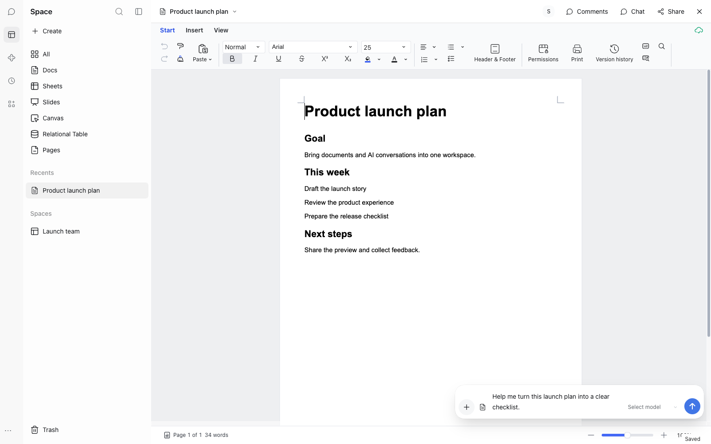

# Space plugin for official DeepSeek Harness

English | [简体中文](README.zh-CN.md)

Space is a proof-of-concept plugin for Univer Workspace. It runs inside official DeepSeek
Harness (DSH), connects to a Workspace service, and lets you browse your files, edit
Univer Docs and Sheets, and chat with an AI alongside an open document.

This preview targets DSH 0.2.2-rc.1. It is an optional way to use Workspace inside DSH,
not a replacement for the separate Workspace Agent Desktop application. Use non-critical
documents while evaluating it.

Space keeps your document and chat composer in the same view. This screenshot uses an
English demo workspace; the example message is an unsent draft.

## What you get

- Space-style navigation over your Spaces, folders and files, with real ACL-checked
  metadata.
- Writable collaborative Univer Docs and Sheets, plus formal viewers for Slides, Canvas
  and Relational Table, and the shared Workspace HTML Viewer for Pages.
- Read-only Markdown preview and source for `.md` Blobs.
- The native DSH Conversation in a floating overlay, with one composer and transcript.
- File sharing, rename, move, trash and restore through the existing Workspace
  workflows, and Worktree review for agent changes.

DSH owns Session history, the composer, the model, and Agent and tool logs. Official host
source is unchanged.

## Before you start

Space runs inside the official DeepSeek Harness Desktop. Install DSH 0.2.2-rc.1 from the
official DeepSeek Harness project first:
https://github.com/deepseek-ai/deepseek-harness

## Get the package

There is no public Space GitHub Release yet. The current temporary entry is the **Space
Plugin** GitHub Actions workflow artifact, which contains a `.tgz` package, `SHA256SUMS`
and `build-info.json`, and is retained by Actions for 30 days:
https://github.com/dream-num/univer-workspace/actions/workflows/space-plugin-build.yml

The planned distribution channel is a GitHub Prerelease built from a `space-plugin-v`
tag.

## Install and connect in three steps

1. Download the `.tgz` package from the workflow artifact and verify it with
   `shasum -a 256 -c SHA256SUMS` (macOS) or `sha256sum -c SHA256SUMS` (Linux).
2. In DSH, open Plugins, choose Add plugin, paste the tarball's path into Package name
   or address, install, then fully quit and restart DSH.
3. Select Space and choose Sign in to Univer, then authorize in the system browser.

On a fresh profile, approve the listed `protobufjs@7.6.6` dependency build when the
installer asks. This is the normal dependency trust step.

## Update and uninstall

For updates, remove the existing `dsh-space-plugin` bundle, install the new exact tarball
and cold-restart DSH; verify the checksum first. Uninstall by removing `dsh-space-plugin`
in Plugins and restarting. Hot reinstall is not the supported procedure.

Full instructions: [installation guide](docs/installation.md) ·
[中文安装说明](docs/installation.zh-CN.md)

## Known POC risks

- On DSH 0.2.2-rc.1, native Conversation focus is captured after inbox insertion rather
  than at the send gesture, so ordinary chat may act on an earlier document or selection.
  Check the target and the result when trying AI edits. The separate **Ask for change**
  control captures its selection at activation and is the more predictable path for a
  scoped edit, but it does not remove that ordinary-chat risk.
- Reliable offline writing is not enabled: while disconnected, new content edits pause
  until reconnection.
- History remains unaccepted, Favorites is unavailable, and Space Move/Trash/Restore are
  not implemented.

## Documentation

| Guide | Scope |
| --- | --- |
| [Installation](docs/installation.md) | Package, install, update, uninstall, first use, limitations |
| [安装说明](docs/installation.zh-CN.md) | 安装、更新、卸载、首次使用与已知限制 |
| [Developer guide](docs/development.md) | Build, packaging, behavior reference, test scripts |
| [开发者指南](docs/development.zh-CN.md) | 构建、打包、行为参考与测试脚本 |
| [Administration](docs/administration.md) | Server, OAuth registration, backup, license |
| [管理员指南](docs/administration.zh-CN.md) | Server、OAuth 注册、备份与许可配置 |
