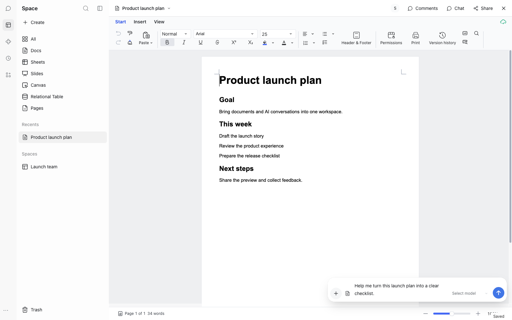

# 面向官方 DeepSeek Harness 的 Space 插件

[English](README.md) | 简体中文

Space 是 Univer Workspace 的概念验证（POC）插件。它运行在官方 DeepSeek Harness（DSH）内部，连接一个 Workspace 服务，让你浏览文件、编辑 Univer Docs 与 Sheets，并在打开的文档旁边与 AI 对话。

此预览针对 DSH 0.2.2-rc.1。它是在 DSH 内使用 Workspace 的一种可选方式，并不替代独立的 Workspace Agent 桌面应用。评估期间请使用非关键文档。

Space 提供内容导航、可协同编辑的 Univer Docs/Sheets、正式的 Slides/Canvas/Relational Table 查看器、用于 Pages 的共享 Workspace HTML Viewer，以及浮动显示的原生 DSH Conversation。会话历史、输入框、模型、Agent 与工具日志由 DSH 管理。插件不修改官方宿主源码。



Space 让你的文档与对话输入框保持在同一视图内。该截图使用英文演示工作空间；示例消息是一条未发送的草稿。

## 构建与安装

使用 Node >=24.9.0、pnpm 11 以及本应用隔离的 npm 依赖图。从仓库根目录开始，先构建共享 runtime 与 reference provider，再安装插件的本地构建依赖：

```sh
pnpm --filter '@univerjs/univer-workspace-agent-runtime...' --filter '@univerjs/univer-workspace-client-core...' --filter '@univerjs/univer-workspace-reference-provider...' install --frozen-lockfile
pnpm --filter @univerjs/univer-workspace-agent-runtime build
pnpm --filter @univerjs/univer-workspace-client-core build
pnpm --filter @univerjs/univer-workspace-reference-provider build
cd apps/space-plugin
npm ci --no-audit --no-fund
npm run build
npm test
npm run typecheck
npm run package:release -- /absolute/output/outside/repository
```

使用官方 DSH 插件管理器安装产出的 tarball。耦合的 Univer 依赖固定为 1.4.0；React 18 由官方宿主模块加载器解析。Tailwind 工具类带前缀/作用域，preflight 关闭。打包器从已提交的 `package-lock.json` 复制生产依赖闭包；它绝不重新解析新的传递依赖版本。清单/版本变更需要同步更新 package-lock。桌面安装包在仅宿主可见的 `lib/runtime-license.json` 中包含仓库现有的 Workspace 应用 license，以及配套的 Exchange 校验密钥。若它缺失或与当前源码不一致，打包与资源扫描会失败。构建日志和已提交的生成文件中不会写入任何 license 值。构建期 PostCSS 将 SDK 全局 reset 块与无前缀工具类限制在编辑器和 Univer namespace portal 根节点内；已发布的 SDK 文件保持完整。

每次推送到 `feat/space-full-univer-integration` 也会构建一个 **Space Plugin** workflow artifact。从成功的 GitHub Actions run 中下载并解压。它包含 `space-plugin-<version>-<short-sha>.tgz`、`SHA256SUMS` 和 `build-info.json`；Actions 保留 30 天。在解压后的目录中，用 macOS 的 `shasum -a 256 -c SHA256SUMS` 或 Linux 的 `sha256sum -c SHA256SUMS` 校验下载。然后按[发布候选](#发布候选)所述在官方 DSH 插件管理器中安装该 tarball。这些 workflow artifact 是供评审的构建产物，不是 GitHub Release 或 npm 发布。

## 使用

1. 打开一个已有的原生 DSH Conversation 并选择 Space 全局入口。一条常驻的 52px Activity Bar 可选择 Chat、Space 与原生全局面板。Chat 拥有原生 Session 列表；Space 提供带 Space 标题的公开 `sidebar.workspaces` 内容。顶部次要按钮将其收起；选中的 Activity 条目会恢复它。Plugins/Automation 没有 Session 列表，也没有多余的次要轨道。这一受控的 DOM/CSS 集成限定在官方 Web 版本 `0.2.2-rc.1` / commit `c59d10a` 与测试过的原生结构上。未知版本保持原生导航，不应用该适配器。宿主控件、宽度偏好与 Sessions 仍由宿主拥有；卸载会移除该适配器。
2. 选择 **Sign in to Univer**。默认服务为 `https://space.univer.ai/`；系统浏览器完成已有的 Workspace 授权，插件再用 PKCE 交换其一次性 code。DSH Settings → Workspace 拥有账户、切换账户、退出登录与自定义 Workspace URL。宿主凭据提供方只持久化插件自己的授权；客户端不收到 cookie 或 token。
3. All / Your items 列表展示真实且经 ACL 检查的元数据。Pinned 是独立的本地导航与 Suggested 分区；它不代表 Favorites。Space 打开 Overview / Content；Folder 打开自己的面包屑与内容列表。
4. Docs 与 Sheets 使用正式的已发布 Core preset、Collaboration Client、浏览器协同 UI 与 Facade Server loader。工具栏、选区/右键菜单与协同 Undo/Redo 仍由 SDK 拥有。SDK changeset 远程保存；其他客户端通过真实的 Server WebSocket 接收编辑。文件切换会在销毁前排空待处理变更；刷写失败时当前编辑器保持打开。断连期间，新的内容编辑会暂停直到重连。可靠的离线写入未启用。SDK 的排队在线变更恢复仍然启用。Workspace cookie 保持仅宿主可见；隔离的授权由官方凭据提供方持久化：SDK HTTP 使用已有的 owner Connection；WebSocket 使用其一次性 session ticket 直连 Workspace。Slides/Canvas/Relational Table 保持分离式预览。Pages 专门映射到 Server 的 `.univer.html` Blob，使用 Fork 的共享正式沙箱与绑定引擎。它支持脚本、经过认证的 Sheet 绑定、检查，以及离开前保存并在连接变更失败后恢复。License 使用 Fork 现有的源码，通过官方 SDK 初始化。Docs/Sheets Comments 使用正式 preset 与远程数据源；文档工具栏打开原生面板。Docs 支持选区锚点、回复、Resolve/Reopen，以及原文被移除后仍保留的讨论。History 仍未验收。
5. 浮动对话提供紧凑消息、展开与最小化三种状态。可拖动其抓手、调整任一侧尺寸、恢复窗口、创建宿主 Conversation 或从 History 中选择一个已有的。它是一份 DSH 输入框/记录，消息、模型、运行状态与工具由 DSH 拥有。它绝不占用编辑器宽度。
6. 打开六种受支持内容类型中的任意一种或一个 Markdown Blob 时，会在 `conversation.input.dock` 中将其稳定身份与所选原生 Session 显式关联。可在那里移除或重新关联。提问“总结当前文档”；原生 Agent 会收到一段简短的运行时上下文身份，并通过 `univer_inspect` 读取当前 Server 内容（Docs 文本、Sheets 单元格、Slides/Canvas/Relational Table 的结构化 SDK Unit 数据、Pages HTML 源码）。普通用户消息中不会插入正文或大段 JSON。Page 关联在原生消息接纳时冻结，包括排队请求；过期的关联响应会被拒绝。
7. 已有的持久 Workspace 引用仍可通过公开的 UserText 规则/键控 Slot 点击。点击会重新检查当前 ACL 与 Node/Resource/Unit，打开文件，保留其原生 Session 并显示当前关联。文件切换保留各已选原生 Session 与未发送草稿。Workspace 身份/端点变更会清除 Workspace 授权与内容，但不清除 DSH 引用。关闭查看器会返回其来源列表。重连同一端点会保留认证；无效或不可达的替换端点会保留现有服务。

Create / New 保留全部八个条目：Doc、Sheet、Slide、Canvas、Relational Table、Page、Folder、Space。全部使用 Personal Space；Space / Folder 使用当前目录。六种内容类型在 Server 持久化后自动打开。Folder 留在其父级中，Space 导航到新建的 Space。受限目标保留禁用条目并给出权限反馈。Node 重命名/移动与 Trash/restore 复用 Browser 产品工作流；文件身份与原生 Session 保持稳定。

Space Share 管理真实的 Team 成员关系。File Share 区分 Team 继承、Personal 直接/祖先授权与正式链接访问。Viewer/Editor（以及 Team Admin）是既有的 Server 角色；可选的创建邀请会立即激活成员关系。Favorites 仍然不可用。Pinned Pages 依据 Workspace Node 元数据显示真实的 Page/Subpage 层级；悬停控件复用既有的文件动作与 Page 创建工作流。分组折叠与 Page 展开在 Chat / Space 切换之间保留在实时导航 store 中；置顶与展开偏好仍然是 session 局部的。Trash/Restore、Rename 与同一 Space 内的文件夹移动可通过共享行、右键与文件身份菜单使用。Space 支持 Create/Open/Rename；Space 的 Move/Trash/Restore 需要单独的生命周期扩展，尚未实现。禁用控件会将功能可用性与 Server 权限分开说明。Suggested 只有本地置顶元数据卡片，没有虚构的模板或推荐。

原生 DSH 输入框比 Space 的 52px 输入胶囊更高；它保持完整。

Markdown `.md` / `.markdown` Blob 以共享的只读 Markdown Viewer 的 Preview / Source 控件打开。两种模式都使用完整的、已校验的 UTF-8 源码，包括原始行尾；打开不会把 Blob 转换成 Doc。文件头复用 Workspace Browser 的 **Download** 动作处理 Blob。它使用 Server 的原始字节下载与原始文件名（包括 UTF-8 BOM），而不是解码后的 Preview/Source 文本。每次点击都会重新检查当前账户、Node/Resource 身份与 Server 下载权限；访问被撤销后，缓存的预览不授予下载权限。

共享分类器也支持 Markdown MIME 类型，以及历史上传为 `application/octet-stream` 但文件名是 Markdown 的文件。二进制、无效 UTF-8、部分读取和被拒绝的读取都会显式失败。Markdown 不在 Create / New 中。

Pages 加载完整的 HTML 源码，不受 Space 曾经的 1 MiB 截断限制；部分响应会被拒绝。可选的 HTML 源码缓存最多保留 16 个条目和 16 MiB 的 UTF-8 源码。这是缓存预算，不是打开限制。每次打开仍会在使用任何缓存字节之前检查当前 Node/Resource ACL。正式 HTML 沙箱、脚本、Sheet 绑定与离开前保存/恢复协议保持不变。

Live Docs 焦点的作用域限定于当前活跃的 Space owner、文档关联与编辑器挂载代次。该挂载内的选区更新是有序的，退出会阻止延迟更新恢复已关闭的编辑器。被捕获的消息目标与待处理的选区建议各有独立生命周期；在同一文档中切换 Conversation 不会使待处理的建议失效。消费带有不同目标的排队消息的步骤没有隐式焦点。

**官方 DSH 0.2.2-rc.1 上的已知限制：** 原生 Conversation 焦点仍然是在 inbox 插入之后从 Host 状态捕获，而不是在发送手势时捕获。因此，仍在传输中的选区更新可能使该消息快照中保留一个更早的目标。代次顺序与原生发送阶段都不能关闭这个窗口。精确的原生发送绑定需要 DSH 提供受支持的按次快照/接纳 API；输入框阻塞与 pre-step 钩子都不提供它。这是一个已知的 POC 风险：普通对话可能作用于更早的文档或选区。使用 AI 编辑时请检查目标与结果。独立的 **Ask for change** 控件会在激活时捕获其 SDK 选区，并保留既有的目标、内容、权限与 revision 检查。其模型请求把选中文本与只读的上下文段落文本分开。模型返回绑定到该选区请求的完整本地片段。宿主会在抽取替换内容之前验证完全未变的前缀与后缀；它绝不会搜索相似文本或修复响应。遗留、不匹配、含糊、改变上下文或不完整的响应会失败，且不投射新的候选。最终仍由用户检查提议的措辞。

Docs 选区工具需要与 SDK 公开的 `PARAGRAPH_ID_PREFIX` 兼容的唯一 ID。捕获会在 SDK 解析段落偏移之前校验 ID。捕获错误会清除旧的选区目标、中止未完成的提议并显示诊断信息，同时原生编辑/保存仍可用。之后的有效选区会恢复选区控件。该守卫不会生成或持久化缺失的 ID，不会修复源文档，也不会说明其 ID 为何无效。选区替换中新插入的段落使用 SDK 公开的 `createParagraphId` 工厂；未改动的源段落身份由 SDK diff 保留。

当前协议与真实 Server 回归（使用注册了精确 OAuth 回调的隔离本地 Server）：

```sh
SPACE_TEST_LOGIN_FILE=/path/to/private-fixture-login.json \
SPACE_EVIDENCE_DIR=/path/to/evidence/outside/source \
node test/live/auth/check-oauth-api-live.mjs
```

该协议检查覆盖 consent、code 交换、PKCE、回调、身份、八种创建类型与六条文件生命周期路径。CRUD、协同、共享与人类协同 Web 脚本通过同一 OAuth 流程使用 `authorizeWorkspace`。原生 Desktop 检查需单独运行。

Docs、Sheets、Slides、Canvas 与 Relational Table 现在使用共享的 Browser preset 源码，包括其既有的协同与功能插件。Base 公式 Worker 被打包并通过 owner Connection 提供服务。

对于原始 Workspace Browser 的最小装配检查，用它自己的 Vite 配置针对同一 Server 提供服务，设置 `SPACE_WORKSPACE_BROWSER_ORIGIN`，并运行 `node test/live/editor/check-editor-assembly-live.mjs`。它观察真实的协同 WebSocket 与当前 History 版本，不做任何编辑，并比较持久化的 Snapshot 哈希。这不代表已经验证 Comments 写入、多人编辑或离线持久化。

Workspace 读取工具为 `univer_spaces`、`univer_documents`、`univer_list`、`univer_open` 与 `univer_inspect`。目录发现使用原有的递归 Workspace 实现与过滤，默认使用原生请求被接纳时捕获的 Space。原生 Session 可以在没有当前文件的情况下打开已授权的 Node、Resource 或 Unit；检查使用其 Session 关联。Server 会重新检查访问权限。`univer_api` 复用原有版本匹配的 Facade 参考查找，无需文档访问权限。`univer_new` 与 `univer_create` 对全部五种 Univer Unit 类型复用原有 Resource 创建路径。`univer_workspace` 使用既有 Workspace 操作进行 Space、Folder 与 Page 的创建、重命名、移动与恢复。被接纳的 Folder 是默认目标。`univer_compile_markdown` 使用共享的 Client Core 编译器与物化器，在显式提供的草稿 Worktree 中创建可编辑的 Modern Doc。它不发布也不合并。保存返回的 `sourceMap`；使用该 map 与选定的 `blockIds` 调用 `univer_export_markdown` 以读取当前原生内容、导出图片附属文件，并在块更新前刷新 map。所有源码、资源与输出路径都留在原生 Session workspace 内。这些工具保持编译器的草稿合同；对既有文件的普通编辑仍使用 trunk。检查读取当前 Server 内容，返回 revision/hash 与有界的文本/单元格/结构化 Unit/HTML 源码行，并暴露 `nextOffset` 用于分页。发现/读取操作仍然是有界且 Session 局部的；草稿检查使用既有的 headless 检查 runtime。它们尚未提供完整的旧插件接口。普通 `univer_edit` 调用会选择与原生请求一同接纳的文档，或一个明确标识的已授权 Unit，并通过原有协同 runtime 把 Facade mutation 提交到 trunk。明确创建的 Worktree 保留既有的 Docs/Sheets 草稿与 Review 工作流。Review 读取当前比较结果；Apply 使用既有 Workspace 合并工作流与当前 Server 权限。Reject/Cancel 丢弃草稿。预览与 Apply 之间没有版本绑定：并发编辑可能改变合并结果或导致冲突。移除当前文档关联不会擦除持久消息，也不会撤销历史读取授权；变更身份或断开连接可清除授权。

DSH Tools 是仅类型（type-only）的开发依赖。四个公开 JSON Schema 注册与此前 defineTool 构建器的输出完全一致。在 profile 中安装另一个 Tools 服务包可能使它的模块内 scheduler Symbol 与内置 Agent loop 分裂。包回归测试防止该运行时依赖重新出现。不修改 DSH 源码或已安装的 SDK。

Shell 图标使用 Lucide React 0.468.0；ISC/Feather 声明保留在 `THIRD_PARTY_NOTICES.txt` 中并随包分发。

额外的只读 UI 检查：在连接 Workspace 后，使用相同的宿主/浏览器/MVP fixture 变量运行 `node test/live/editor/check-readonly-live.mjs`。它验证 Base 创建控件被禁用，以及 Slides 的插入被 SDK 权限守卫拒绝。源文档快照保持不变。

`node test/live/navigation/check-navigation-lifecycle-live.mjs` 还需要 `SPACE_PLUGIN_TARBALL=/absolute/path/to/exact-built-package.tgz`，并通过官方管理器移除再重新安装该 bundle。请保留宿主的诊断信息。

使用 `SPACE_LIFECYCLE_REMOVE_ONLY=1` 配合生命周期脚本，可单独验证实际的卸载还原。这会刻意让 bundle 保持未安装状态；之后请通过管理器重新安装同一个精确的 tarball。

在 macOS 上，原生宿主拖拽标记应用于已有的次要行/文件头行。Chat 保持顶部行空白（除侧边栏控件外）；Space 保留其 Space 标题。不添加额外的 chrome 行、白色条或顶部留白。宿主把交互控件排除在拖拽几何之外。

Shell 对表面、文字、次要标签、边框与选中/悬停状态使用宿主主题 token。`test/live/navigation/check-navigation-theme-live.mjs` 通过真实的原生 Settings 控件切换主题并恢复先前偏好；它同时捕获 Chat 与 Space 的浅色/深色状态。普通提示中不会注入文档正文。结构化 Unit 检查是由 Tool 返回的有界 JSON 数据，而不是完整编辑器或写入能力。Schema/名称保持不变；inspect 描述现在在受检合同 fixture 中记录了这些新增的读取格式。

`src/content-types.ts` 中的分类法拥有每个 UI 名称与创建条目。`node test/live/editor/check-crud-live.mjs` 针对 Server 覆盖全部八种对象类型，包括恢复后的内容/身份与未授权写入被拒绝。`node test/live/editor/check-html-live.mjs` 覆盖 Page 脚本、Sheet 绑定读写、持久化后重开、检查，以及连接变更被拒后的恢复。

正式 HTML Viewer 是对 Fork 既有 `packages/workspace-html-viewer` 的构建期 `file:` 依赖；`.npmrc` 用隔离的 consumer peers 物化其源码，而不是链接第二套 SDK/React 依赖图。浏览器 JSX 对该共享组件使用自动转换。所有耦合 SDK 保持在 1.4.0。桌面打包通过仅宿主的运行时配置携带 Fork 既有的开发 license。非空的 UNIVER_LICENSE 会覆盖它；普通的 Desktop 启动无需环境变量设置。该 license 既有的范围与到期时间仍然适用；校验仍由 SDK 负责。请从本仓库运行构建/安装，并保留那些源码目录。

运行 `node test/live/collaboration/check-human-collaboration-live.mjs` 与 `node test/live/collaboration/check-sharing-live.mjs` 时需要两个独立配置的 DSH 宿主，每个都以不同的 Workspace 测试用户认证。除宿主/浏览器/证据变量外，还要提供 `SPACE_SECOND_DSH_LOG` 与 `SPACE_SECOND_LOGIN_FILE`。这些脚本覆盖评论、身份、权限、授权与共享。请勿将凭据写入仓库或生成的证据文件。

## 发布候选

此包是供评估的概念验证预览，不是生产发布。目标宿主版本是官方 DSH 0.2.2-rc.1。导航适配器识别已发布的 Web 构建 0.2.2-rc.1 / c59d10a。Desktop 0.2.2-rc.1 的安装与原生回流验收仍未完成。

在 Plugins 中选择 Add plugin，把生成的 tarball 路径粘贴到 Package name or address，然后安装并完全退出后重新启动 DSH。更新时，先移除已有的 dsh-space-plugin bundle，安装已核验的新版 tarball 并完全退出后重新启动 DSH；先校验校验和。通过在 Plugins 中移除 dsh-space-plugin 并重启来卸载。Workspace 文档保留在 Server 上；原生对话历史由 DSH 拥有。热重装可能遇到官方宿主模块身份诊断，因此不受支持。该包不包含第二套 DSH runtime 或本地 Workspace Server。

在新 profile 上，pnpm 会阻止传递依赖 protobufjs@7.6.6 的 postinstall，直到显式批准。在官方安装器中，确认这是列出的那个包并选择 Allow these scripts 然后重试。这是正常的依赖信任步骤，不是 peer 警告失败。所发布的那个 postinstall 精确地读取依赖元数据并打印版本方案警告；它不下载任何可执行文件。不要全局启用所有依赖脚本。

Desktop 测试包在仅宿主的 `lib/runtime-license.json` 中包含仓库现有的 Workspace 应用 license，因此普通的 Desktop 启动不需要终端环境变量。非空的 UNIVER_LICENSE 可以覆盖打包的值。既有的运行时配置路由要求身份认证且仅允许所有者访问，会把它提供给官方 LicensePlugin；它不会被保存在客户端偏好中，也不会被包含在 Agent 上下文中。打包不会延长它的范围或到期时间。

Server 必须运行匹配的发布 commit（包括 Review/Apply 修复），以单一写进程对持久化产品 SQLite、协同 SQLite 与 Blob 存储运行。请一起备份这些存储。升级前停止旧的写进程；绝不重置数据库。远程服务需要 HTTPS/WSS、已注册的公共 OAuth 客户端 `univer-workspace-harness`（带 consent 与 `identity session` scopes），以及针对 /api、/universer-api 与协同 WebSocket upgrade 的反向代理支持。插件期望的是一个服务 origin，而不是 API 路径。多 Unit SDK 合并是按 Unit 的，不是跨 Unit 事务；Space 当前的文档 Agent 编辑只针对一个 Doc 或 Sheet。

首次使用：选择 Space 并选择 Sign in to Univer。在系统浏览器中登录并授权；授权成功后会加载 Space Home。DSH Settings → Workspace 管理当前账户与服务器、切换账户、退出登录与自定义 Workspace URL。Session 复用使用官方宿主凭据提供方的隔离 `dsh-space-plugin/workspace` 授权记录。只有该记录会被改变；DSH 模型凭据与原生 Session 仍由 DSH 拥有。被拒绝、取消或过期的请求可以重试。切换账户使用浏览器的 Workspace 账户；请在授权前于该处退出登录或选择所需账户。

现有云端注册接受精确的回环返回地址 `http://127.0.0.1:3101/auth/oauth/callback`。插件只为待处理的授权绑定 IPv4 回环，并在完成、取消或超时时关闭它。请保持该端口空闲；冲突的监听会产生可重试的登录错误，绝不会回退到凭据表单。自定义 Server 管理员必须注册同一个精确回调。已认证的公共 DSH Connection 启动/取消请求；回环监听只接受有界且 state 匹配的 OAuth 回调。原生 Desktop 的外部浏览器转发与返回链接需要在 0.2.2-rc.1 上单独验收。返回链接可能触发操作系统/浏览器的确认。不使用 `univer-workspace://` scheme，也不使用 DSH 账户授权。

用一个一次性的 Team Space 与两个账户复现演示：创建一个 Folder 与全部六种内容类型；重命名/移动/放入回收站/恢复一个文件；从两个客户端编辑 Docs/Sheets；与第二个账户共享并添加一条评论。把一个 Doc 与原生对话关联，请 Agent 向一个私有 Worktree 追加一个唯一段落并标记为 ready，检查 Review，显式 Apply，并验证已打开的第二个客户端与一次重开。用 Sheet 公式、Reject 以及 Review 之后的一次共享编辑重复该流程；验证 SDK 的合并/冲突行为与持久化结果。Viewer / 被移除成员的写入必须失败。不包含任何测试 fixture、模型凭据或私有 Session 归档。

发布脚本只暂存运行时文件、仅生产用的清单、声明与 npm-shrinkwrap.json。npm 消费者遵循该 lock；DSH 的 pnpm 管理器拥有其 profile lock 并需要 registry 访问。请保留 profile lock 以便完全一致地重装。在分发新产物前，运行发布扫描与实际的干净 profile 安装。

## DSH 声明依赖

精确的仅开发依赖 `dsh-client-ui-dockkit`、`dsh-util-file-drag` 与 `@shikijs/langs` 条目满足已发布的 DSH 0.2.2-rc.1 类型声明中的导入。上游只把这些边列为开发依赖。它们不会被加入已安装插件的生产运行时。在上游发布 DSH 元数据修复并完成一次干净 typecheck、确认这些导入可通过所属包解析之后，移除这些 consumer 条目。

## SDK 与 lock 更新

在对齐此隔离应用的精确 SDK 依赖之后，用 npm 重新生成 `package-lock.json`，然后运行 `npm run lock:runtime`。后者从打包器所用的、经过审计的生产依赖闭包推导出 `runtime-lock.json`。在 `npm ci` 之前构建共享的 Runtime、Client Core 与 reference provider，使被复制的本地构建依赖包含其当前产物。

## 插件自有菜单位置

Space 下拉菜单与内容列表右键菜单使用一个 body portal 与公开的 `@floating-ui/dom` 定位 API。实际菜单尺寸决定所属 Space shell 与可视视口内的 flip/shift 与可滚动尺寸。该 portal 保留作用域化的 shell 工具类与继承的主题 token；监听器只在菜单打开期间存在。原生 DSH、Univer 与正式 File Tree 菜单保持其既有实现。文件动作与 Server 能力检查仍位于共享的 `FileActions` 组件中。

运行 `node test/browser/check-floating-menu-regression.mjs`，配合 `SPACE_PLAYWRIGHT_MODULE`、可选的 `SPACE_BROWSER_EXECUTABLE` 与 `SPACE_EVIDENCE_DIR`，在隔离的浏览器 fixture 中演练真实的 React 组件：角落、调整尺寸、祖先滚动、长菜单、主题切换、CSS 与可视视口缩放、点击外部与键盘行为。该 fixture 不代表已经验证最初报告的场景或 Electron Desktop。既有的 `test/browser/check-create-menu-regression.mjs` 检查八条目创建工作流。

`node test/browser/check-navigation-menu-regression.mjs` 使用相同的浏览器/证据环境检查实际的 Navigation 嵌套滚动容器。放置仍使用 shell 边界；隐藏引用检测使用该引用的裁剪祖先。部分被裁剪的触发器保留其菜单；完全被裁剪的触发器会关闭它。该检查还验证 190px shell 中多行 Create 标签没有固定高度文本溢出。

## 编辑器语言

五个协同 Univer 编辑器与 AI Changes 预览遵循当前 DSH 界面语言（英文或简体中文）。切换语言会就地更新 SDK locale；它们不会重建 Unit，也不会添加单独的偏好项。其他宿主语言使用其声明的回退链，最终回退到英文。
