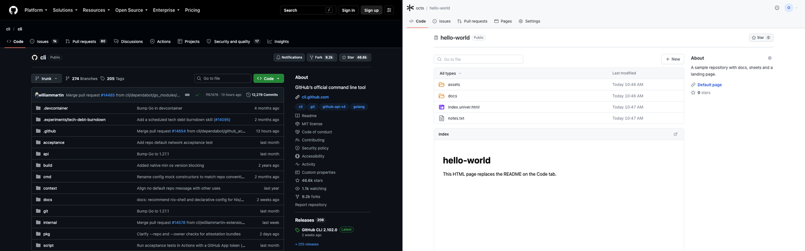
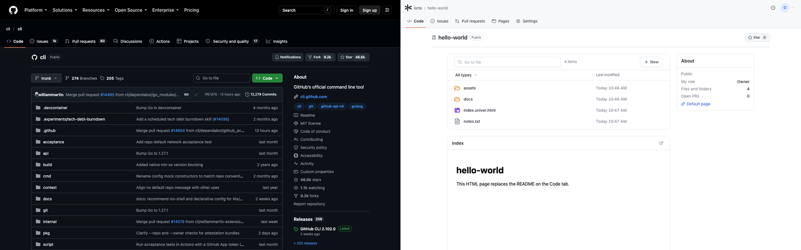

# Repository Code tab

实施记录：2026-10-15。范围为 Repository view 的 Code tab 主体布局和右侧 About 区；页头、tab 栏与 Star 沿用
[repository-framework-star.md](./repository-framework-star.md)。Watch、Fork 及其统计不做，HTML 页面继续替代 README。

## 实现

- 文件区（`NodeBrowser` 的 `compact` 模式）：搜索框和 New 菜单移到卡片外的工具栏；列表是带 `surface` 表头的
  圆角 6px 表格，行用 1px 分隔线，悬停整行高亮，文件名为常规字重、悬停加下划线。非 compact 的 Wiki 布局不变。
  `..` 返回行、类型筛选、搜索、行内操作菜单和键盘焦点保持原行为。
- 容器：Code tab 与子目录页使用 `max-w-7xl`、`px-8`，与页头宽度和左边距对齐。
- HTML 内容区：保留原卡片和 iframe 渲染，位置在文件表之下（GitHub README 所在位置）。卡片头改为 `surface` 底色，
  多页面 tab 的选中线改用 `repository-selected`。
- About 区：1024px 以上为 296px 右侧栏，以下堆叠在内容之后。显示 Description、默认页面链接、Star 数，
  有重命名权限的用户可见设置入口。Star 数与页头共用同一查询，点击 Star 后两处同步变化。
  原来的「我的角色 / 文件与目录 / 进行中的 PR」三行在 GitHub 中没有对应项，已移除并删除对应的未使用文案。

## 数据模型变更（已获确认）

Space 原先没有简介字段，因此经你确认新增 `spaces.description`（V11）：`TEXT NOT NULL DEFAULT ''`，纯文本，
修剪空白后至多 350 字符，空字符串表示未设置。`SpaceView.description` 随 `GET /api/spaces`、
`GET /api/spaces/{spaceId}` 返回，`PATCH /api/spaces/{spaceId}` 可修改，权限与重命名 Space 相同。
创建团队空间时不接收简介，之后在 Settings 编辑。没有简介时 About 不显示该行。

V10 → V11 沿用启动迁移边界：校验 V10 指纹、一致性备份、事务内 `ALTER TABLE`、外键与完整性检查、
V11 指纹校验。V1–V9 的升级链和 V0 迁移都落到 V11；V6–V10 的指纹校验函数新增 `spaceColumns` 参数，
使旧版本仍按各自的列集合校验。部署须停全部旧实例，由单个 V11 实例完成迁移；回退须停新实例并恢复 V10 备份。

## 截图对比

参考：2026-10-15 的 [GitHub cli/cli](https://github.com/cli/cli)，未登录。本地：独立临时数据库中的
`octo / hello-world`（公开仓库，含 2 个目录、1 个文本文件、1 个 `.univer.html` 页面，有简介）。
视口 1440×900，取页面顶部同一区域，各缩放 50%；**左 GitHub，右 Workspace**。GitHub 一侧包含全站导航，
Workspace 一侧包含自己的顶栏，两者没有裁剪对齐。

HTML 内容区改动前后（左前右后，各缩放 50%）：[html-before-after.png](../../../../docs/images/repository-code-tab/html-before-after.png)。
暗色主题：[workspace-dark.png](../../../../docs/images/repository-code-tab/workspace-dark.png)；
清空简介后的 About：[workspace-empty-description.png](../../../../docs/images/repository-code-tab/workspace-empty-description.png)。

实测几何（1440×900）：

| 项目 | GitHub | Workspace |
| --- | --- | --- |
| 文件表 x / 宽 | 112 / 904 | 113 / 894 |
| 文件行高 | 40–41px | 40px |
| About 侧栏 | 未能测量（页面类名变化，选择器未命中） | x=1032，宽 296 |

### 剩余差异

| 项目 | 差异与原因 |
| --- | --- |
| 分支与标签 | Workspace 没有分支或标签，工具栏无分支选择器，也无 Branches / Tags 入口。 |
| 提交信息行 | 没有最新提交、提交说明、提交时间和历史入口；表头只有 Name 与 Last modified。 |
| 工具栏动作 | 只有 Go to file 和 New（新建/上传）；没有 Code（克隆）按钮。 |
| README 卡片 | 卡片头显示页面名而非 README，多页面时是 tab；没有 README 的目录/大纲按钮。 |
| About 内容 | 只有 Description、默认页面、Star 数。没有 topics、license、Activity、Releases、Packages、Languages、Contributors。 |
| Star 计数 | 显示精确数值，GitHub 对大数用 `46.6k` 缩写。 |
| 字体与图标 | 系统字体与 Lucide，与 GitHub 的字形和 Octicons 有差异。 |
| 文件表宽度 | 894px，GitHub 约 902–904px；侧栏宽度 GitHub 一侧未测量。 |
| 行内操作 | 悬停显示操作菜单（重命名、分享、移到回收站等），GitHub 没有对应项。 |
| 窄屏 | About 堆叠在内容之后；GitHub 窄屏的 About 位置未对照。 |

## 验证

| 检查 | 结果 |
| --- | --- |
| `pnpm typecheck`（workspace） | 通过。 |
| `pnpm build`（workspace） | 通过。 |
| `pnpm test`（workspace） | 73 个文件、352 项通过。 |
| `test:production-import` | 通过，含新增的 V10 → V11 生产构建矩阵与 V0–V9 既有矩阵。 |
| V10 → V11 | 空表与已发布 Blob/Issue/未完成上传/Operation/删除任务保留；失败回滚到 V10 且备份可读；重启不重复迁移或备份。 |
| 描述 API | HTTP 测试覆盖修剪、350 字符上限、非字符串 400、非管理者 403、仅改名不影响简介、清空。 |
| 生成物 | `api:generate` 重复执行结果稳定；未运行带 `git diff --exit-code` 的 `api:verify`（变更尚未提交）。 |
| 浏览器 | 320/390/768/1024/1440px 无横向溢出；Star 0 → 1 → 0 时 About 与页头同步；设置页保存简介后 About 更新，清空后该行消失；明暗主题各截一张图。 |
| HTML 区回归 | 取改动前（HEAD 三个文件）与改动后的同一元素截图，左上 700×200 区域 0 像素差异；容器宽度由 798 变为 894。 |

### 未通过或未验证

- 未运行根 `pnpm test`、CLI 测试、`pnpm package:workspace-cli`；本次只改 `apps/workspace`，也没有改 CLI 或 client-core。
  上一个提交记录的根 `apps/agent/desktop` 测试失败（`pnpm config get overrides` 输出为空）与本任务无关，未重新确认。
- 未对 `spaces.$spaceId.tsx`、`node-browser.tsx`、`spaces.service.ts`、`spaces.repository.ts` 运行 oxfmt：
  这些文件在 HEAD 上就未通过 `oxfmt --check`，格式化会混入无关改动。新增文件均已通过检查。
- GitHub 一侧的 About 侧栏位置与宽度没有测到；对比图上的差异判断基于实测几何和页面结构，未逐像素比对。
- 只用本机 Chromium 验证；未测 Safari、Firefox、触屏设备和读屏软件。未做 axe 检查。
- 未部署，也未对真实线上数据库执行升级；迁移验证全部使用临时数据。
