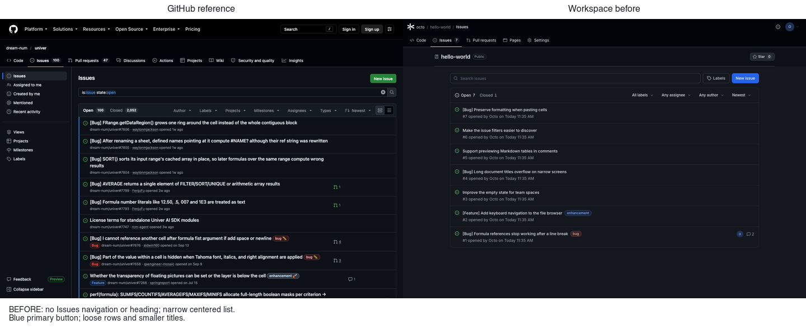
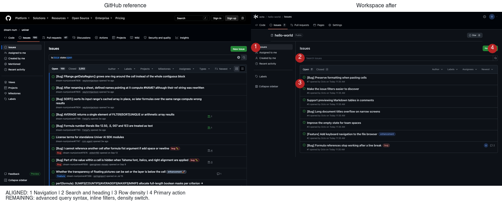
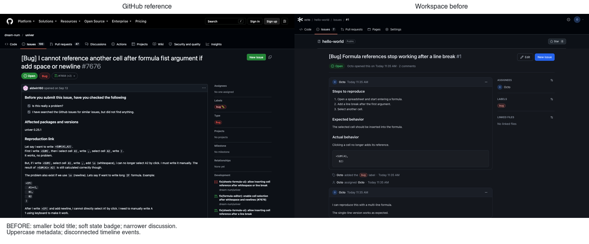
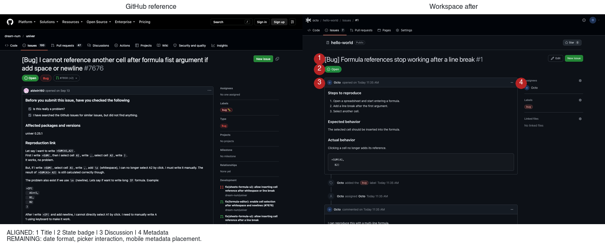

# Repository Issues tab

范围：Issues 列表与详情的前端还原；复用现有 HTTP contract、权限和数据模型，不改公共页头、tab 与 Star。

## 改动前差异与优先级

参考 2026-10-15 的 [dream-num/univer Issues](https://github.com/dream-num/univer/issues) 与
[Issue #7676](https://github.com/dream-num/univer/issues/7676)，未登录、暗色，1440×1000。
本地为独立临时数据库中的 `octo / hello-world`，含 8 个 Issue（7 open / 1 closed）、标签、指派与评论。

| 优先级 | 改动前差异 | 处理方向 |
| --- | --- | --- |
| P1 | 列表是居中的窄卡片，缺少当前 GitHub 的 Issues 左侧导航与页面标题 | 在 Repository 列表增加已有筛选能力的快捷入口；内容扩展到侧栏右侧 |
| P1 | Repository 内容没有继承 GitHub 字体、背景和边框令牌 | 只在 Issues Repository 内容内使用现有 chrome 令牌 |
| P1 | 搜索、Labels 与蓝色 New issue 挤在同一行 | 标题与绿色 New issue 同行；独立搜索行；Labels 移到导航 |
| P1 | 行标题偏小、行距偏大，计数没有徽标；筛选触发器冗长且顺序不同 | 16px 标题、12px 元数据、紧凑行、计数徽标、Author / Labels / Assignees / Sort |
| P1 | 详情标题 24px 半粗、浅色徽标、额外底边线；正文列偏窄 | 32px 常规标题、实心状态、扩大主列，保持 280px 元数据栏 |
| P2 | 正文头只有时间，没有 opened/commented；侧栏标题全大写 | 正文与评论头增加动作语义；侧栏 sentence case |
| P2 | 时间线事件缺少连接线与圆形图标；评论区像独立卡片 | 连续时间线与独立 Add a comment 标题，Write / Preview 页签贴近 GitHub |
| 保留 | Workspace 有关联文件，GitHub 没有完全对应项 | 保留 Linked files，不伪装成 Development |
| 不显示 | Projects、Milestones、Type、Relationships、reactions、订阅缺少模型或接口支持 | 不新增假控件、数据或接口 |

改动前原图：[列表](../../../../docs/images/repository-issues-tab/before-list.png)、
[详情](../../../../docs/images/repository-issues-tab/before-detail.png)。
GitHub 原图：[列表](../../../../docs/images/repository-issues-tab/github-list.png)、
[详情](../../../../docs/images/repository-issues-tab/github-detail.png)。

## 实现

- Repository 列表有 256px 左侧导航，支持 Issues、Assigned to me、Created by me、Recent activity、Labels
  和收起/展开。快捷入口只组合已有 URL 筛选，不增加查询接口。900px 以下隐藏侧栏，Labels 保留为搜索旁入口。
- 列表主体使用 24px 页内边距；标题与绿色 New issue 同行，搜索独占一行，可提交和清空。
  表头按 Author / Labels / Assignees / Sort 排列；菜单显示当前选项，筛选保留在 URL。
  有结果时显示筛选摘要与清除入口，无结果时保留原空态的清除入口。
- 行标题为 16px/600，元数据 12px，行内边距 10px，单行标题时行高约 65px；保留标签、头像、评论数与关联文件数。
- 详情容器改为 `max-w-7xl`，标题为 32px 常规字重，状态徽标实心填色，移除标题下额外分隔线。
  主列与 280px 元数据栏间距 32px；窄屏动作与标题分行，元数据栏排在讨论之后。
- 正文和评论头增加 opened/commented 文案，元数据标题取消全大写；事件增加圆形图标与连接线。
  评论输入区有独立标题、头像、Write / Preview 页签；页签支持方向键、Home/End 和关联的 tabpanel。
- Issues Repository 内容复用现有 `repository-chrome` 字体、背景和边框令牌，新增样式仅限 `.repository-issues`。
  绿色主按钮与 Markdown 的蓝色链接分别设定，避免链接跟随按钮变绿。
- 创建、评论、编辑、状态变更、标签、指派和关联文件继续调用原有 mutation；权限判断、Markdown 安全策略、
  分页和实时失效保持不变。共享的 IssueComposer、状态徽标和侧栏标题也供 Wiki / 新建页使用。

## 并排对比

以下每张图均为**左 GitHub、右 Workspace**，1440×1000 原图各缩放至 50%，不裁剪公共页头。
红色数字对应下表。两侧使用不同的真实/测试内容，不作为逐像素差分。
浏览器回归另外创建了一个 Issue，最终截图为 9 个 Issue（7 open / 2 closed）；标签与指派回归也追加了时间线事件。

### 列表：改动前



### 列表：改动后



| 标注 | 已对齐 | 尚有差异 |
| --- | --- | --- |
| 1 | 左侧筛选导航的宽度、行式入口、选中底色和指示条 | 只显示已有能力；收起按钮没有固定在侧栏底部，也没有 GitHub 的 Mentioned / Views 等入口 |
| 2 | 页标题、新建按钮、独立搜索行和带背景的筛选表头 | 搜索仍是原有纯文本匹配，不解析 `is:issue state:open` 等 GitHub 查询语法 |
| 3 | 标题/元数据层级、约 65px 行高、分隔线、计数徽标、行悬停 | 图标仍为 Lucide；标签/作者/头像仍随整行打开详情，不像 GitHub 可直接点击筛选；无密度切换 |
| 4 | 绿色主按钮、紧凑尺寸 | 沿用 Workspace 的按钮与焦点样式，未做逐像素对齐 |

### 详情：改动前



### 详情：改动后



| 标注 | 已对齐 | 尚有差异 |
| --- | --- | --- |
| 1 | 标题字号、常规字重、弱化的编号、主列宽度 | 内容与标题长短不同；保留现有 Edit；公共页头不在本任务内 |
| 2 | Open / Completed / Not planned 的实心状态徽标 | 没有 Type 和关联 PR 汇总，因为模型不支持 |
| 3 | 正文/评论卡片的边框和表头、opened/commented、时间线连接与图标 | 日期沿用共享格式（例如 `Today 11:35 AM`），没有 GitHub 的 `1w ago`；Markdown 字号/行距、事件间距仍有差异 |
| 4 | 280px 元数据栏、句式标题、分组分隔线 | 标签/指派/文件继续使用现有对话框，不是 GitHub 的行内 popover；保留 Linked files |

其他截图：[窄屏列表](../../../../docs/images/repository-issues-tab/mobile-list.png)、
[窄屏详情](../../../../docs/images/repository-issues-tab/mobile-detail.png)、
[亮色列表](../../../../docs/images/repository-issues-tab/light-list.png)、
[亮色详情](../../../../docs/images/repository-issues-tab/light-detail.png)。

### 剩余差异

- 未显示缺少数据支撑的 Projects、Milestones、Issue Type、Relationships、reactions、订阅、Development、
  跨 Issue 关系与 Mentioned；没有为它们新增模型或接口。
- 搜索语法、列表行内筛选、密度切换、筛选菜单中的成员搜索和多标签选择没有新增。
  现有筛选仍支持标签、创建者、指派、状态与创建/更新时间排序；作者菜单只提供任意作者/我，指派菜单只提供任意/我/未指派。
- 分页继续使用游标式 Load more，不伪造 GitHub 的页码。
- 窄屏元数据放在讨论之后，GitHub 会把部分元数据放在正文前；窄屏筛选控件会换行。
- 保留 Workspace 品牌、仓库简介行、Star 和已有导航；GitHub 的全站页头和更多仓库 tab 不属于本次范围。

## 验证

| 检查 | 结果 |
| --- | --- |
| 根 `pnpm typecheck` | 通过，含 Workspace / Agent / CLI 与 private packages |
| 根 `pnpm build` | 通过；有既有 WASM 路径、动态导入及大 chunk 警告 |
| 最终 `pnpm --filter @univerjs/univer-workspace typecheck` / `build` | 通过，含 OpenAPI lint、路由生成、Web 与 Server 构建 |
| `pnpm --filter @univerjs/univer-workspace test` | 73 个文件、352 项全部通过 |
| Issues URL 与 i18n 定向测试 | 2 个文件、7 项通过 |
| 根 `pnpm test` | **失败**：Agent Desktop `test/profile-runtime.test.mjs:30` 对 `pnpm config get overrides --json` 的空输出执行 `JSON.parse`，抛出 `Unexpected end of JSON input`；该模块未修改，前一任务也记录了同类失败。根递归测试在此停止，不能宣称全仓测试通过 |
| 浏览器自动回归 | `test/browser/issues.smoke.mjs` 通过：快捷筛选、Author / Sort 菜单、侧栏收起/展开、无结果搜索/清空、新建、Markdown 预览键盘切换、评论、改标题、关闭/重开 |
| 浏览器手动回归 | 编辑正文、编辑/删除评论、修改标签、取消/重新指派、添加关联文件均通过；公开只读访客没有 Edit / New issue / 评论输入框，显示仅成员可评论 |
| 响应式 | 列表与详情在 320 / 768 / 1024 / 1440px 的页面和 Issues 滚动容器均无横向溢出；另保存 390px 截图 |
| 明暗主题与无障碍 | 列表、详情在明暗主题下各做一次局部 axe 检查，`.repository-issues` 内均为 0 violations；修复了元数据标题层级。此结果不代表全应用已通过无障碍审计 |
| Wiki / 中文 | 切换 Wiki 与中文后，详情及编写/预览、评论输入框可用，无页面横向溢出 |
| 运行时错误 | 最终浏览器回归没有记录到未捕获页面错误；编辑 i18n 时曾遇到 Vite HMR Provider 错误，完整刷新后消失 |
| 格式与 diff | 8 个改动的 TSX / 浏览器脚本通过 `oxfmt --check`；`git diff --check` 通过。`global.css` 与 `i18n.tsx` 的整体格式检查在 HEAD 也失败，未为本任务重排整份文件 |
| 设计机械检查 | Impeccable detector 无发现 |

浏览器脚本运行方式（需本地临时服务、已登录的英文 Repository session 与可丢弃 Team Space；会创建 Issue/评论）：

```bash
WORKSPACE_ISSUES_URL=http://127.0.0.1:5173/spaces/<id>/issues \
AGENT_BROWSER_SESSION=<isolated-session> \
node apps/workspace/test/browser/issues.smoke.mjs
```

### 未能验证

- 根测试未全绿，CLI 和其他包的整套递归测试没有在本次根命令中跑完；未修改或跳过阻断它的测试。
- 仅用 Chromium 与模拟视口验证，没有测试 Safari、Firefox、真实触屏设备或读屏软件。
- 未覆盖超长时间线、Load more 多页数据、断网重试、所有角色的完整写入权限组合；原有服务端测试继续覆盖权限与游标分页。
- GitHub 参考页未登录，未验证其登录后的评论编辑、管理菜单与权限态；Workspace 的这些操作单独回归。
- 未运行 CLI packaging 或 production-import；没有修改服务端、schema、迁移、部署、HTTP contract 或 SDK 依赖。
- 没有执行部署，也没有操作原有数据库。
