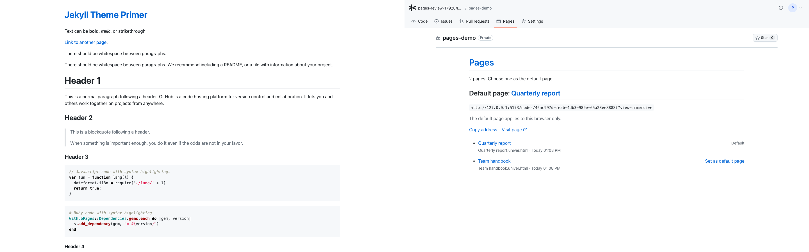
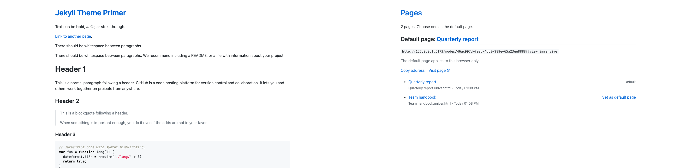
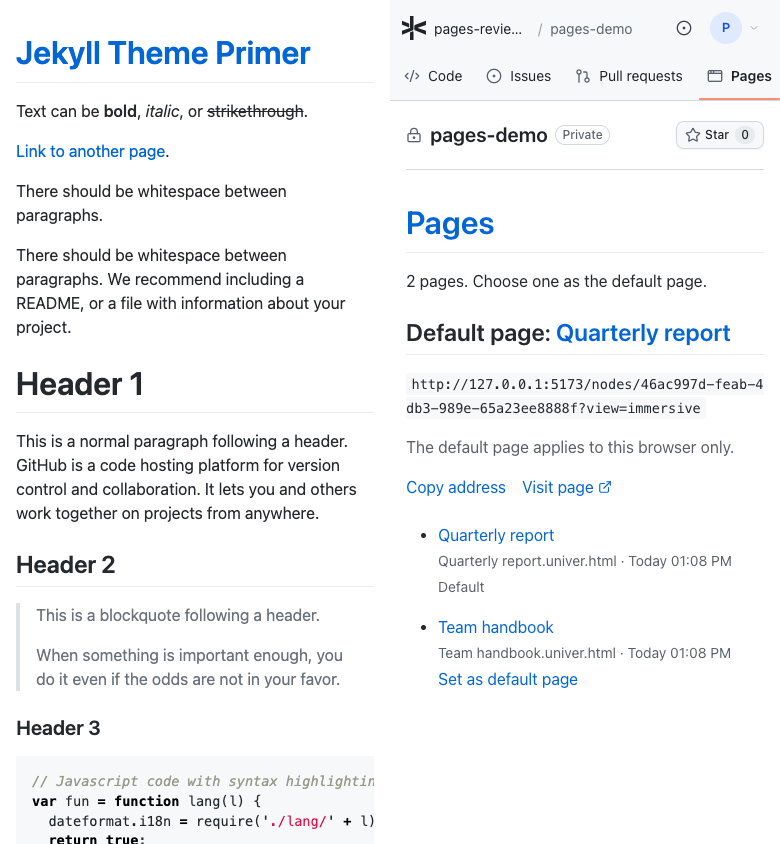

# Repository Pages tab

实施记录：2026-10-15。分支：`feat-github-ui-copy-6-pages-tab`。

## 参考与范围

参考官方已发布的 [Jekyll Theme Primer 演示站点](https://pages-themes.github.io/primer/)，
不是 GitHub Settings → Pages。该站点实际使用 `jekyll-theme-primer` 的 Markdown 正文样式。
截图直接来自该 HTTPS 站点，Workspace 截图使用独立临时数据库、测试账号及两份合成 HTML 文件，
没有修改站点内容、GitHub 设置、仓库 `.data` 或线上数据。

保留 Repository 公共页头、仓库标题、Star 和 tab 栏。Pages 仍紧挨 Pull requests 右侧，
路由仍为 `/spaces/$spaceId?view=apps`。只修改该 tab 的正文，不修改全局 `/apps`、Code 的页面预览、
Wiki、HTML 文件本身、HTTP contract、权限或数据模型，也不新增发布能力。

## 实现

- 用 Primer 文档式正文替换原来带边框和底色的管理卡片；内容顺序保持为数量说明 → 默认页 → 页面列表。
- 最大容器宽 1012px（含左右各 16px 内边距），顶部间距 32px；1440px 下正文从 x=230 开始，
  与参考站点一致。系统字体、正文 16px/24px、蓝色链接 `#0366d6`、标题分隔线 `#eaecef`。
- Pages 标题 32px/40px，链接回当前 Pages 目录；默认页标题 24px/30px。段落间距 16px，
  默认地址使用浅灰色行内代码样式，完整地址可换行，不再截断。
- 列表保留名称、原始文件名、更新时间和默认标记/操作。复制及设为默认仍使用真实按钮，
  以链接外观融入正文；访问页面仍是原来的 immersive 路由。键盘焦点有清晰轮廓。
- 小于 640px 时列表操作放在当前条目正文下方，避免操作挤压名称；不改变条目顺序。
  暗色使用局部兼容配色，正文样式不穿透 HTML viewer 的 shadow root/iframe。

## 原有能力验收

| 原有内容/操作 | 结果 |
| --- | --- |
| Pages tab 位置和进入 | 从 Code 点击 Pages；位于 Pull requests 后，`aria-current=page` 和 URL 正确。 |
| 数量和列表 | 两份真实上传的 `.univer.html` 文件可见；名称、文件名、更新时间均保留。 |
| 默认页及本地范围说明 | 默认标题、完整 URL、说明和列表标记保留。 |
| 设为默认页 | 键盘 Enter 切换成功；刷新后 URL 和选择保持，仍只保存到当前浏览器 localStorage。 |
| 复制地址 | 成功分支写入当前默认页完整地址并提示；拒绝分支显示原错误提示。自动测试替换 Clipboard API，不依赖操作系统剪贴板权限。 |
| 访问页面 | 点击后进入默认页 immersive URL，真实 HTML viewer 渲染测试文件的正文。 |
| 每个页面的名称链接 | 两个 Node URL 均能打开，并通过真实 viewer 看到 HTML 正文。 |
| 空目录 | 保留“还没有页面”、说明、提示；不显示默认页操作。 |
| 响应式 | 320/768/1024/1440px 自动检查内容区和整页无横向溢出；另检查 390px 截图。 |
| 中英文、暗色 | 实际切换并截图；明暗和中文页面的 axe 检查均通过。 |

## 并排截图

以下均为**左 Primer 参考站点、右 Workspace**。未更改页面文字或拼造不存在的内容。

桌面原始视口均为 1440×900，整屏直接拼接：



正文对齐图：左从 y=0、右从 y=170 开始，各裁剪 1440×700，无缩放；右侧排除了保留的公共框架，
两边标题距正文顶端均为 32px，正文左右边界和标题分隔线可直接比较。



移动端均为 390×844，完整首屏直接拼接：



原图：[改动前](../../../../docs/images/repository-pages/workspace-before.png) ·
[Primer 桌面](../../../../docs/images/repository-pages/primer-desktop.png) ·
[Workspace 桌面](../../../../docs/images/repository-pages/workspace-desktop.png) ·
[Primer 移动端](../../../../docs/images/repository-pages/primer-mobile.png) ·
[Workspace 移动端](../../../../docs/images/repository-pages/workspace-mobile.png) ·
[Workspace 暗色](../../../../docs/images/repository-pages/workspace-dark.png) ·
[Workspace 中文](../../../../docs/images/repository-pages/workspace-chinese.png)。

### 剩余差异

| 项目 | 当前差异与原因 |
| --- | --- |
| 公共框架 | 参考是独立站点，无仓库页头和 tab；Workspace 按要求保留，正文整体下移 170px。 |
| 正文内容和长度 | 参考是 Markdown 排版示例，含多级标题、引用、代码等；Workspace 保留现有页面目录，没有复制示例文字或凭空新增文章。 |
| 默认页与列表操作 | 参考没有默认页切换、复制和文件元数据；Workspace 全部保留，采用正文链接、列表及行内代码样式，所以段落位置和密度不同。 |
| HTML 页面 | 目录采用 Primer 外观；访问后的页面仍由文件自己的 HTML/CSS 决定，不强行给用户内容换主题。 |
| 标题锚点和页脚 | 未新增参考演示的标题锚点按钮及 Improve this page 页脚，Workspace 没有对应的源码编辑目的地。 |
| 暗色与图标 | 参考站点为固定亮色；Workspace 暗色是兼容实现，非逐像素复刻。外链图标仍用现有 Lucide。 |
| 移动端 | 长地址自然换行，条目操作放在正文下；上方仓库 tab 仍沿用公共框架的横向滚动。 |

## 验证与限制

- `pnpm typecheck`、`pnpm build`：全仓库通过。最终响应式调整另通过 Workspace typecheck 和 build:web。
  构建仍有已有的 WASM 路径、chunk 大小和 Router circular-dependency 警告，未改动这些边界。
- `pnpm --filter @univerjs/univer-workspace test`：73 个文件、353 项通过。
- 可重复运行的浏览器回归（需要安装 `agent-browser`，并先启动使用临时数据库的 Server/Vite）：

  ```bash
  WORKSPACE_TEST_ORIGIN=http://127.0.0.1:5173 node --test apps/workspace/test/browser/repository-pages.mjs
  ```

  该测试通过真实 API 创建独立账号、Space 和 Blob；测试导航、键盘切换、本地默认页刷新持久化、
  复制成功/失败、所有页面打开、真实 HTML 正文、空目录和各宽度溢出。测试不重置数据库。
- axe：亮色移动端、暗色桌面和中文桌面整页均为 0 violations、0 incomplete；页面异常记录为空。
- 修改的 TSX/MJS 通过 `oxfmt --check`；`git diff --check`、Impeccable detector 通过。
  仓库没有独立的全局 lint script；现有 API lint 随 typecheck/build 通过。
- **根 `pnpm test` 未全部通过**：现有 `apps/agent/desktop/test/profile-runtime.test.mjs:30`
  对 `pnpm config get overrides --json` 的空输出执行 JSON.parse，报 `Unexpected end of JSON input`。
  此问题在之前的 Settings 实施记录中已有记录；本任务未修改或屏蔽它，因此“全仓库测试全部通过”尚未达成。
- 未验证真实操作系统剪贴板权限、Safari、Firefox、读屏软件、真实触屏设备、生产部署或线上数据。
  HTML 文件与 Sheet 的数据绑定、协同写入、匿名分享权限不属于本次外观变更的验证范围。
- 启动 Vite 时 pnpm 自动安装依赖并改写了 `pnpm-lock.yaml` 元数据；启动日志确认来源后，
  已撤销本次自动产生的 lockfile 差异，不引入依赖变更。临时 Server/Vite 在验证后主动以 SIGTERM 停止。
- 独立 UI 完成审查与文档核对均为 `ship`，无必须修复项；审查检查截图、源码和验证边界，未重复运行测试。
