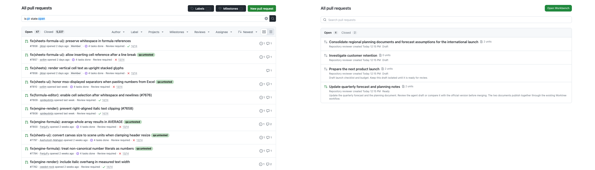
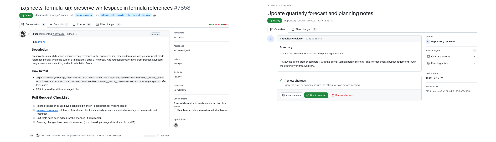

# Repository Pull requests：GitHub 布局对照与验证

实施日期：2026-10-15。分支：`feat-github-ui-copy-4-pr-tab`。
仅修改 Browser 的 Repository PR 展示，不修改 Worktree 模型、HTTP contract、数据库或 SDK。
没有新增评论、Reviewers、Checks、分支或 PR 编号。

## 改动

- 列表使用 GitHub 式标题/操作行、搜索框、灰底筛选栏、计数徽标、紧凑列表和状态图标。
  默认 Open，修复首次查询完成前误选 Closed 的问题；摘要、作者、创建/处理时间和文档数保留。
  整行仍可通过真实链接打开详情，包括浏览器中键/新标签行为。
- 详情使用大标题、实心状态徽标、页内导航、头像与摘要主栏、元信息侧栏和底部审阅操作区。
  Overview 对应 GitHub Conversation 的布局，但不伪造会话能力。
  Files changed 放置原有文档选择、原生预览和结构化对比；窄屏改为上下排列。
- `section=overview|files` 只是 URL 展示状态；原有 `worktree`、`unit`、`view` 链接继续有效。
  带 Unit 的旧链接直接进入文档审阅，未指定 Unit 时显示 Overview。
- 原有 mutation、权限判断、确认弹窗、合并冲突检测、幂等键和反馈继续由
  `worktree-review-panel.tsx` 执行。新 layout 只接收展示数据、审阅内容和操作节点。
- Wiki 和全局 Workbench 保留原任务分组、筛选、可调整侧栏和原有预览布局。

## 截图

参考为当日线上 [dream-num/univer 的 PR 列表](https://github.com/dream-num/univer/pulls) 和
[PR #7858](https://github.com/dream-num/univer/pull/7858)，未登录 GitHub。
Workspace 使用独立临时数据库中的 `repo-review / quarterly-planning`，英文、已登录。
所有并排图均为**左 GitHub、右 Workspace**，真实内容和计数未被替换。

桌面两侧视口均为 1440×1000。为比较本任务的内容区，GitHub 去掉顶部 172px，
Workspace 去掉已有公共框架的顶部 170px，各保留 1440×828；没有缩放某一侧来对齐。
移动端为 390×844 完整视口，因此公共框架的高度差也在图内。

### PR 列表

[暗色对照](../../../../docs/images/repository-pull-requests/comparison-list-dark.png) ·
[移动端对照](../../../../docs/images/repository-pull-requests/comparison-list-mobile.png) ·
[改动前列表](../../../../docs/images/repository-pull-requests/before-list.png)

### PR 详情

[暗色对照](../../../../docs/images/repository-pull-requests/comparison-detail-dark.png) ·
[移动端对照](../../../../docs/images/repository-pull-requests/comparison-detail-mobile.png) ·
[Files changed 原生文档审阅](../../../../docs/images/repository-pull-requests/workspace-files.png) ·
[改动前详情](../../../../docs/images/repository-pull-requests/before-detail.png)

## 改动前后功能对照

“真实浏览器”指 Chromium + 本地真实 HTTP/OT 服务；“注入”仅验证 Browser 展示与权限分支，
不把模拟结果写入产品数据库。

| 改动前的信息/操作                | 改动后位置/行为                                                                 | 验证                                                                   |
| -------------------------------- | ------------------------------------------------------------------------------- | ---------------------------------------------------------------------- |
| Worktree 名称、状态              | 列表标题/图标；详情标题与状态徽标                                               | 真实浏览器覆盖 Draft、Ready、Merged、Discarded；Merging 沿用原状态映射 |
| 作者、仓库、更新时间             | 页头、公共仓库框架、Overview 侧栏                                               | 真实浏览器；没有把当前访问者当作作者                                   |
| 摘要、文档数量、处理时间         | 列表保留；Overview 摘要、文档区和审阅区                                         | 真实浏览器，包括无摘要、零文档                                         |
| Open / Closed 切换               | 列表筛选栏和计数                                                                | 真实浏览器，合并/放弃后计数刷新                                        |
| 搜索和切换任务                   | 列表搜索名称/摘要/创建者；返回列表切换 PR；原跨任务/文档搜索仍在 Open Workbench | 真实浏览器验证列表搜索/清空、Wiki 原 Dashboard                         |
| 任务分组、展开/折叠、调整侧栏    | 全局和空间级 Open Workbench 仍使用原 Dashboard；PR 内改用文档导航               | Dashboard 未改；既有测试通过，Wiki 浏览器验证                          |
| 文档选择、类型与变更标记         | Overview 侧栏、Files changed 文档导航和审阅标题                                 | 真实浏览器切换 Sheet/Doc；删除/撤销标记与选中项保留                    |
| AI 草稿查看                      | Files changed 的 View，仍用原 iframe                                            | 真实浏览器，原生画布加载                                               |
| 结构化对比                       | Files changed 的 Compare                                                        | 真实浏览器检查 Official version / AI changes、原生画布；刷新保留选择   |
| 正式版本、合并预览链接           | 继续解析原 `view=trunk                                                          | preview`，可用性仍由原规则决定                                         | 既有 view 解析测试通过；预览控件展示通过注入验证 |
| 合并检查、冲突提示/阻止合并      | Files changed 提示区；两个详情分区的合并按钮共用原判断                          | 注入冲突响应验证禁用；注入 preview 响应验证切换控件存在                |
| 标记删除 / 撤销删除              | Files changed 的当前文档标题栏                                                  | 真实浏览器完成写入与撤销                                               |
| 提交审阅 / 合并 / 放弃           | Overview 与 Files changed 的底部操作区                                          | 真实浏览器完成 Draft → Ready → Merged，以及另一个 Draft → Discarded    |
| 二次确认与取消                   | 原 ConfirmDialog                                                                | 真实浏览器取消不改变状态；确认后服务端状态刷新                         |
| 各文档合并结果                   | 原审阅标题的结果 Badge                                                          | 复用原组件；真实合并流程和既有反馈测试通过                             |
| 无审阅权限、文档不存在、请求失败 | 原文档空状态；详情失败支持 Retry                                                | 注入权限响应验证操作隐藏；真实缺失 Unit；中断请求后 Retry 恢复         |
| 旧 URL、刷新、新标签             | 保留原路由和参数；Overview/Files 使用真实链接                                   | 真实浏览器验证旧链接、刷新、真实 href；不拦截浏览器修饰键行为          |

## 仍未对齐的差异

| 项目             | 差异与原因                                                                                                                                                                                                                                                        |
| ---------------- | ----------------------------------------------------------------------------------------------------------------------------------------------------------------------------------------------------------------------------------------------------------------- |
| GitHub 专有数据  | 不显示 `#编号`、源/目标分支、commit 数、Checks、评论数、Reviewers、Labels、Assignees、Milestones 等。Worktree 没有相应 PR 合同，不新增接口或模型来凑页面。                                                                                                        |
| 详情导航         | 使用 Overview / Files changed；没有 Conversation、Commits、Checks 空壳。Files changed 计数为原有全部关联文档数，包含 unchanged，不冒充 Git diff 文件数。                                                                                                          |
| 操作与状态       | New pull request 替换为已有 Open Workbench；Ready/Discarded 保留产品语义，不改写为 GitHub Open/Closed，也不新增 Reopen 按钮。                                                                                                                                     |
| 内容密度         | 保留 Workspace 摘要和文档数，部分列表行为三行；GitHub 参考多数为两行。没有伪造 Review required、CI 或标签填充留白。                                                                                                                                               |
| 详情排版         | 保留显式返回列表链接，标题比 GitHub 参考下移约一行；摘要较短、没有事件/评论时间线，审阅操作因此更靠上。侧栏用作者、文档、更新时间和 Worktree ID 填入真实信息。                                                                                                    |
| 字体、图标与细节 | 系统字体和 Lucide 仍与 GitHub 字形、Octicons、气泡尖角有差异；侧栏约 296px，参考约 320px。未复制 GitHub 品牌资产。                                                                                                                                                |
| 文档审阅         | Files changed 使用 Univer 原生文档与对比器，不显示源码 diff、增删行数、Viewed checkbox 或行评论。保留固定可操作的编辑器高度，内部仍有自己的滚动条。                                                                                                               |
| 搜索、排序与分页 | 列表是普通本地文本搜索，不支持 GitHub `is:pr` 查询语法、高级筛选、密度/排序菜单。沿用原 active/processed 各首批摘要（默认每批最多 50 条），未在本次视觉任务中重做游标分页；计数与搜索限于已加载摘要。直接 Worktree 详情按 ID 读取，不再依赖它是否落在首批列表内。 |
| 移动端公共框架   | 沿用依赖任务的横向 tab 与 Star 行；GitHub 使用 More 菜单，顶部占用不同。属于公共框架，不在本任务改写。                                                                                                                                                            |

## 验证结果与限制

| 检查               | 结果                                                                                                                                                                                  |
| ------------------ | ------------------------------------------------------------------------------------------------------------------------------------------------------------------------------------- |
| `pnpm typecheck`   | 全仓库通过；最终改动后另运行 Web TypeScript 检查通过                                                                                                                                  |
| `pnpm build`       | 全仓库通过；最终 Workspace production build 再验证通过                                                                                                                                |
| Workspace 全量测试 | 73 个文件、353 项通过；最终相关定向测试 4 个文件、26 项通过                                                                                                                           |
| 根 `pnpm test`     | 未通过：未改动的 `apps/agent/desktop/test/profile-runtime.test.mjs:30` 对空输出执行 `JSON.parse`，报 `Unexpected end of JSON input`；与公共框架任务记录的失败一致。未跳过或修改测试。 |
| lint / format      | 仓库无独立全局 lint script；build/typecheck 中 API lint 通过。`pnpm format:check` 报告 629 个文件有格式问题，未格式化无关文件；本任务新增/重排的 TS/TSX/浏览器脚本单独检查。          |
| 浏览器 smoke       | `test/browser/pull-requests.smoke.mjs`；真实服务完成操作流程，另覆盖注入的冲突/预览/无权限/失败恢复                                                                                   |
| 视觉与响应式       | 明暗桌面、390px 移动截图；320/390/768/1024/1440px 检查无整页横向溢出；另检查中文 320px 详情与文档导航                                                                                 |
| 无障碍与运行时     | 明暗主题列表/Overview 内容区 axe 各 0 violations、0 incomplete；正常列表/详情/原生预览无未处理页面异常；故障注入期间的失败请求属于预期                                                |
| 设计与 diff        | Impeccable detector 返回 `[]`；`git diff --check` 通过；HTTP 生成物无差异                                                                                                             |

未验证 Safari、Firefox、真实触屏/读屏软件、复杂文档的渲染保真度、真实并发 Trunk 更新产生的
合并预览/冲突、真实线上数据库或生产部署。权限/冲突 UI 注入不替代服务端授权或 SDK 合并算法验证；
相关原实现与已有服务端测试保持不变。未升级依赖、发布或部署。
