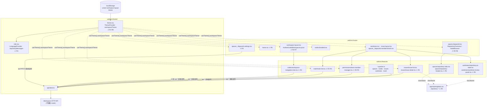
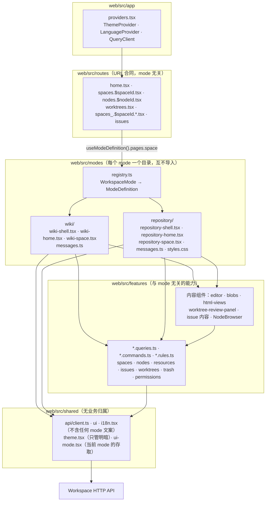
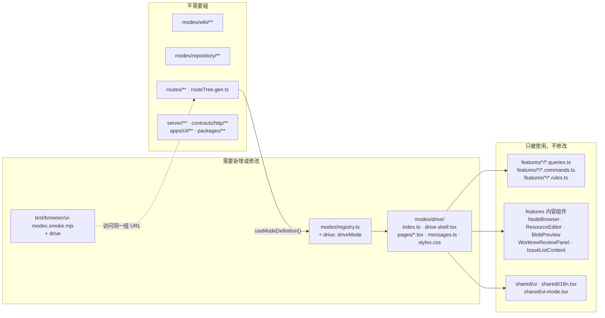

# UI Mode 解耦：调研、风险与迁移路线

> 状态：提案（2026-10-15），未实施。本文只记录调研结论和推荐方案，不代表已接受的架构决策；
> 方案被接受后，其中的边界规则再按约定写入 `docs/architecture.md` 或 ADR。
>
> 调研基线：分支 `feat-ui-decouple`，commit `384eb3f`。下文所有路径相对 `apps/workspace/`，
> 未注明的结论都来自代码阅读，没有运行浏览器实测。

## 0. 结论摘要

- 现在的 "mode" 叫 `workspaceTheme`（`web/src/shared/theme.tsx`），是 `"wiki" | "repository"`
  两个值，存在浏览器 `localStorage`。服务端、HTTP contract、CLI 和 Agent 完全不感知 mode，
  耦合**只存在于 Browser 的 `web/src`**。
- mode 分支没有边界：14 个文件里有 23 处 `workspaceTheme === "repository"` 判断，15 处
  直接读 `useTheme().workspaceTheme`，分布在外壳、8 个 route、`features/*` 下的 4 个通用组件和全局 i18n Provider。
- 两种 mode 底层用的是同一套产品 API 和 Query，差异几乎全在呈现层。但业务写操作（mutation、
  缓存失效、成功后的导航）就写在组件里，所以呈现分支会顺带分叉业务行为，例如
  `spaces_.$spaceId.settings.tsx` 里两种 mode 提交的 PATCH 字段和成功后的去向都不一样。
- 推荐方案：**在 `web/src` 内分层，不拆 package，不改 URL**。抽出 `domain/` 层（Query、命令、
  领域规则），每个 mode 放进自己的 `modes/<id>/` 目录，路由文件退化为"解析参数 → 交给当前 mode
  的页面"。引入一个只有静态对象表的 mode 注册表，不引入插件机制或新依赖。
- 迁移分 8 步，每一步都可以单独合入并验证，外部行为不变。

## 1. 调研范围

| 部分 | 读了什么 | 目的 |
| --- | --- | --- |
| mode 状态 | `web/src/shared/theme.tsx`、`web/src/app/providers.tsx` | mode 的存储、生命周期和注入方式 |
| 外壳 | `web/src/routes/-workspace-layout.tsx`（1496 行） | 导航、页头、标题、设置入口的 mode 分支 |
| 路由 | `routes/home.tsx`、`spaces.$spaceId.tsx`、`nodes.$nodeId.tsx`、`worktrees.tsx`、`-issue-layout.tsx`、`spaces_.$spaceId.{settings,members,trash}.tsx` | 同一 URL 在两种 mode 下的渲染差异 |
| Feature | `features/spaces/*`、`features/issues/{issue-list,issue-detail,issues-sidebar}.tsx`、`features/trash/trash-list.tsx`、`features/permissions/team-member-manager.tsx`、`features/worktrees/{worktree-review-panel,repository-pull-request-layout,repository-pr-state}.tsx`、`features/worktrees/worktree-space.ts`、`features/nodes/{workspace-navigation-tree,node-browser,create-node-dropdown}.tsx`、`features/html-views/apps-sidebar.tsx` | 通用组件是否感知 mode，业务写操作放在哪里 |
| 文案和样式 | `web/src/shared/i18n.tsx`（`repositoryMessages`）、`web/src/app/styles/global.css`（`.repository-*`） | 非组件层面的 mode 泄漏 |
| 共享包 | `packages/workspace-file-browser`（README、`types.ts`） | 已有的"UI 组件 + 注入 DataSource"先例 |
| 外部消费方 | `apps/cli/src`、`packages/client-core/src`、`packages/dsh-univer-workspace-plugin/src` 中的 Browser URL | URL 合同是否被 mode 约束 |
| 测试 | `vitest.config.ts`、`test/unit`、`test/browser/*.mjs` | 现有验证手段能覆盖到哪一层 |
| 既有文档 | `docs/architecture.md` 的「Web 应用」、`docs/proposals/repository-view-*.md` | 依赖方向约定和 Repository 视图的设计意图 |

没有调研：服务端模块（与 mode 无关，已用 grep 确认 `server/src` 里没有 mode 相关代码）、
`features/editor` 的内部实现（编辑器在两种 mode 下完全相同）。

## 2. 现状：mode 是怎么实现的

```text
localStorage["univer-workspace-layout-theme"]
        │  readWorkspaceTheme()         web/src/shared/theme.tsx
        ▼
ThemeProvider (context: workspaceTheme, setWorkspaceTheme, 以及 light/dark 主题)
        ├── LanguageProvider  ── t() 在 repository 下优先查 repositoryMessages   shared/i18n.tsx
        ├── WorkspaceLayout   ── 导航、页头、标题、设置入口分支                     routes/-workspace-layout.tsx
        ├── 8 个 route 组件   ── 各自 `const repository = workspaceTheme === "repository"`
        └── 4 个 feature 组件 ── issue-list / issue-detail / trash-list / team-member-manager
```

切换入口是应用设置弹窗里的 `Segmented`（`-workspace-layout.tsx:901-905`），切换立即生效，
不刷新页面，也不改变 URL。

几个要点：

1. **mode 和明暗主题放在同一个 Context 里**。`ThemeContextValue` 同时包含 `workspaceTheme`
   和 `theme / resolvedTheme`，任何一个变化，所有 `useTheme()` 的消费者都会重新渲染。
2. **mode 不在 URL 里**。同一个 `/spaces/:id` 在 wiki 下渲染 `NodeBrowser`，在 repository
   下渲染 `RepositoryTabs + RepositoryOverview`（`spaces.$spaceId.tsx:175-216`）。
3. **路由的 search 参数是 mode 专属的**。`/spaces/:id?view=prs|apps` 只有 repository 会读；
   `/home?view=recent|owned|shared` 只有 wiki 会读（`home.tsx:48`）。
4. **"repository" 这个词同时出现在三个层面**：mode 名、外壳 props（`repositoryTab`、
   `repositoryHome`、`repositoryBreadcrumbs`）和 CSS 作用域（`.repository-chrome`）。

## 3. 两种 mode 的特征

### 3.1 Wiki mode

| 维度 | 表现 | 代码位置 |
| --- | --- | --- |
| 信息架构 | 左侧可拖宽的侧栏：Home、Workbench、文件树（Personal/Team Space 懒加载）、Apps 分组、Issues 分组、Trash | `-workspace-layout.tsx:490-614`，`features/nodes/workspace-navigation-tree.tsx`，`features/html-views/apps-sidebar.tsx`，`features/issues/issues-sidebar.tsx` |
| 首页 | Recent / Owned / Shared 三个列表，`?view=` 切换，顶部有新建下拉 | `home.tsx:64-68`、`home.tsx:170-226` |
| Space 页 | `NodeBrowser` 网格 + "成员""空间设置"按钮 | `spaces.$spaceId.tsx:149-171`、`208-214` |
| 页头 | `<h1>` 页面标题 + 节点搜索 + 齿轮按钮打开应用设置 | `-workspace-layout.tsx:714-768` |
| 交互 | 侧栏内直接拖拽移动、新建、上传、分享、改名、删除 | `workspace-navigation-tree.tsx:63-260`（14 处 API 调用） |
| 设置页 | 一张表单，名称、描述、公开只读一次提交，成功后回到 Space 页 | `spaces_.$spaceId.settings.tsx:85-125` |
| 本地状态 | 侧栏宽度/折叠、Apps 与 Issues 分组展开状态 | `shared/resizable-sidebar.tsx`、`apps-sidebar.tsx:314`、`issues-sidebar.tsx:164` |
| 文案 | `messages` 原始词汇："空间""团队空间""成员" | `shared/i18n.tsx` |

### 3.2 Repository mode

| 维度 | 表现 | 代码位置 |
| --- | --- | --- |
| 信息架构 | 没有侧栏；面包屑 + GitHub 式 tab：Code / Issues / Pull requests / Pages / Settings | `-workspace-layout.tsx:424-430`、`features/spaces/repository-tabs.tsx` |
| 首页 | 仓库列表（个人 + 团队 Space），类型筛选和名称搜索；忽略 `?view=` | `home.tsx:54-63`、`86-150` |
| Space 页 | Files（目录 + README 式默认 Page + About 卡片）、Pages、PRs 三个子视图，由 `?view=` 决定 | `spaces.$spaceId.tsx:220-308`、`309-811` |
| Header | 仓库名、可见性徽标、Star 按钮（乐观更新） | `features/spaces/repository-header.tsx` |
| PR | Worktree 用 PR 的形态展示，lifecycle 按钮挪到 PR 布局里 | `features/worktrees/repository-pull-request-layout.tsx`、`worktree-review-panel.tsx:252,279-289` |
| 设置页 | 设置子导航（常规/成员/回收站），名称、描述、可见性分别提交，成功后留在原页 | `features/spaces/repository-settings-layout.tsx`、`spaces_.$spaceId.settings.tsx:103-108,134-254` |
| 本地状态 | 每个 Space 的默认 Page | `spaces.$spaceId.tsx:83-146`（`univer-workspace-landing-app:<spaceId>`） |
| 文案 | `repositoryMessages` 覆盖约 40 个 key："仓库""协作者" | `shared/i18n.tsx:1257-1335` |
| 样式 | `.repository-chrome`、`.repository-pages/settings/issues/pull-requests` 及 3 个专属 token | `app/styles/global.css:72-74,426-596` |
| 额外数据 | 进入 Space 时额外拉取 html views、active/processed worktrees、star | `spaces.$spaceId.tsx:98-110`、`repository-tabs.tsx:23-29` |

### 3.3 共性与差异，以及归属

"归属"一列是本文的建议，不是现状。

| 能力 | 两种 mode 是否相同 | 建议归属 | 依据 |
| --- | --- | --- | --- |
| Session、Space、Node、Resource、Worktree、Issue、Trash、Permission 的 Query | 相同 | **领域层** | 两种 mode 用同一组 `*QueryOptions` |
| 写操作：建节点/资源、移动、改名、删除、分享、成员、恢复回收站、Issue、Worktree 合并 | 相同的 API，不同的入口 | **领域层**（命令） | 当前散落在 12 个组件里，见 R3 |
| 写操作之后的缓存失效 | 应当相同 | **领域层** | 现在由每个调用点自己写 `invalidateQueries`，见 R3 |
| 成功后去哪里（导航、toast） | 不同 | **mode 专属** | 例如设置页：wiki 回 Space 页，repository 留在原地 |
| 领域规则：Worktree 属于哪个 Space、"打开中"的 Worktree 状态、只有 Team Space 有 Issues/成员 | 应当相同 | **领域层** | 现在重复了 3 份，见 R5 |
| Space 显示名（个人 Space 用 owner 用户名） | 只有 repository 用 | **mode 专属** | `features/spaces/space-name.ts` 注释写明是 GitHub 约定 |
| 编辑器、Blob 预览、HTML View、Worktree 单文档审阅 | 相同 | **共享组件**（feature 内） | 内容区与 mode 无关 |
| 外壳：侧栏 / tab、页头、面包屑、标题 | 不同 | **mode 专属** | |
| 首页、Space 页、目录页的布局 | 不同 | **mode 专属** | |
| Star | 只有 repository 展示 | **领域层**提供命令，**mode** 决定是否展示 | API 本身是产品能力（`server/src/modules/spaces/spaces.router.ts:51-56`） |
| 术语（空间 vs 仓库） | 不同 | **mode 专属** | |
| 明暗主题、语言 | 相同 | **共享**（`shared/`） | 与 mode 正交 |
| URL：`/home`、`/spaces/:id`、`/nodes/:id`、`/worktrees`、Issue 路由 | 相同 | **路由合同**（mode 无关） | CLI 生成 `/nodes/:id` 链接（`apps/cli/src/features/html-view/html-view.ts:81`） |
| URL search：`?view=` | 不同，各读各的 | **mode 专属**，但需要统一校验 | 见 R6 |

简单说：**数据和规则相同，组织方式和措辞不同**。这说明领域层可以做得很薄，大部分工作是把
已有代码挪到正确的位置，而不是重新设计业务。

## 4. 现状架构图



怎么读：虚线箭头是"读取 mode 并在内部分支"，⚠ 后面的编号对应第 5 节的风险。可以看到 mode
从 `shared/theme.tsx` 出发，同时穿透 `routes` 和 `features` 两层，`features` 里的通用组件也在分支；
实线箭头表示业务写操作绕过 `*.queries.ts`，直接从组件打到 API。

## 5. 风险清单

严重程度：**高** = 不处理就无法安全加第三种 mode；**中** = 能加，但每加一个都要改共享代码或会出现
跨 mode 的回归；**低** = 维护成本或体验问题，不阻塞目标。

### 5.1 现状已经存在的风险（按严重程度排序）

#### R1 · 高 · mode 判断是二值比较，新增 mode 会静默落入 wiki 分支

- **位置**：`web/src/shared/theme.tsx:12-18`（`readWorkspaceTheme` 只认 `"repository"`，其余一律
  `"wiki"`）；14 个文件里的 23 处 `workspaceTheme === "repository"` / `!== "repository"`，例如
  `routes/-workspace-layout.tsx:425,486,491,730,758,808`、`routes/home.tsx:74-86`、
  `routes/spaces.$spaceId.tsx:98`、`features/issues/issue-list.tsx:67,646`。
- **表现**：`WorkspaceTheme` 加一个成员后，TypeScript 不会报任何错误，因为这些都是相等比较，
  不是穷尽的 `switch`。新 mode 在 23 个点上全部走 "不是 repository" 的分支，也就是 wiki，
  而 `readWorkspaceTheme` 读到新值也会把它改回 `"wiki"`。
- **如何阻碍目标**：mode 之间没有隔离，"不是 repository" 实际上等于 "wiki 加上所有未来的 mode"。
  新增 mode 必须找到并修改全部 23 处，漏一处就在页面局部混入 wiki 的行为。
- **影响范围**：全部认证页面的外壳、首页、Space 页、Issue、设置、成员、回收站、Worktree 页。
- **缓解**：mode 的选择集中在一个注册表里，由类型穷尽检查保证完整（第 7 节 `ModeDefinition`）；
  迁移完成后，`useTheme().workspaceTheme` 不再对页面开放（第 8 节步骤 2、7）。

#### R2 · 高 · 通用 feature 组件和外壳内部按 mode 分支

- **位置**：
  - `features/issues/issue-list.tsx:66-67,91-316,415,521-554,626-646`：同一组件内约 15 处 `repository &&`
    决定布局、侧栏、新建按钮是否显示；
  - `features/issues/issue-detail.tsx:63-64,149-329`；
  - `features/trash/trash-list.tsx:26-28,80-167`；
  - `features/permissions/team-member-manager.tsx:43-44,194-239`；
  - `routes/-workspace-layout.tsx:370-970`：一个组件同时实现两套导航（`renderNavigation`，490-614）、
    两种页头（714-768）、两种设置入口（758、808）、两种标题规则（478-482）；
  - `routes/spaces.$spaceId.tsx`：同一个 route 文件里有 wiki 的 `NodeBrowser` 和 repository 的
    `RepositoryOverview / FilesView / AppsView / PullRequestsView`（814 行中约 600 行只属于 repository）。
- **表现**：`features/` 本该是"按用户能力组织"的通用层（`docs/architecture.md` 的「Web 应用」），
  现在却要知道有几种 mode、每种长什么样。`WorkspaceLayoutProps`（`-workspace-layout.tsx:306-320`）
  里有 4 个 `repository*` 前缀的 props，`repositoryDataActive` 已经没有任何调用方在传。
- **如何阻碍目标**：新增 mode 要改共享组件，修改一个 mode 的样式可能改坏另一个 mode，两者无法独立
  演进，也无法单独删除。
- **影响范围**：Issue、回收站、成员、Space 首页、全局外壳。
- **缓解**：把 mode 专属的布局整体移到 `modes/<id>/`；feature 组件只保留与 mode 无关的部分，
  需要差异的地方通过 props（布局插槽、密度、显示开关）由 mode 传入，不再读取 mode
  （第 8 节步骤 4-6）。`worktree-review-panel.tsx:65-77,279-289` 的
  `repository?: RepositoryReviewPresentation` 已经是这种写法，可以作为模板。

#### R3 · 高 · 业务写操作写在 UI 组件里，并随 mode 分叉

- **位置**：12 个组件文件直接调用 `api.POST/PATCH/PUT/DELETE`，`useMutation` 共 51 处，例如：
  - `routes/spaces_.$spaceId.settings.tsx:85-125`：wiki 一次提交 `{name, publicRead, description}`，成功后
    导航回 Space 页；repository 只提交 `{name}`（描述、可见性在 193、240 行分别提交），成功后留在原页；
  - `features/nodes/workspace-navigation-tree.tsx:63-260`：wiki 侧栏的 DataSource 里有建 Team Space、
    建文件夹、建资源、移动、改名、删除、分享授权、上传，共 14 处 API 调用；
  - `features/nodes/create-node-dropdown.tsx:70,111` 和 `workspace-navigation-tree.tsx:83,100`
    各实现了一次"建文件夹 / 建 Univer 资源 + 等待创建完成"；
  - `routes/-workspace-layout.tsx:1057` 与 `workspace-navigation-tree.tsx:75` 各实现了一次建 Team Space；
  - `features/spaces/repository-header.tsx:47-75`：Star 的乐观更新只存在于 repository 组件里。
- **表现**：哪些 Query 要失效、Idempotency-Key 怎么生成、创建后要不要等待 Operation 完成，
  都由各个调用点自己决定。两个调用点之间的不一致无法从类型上发现。
- **如何阻碍目标**：新 mode 想要"建一个文件夹"，只能复制一份已有组件里的 mutation，或者去复用
  另一个 mode 的组件，两种做法都违背"只共享领域层"。这是阻碍"mode 只依赖领域层"的根本原因。
- **影响范围**：Node、Resource、Space、成员、回收站、Issue、Worktree 的所有写操作。
- **缓解**：每个 feature 增加 `*.commands.ts`，导出命令 hook（如 `useCreateFolder()`、
  `useUpdateSpace()`），在里面统一调用 API、生成 Idempotency-Key、失效缓存；"成功之后去哪"由调用方
  传入回调，这部分属于 mode（第 8 节步骤 3）。

#### R4 · 中 · 文案和样式按 mode 全局切换

- **位置**：`shared/i18n.tsx:1257-1335`（`repositoryMessages`）和 `1366-1395`（`LanguageProvider` 读
  `useTheme()`，`t()` 在 repository 下先查覆盖表）；`app/styles/global.css:72-74,326-327`（3 个
  `--color-repository-*` token）和 `426-596`（`.repository-chrome` 等作用域）；`repository-chrome`
  这个 class 被直接写在 `features/spaces/repository-tabs.tsx:74`、`repository-header.tsx:19`、
  `repository-settings-layout.tsx:19`、`features/worktrees/repository-pull-request-layout.tsx:170`、
  `features/issues/issue-list.tsx:646` 和 `routes/-issue-layout.tsx:40`、`spaces.$spaceId.tsx:261`。
- **表现**：`shared/` 是最底层，按照 `shared → features → routes → app` 的依赖方向它不应该知道任何
  mode，现在却持有 repository 的全部术语。所有组件里的 `t("members")` 在 repository 下都会变成
  "协作者"，包括 wiki 和 repository 都在用的分享弹窗、Toast。
- **如何阻碍目标**：第三种 mode 要么修改 `LanguageProvider` 加第三张覆盖表，要么接受 repository 的
  覆盖。覆盖是按 key 全局生效的，一个 mode 想把 "members" 改成 "成员（只读）" 会影响其他 mode 共用
  这个 key 的所有位置。CSS 方面，没有 mode 作用域根节点，`.repository-*` 由各组件自行挂载。
- **影响范围**：全部界面文案；Issue、PR、设置、Pages 的样式。
- **缓解**：文案覆盖表随 mode 定义一起注册（`ModeDefinition.messages`），`LanguageProvider` 从当前
  mode 读取覆盖表，不再知道 repository 的存在。CSS 改为由外壳在根节点挂 `data-ui-mode="<id>"`，
  mode 样式写成 `[data-ui-mode="repository"] …`，组件不再直接写 `repository-chrome`（第 8 节步骤 2、6）。

#### R5 · 中 · 领域规则在多个 mode 文件里重复

- **位置**：
  - "打开中"的 Worktree 状态 `["draft", "ready", "merging"]` 有 3 份：
    `features/worktrees/repository-pr-state.tsx:7`、`features/spaces/repository-tabs.tsx:13`、
    `routes/-workspace-layout.tsx:485`（内联数组）；
  - "只有 Team Space 有 Issues / 成员管理"散落在 `repository-tabs.tsx:29`、`settings-nav.tsx:24`、
    `issues-sidebar.tsx:21`、`node-actions-menu.tsx:53`；
  - `worktreeBelongsToSpace`（`features/worktrees/worktree-space.ts`）本身是领域规则，但它的注释和调用点
    都把它描述成 "GitHub-style repositories"，`-workspace-layout.tsx:486` 只在 repository 下按 Space 过滤
    Workbench 徽标计数；
  - `RepositoryTabs` 自己拉取 spaces、两份 worktree 列表和 issue 计数（`repository-tabs.tsx:23-29`），
    `spaces.$spaceId.tsx:102-110` 又拉一遍，它们靠 React Query 的缓存键对齐，不是靠同一个函数。
- **表现**：规则以 "repository 的展示细节" 的形式存在，命名和位置都在 mode 专属文件里。
- **如何阻碍目标**：第三种 mode 要么从 repository 的文件导入这些规则（mode 之间产生依赖），要么再抄一份
  （规则漂移）。服务端增加一个 Worktree 状态时，需要改 3 个地方。
- **影响范围**：Worktree 计数、Issue 入口、成员入口。
- **缓解**：把这些规则移到领域层的纯函数（如 `isOpenWorktree(state)`、`spaceSupportsIssues(space)`），
  并在 `web/src/**/*.test.ts` 里给出单元测试；mode 只调用（第 8 节步骤 1、3）。

#### R6 · 中 · 同一 URL 的含义取决于浏览器里的 mode

- **位置**：`routes/spaces.$spaceId.tsx:50-53,72`（`?view=files|prs|apps` 只在 repository 生效）、
  `routes/home.tsx:48`（`?view=recent|owned|shared` 只在 wiki 生效）、`routes/worktrees.tsx:47-70`
  （带 `spaceId` 时 repository 渲染 PR 页，wiki 渲染 Workbench）。
- **表现**：一个 repository 用户把 `/spaces/x?view=prs` 发给 wiki 用户，对方看到的是普通 Space 页，
  `view` 被静默忽略；反过来 `/home?view=shared` 在 repository 下显示的是仓库列表。mode 只存在
  localStorage，链接里没有任何线索。
- **如何阻碍目标**："mode 可以任意切换" 要求每个 URL 在所有 mode 下都有确定的落点。现在每个 route 文件
  自己决定 search 参数是否有效，新 mode 想定义自己的子视图只能继续往同一个 `validateSearch` 里加值。
- **影响范围**：`/home`、`/spaces/:id`、`/worktrees`；CLI 和 Agent 只生成 `/nodes/:id` 和 API 路径，
  不受影响（`apps/cli/src/features/html-view/html-view.ts:81`、
  `packages/dsh-univer-workspace-plugin/src/client/workspace-resource-reference.ts:858`）。
- **缓解**：把 URL 分成两类并写入路由层：**实体地址**（`/home`、`/spaces/:id`、`/nodes/:id`、
  `/worktrees/:id`、Issue 路由）对所有 mode 有效，是对外合同；**视图参数**（`?view=`）由 mode 声明，
  其他 mode 收到不认识的值时忽略并落到该实体的默认视图。这与现状行为一致，只是从隐式变为显式规则
  （第 8 节步骤 5）。本提案不把 mode 写进 URL，原因见第 9 节方案 C。

#### R7 · 中 · repository 下有"半外壳"页面

- **位置**：`routes/-workspace-layout.tsx:424-430` 的 `repositoryShell` 条件，以及 `routes/apps.tsx:50-53`、
  `routes/worktrees.tsx:54`（无 `spaceId` 时）、`routes/nodes.$nodeId.tsx:131-133`（资源页不传 `repositoryTab`）。
- **表现**：这些页面在 repository 下 `repositoryShell` 为 false，于是显示侧栏，但侧栏内容是 repository 的
  仓库列表（`renderNavigation` 只看 `workspaceTheme`），页头又是 wiki 样式的 `<h1>`。一个页面同时混用两个
  mode 的外壳。这一点来自代码推导，没有在浏览器里确认实际观感。
- **如何阻碍目标**：说明"外壳长什么样"由页面传入的零散 props 和 mode 共同决定，没有一个地方能回答
  "repository 下的 /apps 页面应该是什么样"。新 mode 必须逐页检查这些组合。
- **影响范围**：repository mode 下的 `/apps`、全局 `/worktrees`、文件详情页、`/issues`（`-issue-layout.tsx:34`
  传 `repositoryHome: true`）。
- **缓解**：外壳由 mode 提供，页面只声明"我是哪类页面"（实体类型 + 子视图），由 mode 决定外壳形态
  （第 8 节步骤 4）。

#### R8 · 低 · mode 与明暗主题共用一个 Context，且没有任何测试

- **位置**：`shared/theme.tsx:62-130`；`vitest.config.ts`（`environment: "node"`，没有 DOM 测试环境）；
  `test/browser/repository-settings.mjs`、`repository-pages.mjs` 等浏览器脚本只覆盖 repository，且需要手动
  启动 dev server 和 `agent-browser`，不在 `pnpm test` 中。
- **表现**：切换明暗主题会让所有读 `workspaceTheme` 的组件重新渲染；mode 选择逻辑、
  `repositoryShell` 条件、`t()` 覆盖规则都没有单元测试。
- **如何阻碍目标**：迁移时没有自动化手段证明 "wiki 的行为没变"，回归只能靠人工点页面。
- **影响范围**：迁移本身的安全性。
- **缓解**：第 8 节步骤 0 先补安全网：mode 解析、领域规则、文案覆盖的纯函数单测，以及一个同时覆盖两种
  mode 的浏览器冒烟脚本。不为此引入 jsdom 或 Testing Library（那是新依赖，需要另行确认）。

### 5.2 解耦过程中会引入的风险

这些风险对应第 8 节的具体步骤，在该步骤的"验证"里有对应检查。

| # | 严重程度 | 引入于 | 风险 | 具体表现 | 缓解 |
| --- | --- | --- | --- | --- | --- |
| N1 | 高 | 步骤 3 | 抽命令时改变了写操作语义 | 设置页 wiki 现在一次提交三个字段并导航；如果命令把 "成功后导航" 也收进去，repository 的"留在原页"会被破坏，反之亦然。`workspace-navigation-tree.tsx` 与 `create-node-dropdown.tsx` 的两份建资源流程如果合并时选错一份，等待创建完成的提示文案或刷新范围会变 | 命令只负责 API + Idempotency-Key + 缓存失效，返回结果；导航和 toast 留给调用方。每个命令先写成"现有两份实现的并集"，用浏览器冒烟脚本对比两种 mode 的网络请求和最终 URL |
| N2 | 高 | 步骤 4 | 外壳拆分后丢失 wiki 的细节行为 | `-workspace-layout.tsx` 有大量只在 wiki 生效的细节：侧栏宽度持久化（`workspace-navigation-sidebar`）、移动端抽屉在导航后关闭（410-414）、折叠态的图标导航（548-587）、页面标题规则（478-482；repository 另有 `document.title` 规则 431-438） | 先把 `AuthenticatedWorkspaceLayout` 原样移动成 `modes/wiki/wiki-shell.tsx`，不做任何修改；第二个 PR 才拆 repository 的部分。两步之间用冒烟脚本截图对比 |
| N3 | 中 | 步骤 2、5 | mode 注册表变成"插件框架" | 一旦允许 mode 声明任意路由、注入任意 Provider，mode 之间又会通过注册表互相影响，路由树也不再能由 TanStack Router 静态生成 | 注册表是一个 `as const satisfies Record<WorkspaceMode, ModeDefinition>` 的静态对象，只有固定字段（页面组件、外壳、文案覆盖、视图参数）。mode 不能新增 URL，新增 URL 走正常的 route 文件流程 |
| N4 | 中 | 步骤 5 | 页面状态在切换 mode 时出错 | 切换 mode 时同一 route 换成另一棵组件树，本地 state（搜索框、展开状态、默认 Page 选择）被丢弃；如果两个 mode 的页面复用同一个 `key`，React 可能错误地保留 state | 在 mode 根节点使用 `key={mode}`，切换时明确地整树重建；需要跨 mode 保留的只有 URL 和 React Query 缓存，二者都与 mode 无关 |
| N5 | 中 | 步骤 6 | feature 组件"去 mode 化"后 props 膨胀 | 把 `issue-list.tsx` 的 15 处 `repository &&` 换成 15 个布尔 props，等于换个名字保留耦合 | 不逐个替换。先区分"数据 + 交互"（留在 feature，如 `IssueListContent`）和"布局"（移到 `modes/<id>/`）；只有确实需要外部控制的地方才加 props，并且按语义命名（`density`、`sidebar` 插槽），不用 `repository` 命名 |
| N6 | 中 | 步骤 2 | 文案覆盖移动后 key 失效 | `repositoryMessages` 的类型是 `Partial<Record<MessageKey, string>>`，移动后如果类型被放宽，删掉的 key 不会报错 | 保持同一个类型；在 `i18n.test.ts` 加一个测试：每个 mode 的覆盖表 key 都存在于 `messages`，且 zh-CN 和 en-US 的 key 集合相同 |
| N7 | 低 | 步骤 6 | CSS 作用域改名造成样式漏挂 | `.repository-chrome` 当前由 7 个位置挂载，改成根节点 `data-ui-mode` 后，某些原本**没有**挂 `.repository-chrome` 的 repository 页面会突然获得这些样式 | 迁移时保留现有 class 名作为子作用域，只把根节点作用域加上；先在 repository 冒烟脚本里截图比较，再删除重复的 class |
| N8 | 低 | 全程 | 迁移周期内两套写法并存 | 一部分页面已经走注册表，一部分还在读 `workspaceTheme`，新代码不知道该学哪种 | 每一步结束时更新本文第 8 节的进度；步骤 7 用 grep 检查清除旧写法，`docs/architecture.md` 在步骤 7 才写入新规则 |

## 6. 目标架构

### 6.1 分层和依赖方向



图中已存在的文件（`providers.tsx`、route 文件、`*.queries.ts`、内容组件、`api/client.ts`、`i18n.tsx`、`theme.tsx`）与代码同名；`web/src/modes/**`、`*.commands.ts`、`*.rules.ts`、`shared/ui-mode.tsx` 是本提案新增的文件，迁移前不存在。怎么读：箭头是 import 方向，只能向下。`routes` 解析 URL 和 loader 后，通过注册表拿到当前 mode
的页面组件；每个 mode 只依赖 `features`（领域层和内容组件）与 `shared`，`wiki/` 和 `repository/`
之间没有箭头。`features` 和 `shared` 里不再出现 mode 名。

### 6.2 各层的职责

| 层 | 拥有 | 不拥有 | 依赖 |
| --- | --- | --- | --- |
| `shared` | HTTP client、UI primitive、语言选择与 `t()` 机制、明暗主题、当前 mode 的读写（`ui-mode.tsx`） | 任何 mode 的文案、样式、规则 | 无 |
| `features` 领域层（`*.queries.ts`、`*.commands.ts`、`*.rules.ts`） | Query 定义、写操作命令（API、Idempotency-Key、缓存失效）、领域规则纯函数 | 导航、toast、布局、mode 判断 | `shared` |
| `features` 内容组件 | 与 mode 无关的内容区：编辑器、预览、Worktree 单文档审阅、Issue 正文与评论、`NodeBrowser` | 外壳、页面布局、术语选择 | 领域层、`shared` |
| `modes/<id>` | 外壳、各类页面的布局、成功后的导航与反馈、文案覆盖、mode 样式、mode 专属的本地状态 | 产品 API 调用、领域规则、URL 定义 | `features`、`shared` |
| `modes/registry.ts` | `WorkspaceMode` 联合类型、每个 mode 的 `ModeDefinition`、mode 选项列表 | 运行时注册、动态加载 | `modes/<id>` |
| `routes` | URL、loader、search 参数的基础校验、实体不存在时的 404 | 渲染哪套 UI | `modes/registry.ts`、领域层 |

"领域层"不新建顶层目录，而是 `features` 里的非 JSX 文件。理由：`docs/architecture.md` 已经规定
`features` 按能力组织、通过 `index.ts` 对外，`*.queries.ts` 也已经在那里；再建一个 `domain/` 会让
同一个能力拆到两个目录。约束靠文件后缀和 import 规则保证，见第 8 节步骤 7。

## 7. 推荐方案：静态 mode 注册表

### 7.1 是否需要注册机制

需要，但只需要一个**静态对象表**，不需要插件系统。理由来自 R1 和 R7：

- 不加注册表，也可以在每个 route 里写穷尽的 `switch (mode)`，TypeScript 能保证不漏。但这样每加一个
  mode 要改约 10 个 route 文件，并且外壳、文案、样式仍然分散，R4、R7 无法解决。
- 注册表把"一个 mode 由什么组成"写成一个类型，新增 mode 时编译器会列出缺失的字段，这正是
  "易于新增 mode"需要的检查。
- 不做运行时注册、不做动态 import、不做第三方 mode：本仓库只有 Browser 一个宿主，mode 由本仓库开发，
  静态表足够。按需加载（code splitting）可以以后在注册表内部改成 `lazy()`，不影响 mode 的写法。

### 7.2 形状

下面是示意，具体字段在步骤 2、5 中随迁移逐步加入，不一次定义完。

```ts
// web/src/modes/registry.ts
import type { ComponentType, PropsWithChildren } from "react";
import type { MessageKey } from "../shared/i18n";

export interface ModeShellProps extends PropsWithChildren {
  readonly page: PageContext; // 例如 { kind: "space", spaceId } / { kind: "node", nodeId, ... }
}

export interface ModeDefinition {
  readonly label: MessageKey;                    // 设置弹窗里的选项文案
  readonly messages: ModeMessages;               // 文案覆盖，类型与现在的 repositoryMessages 相同
  readonly Shell: ComponentType<ModeShellProps>; // 外壳：导航、页头、面包屑
  readonly pages: {                              // 每类实体页面的布局
    readonly home: ComponentType<HomePageProps>;
    readonly space: ComponentType<SpacePageProps>;
    readonly folder: ComponentType<FolderPageProps>;
    readonly spaceSettings: ComponentType<SpaceSettingsPageProps>;
    // members、trash、worktree、issues……按迁移进度加入
  };
  readonly parseView?: (raw: unknown) => string | undefined; // 该 mode 认识的 ?view= 值
}

export const modes = {
  wiki: wikiMode,
  repository: repositoryMode,
} as const satisfies Record<string, ModeDefinition>;

export type WorkspaceMode = keyof typeof modes;
```

```ts
// web/src/routes/spaces.$spaceId.tsx（迁移后）
function SpacePage() {
  const { spaceId } = Route.useParams();
  const { view } = Route.useSearch();
  const { Shell, pages } = useModeDefinition();
  return (
    <Shell page={{ kind: "space", spaceId }}>
      <pages.space spaceId={spaceId} view={view} />
    </Shell>
  );
}
```

几条约束：

1. `WorkspaceMode` 从 `modes` 的 key 推导，`shared/ui-mode.tsx` 用它校验 localStorage 的值；未知值回落到
   `wiki`，这是现有行为（`theme.tsx:12-18`），改动只是从硬编码 `"repository"` 变成查表。
2. route 文件只能从 `modes/registry.ts` 导入，不能导入 `modes/wiki/*` 或 `modes/repository/*`。
3. `modes/<a>/` 不能导入 `modes/<b>/`。两个 mode 都需要的东西说明它不属于 mode，应下沉到 `features`。
4. `features` 和 `shared` 不能导入 `modes`，也不能读取当前 mode。

### 7.3 这个方案如何回应改变策略的风险

| 风险 | 为什么它影响策略 | 方案中的回应 |
| --- | --- | --- |
| R1 | 决定了必须有一个能被编译器穷尽检查的 mode 集合 | `WorkspaceMode` 由注册表 key 推导，`ModeDefinition` 缺字段即编译失败 |
| R3 | 决定了领域层必须包含命令，而不只是 Query | 新增 `*.commands.ts`，mode 不再直接调用 `api.*` |
| R6 | 决定了不能用"每个 mode 一棵 URL 树"的方案 | URL 保持 mode 无关；`?view=` 由 mode 通过 `parseView` 声明，未知值落到默认视图 |
| R7 | 决定了外壳必须归 mode 所有，而不是由页面传入 props 拼装 | 页面只传 `PageContext`，`Shell` 由 mode 提供 |
| N3 | 决定了注册表只能是静态表 | 注册表不提供路由和 Provider 注入能力 |

## 8. 分步迁移路线

原则：每一步是一个可以单独合入的 PR（大的步骤拆成多个 PR），合入后两种 mode 的外部行为不变；
先下沉共享的东西（规则、命令），再拆分 mode 专属的东西（外壳、页面），最后用检查锁住边界。

下文的通用验证命令：

```bash
pnpm --filter @univerjs/univer-workspace typecheck
pnpm --filter @univerjs/univer-workspace test
pnpm --filter @univerjs/univer-workspace build
# 需要先启动 dev server（pnpm --filter @univerjs/univer-workspace dev 和 dev:server）
WORKSPACE_TEST_ORIGIN=http://127.0.0.1:5173 node --test test/browser/ui-modes.smoke.mjs
```

`ui-modes.smoke.mjs` 在步骤 0 中新增，沿用现有 `test/browser/*.mjs` 的 `agent-browser` 写法，不引入新依赖。

### 步骤 0：建立安全网

- **做什么**：新增 `test/browser/ui-modes.smoke.mjs`，对两种 mode（通过设置 localStorage
  `univer-workspace-layout-theme`）各访问一组固定 URL：`/home`、`/home?view=shared`、`/spaces/<team>`、
  `/spaces/<team>?view=prs`、`/spaces/<team>?view=apps`、`/nodes/<folder>`、`/nodes/<sheet>`、
  `/spaces/<team>/settings`、`/spaces/<team>/members`、`/spaces/<team>/trash`、`/spaces/<team>/issues`、
  `/worktrees`、`/apps`。每个页面记录截图、最终 URL、`document.title` 和关键地标（侧栏、tab、页头）是否存在；
  对设置页的改名、建文件夹两个写操作记录 HAR。基线文件放在 Git 忽略的本地目录，不提交。
- **对应风险**：R8，以及后续所有步骤的回归。
- **验证**：在当前代码上连续运行两次，截图 `agent-browser diff screenshot --baseline` 无差异；脚本在 wiki 下
  断言存在侧栏、在 repository 下断言存在 `nav[aria-label]` tab 栏。

### 步骤 1：领域规则下沉为纯函数

- **做什么**：新增 `features/worktrees/worktree.rules.ts`（`OPEN_WORKTREE_STATES`、`isOpenWorktree`，并把
  `worktree-space.ts` 的 `worktreeBelongsToSpace` 移入）和 `features/spaces/space.rules.ts`
  （`spaceSupportsIssues`、`spaceSupportsMembers`），替换 R5 列出的 3 份状态数组和 4 处 `type === "team"`
  判断。从各自的 `index.ts` 导出。
- **对应风险**：R5。
- **验证**：新增 `worktree.rules.test.ts`、`space.rules.test.ts` 并通过 `test`；
  `rg -n '"draft", "ready", "merging"' web/src` 只剩 `worktree.rules.ts` 一处；`typecheck`；冒烟脚本无差异
  （特别是 repository tab 上的 PR 计数和 wiki 的 Workbench 徽标）。

### 步骤 2：mode 状态独立，建立注册表骨架，文案随 mode 注册

- **做什么**：
  1. 新增 `shared/ui-mode.tsx`：`UiModeProvider`、`useUiMode()`、`parseUiMode(raw, known)`；继续使用
     localStorage key `univer-workspace-layout-theme`，保证已有用户的选择不丢。`theme.tsx` 只保留明暗主题，
     `useTheme().workspaceTheme` 暂时作为兼容字段转发到 `useUiMode()`。
  2. 新增 `modes/registry.ts`、`modes/wiki/index.ts`、`modes/repository/index.ts`，此时 `ModeDefinition` 只有
     `label` 和 `messages` 两个字段。
  3. `repositoryMessages` 原样移到 `modes/repository/messages.ts`。`LanguageProvider` 改为接收
     `overrides` prop，由 `app/providers.tsx` 根据当前 mode 传入（`app` 是最高层，可以导入 `modes`）。
  4. `app/providers.tsx` 在 `document.documentElement` 上设置 `data-ui-mode`，为步骤 6 的样式作用域做准备。
  5. 设置弹窗（`-workspace-layout.tsx:899-906`）的选项改为遍历注册表。
- **对应风险**：R1（部分）、R4（文案部分）、R8（Context 合并）；引入 N3、N6。
- **验证**：`i18n.test.ts` 增加覆盖表 key 合法性测试（N6）；`ui-mode` 的 `parseUiMode` 单测覆盖未知值回落
  `wiki`；`rg -n 'repositoryMessages|"repository"' web/src/shared` 无结果；冒烟脚本文案和截图无差异；
  手动切换 mode 后刷新页面，选择被保留。

### 步骤 3：写操作收敛为领域命令（按 feature 分 PR）

- **做什么**：在每个 feature 新增 `*.commands.ts`，导出命令 hook，内部负责 API 调用、Idempotency-Key、
  `waitForCreatedResource`、缓存失效；`onSuccess` 之后的导航和 toast 由调用方传入。建议顺序和范围：
  1. `spaces`：`useUpdateSpace`（替换 `spaces_.$spaceId.settings.tsx:85-125`，保留 wiki 与 repository
     各自的字段组合和成功回调）、`useCreateTeamSpace`（合并 `-workspace-layout.tsx:1057` 与
     `workspace-navigation-tree.tsx:75`）、`useToggleSpaceStar`（从 `repository-header.tsx:47-75` 移入）；
  2. `nodes` / `resources`：`useCreateFolder`、`useCreateUniverResource`、`useMoveNode`、`useRenameNode`、
     `useTrashNode`、上传（合并 `create-node-dropdown.tsx` 与 `workspace-navigation-tree.tsx` 的两份实现）；
  3. `permissions`、`trash`、`issues`、`worktrees`。
  `workspace-navigation-tree.tsx` 的 `WorkspaceFileBrowserDataSource` 改为调用这些命令，保持
  `packages/workspace-file-browser` 的合同不变。
- **对应风险**：R3；引入 N1。
- **验证**：每个 PR 后，`rg -n 'api\.(POST|PATCH|PUT|DELETE)' web/src --glob '*.tsx'` 的结果减少到只剩未迁移的
  feature，最终只剩 `auth-card.tsx`、`cli-login.tsx`、`-workspace-layout.tsx` 的账号相关调用（认证流程不在
  本次范围）；冒烟脚本的 HAR 中，改名、建文件夹请求的 method、path、body 字段和成功后的最终 URL 与基线一致
  （N1）；`typecheck`、`test`。

### 步骤 4：外壳归 mode 所有（两个 PR）

- **做什么**：
  1. PR 4a：把 `-workspace-layout.tsx` 中与 mode 无关的部分抽到 `routes/-workspace-shell-parts.tsx`（或
     `features/auth`、`features/spaces` 的对应位置）：`ProfileDialog`、`PasswordDialog`、`CreateTeamDialog`、
     `TrialNoticeDialog`、应用设置弹窗、账号菜单、`VisitorLayout`。然后把 `AuthenticatedWorkspaceLayout`
     **原样复制**为 `modes/wiki/wiki-shell.tsx` 和 `modes/repository/repository-shell.tsx`，各自删除对方的
     分支。`WorkspaceLayout` 改为 `session → useModeDefinition().Shell`，保留现有 props 以便路由文件暂不修改。
  2. PR 4b：两个 shell 内部删除 `workspaceTheme` 判断；`repository*` props 只由 repository shell 读取，
     wiki shell 忽略它们。`repositoryDataActive` 没有调用方，直接删除。
- **对应风险**：R2（外壳部分）、R7；引入 N2。
- **验证**：`rg -n 'workspaceTheme' web/src/modes web/src/routes/-workspace-layout.tsx` 无结果；冒烟脚本两种
  mode 截图与基线一致，包括折叠侧栏、移动端视口（390×844）的抽屉、`document.title`；`typecheck`。
  R7 中的"半外壳"页面在这一步**保持原样**，只是现在能在 `repository-shell.tsx` 一个文件里看清楚，是否修正
  属于行为变更，单独决定。

### 步骤 5：页面由 mode 提供，路由退化为 URL 合同（按 route 分 PR）

- **做什么**：按 `home` → `spaces.$spaceId` → `nodes.$nodeId`（目录页）→ `spaces_.$spaceId.{settings,members,trash}`
  → `worktrees` → `-issue-layout` 的顺序，把每个 route 中 mode 分支的两半分别移到
  `modes/wiki/pages/*.tsx` 与 `modes/repository/pages/*.tsx`，route 只保留 `validateSearch`、`loader`、
  参数读取和 `<Shell><pages.x /></Shell>`。`?view=` 的校验改为：route 接受任意字符串，交给当前 mode 的
  `parseView`，不认识时返回该页面的默认视图（与现状相同）。`spaces.$spaceId.tsx` 里只属于 repository 的
  `RepositoryOverview / FilesView / RepositoryAbout / AppsView / PullRequestsView` 整体移到
  `modes/repository/pages/space/`。在 mode 根节点使用 `key={mode}`。
- **对应风险**：R2（页面部分）、R6；引入 N3、N4。
- **验证**：每个 PR 后 `rg -n 'useTheme\(\)' web/src/routes` 的结果减少；`spaces.$spaceId.tsx` 等 route 文件不再
  导入 `features/spaces/repository-*`；`/spaces/<id>?view=prs` 在 wiki 下仍显示 Space 页、
  `/home?view=shared` 在 repository 下仍显示仓库列表（冒烟脚本断言）；在页面中输入搜索词后切换 mode，
  新 mode 的页面状态为初始值且无控制台错误（N4）；`pnpm --filter @univerjs/univer-workspace routes:generate`
  后 `routeTree.gen.ts` 的路由集合不变。

### 步骤 6：feature 组件去 mode 化，样式按 mode 作用域

- **做什么**：
  1. `issue-list.tsx`、`issue-detail.tsx`、`trash-list.tsx`、`team-member-manager.tsx`：拆出与布局无关的内容组件
     留在 feature（例如 `IssueListContent`、`TrashBatchList`），两种布局分别在 `modes/<id>/pages` 中组装。
     必须保留在 feature 的差异使用语义化 props（如 `density: "comfortable" | "compact"`），不使用
     `repository` 命名。
  2. `features/spaces/repository-{tabs,header,settings-layout}.tsx`、`features/worktrees/repository-{pr-state,pull-request-layout}.tsx`
     移到 `modes/repository/`。`worktree-review-panel.tsx` 的 `repository?: RepositoryReviewPresentation`
     改名为中性的 `layout` 插槽。
  3. `global.css` 中的 `.repository-*` 规则移到 `modes/repository/styles.css`，选择器前加
     `[data-ui-mode="repository"]`；3 个 `--color-repository-*` token 随之移动。
- **对应风险**：R2（feature 部分）、R4（样式部分）；引入 N5、N7。
- **验证**：`rg -n 'useTheme\(\)' web/src/features` 中没有读取 `workspaceTheme` 的结果；`rg -n 'repository' web/src/features`
  只剩领域含义的命名（如 HTTP schema 类型名）；冒烟脚本截图无差异（N7）；`build` 后检查产物 CSS 中
  `.repository-chrome` 规则都带 `[data-ui-mode=repository]` 前缀。

### 步骤 7：锁住边界并更新文档

- **做什么**：删除 `useTheme().workspaceTheme` 兼容字段；在 `web/src/**/*.test.ts` 中新增一个架构测试，
  用 Node 的 `fs` 扫描 import 语句并断言：`shared`、`features` 不导入 `modes`；`modes/<a>` 不导入 `modes/<b>`；
  `routes` 只从 `modes/registry` 导入 mode。规则写入 `docs/architecture.md` 的「Web 应用」依赖方向，把
  `shared → features → routes → app` 更新为 `shared → features → modes → routes → app`，并说明命令与规则文件
  的后缀约定。
- **对应风险**：R1（收尾）、N8。
- **验证**：`test` 包含架构测试并通过；故意在 `features/issues` 中导入 `modes/registry` 时该测试失败（本地验证后
  撤销）；`rg -n 'workspaceTheme' web/src` 无结果；`git diff --check`；仓库级 `pnpm typecheck && pnpm test && pnpm build`。

### 进度表

逐个 PR 的任务拆分、验收和验证见 [`tasks/feat-ui-decouple.md`](../../../../tasks/feat-ui-decouple.md)。

| 步骤 | 状态 | 关闭的风险 | 引入并需要检查的风险 |
| --- | --- | --- | --- |
| 0 安全网 | 未开始 | R8（部分） | — |
| 1 领域规则 | 未开始 | R5 | — |
| 2 mode 状态与文案 | 未开始 | R1（部分）、R4（文案）、R8 | N3、N6 |
| 3 领域命令 | 未开始 | R3 | N1 |
| 4 外壳 | 未开始 | R2（外壳）、R7（可见化） | N2 |
| 5 页面 | 未开始 | R2（页面）、R6 | N3、N4 |
| 6 feature 与样式 | 未开始 | R2（feature）、R4（样式） | N5、N7 |
| 7 边界检查与文档 | 未开始 | R1 | N8 |

步骤 1 和步骤 2 互不依赖，可以并行；步骤 3 的各 feature PR 可以并行；步骤 4 必须在步骤 5 之前；
步骤 6 依赖步骤 5 中对应页面已迁移。

## 9. 走查：新增一个假想的第三种 mode

假想 mode：**Drive**（类似网盘）。首页是"最近 + 加星"的文件列表，Space 页是带列（名称、修改者、修改时间）
的列表视图，没有 tab，Issues 和 PR 收在右上角的入口里，术语保持"空间"。

### 9.1 迁移完成后要做的事

| 要改的地方 | 改什么 | 说明 |
| --- | --- | --- |
| `web/src/modes/drive/index.ts`（新增） | 导出 `driveMode: ModeDefinition` | 缺任何字段编译失败 |
| `web/src/modes/drive/drive-shell.tsx`（新增） | 外壳 | 可从 `features` 组合 `WorkspaceNavigationTree` 等现成组件 |
| `web/src/modes/drive/pages/*.tsx`（新增） | `home`、`space`、`folder`、`spaceSettings`、`members`、`trash`、`worktree`、`issues` 的布局 | 数据来自 `*.queries.ts`，写操作来自 `*.commands.ts`，内容区复用 `NodeBrowser`、`IssueListContent` 等 |
| `web/src/modes/drive/messages.ts`（新增） | 只覆盖需要不同措辞的 key | 可以为空对象 |
| `web/src/modes/drive/styles.css`（可选新增） | `[data-ui-mode="drive"] …` | |
| `web/src/modes/registry.ts` | `modes` 对象加一行 `drive: driveMode` | `WorkspaceMode` 自动包含 `"drive"`，设置弹窗自动多一个选项 |
| `web/src/shared/i18n.tsx` | 只有当 Drive 需要**新的**文案 key（如 "加星"）时，在 `messages` 中增加 | 这是新增产品词汇，不是 mode 覆盖 |
| `test/browser/ui-modes.smoke.mjs` | mode 列表加 `drive` | 自动对同一组 URL 跑一遍 |

### 9.2 不需要碰的地方

- `web/src/modes/wiki/**`、`web/src/modes/repository/**`：不读、不改、不导入。
- `web/src/routes/**`：URL、loader、`routeTree.gen.ts` 都不变；`/spaces/:id?view=prs` 在 Drive 下由 `parseView`
  决定，Drive 不认识就显示默认视图。
- `web/src/features/**` 的领域层和内容组件：不加任何 `if (mode === "drive")`。如果 Drive 需要一个现在没有的能力
  （例如"加星的文件"），它是新的产品能力：先在服务端和 HTTP contract 中实现，再在 `features` 中增加 Query 或命令，
  而且对 wiki 和 repository 同样可用。
- `server/**`、`contracts/http/**`、`generated/http/**`、`apps/cli/**`、`packages/**`。
- `shared/theme.tsx`、`shared/ui-mode.tsx`、`app/providers.tsx`。

### 9.3 走查图



Drive 是假想 mode，`modes/drive/**` 只用于走查；其余名称与第 6 节目标结构一致。怎么读：左边是新增 Drive 时唯一需要动的三处，中间是 Drive 通过 import 使用但不修改的领域层与共享组件，
右边是完全不需要打开的部分。`routes` 指向注册表的箭头说明路由不需要知道 Drive 存在，注册表加一行后
所有 URL 自动可用。

### 9.4 对比：如果今天就加 Drive

在现状代码上做同样的事，需要修改：`shared/theme.tsx`（`readWorkspaceTheme` 只认 repository）、
`shared/i18n.tsx`（第三张覆盖表和 `t()` 里的分支）、`routes/-workspace-layout.tsx` 的 6 处分支和
`repositoryShell` 条件、另外 8 个 route 文件、`features/issues/issue-list.tsx`、`issue-detail.tsx`、
`features/trash/trash-list.tsx`、`features/permissions/team-member-manager.tsx`，即 `theme.tsx` 之外 14 个已有文件的 23 处
判断，且每处都要决定 Drive 应该走 wiki 的还是 repository 的分支，还是第三个分支。漏改的点不会有编译错误（R1）。

## 10. 备选方案及未选原因

| 方案 | 做法 | 未选原因 |
| --- | --- | --- |
| A. 最小修补 | 保留现有结构，只把 23 处比较改成穷尽 `switch`，抽出重复常量 | 解决了 R1、R5，但 R2、R3、R4 还在：新增 mode 仍要修改通用 feature 组件、i18n Provider 和外壳，mode 之间仍然共享同一批文件，达不到"互不干扰" |
| B. 每个 mode 一个 package | `packages/workspace-ui-wiki`、`packages/workspace-ui-repository`，Browser 组合 | 没有 Browser 之外的消费者，package 边界只增加构建、README 和依赖图成本；仓库规则要求"只有承担了新的职责或生命周期时才增加抽象"。目录边界加架构测试已经能保证同样的隔离。将来如果 Agent 也要渲染某个 mode，再把对应目录提成 package |
| C. mode 写进 URL | 例如 `/r/spaces/:id` 或 `?mode=repository` | 改变对外行为：CLI 生成的 `/nodes/:id` 链接（`apps/cli/src/features/html-view/html-view.ts:81`）和用户已分享的链接都要重定向；路由树按 mode 翻倍；同一个实体在不同 mode 下有不同地址，与"任意切换"冲突 |
| D. mode 存到服务端的用户偏好 | 新增 API 字段，跨设备同步 | 需要修改 HTTP contract 和产品数据库，属于新功能；当前产品文案明确说明"主题设置仅保存在当前浏览器"（`modes` 迁移前位于 `shared/i18n.tsx` 的 `repositoryHint`）。与解耦正交，可在本方案完成后单独评估 |
| E. 每个 mode 一棵 TanStack Router 路由树 | 用 pathless layout route 区分 | 同一个 URL 不能同时属于两棵路由树，最终仍要在某处按 mode 选择，等价于本方案但路由生成更复杂 |
| F. 运行时插件注册 | mode 在启动时调用 `registerMode()`，可声明路由和 Provider | 没有第三方 mode 的需求；mode 能注入路由和 Provider 后，又会通过注册表互相影响（N3） |

## 11. 推测与未验证事项

| 事项 | 依据 | 如何验证 |
| --- | --- | --- |
| R7 的"半外壳"在浏览器里确实是侧栏 + 仓库列表 + wiki 页头的混合形态 | 只根据 `repositoryShell` 条件和 `renderNavigation` 推导 | 步骤 0 冒烟脚本在 repository 下访问 `/apps`、`/worktrees`、文件详情页并截图 |
| R8 中合并 Context 带来的重复渲染有实际成本 | 只是 React Context 的一般行为，没有 profile | React DevTools Profiler 切换明暗主题；预计成本很小，不作为迁移理由 |
| `spaces.$spaceId.tsx` 约 600 行只属于 repository | 按 `RepositoryOverview`（220 行）到 `PullRequestsView` 结束（约 811 行）的函数范围估算 | 步骤 5 移动后看 diff 行数 |
| N4 中 React 是否会在切换 mode 时错误保留 state | 推测，取决于两个 mode 的组件树结构 | 步骤 5 的手动检查 |
| 没有用户依赖跨 mode 的 `?view=` 链接 | 没有访问日志或埋点可查 | 无法从代码验证；方案保持现有忽略行为，所以不依赖这个假设 |
| 合并 `create-node-dropdown.tsx` 与 `workspace-navigation-tree.tsx` 两份建资源流程不会改变行为 | 只读了 API 调用部分，没有逐行比较 toast 和刷新范围 | 步骤 3 中逐行比较，并用 HAR 对比 |
| 没有 code splitting 时两种 mode 都进同一个 bundle，对首屏有可感知影响 | `vite.config.ts` 的 `tanstackRouter` 未开启 `autoCodeSplitting`；没有测量 | `build` 后比较产物大小；若需要，在注册表内部改为 `lazy()` |
| `packages/workspace-file-browser` 的 DataSource 合同足以支撑步骤 3 后的 wiki 侧栏 | 只读了 README 和 `types.ts` 的导出 | 步骤 3 中 `typecheck` 和冒烟脚本 |

## 12. 范围与需要确认的事项

- 整个路线不引入新依赖：浏览器验证沿用 `test/browser/*.mjs` 已经使用的 `agent-browser`，单元测试沿用 Vitest
  的 node 环境。若后续希望做 React 组件级测试，需要引入 jsdom / Testing Library，届时另行确认。
- 整个路线不改变对外行为：URL、HTTP contract、localStorage key、两种 mode 的现有界面都保持不变。R7 的
  "半外壳"是否修正、mode 是否持久化到服务端，都是行为变更，不在本路线内。
- 没有大范围重写：步骤 4 和 5 是移动代码，每个 PR 都限定在一个外壳或一个 route；最大的单次移动是
  `-workspace-layout.tsx`（1496 行），按 N2 的缓解拆成两个 PR。

### T3.0 调用点失效集合变更（PR 描述素材）

按已确认的 A 方案，产品列表统一失效 nodes、recent-resources、owned-by-me、shared-with-me。
仅活跃查询会立即重新请求；非活跃缓存标记为失效。各调用点相对原实现新增的 key 如下：

| 调用点 | 新增 key |
| --- | --- |
| create-node-dropdown：建文件夹、建文档、导入、上传 | shared-with-me |
| routes/nodes.$nodeId：Unit 解析后跳转 | shared-with-me |
| trash-list：恢复 | recent-resources、shared-with-me |
| node-actions-menu：改名、移入回收站 | 无 |
| node-browser：编辑名称或位置 | 无 |
| resource-header：改名 | 无 |
| workspace-navigation-tree：创建、上传、改名、移动、移入回收站 | 无 |
| worktree-change-feed：ready / changed 事件 | 无 |

保留 resource-header 的资源详情与 HTML 列表失效、移入回收站的空间限定失效，
以及 worktree-change-feed 的 worktrees 失效。恢复操作仍先刷新回收站，再刷新产品列表。

### T3.1 请求与导航对比（PR 描述素材）

空间写操作迁入 `features/spaces/spaces.commands.ts`；表单字段组合、导航、toast 和关闭弹窗留在调用方。
首页的创建回调也移除了重复失效操作，与外壳和侧栏共用创建命令。

| 冒烟操作 | 重构前后 method / path | body 字段 | 成功后 URL |
| --- | --- | --- | --- |
| wiki 设置改名 | PATCH /api/spaces/{spaceId} | name、publicRead、description | /spaces/{spaceId} |
| repository 设置改名 | PATCH /api/spaces/{spaceId} | name | /spaces/{spaceId}/settings |

以上两项由 T0 的 HAR 摘要与最终 URL 基线进行对比。设置专项脚本另覆盖 description、
publicRead 独立保存、失败保留草稿及重试；新增 Star 乐观更新、失败回滚、成功重试、取消 Star，
以及 repository 首页和 wiki 侧栏的团队空间创建检查。测试结束时将公开测试空间恢复为私有，
避免影响其他账号的侧栏截图。

### T3.2 命令与行为保留（PR 描述素材）

节点写操作统一到 `nodes.commands.ts`；两份传输流程先移入 `node-transfers.ts`，再合并。
新增 `useImportDocument` 承接原有导入流程，避免把上传链路留在组件中。

- 创建资源的 Idempotency-Key、初始文档格式、完成轮询和提示保持一致。
- Blob 上传保留「预留 → PUT 字节 → 完成」顺序；失败时尽力撤销，撤销失败不覆盖原错误。
- 通用入口解析上传/导入响应中的服务端错误，导入完成要求 Unit ID；侧栏保留固定英文兜底，
  task 为 done 即完成。显式参数保留这些既有差异，不按 mode 分支。
- 删除命令在失效前等待调用方的 `beforeInvalidate`；当前节点页面先退出，再刷新列表。
  这是本任务对通用成功回调约定的局部细化，导航实现仍在调用方。
- ResourceTitle 保留资源详情、节点详情和 HTML 列表失效；普通改名/移动只刷新产品列表。

| T0 写操作 | method / path | body 字段 | 成功后 URL |
| --- | --- | --- | --- |
| wiki / repository 创建文件夹 | POST /api/nodes | spaceId、parentNodeId、name | 保留当前 /spaces/{spaceId} |
| wiki 设置改名（回归） | PATCH /api/spaces/{spaceId} | name、publicRead、description | /spaces/{spaceId} |
| repository 设置改名（回归） | PATCH /api/spaces/{spaceId} | name | /spaces/{spaceId}/settings |

传输单测覆盖错误策略、撤销失败、完成失败、缺少上传目标、Unit ID 等待条件与空错误消息。
真实浏览器另验证创建 Sheet、文件夹移动与改名、Blob 上传、缺失空间校验和删除前后缓存顺序。

### T3.3 权限命令与请求合同（PR 描述素材）

五个权限命令迁入 `permissions.commands.ts`。添加成员和修改角色共用命令，但保留两个 mutation
实例及原有 pending 状态；toast、清空输入和关闭添加弹窗仍在调用方。
侧栏数据源等待命令完成后按原流程重新读取分享信息，包接口不变。
缓存仅失效对应 node-grants、node-link-sharing 或 team-members，不扩大到产品列表。

| 操作 | method / path（保持原合同） | body 字段 | 成功后位置 |
| --- | --- | --- | --- |
| 授予节点权限 | PUT /api/nodes/{nodeId}/grants/{userId} | role | 原页面 |
| 移除节点权限 | DELETE /api/nodes/{nodeId}/grants/{userId} | 无 | 原页面 |
| 修改链接分享 | PUT /api/nodes/{nodeId}/link-sharing | enabled、role | 原页面 |
| 添加成员 / 修改角色 | PUT /api/team-spaces/{spaceId}/members/{userId} | role | 原页面 |
| 移除成员 | DELETE /api/team-spaces/{spaceId}/members/{userId} | 无 | 原页面 |

`test/browser/permissions-commands.mjs` 使用真实服务端与浏览器挂载命令、分享弹窗和成员组件，
核对上述请求、缓存范围、授权/撤销的持久化结果，以及 viewer 被拒绝后不失效缓存。
两种 mode 均验证邀请/移除、链接开关、输入清空及 repository 添加成员后关闭弹窗。
个人节点分享与团队成员管理分别使用对应空间夹具，不改变服务端授权规则。

### T3.4 回收站命令与请求合同（PR 描述素材）

恢复和永久删除迁入 `trash.commands.ts`，命令绑定当前 spaceId，mutation 变量仍为 trashBatchId。
恢复等待当前回收站刷新后才失效 nodes、recent-resources、owned-by-me、shared-with-me；
永久删除只失效当前回收站。失败传播 ApiError，不失效缓存。
确认弹窗、权限禁用条件、pending 图标及成功/失败提示保留在 TrashList。

| 操作 | method / path（保持原合同） | body | 成功后位置 |
| --- | --- | --- | --- |
| 恢复 | POST /api/trash-batches/{trashBatchId}/restore | 无 | 原页面 |
| 永久删除 | DELETE /api/trash-batches/{trashBatchId} | 无 | 原页面 |

`test/browser/trash-commands.mjs` 使用可丢弃本地数据库和真实浏览器，核对请求、缓存范围、
恢复的刷新等待顺序、永久删除后恢复失败，以及两种 mode 的恢复、取消删除与确认删除交互。

验证：typecheck、build、34 张基线截图及回收站专项通过。全量 394 项首轮 388 通过、6 项超时；
超时集中于 collaboration-gateway、history-plugins、referenced-sheet-runtime，单独重跑对应
3 文件的 37 项全部通过，未修改超时阈值或测试配置。

### T3.5 Issues 命令与请求合同（PR 描述素材）

八个写操作迁入 `issues.commands.ts`，请求类型直接使用生成的 HTTP schema。
所有成功写操作仍等待 `issues` 前缀缓存刷新，不扩大到产品列表。创建表单保留标题 trim、
空正文及空数组字段省略；编辑正文、评论与标签描述保持原值。
导航、toast、表单错误和关闭弹窗留在组件，标签保存仍等待刷新后关闭。
评论保存原先先退出编辑再刷新时间线；命令通过 `beforeInvalidate` 调用组件提供的回调保留
该顺序，与 T3.2 的局部时序例外一致，命令本身不引用 UI 状态。

| 操作 | method / path（保持原合同） | body 字段 | 成功后位置 |
| --- | --- | --- | --- |
| 新建 Issue | POST /api/spaces/{spaceId}/issues | title；可选 body、labelIds、assigneeUserIds、nodeIds | /spaces/{spaceId}/issues/{number} |
| 更新 Issue | PATCH /api/spaces/{spaceId}/issues/{number} | 调用方指定的 title、body、state、stateReason、labelIds、assigneeUserIds 或 nodeIds | 原详情页 |
| 添加评论 | POST /api/spaces/{spaceId}/issues/{number}/comments | body | 原详情页 |
| 编辑评论 | PATCH /api/issue-comments/{commentId} | body | 原详情页 |
| 删除评论 | DELETE /api/issue-comments/{commentId} | 无 | 原详情页 |
| 新建标签 | POST /api/spaces/{spaceId}/issue-labels | name、color、description | 原标签页 |
| 编辑标签 | PATCH /api/issue-labels/{labelId} | name、color、description | 原标签页 |
| 删除标签 | DELETE /api/issue-labels/{labelId} | 无 | 原标签页 |

扩充 `test/browser/issues.smoke.mjs`，两种 mode 均验证八类写操作的 method/path/body、创建后导航、
其余操作留在原页、评论清空/退出编辑、标签保存关闭弹窗，以及重名标签被拒绝后保留草稿并显示错误。
原 repository 专有筛选侧栏检查仍保留；wiki 运行共有搜索及写操作检查。
验证：394 项测试、typecheck、build、34 张原基线截图，以及两种 mode 的 Issues 专项全部通过。
