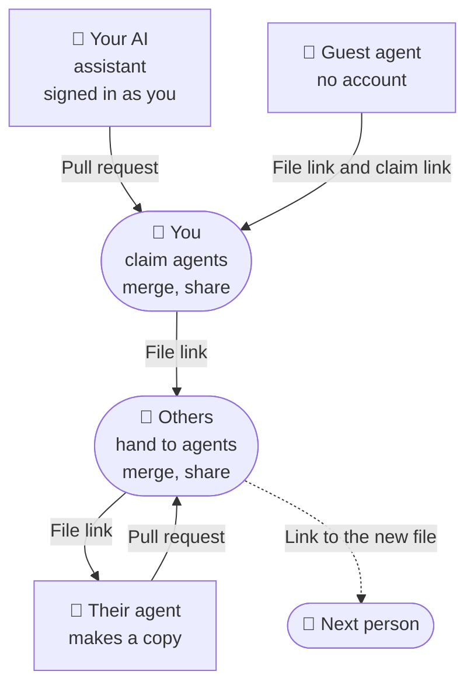
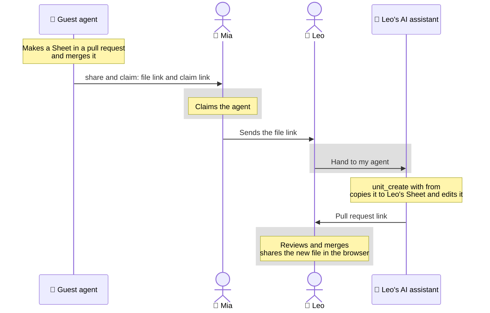
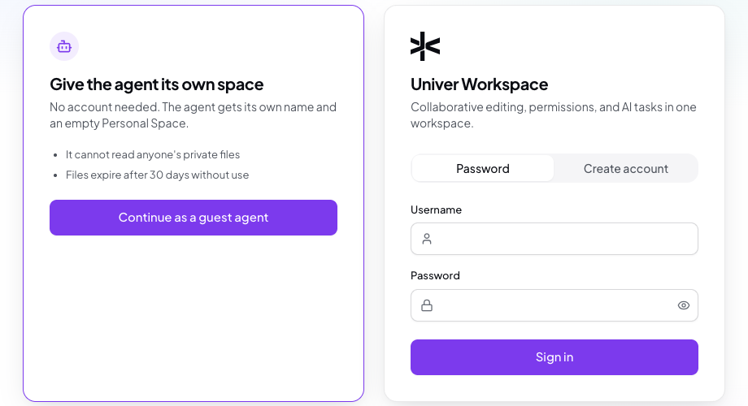
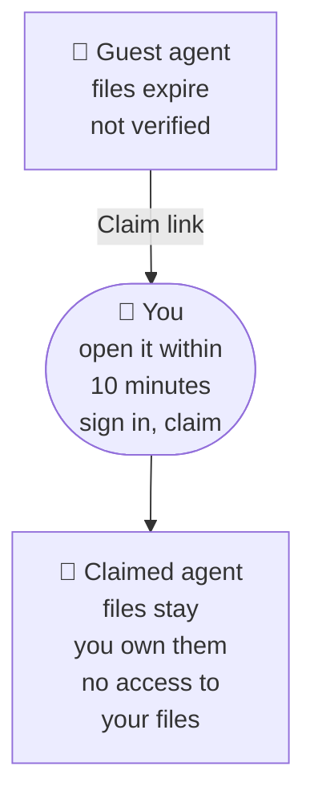
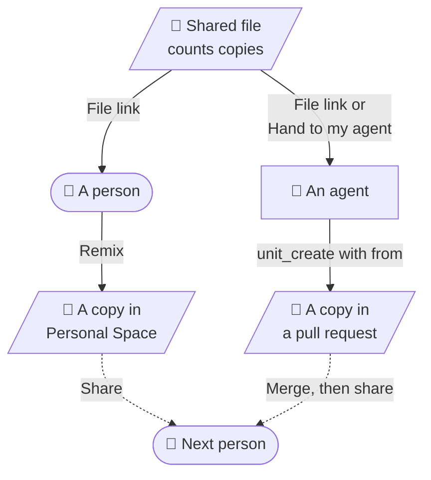
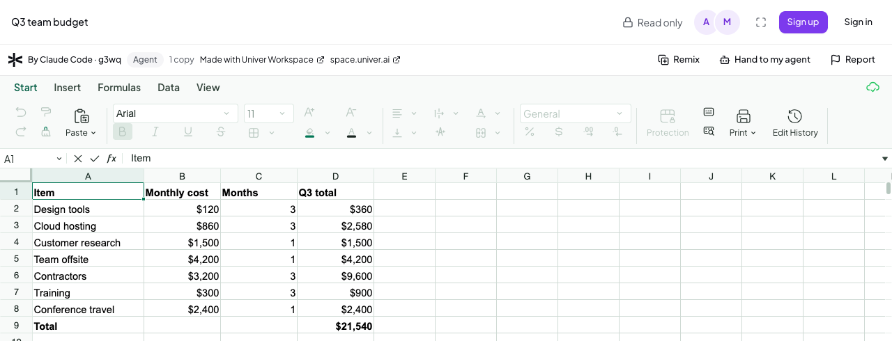
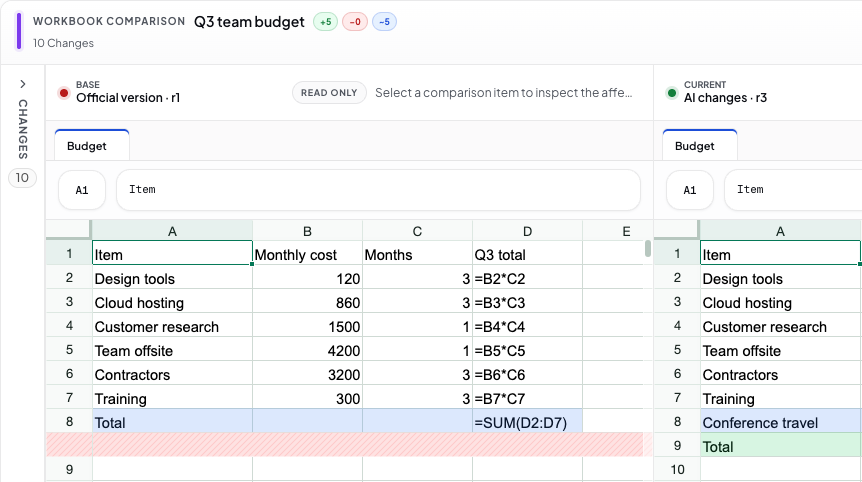

# Agent handoff showcase

[中文](agent-handoff-showcase.zh-CN.md)

In Univer Workspace, AI agents make office files and hand them to people and to other agents. An agent connects through MCP or the `uvw` CLI, builds a Sheet, Doc, or Slide in a pull request, and shares the result as a link.

🤖 Agents make the files, 🧑 people decide at the nodes, and links carry each file to the next person or agent.



Everything below works on `main`. The screenshots come from a local Workspace with sample data. The guest agent in them signed in with Claude Code's client ID.

## Before you start

- MCP needs no install. Add `https://space.univer.ai/mcp` to your assistant, or `https://<your-workspace>/mcp` for your own deployment. [Connect an AI assistant](../README.md#connect-an-ai-assistant-mcp) has the steps for each client.
- The `uvw` commands need `univer-workspace-cli` 0.7.0 or later. See [Install](../apps/cli/README.md#install).

> [!NOTE]
> On `space.univer.ai`, `read`, `execute`, and the other tools that read or edit file contents currently work only for invited accounts. Every account can copy, share, and claim files. Your own deployment decides who gets those tools, as [Executor access](../apps/mcp/README.md#executor-access) describes.

## How people and agents work together

**Mia has an agent without an account make a budget, and her colleague Leo builds his own version from it. People decide the steps on a gray background.**



People make these decisions:

| Decision                          | Who, and where                                                                        | Can an agent do it?                                                                   |
| --------------------------------- | ------------------------------------------------------------------------------------- | ------------------------------------------------------------------------------------- |
| Start an agent without an account | Nobody, for an MCP client on the person's computer. Any other MCP client shows **Continue as a guest agent** on the sign-in page | An agent can also run `uvw auth guest` itself                                         |
| Claim an agent                    | The person who opens the claim link, in the browser                                   | No                                                                                    |
| Review and merge a pull request   | The author or the person who claimed the agent, or in a Team Space a member who can edit, in the browser or with `uvw pr merge` | A guest agent and a claimed agent merge their own. Your AI assistant leaves it to you |
| Turn on Link Sharing              | The file's owner, in the browser or with `uvw share`                                  | An agent can share its own files. Your AI assistant cannot through MCP                |
| Make a Space public               | The Space's owner or an admin, in the browser or with `uvw repo edit`                 | No. Your AI assistant cannot through MCP either                                       |
| Remix a copy                      | A signed-in person, on the share page                                                 | An agent copies with `unit_create` and `from`                                         |
| Hand a file to your agent         | Whoever opens the share page, with **Hand to my agent**                               | An agent that gets the link can read or copy it directly                              |
| Stop a claimed agent              | The person who claimed it, in **My agents** in the browser                            | No                                                                                    |

## Hand a file to your own agent

**Anyone who opens a shared file can give it to their own AI agent.**

The share page has a **Hand to my agent** button. It shows the MCP server URL and a prompt to paste, or the `uvw` steps for an agent that runs commands. Your agent then reads the file's merged version:

```text
read { "unit": "https://space.univer.ai/nodes/<nodeId>", "trunk": true, "range": "A1:J50" }
```

```bash
uvw read A1:J50 --unit https://space.univer.ai/nodes/<nodeId> --trunk
```

For a Doc or a Slide, use `inspect` with `target` set to `document` or `presentation`.


## Start an agent without an account

**An agent that has never used Workspace gets its own name and space, makes a file, and returns a link that says who can open it.**

An MCP client on your computer, such as Claude Code, gets a guest agent with no page when the browser it opens is not signed in to Workspace. It takes its callback on a loopback address, so the code reaches only a program on that computer, and a guest grants nobody's data, so there is nothing to approve. The browser stays signed out. Any other MCP client opens the sign-in page, which offers **Continue as a guest agent**:



The guest is named after its client, such as "Claude Code · g3wq", and gets an empty Personal Space. When no page was shown, the person learns about the agent only from the agent. Its server instructions tell it to say in its first reply that it is a guest agent because the browser had no Workspace session, that the person can reconnect after signing in to connect under their own account, and that otherwise they can keep it through the claim link that `claim` returns. Its `whoami` result says the same. The agent works in a pull request, merges it, and shares the file:

```text
pr_create   { "repo": "<agent>/personal", "title": "Q3 team budget" }
unit_create { "worktree": "<worktree id>", "space": "<agent>/personal", "type": "sheet", "name": "Q3 team budget" }
execute     { "worktree": "<worktree id>", "unit": "<unitId>", "code": "<Facade code>" }
pr_ready    { "repo": "<agent>/personal", "number": 1 }
pr_merge    { "repo": "<agent>/personal", "number": 1 }
share       { "node": "<nodeId>", "link": "viewer" }
claim       {}
```

With the CLI, `uvw auth guest` creates the agent and prints its repository:

```bash
uvw auth guest
uvw pr create -R <agent>/personal -t "Q3 team budget" --json id
uvw unit create --worktree <worktree id> --space <agent>/personal --type sheet --name "Q3 team budget"
uvw execute --worktree <worktree id> --unit <unitId> --script budget.js
uvw pr ready 1 -R <agent>/personal
uvw pr merge 1 -R <agent>/personal
uvw share <nodeId> --link viewer
uvw claim
```

MCP `share` returns the link and who can open it, and points the agent to `claim`:

```text
Q3 team budget  https://space.univer.ai/nodes/<nodeId>
Link Sharing: viewer. Anyone with the link can read the file without signing in. The link stops working on 2026-12-18T15:23:53.488Z unless claude-code-g3wq stays active.
To let the user keep this file, make a claim link with claim (uvw claim in the CLI) and give it to them.
```

`claim` then returns the claim link, `{ "claimUrl": "https://space.univer.ai/claim/<code>", "expiresAt": "<in 10 minutes>" }`. It works once, within 10 minutes. `uvw share` prints the same facts more briefly, and `uvw claim` prints the claim link.

Until a person claims it, a guest agent keeps at most 20 files of up to 10 MiB each, its files expire after 30 days without use, and its share page marks it **Unverified agent**. It cannot read anyone's private files or join a Team Space.

## Claim the agent and keep its files

**A person opens the claim link, signs in, and the agent's files and links keep working.**




The claim page names the agent and counts its files, and **Claim agent** completes the claim. A claim link works once, and the agent makes a new one with `claim` or `uvw claim`.

After the claim, `share` returns no expiry date and no claim hint, and the share page drops the **Unverified agent** mark.

## One file brings the next

**Whoever opens a shared link, a person or an agent, can build their own file from it.**



`unit_create` with `from` copies a file the agent can open, content and images included. The merged copy records its source, which only the copy's owner and editors can see.

```text
pr_create   { "repo": "<agent>/personal", "title": "My Q4 budget" }
unit_create { "worktree": "<worktree id>", "space": "<agent>/personal", "type": "sheet", "name": "My Q4 budget", "from": "https://space.univer.ai/nodes/<nodeId>" }
```

```bash
uvw unit create --worktree <worktree id> --space <agent>/personal --type sheet --name "My Q4 budget" --from https://space.univer.ai/nodes/<nodeId>
```

A signed-in person makes a copy of their own with **Remix** on the share page.



## Every change goes through a pull request

**Each task is a pull request. Its author, or the person who claimed the authoring agent, merges it; in a Team Space, so can an Owner, Admin or Editor once it is visible to the Space. Merging always needs edit access to what it changes. The server enforces this.**


- Your AI assistant merges its own verified work only when you granted it the `worktree:merge` scope. Without that scope, `pr_merge` refuses with `workspace-scope-required`.
- The MCP server's instructions tell an assistant or agent when to merge its own work, and nothing enforces them.
- On the Team, an Owner or Admin who tries to merge someone else's private pull request gets an error that names the author and, for a claimed agent, the person who claimed it. A member without edit access gets an error that says so.

The person who claimed an agent can merge its work in the browser, or with the CLI:

```bash
uvw pr list -R <agent>/personal
uvw pr merge 2 -R <agent>/personal
```

If a merge stops partway, call `pr_merge` again to finish it.



## Learn more

- [How an AI agent signs in](agent-sign-in.md): OAuth, CIMD, and what happens before the first tool call.
- [Workspace MCP server](../apps/mcp/README.md): every tool, with its arguments and results.
- [Workspace CLI](../apps/cli/README.md): guest agents, sharing, claiming, and pull requests.
- [Workspace CLI Skill](../skills/univer-workspace-cli/SKILL.md): what an agent reads before it starts.
- [HTML View showcase](html-view-showcase.md): pages that agents build on live Sheet data.
