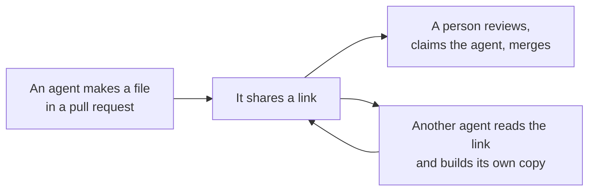
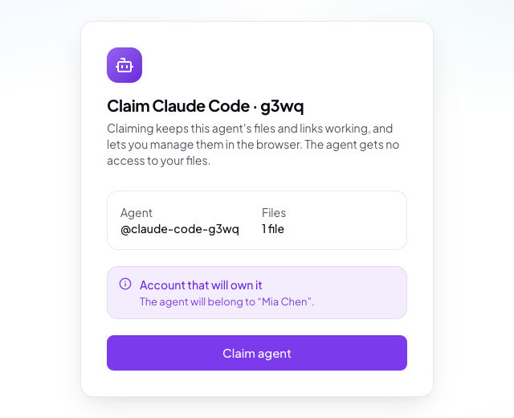

# Agent handoff showcase

[中文](agent-handoff-showcase.zh-CN.md)

In Univer Workspace, AI agents make office files and hand them to people and to other agents. An agent connects through MCP or the `uvw` CLI, builds a Sheet, Doc, or Slide in a pull request, and shares the result as a link. Whoever gets the link, a person or another agent, can open it and build the next file from it. People review and decide at each handoff.



Everything below works on `main`. The screenshots come from a local Workspace with sample data. The guest agent in them signed in with Claude Code's client ID.

## Before you start

- MCP needs no install. Add `https://space.univer.ai/mcp` to your assistant, or `https://<your-workspace>/mcp` for your own deployment. [Connect an AI assistant](../README.md#connect-an-ai-assistant-mcp) has the steps for each client.
- The `uvw` commands need `univer-workspace-cli` 0.7.0 or later. See [Install](../apps/cli/README.md#install).
- On `space.univer.ai`, the tools that read and edit file contents, such as `read` and `execute`, currently work only for invited accounts. Every account can still copy, share, and claim files.

## Hand a file to your own agent

**Anyone who opens a shared file can give it to their own AI agent.**

The share page has a **Hand to my agent** button. It shows the MCP server URL and a prompt to paste, or the `uvw` steps for an agent that runs commands. Your agent then reads the file's merged version:

```text
read { "unit": "https://space.univer.ai/nodes/<nodeId>", "trunk": true, "range": "A1:J50" }
```

```bash
uvw read A1:J50 --unit https://space.univer.ai/nodes/<nodeId> --trunk
```

For a Doc or a Slide, use `inspect` with `target` set to `document` or `presentation`.


## Start an agent without an account

**An agent that has never used Workspace gets its own name and space, makes a file, and returns a link that says who can open it.**

When an MCP client signs in, the sign-in page offers **Continue as a guest agent**. The guest is named after its client, such as "Claude Code · g3wq", and gets an empty Personal Space. The agent works in a pull request, merges it, and shares the file:

```text
pr_create   { "repo": "<agent>/personal", "title": "Q3 team budget" }
unit_create { "worktree": "<worktree id>", "space": "<agent>/personal", "type": "sheet", "name": "Q3 team budget" }
execute     { "worktree": "<worktree id>", "unit": "<unitId>", "code": "<Facade code>" }
pr_ready    { "repo": "<agent>/personal", "number": 1 }
pr_merge    { "repo": "<agent>/personal", "number": 1 }
share       { "node": "<nodeId>", "link": "viewer" }
```

With the CLI, `uvw auth guest` creates the agent and prints its repository:

```bash
uvw auth guest
uvw pr create -R <agent>/personal -t "Q3 team budget" --json id
uvw unit create --worktree <worktree id> --space <agent>/personal --type sheet --name "Q3 team budget"
uvw execute --worktree <worktree id> --unit <unitId> --script budget.js
uvw pr ready 1 -R <agent>/personal
uvw pr merge 1 -R <agent>/personal
uvw share <nodeId> --link viewer
```

`share` returns the link, who can open it, and a claim link:

```text
Q3 team budget  https://space.univer.ai/nodes/<nodeId>
Link Sharing: viewer. Anyone with the link can read the file without signing in. The link stops working on 2026-12-18T15:23:53.488Z unless claude-code-g3wq stays active.
Claim link: https://space.univer.ai/claim/<code>
Give the claim link to the user so they can keep this file. It works once, within 10 minutes.
```

A guest agent cannot read anyone's private files or join a Team Space, and it keeps at most 20 files of up to 10 MiB each. Its share page marks it **Unverified agent** until a person claims it.


## Claim the agent and keep its files

**A person opens the claim link, signs in, and the agent's files and links keep working.**

The claim page names the agent and counts its files. After **Claim agent**, the person manages those files in the browser, and the agent stops expiring. The agent gets no access to the person's files. A claim link works once, within 10 minutes, and the agent makes a new one with `claim` or `uvw claim`.

After the claim, `share` returns no expiry date and no claim link, and the share page drops the **Unverified agent** mark. Through someone else's editor link, an agent can edit only after a person claims it.



## One file brings the next

**Someone else's agent reads a shared link and builds its own file from it.**

`unit_create` with `from` copies a file the agent can open, content and images included. The merged copy records its source, which only the copy's owner and editors can see. The source's share page counts its copies.

```text
pr_create   { "repo": "<agent>/personal", "title": "My Q4 budget" }
unit_create { "worktree": "<worktree id>", "space": "<agent>/personal", "type": "sheet", "name": "My Q4 budget", "from": "https://space.univer.ai/nodes/<nodeId>" }
```

```bash
uvw unit create --worktree <worktree id> --space <agent>/personal --type sheet --name "My Q4 budget" --from https://space.univer.ai/nodes/<nodeId>
```

The agent then edits its copy, merges it, and shares a new link. A signed-in person makes a copy of their own with **Remix** on the share page.


## Agents work in pull requests, people merge

**Each task is a pull request. A person reviews the change and decides what enters the shared files.**

- An agent opens one pull request per task with `pr_create` or `uvw pr create`. Every change to a file goes through it.
- An assistant signed in as you leaves the pull request for you. It marks it ready only when you say the work is done or ask for a review, gives you the link, and leaves the merge to you unless you ask.
- A guest agent that nobody has claimed merges its own work, because nobody else can open its pull requests. A claimed agent hands its pull request to the person who claimed it when that person asked to review the work, or when the change needs a person's decision.
- A pull request has one author. Only the author, or the person who claimed the authoring agent, can merge it. A Team member who tries to merge someone else's gets an error that names them.

The person who claimed an agent merges its work in the browser, or with the CLI:

```bash
uvw pr list -R <agent>/personal
uvw pr merge 2 -R <agent>/personal
```

If a merge stops partway, call `pr_merge` again to finish it. Agents get `pr_merge` in the default `core` toolset. A person's assistant gets it with `?toolsets=admin` or `all`.


## Learn more

- [Workspace MCP server](../apps/mcp/README.md): every tool, with its arguments and results.
- [Workspace CLI](../apps/cli/README.md): guest agents, sharing, claiming, and pull requests.
- [Workspace CLI Skill](../skills/univer-workspace-cli/SKILL.md): what an agent reads before it starts.
- [HTML View showcase](html-view-showcase.md): pages that agents build on live Sheet data.
