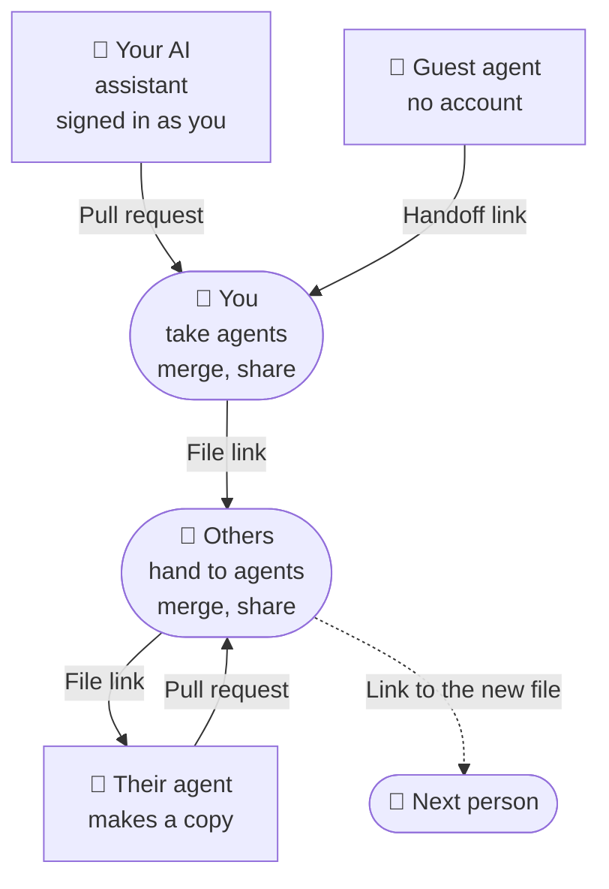
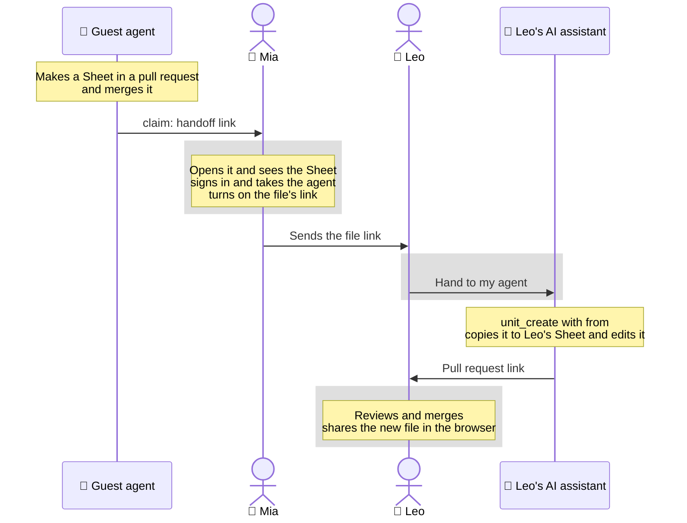
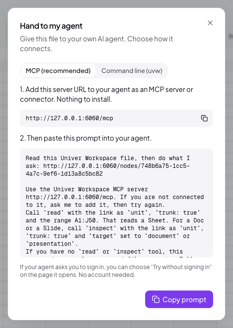
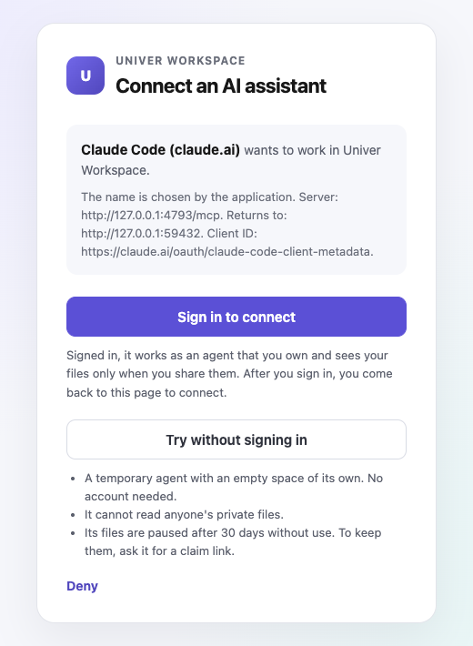
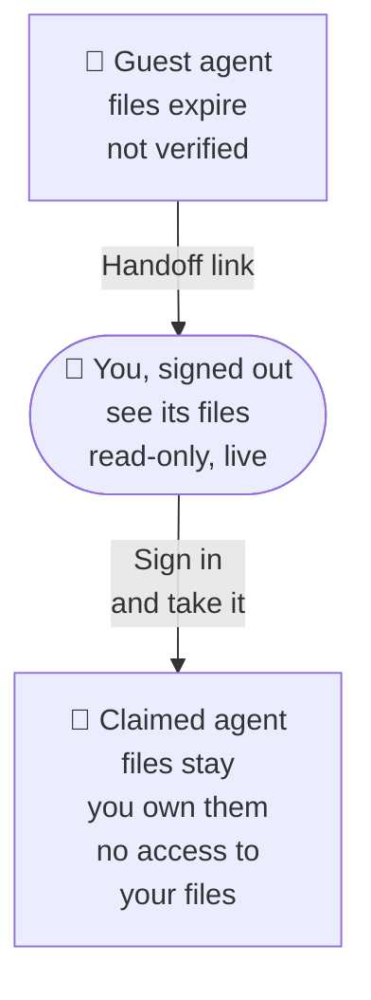
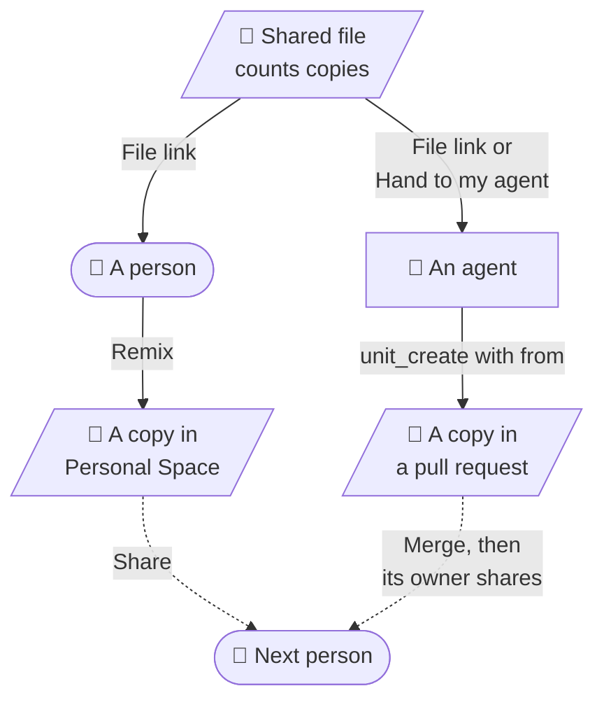
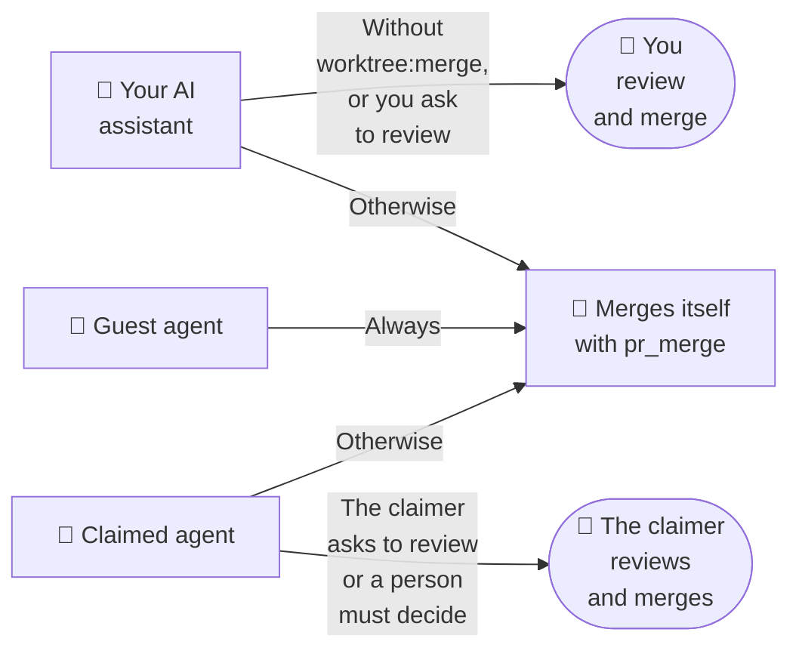

# Agent handoff showcase

[中文](agent-handoff-showcase.zh-CN.md)

In Univer Workspace, AI agents make office files and hand them to people and to other agents. An agent connects through MCP or the `uvw` CLI, builds a Sheet, Doc, or Slide in a pull request, and hands the result over as a link.

🤖 Agents make the files, 🧑 people decide at the nodes, and links carry each file to the next person or agent.



Everything below works on `main`. The screenshots come from a local Workspace with sample data. The guest agent in them signed in with Claude Code's client ID, except on the handoff page, where `uvw auth guest --label "Claude Code"` made it.

## Before you start

- MCP needs no install. Add `https://space.univer.ai/mcp` to your assistant, or `https://<your-workspace>/mcp` for your own deployment. [Connect an AI assistant](../README.md#connect-an-ai-assistant-mcp) has the steps for each client.
- When you are signed in, the connect page's main button connects the assistant as an agent that you own: the one it used before, or a new one. It starts claimed, so it works like the claimed agents on this page. **Connect as myself** connects it as you. This page calls that connection your AI assistant.
- The `uvw` commands need `univer-workspace-cli` 0.7.0 or later. See [Install](../apps/cli/README.md#install).

> [!NOTE]
> On `space.univer.ai`, `read`, `execute`, and the other tools that read or edit file contents currently work only for invited accounts. Every account can copy, share, and claim files. Your own deployment decides who gets those tools, as [Executor access](../apps/mcp/README.md#executor-access) describes.

## How people and agents work together

**Mia has an agent without an account make a budget, and her colleague Leo builds his own version from it. People decide the steps on a gray background.**



People make these decisions:

| Decision                          | Who, and where                                                                        | Can an agent do it?                                                                   |
| --------------------------------- | ------------------------------------------------------------------------------------- | ------------------------------------------------------------------------------------- |
| Start an agent without an account | The person who clicks **Try without signing in** on the connect page, in the browser | An agent can also run `uvw auth guest` itself                                         |
| Take an agent                     | The person who opens its handoff link and signs in, in the browser                    | No                                                                                    |
| Review and merge a pull request   | The author or the person who claimed the agent, or in a Team Space a member who can edit, in the browser or with `uvw pr merge` | A guest agent and a claimed agent merge their own. Your AI assistant leaves it to you |
| Turn on Link Sharing              | The file's owner, in the browser. `uvw share` and `share` return a confirm link to open there | No. A claimed agent and your AI assistant give you the confirm link. A guest agent gives its handoff link instead |
| Make a Space public               | The Space's owner or an admin, in the browser or with `uvw repo edit`                 | No. Your AI assistant cannot through MCP either                                       |
| Remix a copy                      | A signed-in person, on the share page                                                 | An agent copies with `unit_create` and `from`                                         |
| Hand a file to your agent         | Whoever opens the share page, with **Hand to my agent**                               | An agent that gets the link can read or copy it directly                              |
| Stop a claimed agent              | The person who claimed it, in **My agents** in the browser                            | No                                                                                    |

## Hand a file to your own agent

**Anyone who opens a shared file can give it to their own AI agent.**

The share page has a **Hand to my agent** button. It shows the MCP server URL and a prompt to paste, or the `uvw` steps for an agent that runs commands. Your agent then reads the file's merged version:

```text
read { "unit": "https://space.univer.ai/nodes/<nodeId>", "trunk": true, "range": "A1:J50" }
```

```bash
uvw read A1:J50 --unit https://space.univer.ai/nodes/<nodeId> --trunk
```

For a Doc or a Slide, use `inspect` with `target` set to `document` or `presentation`.



## Start an agent without an account

**An agent that has never used Workspace gets its own name and space, makes a file, and returns one link that shows its work.**

When the browser an MCP client opens is not signed in to Workspace, the connect page offers **Sign in to connect** and **Try without signing in**. The second one gives the client a guest agent, and the browser stays signed out:



The guest is named after its client, such as "Claude Code · g3wq", and gets an empty Personal Space. Its server instructions and its `whoami` result tell it that it is a temporary agent and that, when it is done, it gives the user a handoff link from `claim`. `whoami` carries this for clients that never show the model the server instructions. The agent works in a pull request, merges it, and makes its handoff link:

```text
pr_create   { "repo": "<agent>/personal", "title": "Q3 team budget" }
unit_create { "worktree": "<worktree id>", "space": "<agent>/personal", "type": "sheet", "name": "Q3 team budget" }
execute     { "worktree": "<worktree id>", "unit": "<unitId>", "code": "<Facade code>" }
pr_ready    { "repo": "<agent>/personal", "number": 1 }
pr_merge    { "repo": "<agent>/personal", "number": 1 }
claim       {}
```

With the CLI, `uvw auth guest` creates the agent and prints its repository:

```bash
uvw auth guest
uvw pr create -R <agent>/personal -t "Q3 team budget" --json id
uvw unit create --worktree <worktree id> --space <agent>/personal --type sheet --name "Q3 team budget"
uvw execute --worktree <worktree id> --unit <unitId> --script budget.js
uvw pr ready 1 -R <agent>/personal
uvw pr merge 1 -R <agent>/personal
uvw claim
```

`claim` returns the handoff link, `{ "claimUrl": "https://space.univer.ai/claim/<code>", "expiresAt": "<in 7 days>" }`, and `uvw claim` prints it. The link works for 7 days, or until a person takes the agent, so the agent gives the same link again and makes a new one only when it is lost or has expired.

The handoff link is the one way a guest agent shows its work. It cannot turn on Link Sharing, make a repository public or add members: the server refuses, and tells it to give the user the handoff link.

Until a person takes it, a guest agent keeps at most 20 files of up to 10 MiB each, its files expire after 30 days without use, and its files are marked **Unverified agent**. It cannot read anyone's private files or join a Team Space.

## See the agent's work, then take the agent

**Whoever opens the handoff link sees the agent's work at once, read-only and live, without signing in. A person signs in there to take the agent and keep its files.**




The handoff page names the agent and lists the Spaces it owns with their files. Without signing in, you open any of them read-only, private repositories included, and an HTML View among them reads its Sheet data live. The browser keeps this preview for as long as the link works: 7 days, or until a person takes the agent.

**Sign in and take it** signs you in and comes back to the page, and **Take it** makes you the agent's owner. The page then opens where the agent's work is: the one Team repository or Personal Space that holds it, or, when its work is in more than one of them, the repository list filtered to the agent. Once you are signed in, the page shows the summary only, and you open the files after you take the agent.

After that, the link shows nothing to anyone else: it says that the agent has an owner. The agent's files stop expiring and lose the **Unverified agent** mark, and you turn on Link Sharing in the browser for a file you want to send on.

## One file brings the next

**Whoever opens a shared link, a person or an agent, can build their own file from it.**



`unit_create` with `from` copies a file the agent can open, content and images included. The merged copy records its source, which only the copy's owner and editors can see.

```text
pr_create   { "repo": "<agent>/personal", "title": "My Q4 budget" }
unit_create { "worktree": "<worktree id>", "space": "<agent>/personal", "type": "sheet", "name": "My Q4 budget", "from": "https://space.univer.ai/nodes/<nodeId>" }
```

```bash
uvw unit create --worktree <worktree id> --space <agent>/personal --type sheet --name "My Q4 budget" --from https://space.univer.ai/nodes/<nodeId>
```

A signed-in person makes a copy of their own with **Remix** on the share page.


## Every change goes through a pull request

**Each task is a pull request. Its author, or the person who claimed the authoring agent, merges it; in a Team Space, so can an Owner, Admin or Editor once it is visible to the Space. Merging always needs edit access to what it changes. The server enforces this.**



- Your AI assistant merges its own verified work only when you granted it the `worktree:merge` scope. Without that scope, `pr_merge` refuses with `workspace-scope-required`.
- The MCP server's instructions tell an assistant or agent when to merge its own work, and nothing enforces them.
- On the Team, an Owner or Admin who tries to merge someone else's private pull request gets an error that names the author and, for a claimed agent, the person who claimed it. A member without edit access gets an error that says so.

The person who claimed an agent can merge its work in the browser, or with the CLI:

```bash
uvw pr list -R <agent>/personal
uvw pr merge 2 -R <agent>/personal
```

If a merge stops partway, call `pr_merge` again to finish it.


## Learn more

- [How an AI agent signs in](agent-sign-in.md): OAuth, CIMD, and what happens before the first tool call.
- [Workspace MCP server](../apps/mcp/README.md): every tool, with its arguments and results.
- [Workspace CLI](../apps/cli/README.md): guest agents, handoff links, sharing, and pull requests.
- [Workspace CLI Skill](../skills/univer-workspace-cli/SKILL.md): what an agent reads before it starts.
- [HTML View showcase](html-view-showcase.md): pages that agents build on live Sheet data.
