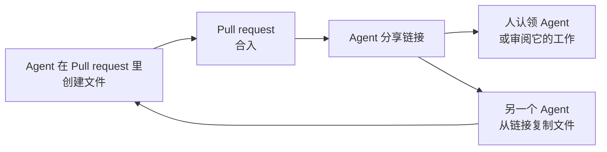
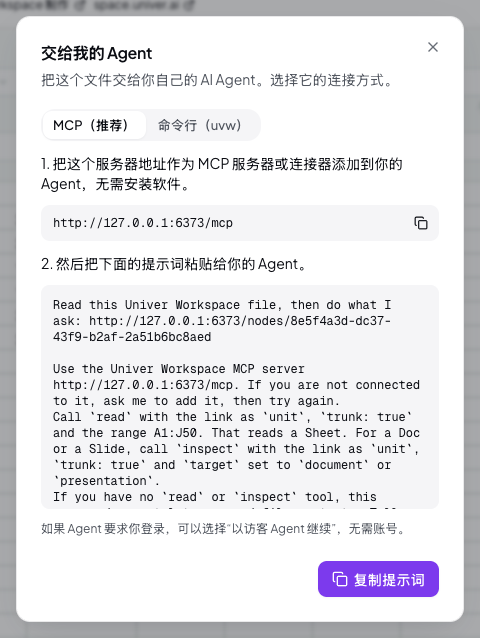
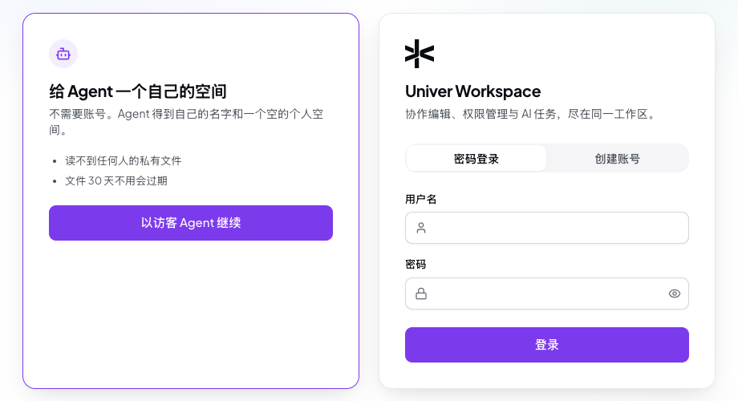
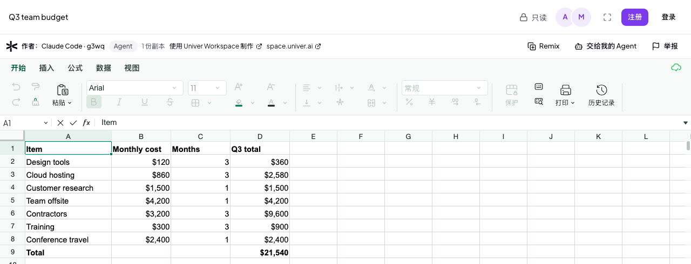

# Agent 交接效果展示

[English](agent-handoff-showcase.md)

在 Univer Workspace 里，AI Agent 制作 office 文件，再交给人和其他 Agent。Agent 通过 MCP 或 `uvw` CLI 接入，在 Pull request 里创建 Sheet、Doc 或 Slide，再用链接分享结果。拿到链接的人或另一个 Agent 都能打开它，并以它为基础做出下一个文件。文件交到人手里时，由人审阅和决策。



下面的内容都已在 `main` 上可用。截图来自一个带示例数据的本地 Workspace，图中的访客 Agent 用 Claude Code 的客户端 ID 登录。

## 开始之前

- MCP 无需安装。把 `https://space.univer.ai/mcp` 添加到你的 AI 助手，自己部署时用 `https://<你的 Workspace>/mcp`。各客户端的步骤见[连接 AI 助手](../README.zh-CN.md#连接-ai-助手mcp)。
- 文中的 `uvw` 命令需要 `univer-workspace-cli` 0.7.0 或更高版本，安装方法见 [Install](../apps/cli/README.md#install)（英文）。

> [!NOTE]
> 在 `space.univer.ai` 上，`read`、`execute` 等读取或编辑文件内容的工具目前只对受邀账号开放。所有账号都可以复制、分享和认领文件。自己部署时由你决定谁能使用这些工具，方法见 [Executor access](../apps/mcp/README.md#executor-access)（英文）。

## 把文件交给你自己的 Agent

**任何打开分享文件的人，都能把它交给自己的 AI Agent。**

分享页上有 **交给我的 Agent** 按钮。它给出 MCP 服务器地址和一段可粘贴的提示词。对能运行命令的 Agent，也可以改用 `uvw` 的步骤。随后你的 Agent 读取这个文件已合入的版本：

```text
read { "unit": "https://space.univer.ai/nodes/<nodeId>", "trunk": true, "range": "A1:J50" }
```

```bash
uvw read A1:J50 --unit https://space.univer.ai/nodes/<nodeId> --trunk
```

Doc 或 Slide 用 `inspect`，并把 `target` 设为 `document` 或 `presentation`。



## 没有账号的 Agent 也能开始工作

**从未用过 Workspace 的 Agent 得到自己的名字和空间，创建文件，并返回一个说明谁能打开的链接。**



MCP 客户端登录时，登录页提供 **以访客 Agent 继续**。访客 Agent 以客户端命名，例如 "Claude Code · g3wq"，并得到一个空的个人空间。Agent 在 Pull request 里工作，合入后分享文件：

```text
pr_create   { "repo": "<agent>/personal", "title": "Q3 team budget" }
unit_create { "worktree": "<worktree id>", "space": "<agent>/personal", "type": "sheet", "name": "Q3 team budget" }
execute     { "worktree": "<worktree id>", "unit": "<unitId>", "code": "<Facade code>" }
pr_ready    { "repo": "<agent>/personal", "number": 1 }
pr_merge    { "repo": "<agent>/personal", "number": 1 }
share       { "node": "<nodeId>", "link": "viewer" }
```

用 CLI 时，`uvw auth guest` 创建 Agent 并打印它的仓库：

```bash
uvw auth guest
uvw pr create -R <agent>/personal -t "Q3 team budget" --json id
uvw unit create --worktree <worktree id> --space <agent>/personal --type sheet --name "Q3 team budget"
uvw execute --worktree <worktree id> --unit <unitId> --script budget.js
uvw pr ready 1 -R <agent>/personal
uvw pr merge 1 -R <agent>/personal
uvw share <nodeId> --link viewer
```

MCP 的 `share` 返回链接、谁能打开它，以及一个认领链接：

```text
Q3 team budget  https://space.univer.ai/nodes/<nodeId>
Link Sharing: viewer. Anyone with the link can read the file without signing in. The link stops working on 2026-12-18T15:23:53.488Z unless claude-code-g3wq stays active.
Claim link: https://space.univer.ai/claim/<code>
Give the claim link to the user so they can keep this file. It works once, within 10 minutes.
```

`uvw share` 0.7.0 打印同样的信息，措辞更简短。

在有人认领之前，访客 Agent 最多保留 20 个文件，每个不超过 10 MiB，文件 30 天不用会过期，分享页也会把它标为 **未验证的 Agent**。它读不到任何人的私有文件，也不能加入团队空间。

## 认领 Agent，保留它的文件

**人打开认领链接并登录，Agent 的文件和链接就会一直有效。**


认领页显示 Agent 的名字和文件数。点 **认领 Agent** 后，这个人可以在浏览器里管理这些文件，这些文件也不再过期。Agent 不会获得这个人文件的任何权限。认领链接只能用一次，10 分钟内有效。Agent 可以用 `claim` 或 `uvw claim` 重新生成。

认领之后，`share` 不再返回过期日期和认领链接，分享页也去掉 **未验证的 Agent** 标记。

## 一个文件带来下一个

**别人的 Agent 读取分享链接，并以它为基础制作自己的文件。**

`unit_create` 带上 `from`，就会复制一个 Agent 能打开的文件，内容和图片一并复制。合入后的副本会记录来源，只有副本的所有者和编辑者能看到。来源文件的分享页会显示副本数。

```text
pr_create   { "repo": "<agent>/personal", "title": "My Q4 budget" }
unit_create { "worktree": "<worktree id>", "space": "<agent>/personal", "type": "sheet", "name": "My Q4 budget", "from": "https://space.univer.ai/nodes/<nodeId>" }
```

```bash
uvw unit create --worktree <worktree id> --space <agent>/personal --type sheet --name "My Q4 budget" --from https://space.univer.ai/nodes/<nodeId>
```

接着 Agent 修改自己的副本，合入后分享一个新链接。已登录的人可以在分享页点 **Remix**，做一份自己的副本。



## 每次改动都经过 Pull request

**每个任务是一个 Pull request。只有作者，或认领了作者 Agent 的人，能合入它。服务端强制执行这条规则。**

- 你自己的 AI 助手把 Pull request 链接交给你，合入留给你。除非你加上 `?toolsets=admin` 或 `all`，它没有 `pr_merge`。
- 没人认领的访客 Agent 自己合入。已认领的 Agent 也自己合入，除非认领人要求审阅，或改动需要人来决定。这是 MCP 服务给 Agent 的指示，没有机制强制执行。
- 团队里的其他人试图合入时，会收到一条写明作者的错误。作者是已认领的 Agent 时，错误里还会写明认领人。

认领了 Agent 的人可以在浏览器里合入它的工作，也可以用 CLI：

```bash
uvw pr list -R <agent>/personal
uvw pr merge 2 -R <agent>/personal
```

合入中途停下时，再调用一次 `pr_merge` 即可完成。


## 了解更多

- [Workspace MCP 服务](../apps/mcp/README.md)：所有工具及其参数和结果（英文）。
- [Workspace CLI](../apps/cli/README.md)：访客 Agent、分享、认领和 Pull request（英文）。
- [Workspace CLI Skill](../skills/univer-workspace-cli/SKILL.md)：Agent 开始工作前读取的内容（英文）。
- [HTML View 效果展示](html-view-showcase.zh-CN.md)：Agent 基于实时 Sheet 数据构建的页面。
