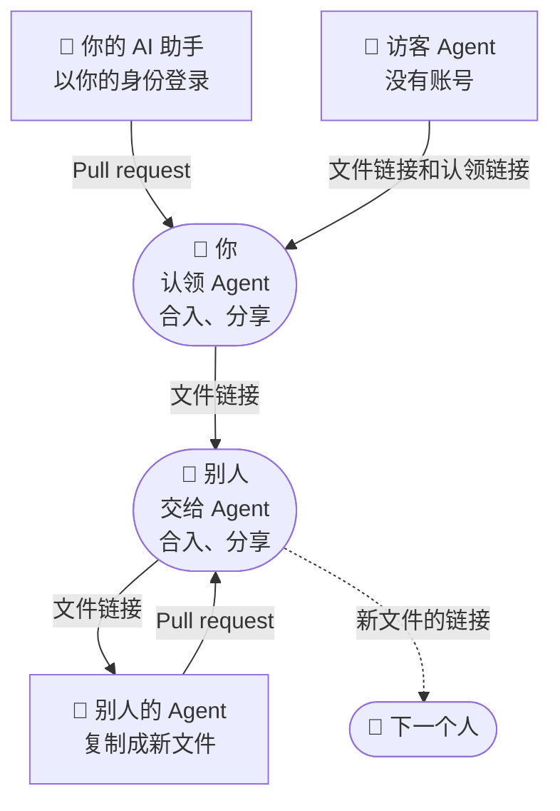
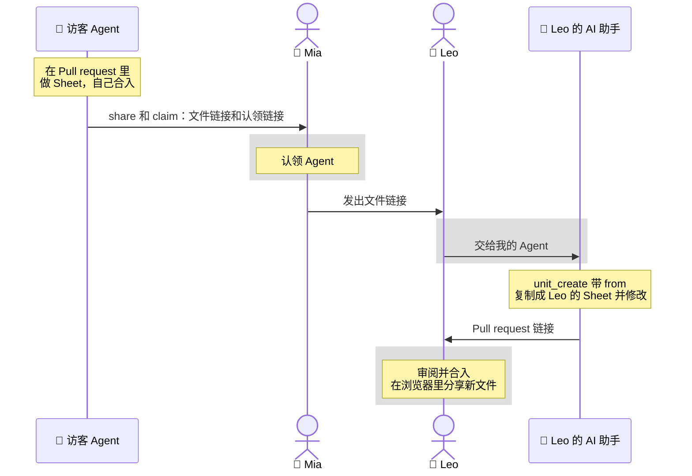
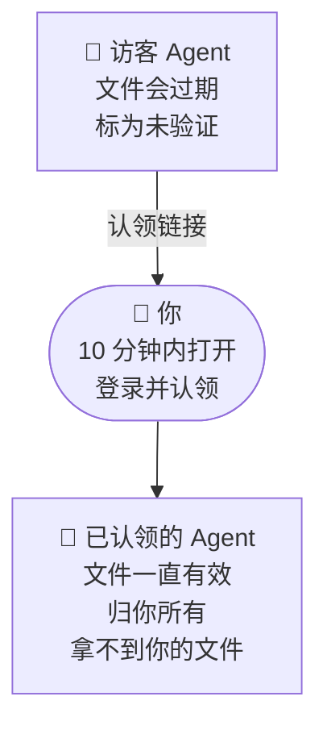
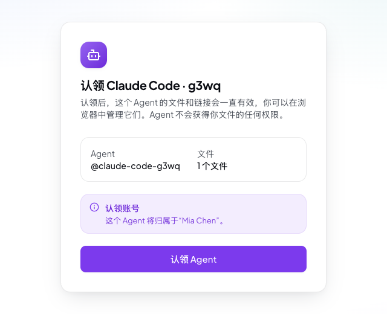
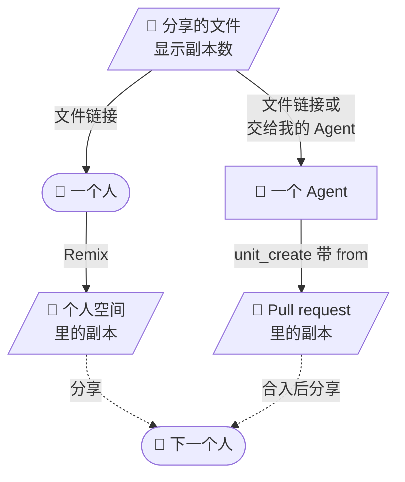
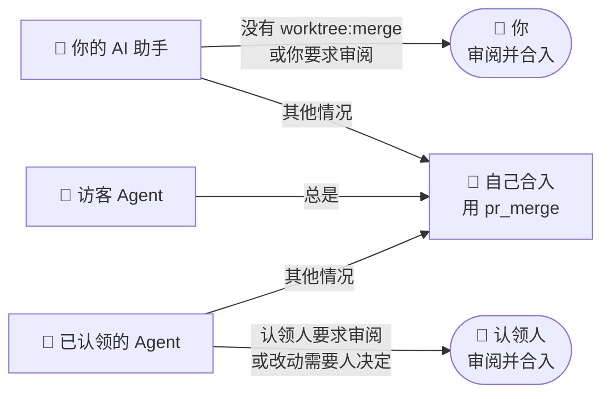
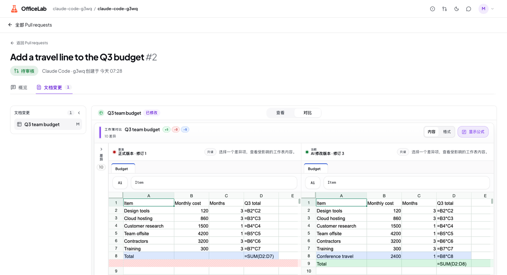

# Agent 交接效果展示

[English](agent-handoff-showcase.md)

在 Univer Workspace 里，AI Agent 制作 office 文件，再交给人和其他 Agent。Agent 通过 MCP 或 `uvw` CLI 接入，在 Pull request 里创建 Sheet、Doc 或 Slide，再用链接分享结果。

🤖 Agent 做文件，🧑 人在节点上做决定，链接把文件带到下一个人或 Agent 手里。



下面的内容都已在 `main` 上可用。截图来自一个带示例数据的本地 Workspace，图中的访客 Agent 用 Claude Code 的客户端 ID 登录。

## 开始之前

- MCP 无需安装。把 `https://space.univer.ai/mcp` 添加到你的 AI 助手，自己部署时用 `https://<你的 Workspace>/mcp`。各客户端的步骤见[连接 AI 助手](../README.zh-CN.md#连接-ai-助手mcp)。
- 你已登录时，同意页默认让助手以一个归你所有的新 Agent 连接。它一开始就是已认领的，和本文里已认领的 Agent 一样工作。选 **Yourself** 则让它以你的身份连接，本文把这种连接叫作你的 AI 助手。
- 文中的 `uvw` 命令需要 `univer-workspace-cli` 0.7.0 或更高版本，安装方法见 [Install](../apps/cli/README.md#install)（英文）。

> [!NOTE]
> 在 `space.univer.ai` 上，`read`、`execute` 等读取或编辑文件内容的工具目前只对受邀账号开放。所有账号都可以复制、分享和认领文件。自己部署时由你决定谁能使用这些工具，方法见 [Executor access](../apps/mcp/README.md#executor-access)（英文）。

## 人和 Agent 怎样协作

**Mia 让一个没有账号的 Agent 做了一份预算，同事 Leo 以它为基础做出自己的版本。灰底的步骤由人决定。**



人在这些地方做决定：

| 决定                    | 谁，在哪里                                           | Agent 能不能做                                             |
| ----------------------- | ---------------------------------------------------- | ---------------------------------------------------------- |
| 让 Agent 不用账号开始   | 人的电脑上的 MCP 客户端不需要任何人。其他 MCP 客户端在登录页显示 **以访客 Agent 继续** | Agent 也可以自己运行 `uvw auth guest`                      |
| 认领 Agent              | 打开认领链接的人，在浏览器里                         | 不能                                                       |
| 审阅并合入 Pull request | 作者或认领人，在 Team Space 里还有能编辑的成员，在浏览器里或用 `uvw pr merge` | 访客 Agent 和已认领的 Agent 合入自己的。你的 AI 助手留给你 |
| 打开链接分享            | 文件的所有者，在浏览器里或用 `uvw share`             | Agent 可以分享自己的文件。你的 AI 助手通过 MCP 不能        |
| 公开一个空间            | 空间的所有者或管理员，在浏览器里或用 `uvw repo edit` | 不能。你的 AI 助手通过 MCP 也不能                          |
| Remix 一份副本          | 已登录的人，在分享页                                 | Agent 用 `unit_create` 带 `from` 复制                      |
| 把文件交给自己的 Agent  | 打开分享页的人，点 **交给我的 Agent**                | 拿到链接的 Agent 可以直接读取或复制                        |
| 停用认领的 Agent        | 认领人，在浏览器的 **我的 Agent** 里                 | 不能                                                       |

## 把文件交给你自己的 Agent

**任何打开分享文件的人，都能把它交给自己的 AI Agent。**

分享页上有 **交给我的 Agent** 按钮。它给出 MCP 服务器地址和一段可粘贴的提示词。对能运行命令的 Agent，也可以改用 `uvw` 的步骤。随后你的 Agent 读取这个文件已合入的版本：

```text
read { "unit": "https://space.univer.ai/nodes/<nodeId>", "trunk": true, "range": "A1:J50" }
```

```bash
uvw read A1:J50 --unit https://space.univer.ai/nodes/<nodeId> --trunk
```

Doc 或 Slide 用 `inspect`，并把 `target` 设为 `document` 或 `presentation`。


## 没有账号的 Agent 也能开始工作

**从未用过 Workspace 的 Agent 得到自己的名字和空间，创建文件，并返回一个说明谁能打开的链接。**

你电脑上的 MCP 客户端（例如 Claude Code）打开的浏览器没有登录 Workspace 时，客户端直接得到一个访客 Agent，没有任何页面。这样的客户端在 loopback 地址上接收回调，授权码只会交给这台电脑上的程序，访客 Agent 又碰不到任何人的数据，所以没有什么需要人批准。浏览器保持未登录。其他 MCP 客户端打开登录页，页面提供 **以访客 Agent 继续**：


访客 Agent 以客户端命名，例如 "Claude Code · g3wq"，并得到一个空的个人空间。没有页面时，人只能从 Agent 那里知道它。服务器说明要求 Agent 在第一次回复里说明：它是访客 Agent，因为浏览器没有 Workspace 会话；登录后重新连接，就能以自己的账号连接；否则可以用 `claim` 返回的认领链接把它留下。它的 `whoami` 结果也写明这些。Agent 在 Pull request 里工作，合入后分享文件：

```text
pr_create   { "repo": "<agent>/personal", "title": "Q3 team budget" }
unit_create { "worktree": "<worktree id>", "space": "<agent>/personal", "type": "sheet", "name": "Q3 team budget" }
execute     { "worktree": "<worktree id>", "unit": "<unitId>", "code": "<Facade code>" }
pr_ready    { "repo": "<agent>/personal", "number": 1 }
pr_merge    { "repo": "<agent>/personal", "number": 1 }
share       { "node": "<nodeId>", "link": "viewer" }
claim       {}
```

用 CLI 时，`uvw auth guest` 创建 Agent 并打印它的仓库：

```bash
uvw auth guest
uvw pr create -R <agent>/personal -t "Q3 team budget" --json id
uvw unit create --worktree <worktree id> --space <agent>/personal --type sheet --name "Q3 team budget"
uvw execute --worktree <worktree id> --unit <unitId> --script budget.js
uvw pr ready 1 -R <agent>/personal
uvw pr merge 1 -R <agent>/personal
uvw share <nodeId> --link viewer
uvw claim
```

MCP 的 `share` 返回链接和谁能打开它，并提示 Agent 调用 `claim`：

```text
Q3 team budget  https://space.univer.ai/nodes/<nodeId>
Link Sharing: viewer. Anyone with the link can read the file without signing in. The link stops working on 2026-12-18T15:23:53.488Z unless claude-code-g3wq stays active.
To let the user keep this file, make a claim link with claim (uvw claim in the CLI) and give it to them.
```

然后 `claim` 返回认领链接，`{ "claimUrl": "https://space.univer.ai/claim/<code>", "expiresAt": "<10 分钟后>" }`，只能用一次，10 分钟内有效。`uvw share` 打印同样的信息，措辞更简短，`uvw claim` 打印认领链接。

在有人认领之前，访客 Agent 最多保留 20 个文件，每个不超过 10 MiB，文件 30 天不用会过期，分享页也会把它标为 **未验证的 Agent**。它读不到任何人的私有文件，也不能加入团队空间。

## 认领 Agent，保留它的文件

**人打开认领链接并登录，Agent 的文件和链接就会一直有效。**





认领页显示 Agent 的名字和文件数，点 **认领 Agent** 完成认领。认领链接只能用一次，Agent 可以用 `claim` 或 `uvw claim` 重新生成。

认领之后，`share` 不再返回过期日期和认领提示，分享页也去掉 **未验证的 Agent** 标记。

## 一个文件带来下一个

**打开分享链接的人或 Agent，都能以它为基础做出自己的文件。**



`unit_create` 带上 `from`，就会复制一个 Agent 能打开的文件，内容和图片一并复制。合入后的副本会记录来源，只有副本的所有者和编辑者能看到。

```text
pr_create   { "repo": "<agent>/personal", "title": "My Q4 budget" }
unit_create { "worktree": "<worktree id>", "space": "<agent>/personal", "type": "sheet", "name": "My Q4 budget", "from": "https://space.univer.ai/nodes/<nodeId>" }
```

```bash
uvw unit create --worktree <worktree id> --space <agent>/personal --type sheet --name "My Q4 budget" --from https://space.univer.ai/nodes/<nodeId>
```

已登录的人可以在分享页点 **Remix**，做一份自己的副本。


## 每次改动都经过 Pull request

**每个任务是一个 Pull request。作者，或认领了作者 Agent 的人，合入它；在 Team Space 里，Pull request 对 Space 可见之后，Owner、Admin 和 Editor 也能合入。合入始终要求对它改动的内容有编辑权限。服务端强制执行这条规则。**



- 只有你授予了 `worktree:merge` scope，你的 AI 助手才会在验证后自己合入。没有这个 scope 时，`pr_merge` 返回 `workspace-scope-required`。
- MCP 服务的指示告诉 AI 助手和 Agent 何时自己合入，没有机制强制执行。
- 团队的 Owner 或 Admin 试图合入别人的私有 Pull request 时，会收到一条写明作者的错误。作者是已认领的 Agent 时，错误里还会写明认领人。没有编辑权限的成员收到的错误会说明缺少编辑权限。

认领了 Agent 的人可以在浏览器里合入它的工作，也可以用 CLI：

```bash
uvw pr list -R <agent>/personal
uvw pr merge 2 -R <agent>/personal
```

合入中途停下时，再调用一次 `pr_merge` 即可完成。



## 了解更多

- [AI agent 如何接入 Workspace](agent-sign-in.zh-CN.md)：OAuth、CIMD，以及第一次调用工具之前发生的事。
- [Workspace MCP 服务](../apps/mcp/README.md)：所有工具及其参数和结果（英文）。
- [Workspace CLI](../apps/cli/README.md)：访客 Agent、分享、认领和 Pull request（英文）。
- [Workspace CLI Skill](../skills/univer-workspace-cli/SKILL.md)：Agent 开始工作前读取的内容（英文）。
- [HTML View 效果展示](html-view-showcase.zh-CN.md)：Agent 基于实时 Sheet 数据构建的页面。
