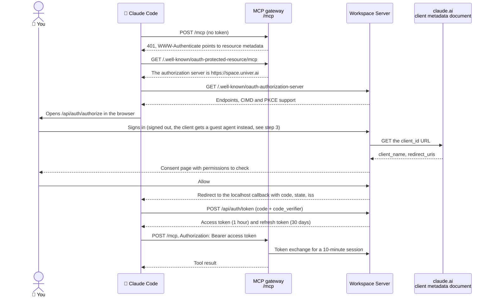
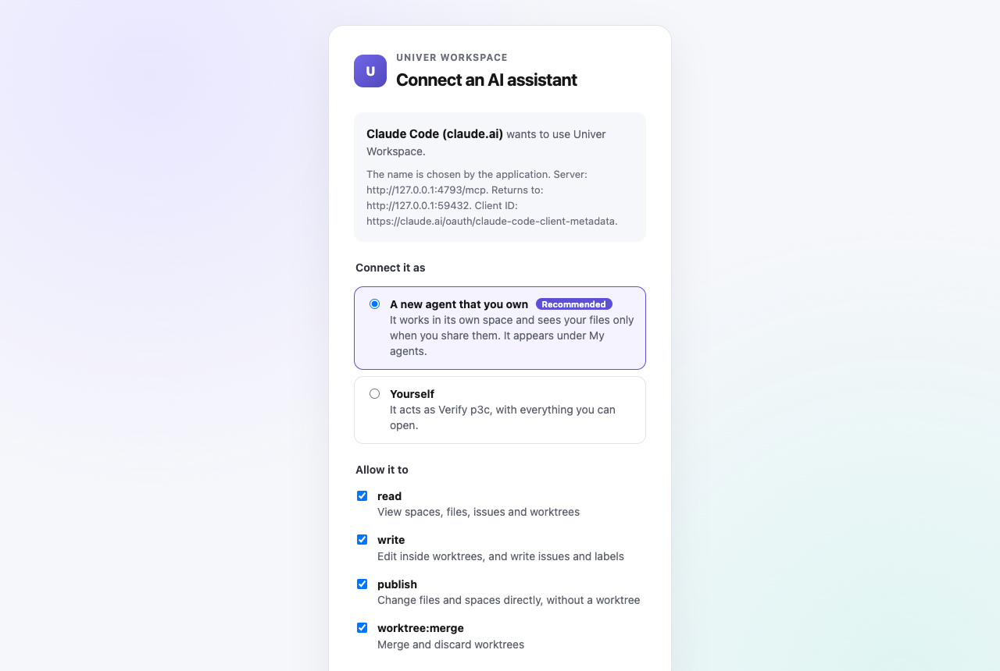

# How an AI agent signs in to Workspace

[中文](agent-sign-in.zh-CN.md)

You type one address into Claude Code, `https://space.univer.ai/mcp`, click **Allow** once in the browser, and the agent can read and edit your files as you. This page explains what happens in between.

The flow is OAuth 2.1 plus a few newer pieces that the MCP authorization spec brings in: resource metadata discovery, Client ID Metadata Documents (CIMD), and token exchange. Ordinary website sign-in rarely uses them, so this page assumes you are seeing them for the first time. Each section says what problem a piece solves, then shows the real request in Workspace.

This page has no setup steps. To connect a client, see [Connect an AI assistant](../README.md#connect-an-ai-assistant-mcp).

## The problem

An agent works on your files for you, so Workspace has to answer three questions:

- Which program is this? Claude Code, or something pretending to be it.
- Whom does it act for? Which Workspace user.
- What may it do? Only read, or also merge pull requests.

One more constraint holds. The agent must never get your password. A password cannot be taken back, and it cannot grant only part of your access.

OAuth solves this by having you deal with Workspace directly in your browser. You sign in and approve, and Workspace gives the agent a token that expires, has a limited scope, and can be revoked. The agent only ever sees that token.

## Four roles

Each OAuth term maps to one Workspace component:

| OAuth term | In Workspace | What it does |
| --- | --- | --- |
| Resource owner | You | Sign in in the browser and choose what to grant |
| Client | An MCP client such as Claude Code, Claude, or VS Code | Starts authorization and calls tools with the token |
| Resource server | The MCP gateway, `https://space.univer.ai/mcp` | Accepts the token and runs tool calls |
| Authorization server | Workspace Server, `https://space.univer.ai` | Runs sign-in and the consent page, issues and revokes tokens |

The gateway and Workspace Server are separate services. The gateway has no database. It reads and writes files through Workspace's HTTP API. The section on the second token exchange depends on this.

## The whole flow

This is Claude Code connecting to `space.univer.ai` for the first time. The sections after it walk through each part.



## Step 1: Find the authorization server from one URL

The client starts out knowing only `https://space.univer.ai/mcp`. It does not know where to sign in or what Workspace supports. So it calls the server without a token, and the gateway answers 401 with a header that says where to look:

```http
HTTP/2 401
www-authenticate: Bearer resource_metadata="https://space.univer.ai/.well-known/oauth-protected-resource/mcp"
```

That address returns protected resource metadata (RFC 9728). It names the server that authorizes this MCP server and the permissions it accepts:

```json
{
  "resource": "https://space.univer.ai/mcp",
  "authorization_servers": ["https://space.univer.ai"],
  "scopes_supported": ["read", "write", "publish", "worktree:merge"],
  "bearer_methods_supported": ["header"]
}
```

The client then reads the authorization server metadata (RFC 8414). This is what `space.univer.ai` returns today:

```json
{
  "issuer": "https://space.univer.ai",
  "authorization_response_iss_parameter_supported": true,
  "client_id_metadata_document_supported": true,
  "authorization_endpoint": "https://space.univer.ai/api/auth/authorize",
  "token_endpoint": "https://space.univer.ai/api/auth/token",
  "registration_endpoint": "https://space.univer.ai/api/auth/register",
  "revocation_endpoint": "https://space.univer.ai/api/auth/revoke",
  "response_types_supported": ["code"],
  "grant_types_supported": ["authorization_code", "refresh_token"],
  "code_challenge_methods_supported": ["S256"],
  "token_endpoint_auth_methods_supported": ["none"],
  "revocation_endpoint_auth_methods_supported": ["none"],
  "scopes_supported": ["read", "write", "publish", "worktree:merge"]
}
```

After these two reads, the client knows every endpoint, and it knows Workspace supports CIMD (`client_id_metadata_document_supported`). The next question is what Workspace should call it.

## Step 2: The authorization server has never met this client

When a website adds "Sign in with GitHub", its developer first registers the app in GitHub's settings and gets a `client_id`. GitHub knows the client from that registration: its name, and where it may send you back after sign-in.

MCP cannot work that way. Anyone can deploy Workspace, and Claude Code cannot register in advance with every deployment. Workspace has three ways to know a client:

| Method | What the `client_id` looks like | How Workspace learns about the client | Used by |
| --- | --- | --- | --- |
| Pre-registered | A fixed name, such as `univer-workspace-harness` | The operator lists it in `OAUTH_CLIENTS_JSON` | Workspace's own apps, such as [Workspace Agent](../apps/agent/README.md) |
| Dynamic Client Registration (DCR, RFC 7591) | A UUID that Workspace generates | The client calls `POST /api/auth/register` with its own name and callback addresses, and Workspace stores them | MCP clients without CIMD support |
| CIMD | An https URL | Workspace fetches a JSON document from that URL and reads the name and callback addresses from it | Claude Code, Claude (web and desktop), VS Code |

### CIMD: the `client_id` is a URL

CIMD stands for Client ID Metadata Document. It is an IETF draft (`draft-ietf-oauth-client-id-metadata-document`). Since the 2025-11-25 revision, the MCP authorization spec prefers it and deprecates DCR.

The idea is direct. The client uses an https URL it controls as its `client_id`, and publishes a JSON document about itself at that URL. Claude Code's `client_id` is `https://claude.ai/oauth/claude-code-client-metadata`, which returns:

```json
{
  "client_id": "https://claude.ai/oauth/claude-code-client-metadata",
  "client_name": "Claude Code",
  "client_uri": "https://claude.ai",
  "redirect_uris": ["http://localhost/callback", "http://127.0.0.1/callback"],
  "grant_types": ["authorization_code", "refresh_token"],
  "response_types": ["code"],
  "token_endpoint_auth_method": "none"
}
```

When Workspace gets a `client_id` like this, it fetches the document, checks that the `client_id` inside matches the URL exactly, and then uses its `client_name` and `redirect_uris`. Workspace keeps the document in memory only, for 5 minutes to 24 hours depending on the response's `cache-control`, and writes nothing to the database.

### Why it beats DCR

With DCR, the client names itself. Any program can register a client called "Claude Code", so the name on the consent page proves nothing. Every install on every machine registers a new client. The table only grows, and Workspace can only cap its size with `MCP_MAX_REGISTERED_CLIENTS`.

CIMD ties the identity to a domain. Only whoever controls `claude.ai` can publish a document at that address. So the consent page can show **Claude Code (claude.ai)**, and the host in parentheses comes from the URL itself, not from anything the client claims. Workspace also stores nothing for it.

Keep one limit in mind. CIMD proves who published the document, not which program is running on your computer. Claude Code's callback is `localhost`, so any program on your machine can start a sign-in with that `client_id`. Approve only a connection you just started yourself.

### What CIMD costs

Workspace has to send a request to a URL that a stranger chose. Without limits, an attacker could make the server reach internal addresses or a cloud metadata endpoint. This class of attack is called SSRF. So Workspace fetches only public addresses, follows no redirects, reads at most 5 KB, gives up after 5 seconds, and limits how many fetches run at once. The full rules are in section 3.3 of the [CIMD design](design/workspace-mcp/cimd.zh-CN.md) (Chinese).

It also means Workspace Server needs outbound internet access. A private deployment without it sets `MCP_CIMD_ENABLED=0`. The authorization server metadata then stops advertising CIMD, and clients fall back to DCR.

## Step 3: Sign in and approve in the browser

The client opens the authorization endpoint in your browser. Each parameter has a job:

```text
https://space.univer.ai/api/auth/authorize
  ?response_type=code
  &client_id=https://claude.ai/oauth/claude-code-client-metadata
  &redirect_uri=http://localhost:<random port>/callback
  &scope=read write publish worktree:merge
  &resource=https://space.univer.ai/mcp
  &state=<random value>
  &code_challenge=<SHA-256 of the code_verifier>
  &code_challenge_method=S256
```

- `redirect_uri` must be one of the `redirect_uris` in the CIMD document. A `localhost` address may use any port (RFC 8252), so Claude Code can listen on a random port each time.
- `resource` (RFC 8707) names the service the token is for. The token works only for `https://space.univer.ai/mcp`.
- `state` comes from the client and returns unchanged on the callback. It stops someone from slipping an authorization you never started into your client.
- `code_challenge` is half of PKCE, explained in the next step.

If you are not signed in and the client listens on your computer, as Claude Code does, you see no page at all. The next paragraph explains. Otherwise Workspace sends you to its sign-in page first. Depending on the deployment, you can sign in with a password, GitHub, Discord, or Google. If you choose GitHub, that is a separate OAuth flow in which Workspace is the client. It ends when you return to Workspace and has nothing to do with the agent's token.

A browser with no Workspace session can give the client a guest agent instead of a person. A guest agent is a new agent account named after the client (the CIMD document's `client_name`, or the name a DCR client registered), such as "Claude Code · g3wq". It can read nobody's private files. When the `redirect_uri` is a loopback `http` address (`127.0.0.1`, `[::1]` or `localhost`), Workspace shows no page. It sends the browser straight back to the callback with a code for a new guest agent that carries every permission the client asked for, and the browser stays signed out. Nobody's data is granted, and the code goes only to a program on that computer, so there is nothing to approve. Workspace creates the agent only when the client trades the code for tokens, so a code the client never uses leaves nothing behind. By default each address creates at most 5 agents an hour (`AGENT_CREATE_LIMIT_PER_HOUR`), and past that the browser shows `AGENT_CREATE_RATE_LIMITED`. While 10,000 such codes wait to be traded, or once one address got 20 of them within a minute, the client gets `temporarily_unavailable` instead of a code, and you try again a minute later. The guest agent does not stay silent about what it is: its server instructions and its `whoami` result say that Workspace created it because the browser had no Workspace session, that you can reconnect after you sign in to connect under your own account, and that otherwise you can keep the agent by claiming it. To connect as yourself, sign in to Workspace in that browser before you connect. With any other `redirect_uri`, such as an `https` one, the sign-in page offers **Continue as a guest agent**, and the guest then approves the consent page like a signed-in user. A deployment that turns guest agents off always shows the sign-in page. The [agent handoff showcase](agent-handoff-showcase.md#start-an-agent-without-an-account) covers what a guest agent can do and how a person claims it.

After sign-in comes the consent page:



The screenshot comes from a local Workspace, so the server and the callback are on `127.0.0.1`. The Client ID is Claude Code's real CIMD URL, and Workspace read the name and host from that document.

The four permissions are the scopes. You can uncheck any of them, as long as one stays checked:

| Scope | Lets the agent |
| --- | --- |
| `read` | View your spaces, files, issues, and worktrees |
| `write` | Edit inside worktrees, and write issues and labels |
| `publish` | Change files and spaces directly, without a worktree |
| `worktree:merge` | Merge and discard worktrees |

With only `read` and `write`, every change the agent makes stays in a pull request for you to review and merge in the browser.

## Step 4: Trade the authorization code for tokens

When you click **Allow**, the browser goes back to the client's callback:

```text
http://localhost:<port>/callback?code=<authorization code>&state=<returned unchanged>&iss=https://space.univer.ai&scope=<the permissions you checked>
```

The client checks `state` and `iss`, then calls the token endpoint:

```text
POST /api/auth/token
grant_type=authorization_code
client_id=https://claude.ai/oauth/claude-code-client-metadata
code=<authorization code>
code_verifier=<the random value from the start>
redirect_uri=http://localhost:<port>/callback
resource=https://space.univer.ai/mcp
```

The response carries two tokens:

- An access token starting with `uvw_at_`. It expires after 1 hour, and the client sends it as `Authorization: Bearer` on MCP calls.
- A refresh token starting with `uvw_rt_`. It lasts 30 days and gets a new access token. Each use replaces it with a new one. If the old one comes back within a minute, Workspace only refuses it, which tolerates a client's concurrent retries. If it comes back later than that, Workspace assumes it was stolen, revokes the whole grant, and the client has to sign in again.

```json
{
  "access_token": "uvw_at_…",
  "token_type": "Bearer",
  "expires_in": 3600,
  "refresh_token": "uvw_rt_…",
  "scope": "read write publish worktree:merge"
}
```

### PKCE: how a client without a secret proves itself

In classic OAuth, the client adds a `client_secret` when it trades the code, which proves it is the registered app. Claude Code runs on everyone's computer and anyone can unpack it, so it cannot keep a secret. For MCP clients, Workspace therefore accepts only public clients whose `token_endpoint_auth_method` is `none`, and rejects any CIMD document that contains a `client_secret`.

PKCE (RFC 7636) takes the secret's place. Before authorization, the client makes a random `code_verifier` and sends only its SHA-256 as `code_challenge`. When it trades the code, it sends the original `code_verifier`, and Workspace hashes it and compares. The authorization code passes through the browser and a localhost callback, where another program on the machine could catch it. Without the `code_verifier`, a caught code gets no token.

### `iss`: where the code came from

One client may talk to several authorization servers. If it mistakes where a code came from, it sends the code to the wrong token endpoint. This is called a mix-up attack. Workspace adds `iss` (RFC 9207) to every callback, whether it succeeds, fails, or is denied, so the client can confirm the code came from `https://space.univer.ai`.

## Step 5: The gateway exchanges the token again

The client calls `/mcp` with its `uvw_at_` token. The gateway never passes that token to Workspace's product APIs. It first runs a token exchange (RFC 8693):

```text
POST /api/auth/token
grant_type=urn:ietf:params:oauth:grant-type:token-exchange
subject_token=<uvw_at_…>
client_id=univer-workspace-mcp-gateway
client_secret=<the gateway's own secret>
```

Workspace returns a session that lasts at most 10 minutes, with the user the token acts for and the granted scopes:

```json
{
  "access_token": "<Workspace session>",
  "issued_token_type": "urn:univer:params:oauth:token-type:workspace-session",
  "token_type": "N_A",
  "expires_in": 600,
  "scope": "read write publish worktree:merge",
  "subject": { "kind": "oauth", "id": "<grant ID>", "client_id": "https://claude.ai/oauth/claude-code-client-metadata" },
  "user": { "id": "<user ID>", "username": "<username>", "kind": "human" }
}
```

The gateway calls product APIs with that session only, and uses the scopes and `user.kind` (person or agent) to decide which tools to list.

This extra step earns its place for three reasons:

- Only the gateway has the `client_secret`, so only the gateway can turn an MCP token into a product session. A leaked MCP token is useless against the product APIs directly.
- The gateway gets Workspace's current answer. When a grant is revoked (the client calls `/api/auth/revoke`, or you delete a PAT under **Access tokens**), its sessions are deleted at once. The gateway may still recognize the token from its cache for up to 30 seconds, but every call that reaches Workspace fails.
- Personal access tokens (`uvw_pat_`) take the same path, so the gateway does not need to tell the two kinds apart.

The gateway's cache and error codes are in [Authentication](../apps/mcp/README.md#authentication) in the MCP server guide.

## Other ways in

The OAuth flow above is the default for MCP clients. Other entry points take their own routes:

| Entry point | How it gets a credential | Fits |
| --- | --- | --- |
| Personal access token (PAT) | Create one under **Access tokens** in the Workspace account menu, then configure `Authorization: Bearer uvw_pat_…` | MCP clients that cannot run OAuth |
| `uvw auth login` | The CLI prints a URL and a code. You match the code in the browser and approve, then run `uvw auth login --complete` | Agents that run terminal commands |
| `uvw auth guest` | The CLI creates a guest agent with no account | Making a file first and handing it to a person to claim |
| Workspace Agent | The pre-registered client `univer-workspace-harness`, through the authorization code flow | A self-hosted Workspace Agent service |

`uvw auth login` looks like the OAuth device code flow, but it is Workspace's own API and issues no OAuth token. The CLI gets a separate Workspace session. See [Login](../apps/cli/README.md#login) in the CLI guide.

## When something goes wrong

| Symptom | Where it stops | What to do |
| --- | --- | --- |
| The client keeps asking you to sign in | After step 4, the client's saved token expired or broke | Sign out of the server in the client and sign in again, for example `claude mcp logout univer-workspace` |
| After sign-in, the browser shows an `invalid_client` or `temporarily_unavailable` error page | Step 2, Workspace could not fetch the CIMD document, or the document failed its checks | On a private deployment, make sure Workspace Server can reach the internet, or set `MCP_CIMD_ENABLED=0` |
| On a self-hosted server behind a fake-IP proxy, CIMD always fails | Step 2, public names resolve into `198.18.0.0/15` and are refused as private addresses | Set `MCP_CIMD_EXEMPT_NETWORKS=198.18.0.0/15` |
| Connected, but some tools are missing | A scope was unchecked in step 3, or the URL's `?toolsets=` leaves the tools out | Sign in again and check the scope, or fix `?toolsets=` |
| The client connected as a new guest agent, not as you | Step 3, the browser had no Workspace session and the client listens on your computer | Claim the agent with the link it gives you, or sign out of the server in the client, sign in to Workspace in that browser, and connect again |
| Claude Code no longer opens sign-in after you configured an `Authorization` header | Claude Code skips OAuth when it sees the header | Use one or the other, not both |

## Terms and sources

| Term | In one line | Source |
| --- | --- | --- |
| OAuth 2.1 authorization code flow | The user approves in the browser, and the client trades a code for tokens | `draft-ietf-oauth-v2-1` |
| Protected resource metadata | A resource server names who authorizes it | [RFC 9728](https://www.rfc-editor.org/rfc/rfc9728) |
| Authorization server metadata | An authorization server lists its endpoints and features | [RFC 8414](https://www.rfc-editor.org/rfc/rfc8414) |
| CIMD | The `client_id` is a URL that points to the client's metadata document | [draft-ietf-oauth-client-id-metadata-document](https://datatracker.ietf.org/doc/draft-ietf-oauth-client-id-metadata-document/) |
| DCR | A client registers itself through an API | [RFC 7591](https://www.rfc-editor.org/rfc/rfc7591) |
| PKCE | A pair of random values replaces a public client's secret | [RFC 7636](https://www.rfc-editor.org/rfc/rfc7636) |
| Resource indicator `resource` | Binds a token to one service | [RFC 8707](https://www.rfc-editor.org/rfc/rfc8707) |
| `iss` callback parameter | Tells the client which authorization server issued the code | [RFC 9207](https://www.rfc-editor.org/rfc/rfc9207) |
| Token exchange | Trade one token for another | [RFC 8693](https://www.rfc-editor.org/rfc/rfc8693) |
| Loopback callback | A `localhost` callback may use any port | [RFC 8252](https://www.rfc-editor.org/rfc/rfc8252) section 7.3 |
| MCP authorization spec | How MCP clients and servers combine the pieces above | [MCP Authorization](https://modelcontextprotocol.io/specification/2025-11-25/basic/authorization) |
