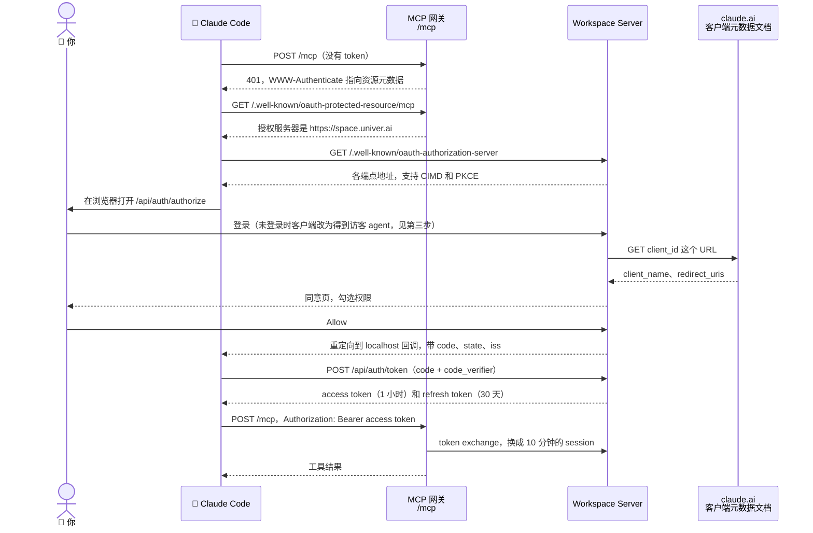
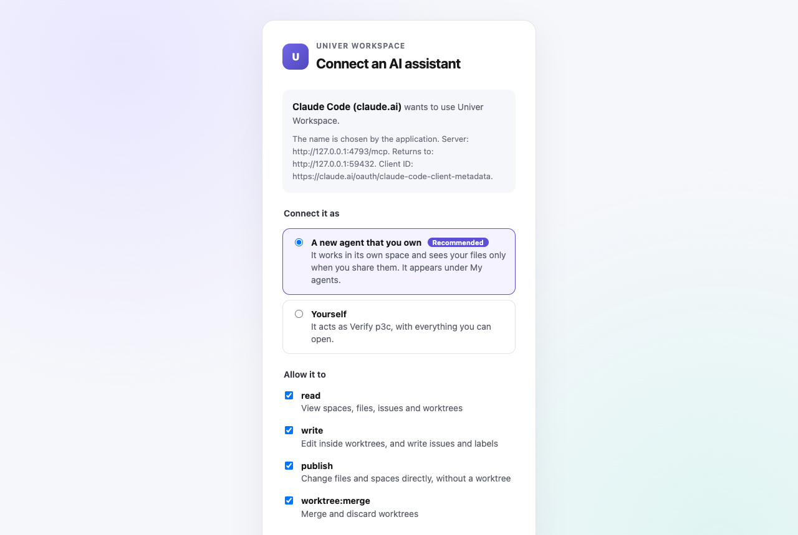

# AI agent 如何接入 Workspace

[English](agent-sign-in.md)

你在 Claude Code 里只输入了一个地址 `https://space.univer.ai/mcp`，点一次浏览器里的 **Allow**，之后 agent 就能以你的身份读写文件。这篇文档讲这中间发生了什么。

这套流程用的是 OAuth 2.1，加上 MCP 授权规范带来的几个较新的机制：资源元数据发现、Client ID Metadata Document（CIMD）和 token exchange。它们在普通网站登录里很少出现，所以下文假设你第一次见到它们，每个机制都先说它解决什么问题，再给出 Workspace 里的真实请求。

操作步骤不在这里。要连接某个客户端，看 [Connect an AI assistant](../README.md#connect-an-ai-assistant-mcp)。

## 要解决的问题

agent 替你操作文件，Workspace 因此要回答三个问题：

- 这是哪个程序？是 Claude Code，还是冒充它的别的程序。
- 它代表谁？哪个 Workspace 用户。
- 它被允许做什么？只读，还是能合并 pull request。

还有一条约束：agent 不能拿到你的密码。密码给出去就收不回来，也无法只授予一部分权限。

OAuth 的做法是让你在浏览器里直接和 Workspace 打交道。你登录、确认授权，Workspace 发给 agent 一张有时效、有范围、可以吊销的 token。agent 自始至终只见过这张 token。

## 四个角色

OAuth 的术语和 Workspace 的组件一一对应：

| OAuth 术语 | 在 Workspace 里是 | 做什么 |
| --- | --- | --- |
| 资源所有者（resource owner） | 你 | 在浏览器里登录，决定授予哪些权限 |
| 客户端（client） | Claude Code、Claude、VS Code 等 MCP 客户端 | 发起授权，拿 token 调用工具 |
| 资源服务器（resource server） | MCP 网关，`https://space.univer.ai/mcp` | 收 token，执行工具调用 |
| 授权服务器（authorization server） | Workspace Server，`https://space.univer.ai` | 登录、同意页，签发和吊销 token |

网关和 Workspace Server 是两个独立的服务。网关不连接数据库，它通过 Workspace 的 HTTP API 读写文件。后面的“两次换 token”一节会用到这一点。

## 完整流程

下图是 Claude Code 第一次连接 `space.univer.ai` 的全过程。后面各节逐段解释。



## 第一步：从一个 URL 找到授权服务器

客户端事先只知道 `https://space.univer.ai/mcp`。它不知道该去哪里登录，也不知道 Workspace 支持哪些方式。所以它先不带 token 直接调用，网关返回 401，并在响应头里告诉它去哪里查：

```http
HTTP/2 401
www-authenticate: Bearer resource_metadata="https://space.univer.ai/.well-known/oauth-protected-resource/mcp"
```

这个地址返回的是受保护资源元数据（RFC 9728），说明这个 MCP 服务由谁授权、接受哪些权限：

```json
{
  "resource": "https://space.univer.ai/mcp",
  "authorization_servers": ["https://space.univer.ai"],
  "scopes_supported": ["read", "write", "publish", "worktree:merge"],
  "bearer_methods_supported": ["header"]
}
```

客户端接着读授权服务器元数据（RFC 8414）。下面是 `space.univer.ai` 当前返回的内容：

```json
{
  "issuer": "https://space.univer.ai",
  "authorization_response_iss_parameter_supported": true,
  "client_id_metadata_document_supported": true,
  "authorization_endpoint": "https://space.univer.ai/api/auth/authorize",
  "token_endpoint": "https://space.univer.ai/api/auth/token",
  "registration_endpoint": "https://space.univer.ai/api/auth/register",
  "revocation_endpoint": "https://space.univer.ai/api/auth/revoke",
  "response_types_supported": ["code"],
  "grant_types_supported": ["authorization_code", "refresh_token"],
  "code_challenge_methods_supported": ["S256"],
  "token_endpoint_auth_methods_supported": ["none"],
  "revocation_endpoint_auth_methods_supported": ["none"],
  "scopes_supported": ["read", "write", "publish", "worktree:merge"]
}
```

两次查询之后，客户端知道了所有端点，也知道 Workspace 支持 CIMD（`client_id_metadata_document_supported`）。下一步它要回答：我在 Workspace 眼里叫什么。

## 第二步：授权服务器从没见过这个客户端

普通网站接入 “用 GitHub 登录” 时，开发者先去 GitHub 后台登记应用，拿到一个 `client_id`。授权服务器靠这个登记认识客户端：它叫什么，登录完可以跳回哪些地址。

MCP 不能这样做。Workspace 可以是任何人自己部署的，Claude Code 不可能事先到每一个部署上登记。Workspace 有三种办法认识一个客户端：

| 方式 | `client_id` 的样子 | Workspace 怎么认识它 | 用在哪里 |
| --- | --- | --- | --- |
| 预先登记 | 固定名字，例如 `univer-workspace-harness` | 运维写进 `OAUTH_CLIENTS_JSON` | Workspace 自己的应用，例如 [Workspace Agent](../apps/agent/README.md) |
| 动态注册（DCR，RFC 7591） | Workspace 生成的 UUID | 客户端调用 `POST /api/auth/register` 自报名字和回调地址，Workspace 存进数据库 | 不支持 CIMD 的 MCP 客户端 |
| CIMD | 一个 https URL | Workspace 去这个 URL 取一份 JSON，从中读出名字和回调地址 | Claude Code、Claude（Web、Desktop）、VS Code |

### CIMD：`client_id` 就是一个网址

CIMD 的全称是 Client ID Metadata Document，目前是 IETF 草案（`draft-ietf-oauth-client-id-metadata-document`）。MCP 授权规范从 2025-11-25 版起优先使用它，并弃用 DCR。

做法很直接：客户端把一个自己掌控的 https URL 当作 `client_id`，在这个 URL 上发布一份描述自己的 JSON。Claude Code 的 `client_id` 是 `https://claude.ai/oauth/claude-code-client-metadata`，访问它得到：

```json
{
  "client_id": "https://claude.ai/oauth/claude-code-client-metadata",
  "client_name": "Claude Code",
  "client_uri": "https://claude.ai",
  "redirect_uris": ["http://localhost/callback", "http://127.0.0.1/callback"],
  "grant_types": ["authorization_code", "refresh_token"],
  "response_types": ["code"],
  "token_endpoint_auth_method": "none"
}
```

Workspace 收到这样的 `client_id` 时，会去取这份文档，确认文档里的 `client_id` 和 URL 完全相同，再用其中的 `client_name` 和 `redirect_uris`。取到的文档只缓存在内存里，按响应的 `cache-control` 保留 5 分钟到 24 小时，不写数据库。

### 为什么比 DCR 好

DCR 里，客户端自己报名字。任何程序都可以注册一个叫 “Claude Code” 的客户端，同意页上的名字因此证明不了什么。每次安装、每台机器都会注册一个新客户端，数据库里的记录只增不减，Workspace 只能用 `MCP_MAX_REGISTERED_CLIENTS` 限制总数。

CIMD 把身份绑在域名上。只有控制 `claude.ai` 的人才能在那个地址发布文档，所以同意页可以显示 **Claude Code (claude.ai)**，括号里的主机名来自 URL 本身，不是客户端自报的。Workspace 也不需要为它存任何记录。

有一点要清楚：CIMD 证明的是文档的发布者，不是你电脑上正在运行的那个程序。Claude Code 的回调地址是 `localhost`，本机上任何程序都可以拿着这个 `client_id` 发起一次登录。所以只批准你自己刚刚发起的连接。

### CIMD 的代价

Workspace 要根据一个陌生人给的 URL 发出请求。不加限制的话，攻击者可以让服务器访问内网地址或云元数据端点，这类问题叫 SSRF。Workspace 因此只访问公网地址，不跟随重定向，文档不超过 5 KB，5 秒内必须返回，并限制同时进行的请求数。完整规则见 [CIMD 设计](design/workspace-mcp/cimd.zh-CN.md) 3.3 节。

这也意味着 Workspace Server 必须能访问外网。没有外网的私有部署要设置 `MCP_CIMD_ENABLED=0`。设置之后，授权服务器元数据不再声明支持 CIMD，客户端会改用 DCR。

## 第三步：在浏览器里登录并同意

客户端在浏览器里打开授权端点。请求里的参数各有用途：

```text
https://space.univer.ai/api/auth/authorize
  ?response_type=code
  &client_id=https://claude.ai/oauth/claude-code-client-metadata
  &redirect_uri=http://localhost:<随机端口>/callback
  &scope=read write publish worktree:merge
  &resource=https://space.univer.ai/mcp
  &state=<随机值>
  &code_challenge=<code_verifier 的 SHA-256>
  &code_challenge_method=S256
```

- `redirect_uri` 必须出现在 CIMD 文档的 `redirect_uris` 里。`localhost` 地址的端口可以不同（RFC 8252），所以 Claude Code 每次可以监听一个随机端口。
- `resource`（RFC 8707）说明 token 要用在哪个服务上。签出的 token 只对 `https://space.univer.ai/mcp` 有效。
- `state` 由客户端生成，回调时原样带回，防止别人把一次不是你发起的授权塞给你的客户端。
- `code_challenge` 是 PKCE 的一半，下一节解释。

你没有登录、而客户端像 Claude Code 一样在你的电脑上监听回调时，你看不到任何页面，下一段解释。其他情况下 Workspace 先跳到登录页。登录方式取决于部署，可以是密码，也可以是 GitHub、Discord 或 Google。如果你选了 GitHub，那是另一次独立的 OAuth，Workspace 在其中是客户端。它在你回到 Workspace 时就结束了，和 agent 拿到的 token 无关。

浏览器没有 Workspace 会话时，客户端可以得到一个访客 agent，而不是某个人。访客 agent 是新建的 agent 账号，名字取自客户端的名字（CIMD 文档的 `client_name`，或 DCR 注册时报的名字），例如 “Claude Code · g3wq”，读不到任何人的私有文件。`redirect_uri` 是 loopback 的 `http` 地址（`127.0.0.1`、`[::1]` 或 `localhost`）时，Workspace 不显示任何页面，直接把浏览器送回回调，带上一个新访客 agent 的授权码，权限是客户端请求的全部 scope，浏览器保持未登录。这里不授出任何人的数据，授权码也只会交给这台电脑上的程序，所以没有什么需要批准。Workspace 在客户端用授权码换 token 时才创建 agent，客户端没用上的授权码不留下任何东西。默认每个地址每小时最多创建 5 个 agent（`AGENT_CREATE_LIMIT_PER_HOUR`），超过后浏览器显示 `AGENT_CREATE_RATE_LIMITED`。已有 10,000 个这样的授权码等着换 token 时，客户端收到 `temporarily_unavailable` 而不是授权码，过一分钟再试即可。想以自己的身份连接，先在这个浏览器里登录 Workspace 再连接。其他 `redirect_uri`，例如 `https` 地址，登录页提供 **Continue as a guest agent**，访客 agent 之后像登录用户一样确认同意页。关闭访客 agent 的部署总是显示登录页。访客 agent 能做什么、怎样被人认领，见 [Agent 交接效果展示](agent-handoff-showcase.zh-CN.md#没有账号的-agent-也能开始工作)。

登录后是同意页：



截图来自一个本地 Workspace，所以 Server 和回调地址都是 `127.0.0.1`。Client ID 是 Claude Code 的真实 CIMD 地址，名称和主机名由 Workspace 从这份文档里读出。

页面上的四项权限就是 scope。你可以取消勾选任何一项，至少留一项：

| scope | 允许 agent |
| --- | --- |
| `read` | 查看你的 Space、文件、issue 和 worktree |
| `write` | 在 worktree 里编辑，写 issue 和 label |
| `publish` | 不经 worktree 直接修改文件和 Space |
| `worktree:merge` | 合并和丢弃 worktree |

只留 `read` 和 `write` 时，agent 的修改都停在 pull request 里，由你在浏览器里审阅和合并。

## 第四步：用授权码换 token

你点 **Allow** 后，浏览器跳回客户端的回调地址：

```text
http://localhost:<端口>/callback?code=<授权码>&state=<原样带回>&iss=https://space.univer.ai&scope=<你勾选的权限>
```

客户端先核对 `state` 和 `iss`，再到 token 端点换 token：

```text
POST /api/auth/token
grant_type=authorization_code
client_id=https://claude.ai/oauth/claude-code-client-metadata
code=<授权码>
code_verifier=<发起授权时生成的随机值>
redirect_uri=http://localhost:<端口>/callback
resource=https://space.univer.ai/mcp
```

响应里有两张 token：

- `uvw_at_` 开头的 access token，1 小时后过期，调用 MCP 时放在 `Authorization: Bearer` 里。
- `uvw_rt_` 开头的 refresh token，30 天有效，用来换新的 access token。每用一次就换一张新的。旧的那张在一分钟内再被使用只会被拒绝，这是为了容忍客户端的并发重试。超过一分钟还有人用它，Workspace 认为它可能被盗，吊销整个授权，客户端需要重新登录。

```json
{
  "access_token": "uvw_at_…",
  "token_type": "Bearer",
  "expires_in": 3600,
  "refresh_token": "uvw_rt_…",
  "scope": "read write publish worktree:merge"
}
```

### PKCE：没有密码的客户端怎么证明自己

传统 OAuth 里，客户端在换 token 时附上 `client_secret`，证明自己就是登记过的那个应用。Claude Code 装在每个人的电脑上，代码谁都能拆开看，藏不住 secret。所以对 MCP 客户端，Workspace 只接受 `token_endpoint_auth_method` 为 `none` 的公开客户端，CIMD 文档里出现 `client_secret` 会被直接拒绝。

PKCE（RFC 7636）代替了 secret。发起授权前，客户端生成一个随机值 `code_verifier`，只把它的 SHA-256 作为 `code_challenge` 发出去。换 token 时再交出 `code_verifier` 原值，Workspace 算一遍哈希比对。授权码经过浏览器和 localhost 回调，可能被本机别的程序截到。截到的人没有 `code_verifier`，授权码就换不出 token。

### `iss`：确认授权码来自哪里

一个客户端可能同时连着好几个授权服务器。如果它弄错了一个授权码的来源，就会把这个码发到错误的 token 端点，这叫 mix-up 攻击。Workspace 在每一个回调上都带 `iss`（RFC 9207），成功、出错和拒绝都带，客户端据此确认授权码来自 `https://space.univer.ai`。

## 第五步：网关再换一次 token

客户端带着 `uvw_at_` token 调用 `/mcp`。网关不会把这张 token 转给 Workspace 的产品 API，而是先做一次 token exchange（RFC 8693）：

```text
POST /api/auth/token
grant_type=urn:ietf:params:oauth:grant-type:token-exchange
subject_token=<uvw_at_…>
client_id=univer-workspace-mcp-gateway
client_secret=<网关自己的 secret>
```

Workspace 返回一个最长 10 分钟的 session，以及这张 token 代表的用户和被授予的 scope：

```json
{
  "access_token": "<Workspace session>",
  "issued_token_type": "urn:univer:params:oauth:token-type:workspace-session",
  "token_type": "N_A",
  "expires_in": 600,
  "scope": "read write publish worktree:merge",
  "subject": { "kind": "oauth", "id": "<授权 ID>", "client_id": "https://claude.ai/oauth/claude-code-client-metadata" },
  "user": { "id": "<用户 ID>", "username": "<用户名>", "kind": "human" }
}
```

网关只用这个 session 调用产品 API，并按 scope 和 `user.kind`（人或 agent）决定列出哪些工具。

多这一步有三个原因：

- 只有网关有 `client_secret`，所以只有网关能把 MCP token 换成产品 session。即使 MCP token 泄露，拿它直接调用产品 API 也没有用。
- 网关拿到的是 Workspace 当下的判断。授权被吊销后（客户端调用 `/api/auth/revoke`，或者你在 **Access tokens** 里删除一个 PAT），换出的 session 立即被删除。网关最多在 30 秒的缓存里还认得这张 token，但所有访问 Workspace 的调用都会失败。
- 个人访问令牌（`uvw_pat_`）走同一条路，网关不需要区分两种凭证。

网关的缓存和错误码见 [Workspace MCP 的 Authentication](../apps/mcp/README.md#authentication)。

## 其他接入方式

上面的 OAuth 流程是 MCP 客户端的默认方式。其他入口各有自己的路：

| 入口 | 怎么拿到凭证 | 适合 |
| --- | --- | --- |
| 个人访问令牌（PAT） | 在 Workspace 账户菜单的 **Access tokens** 里创建，配置为 `Authorization: Bearer uvw_pat_…` | 不支持 OAuth 的 MCP 客户端 |
| `uvw auth login` | CLI 打印一个网址和验证码，你在浏览器里核对验证码并批准，然后运行 `uvw auth login --complete` | 在终端里运行命令的 agent |
| `uvw auth guest` | CLI 直接新建一个访客 agent，不需要任何账号 | 先做出文件、再交给人认领 |
| Workspace Agent | 预先登记的客户端 `univer-workspace-harness`，走授权码流程 | 自己部署的 Workspace Agent 服务 |

`uvw auth login` 的形式像 OAuth 设备码流程，但它是 Workspace 自己的接口，不签发 OAuth token。CLI 拿到的是一个独立的 Workspace session，见 [Workspace CLI 的 Login](../apps/cli/README.md#login)。

## 出了问题看哪一步

| 现象 | 卡在哪一步 | 怎么办 |
| --- | --- | --- |
| 客户端反复要求登录 | 第四步之后，客户端保存的 token 失效或损坏 | 在客户端里登出该服务再登录，例如 `claude mcp logout univer-workspace` |
| 登录后浏览器显示 `invalid_client` 或 `temporarily_unavailable` 错误页 | 第二步，Workspace 取不到 CIMD 文档，或文档没有通过校验 | 私有部署确认 Workspace Server 能访问外网，或设置 `MCP_CIMD_ENABLED=0` |
| 自部署时出口走 fake-IP 代理，CIMD 总是失败 | 第二步，公网域名被解析到 `198.18.0.0/15`，被当成私有地址拒绝 | 设置 `MCP_CIMD_EXEMPT_NETWORKS=198.18.0.0/15` |
| 连上了，但缺少某些工具 | 第三步取消了某个 scope，或 URL 的 `?toolsets=` 没有包含它 | 重新授权并勾选，或检查 `?toolsets=` |
| 客户端连上了，但身份是新的访客 agent，不是你 | 第三步，浏览器没有 Workspace 会话，客户端在你的电脑上监听回调 | 用 agent 给你的认领链接认领它；或者在客户端里登出该服务，在这个浏览器里登录 Workspace，再重新连接 |
| 配了 `Authorization` 头后 Claude Code 不再弹出登录 | Claude Code 看到头就跳过 OAuth | 二选一，不要同时配置 |

## 术语和出处

| 术语 | 一句话 | 出处 |
| --- | --- | --- |
| OAuth 2.1 授权码流程 | 用户在浏览器里授权，客户端拿授权码换 token | `draft-ietf-oauth-v2-1` |
| 受保护资源元数据 | 资源服务器声明由谁授权 | [RFC 9728](https://www.rfc-editor.org/rfc/rfc9728) |
| 授权服务器元数据 | 授权服务器声明自己的端点和能力 | [RFC 8414](https://www.rfc-editor.org/rfc/rfc8414) |
| CIMD | `client_id` 是一个 URL，指向客户端的元数据文档 | [draft-ietf-oauth-client-id-metadata-document](https://datatracker.ietf.org/doc/draft-ietf-oauth-client-id-metadata-document/) |
| DCR | 客户端调用接口自行注册 | [RFC 7591](https://www.rfc-editor.org/rfc/rfc7591) |
| PKCE | 用一对随机值代替公开客户端的 secret | [RFC 7636](https://www.rfc-editor.org/rfc/rfc7636) |
| 资源指示 `resource` | 把 token 绑定到一个服务 | [RFC 8707](https://www.rfc-editor.org/rfc/rfc8707) |
| `iss` 回调参数 | 告诉客户端授权码来自哪个授权服务器 | [RFC 9207](https://www.rfc-editor.org/rfc/rfc9207) |
| token exchange | 用一张 token 换另一张 | [RFC 8693](https://www.rfc-editor.org/rfc/rfc8693) |
| 本机回调 | `localhost` 回调可以用任意端口 | [RFC 8252](https://www.rfc-editor.org/rfc/rfc8252) 7.3 节 |
| MCP 授权规范 | MCP 客户端和服务器如何组合以上机制 | [MCP Authorization](https://modelcontextprotocol.io/specification/2025-11-25/basic/authorization) |
