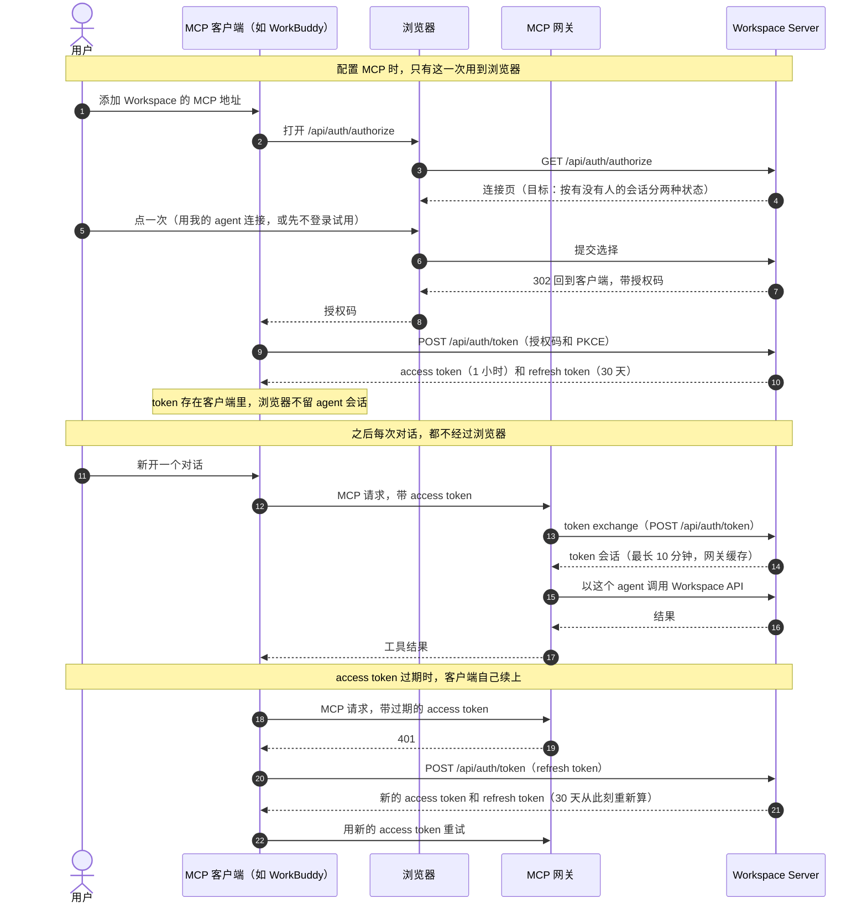

# Agent 身份与授权：重新设计

> 状态：方案已采纳，未实施。第 2 节的三项决定由用户在 2026-11-26 确认。日期 2026-11-26。
> 第 3 节写现状，来自对 `main`（`2cf11df5`）的代码阅读和三次 WorkBuddy 演练（本地 wb4、wb5，以及 staging）。第 4 节起写目标，标为“目标”的内容都不是现状。
> 本文取代以下内容中与它冲突的部分：[低门槛 Agent 入口调研](low-friction-agent-entry.zh-CN.md) 5.5 节第 5 项（scope 拆分）；[Agent Mode 实施规格](agent-mode/spec.zh-CN.md) 9.1 节第 1 项中 agent 自己添加成员的部分；零点击访客授权（#629）；授权页上的 `connect_as` 单选（#634）和 scope 勾选框。

## 1. 为什么重做

今天同一个“连接”动作会落出好几种结果，取决于用户看不见的浏览器状态。浏览器里登录着人，授权页给三个选项。浏览器里留着之前访客留下的 agent 登录态，授权页没有选项，直接以那个 agent 连接。浏览器没有登录态而客户端的回调在本机，系统不出页面，直接造一个访客 agent。staging 演练里用户看到的 “WorkBuddy Connector wants to use Univer Workspace as WorkBuddy Connector · 66nh” 是第二种。

一个操作能不能做，要同时看主体类别（`human`、`agent_claimed`、`agent_unclaimed`）、4 个 scope、会话的来源和它是不是由 token 换来的、仓库角色、仓库设置和 14 条上限。扩大可见范围的动作里只有两种有会话检查（公开仓库和 Link Sharing），而且只拦“人的 token 会话”，任何 agent 都不拦。#636、#639、#640、#641 连续加了说明文字：访客要告诉用户自己是访客，只在用户要求时公开，主人已经能打开 agent 的一切。演练里仍然出现 agent 把整个仓库设成公开（wb4），以及 agent 把主人加成编辑者（staging）。说明文字能减少犯错，但规则仍靠模型自觉。

用户在 2026-11-26 的判断是：之前过度强调“少让人点”，加上 WorkBuddy 这类客户端本身缺少一些条件（它不把 MCP server instructions 交给模型），权限和授权已经理不清了。目标是一个优雅、简单、agent-first 的系统，少摩擦，但不追求零摩擦。

## 2. 已定的三件事

| #   | 决定                     | 含义                                                                                                                                                             |
| --- | ------------------------ | ---------------------------------------------------------------------------------------------------------------------------------------------------------------- |
| D1  | 连接固定点一次           | 放弃浏览器里的零点击访客路径。浏览器里的授权总有一个页面、一次点击。没有浏览器的程序仍可走自助注册接口（`POST /api/agents`、`uvw auth guest`）。                 |
| D2  | agent 不自己扩大可见范围 | 设为公开、加成员或提高角色、把文件分享给某人、打开 Link Sharing 或提高它的角色，只能由人在浏览器里确认。其他会话发起时，服务器拒绝，并返回一个预填好的确认链接。 |
| D3  | scope 收成两档           | 连接页和 PAT 只提供“只读”和“读写”。读写包括合入，能不能合入由仓库自己的规则决定。                                                                                |

## 3. 现状

### 3.1 身份和会话

`users.kind` 是 `human` 或 `agent`。agent 另有一行 `agents`，其中 `owner_user_id` 和 `claimed_at` 同时为空（未认领）或同时有值（已认领），由表上的 CHECK 保证。主体类别在 `apps/workspace/server/src/modules/identity/principal-category.ts` 推导：`human`、`agent_claimed`、`agent_unclaimed`，没有会话时是 `anonymous`。

Workspace API 只认 `workspace_session` cookie。PAT（`uvw_pat_`）和 OAuth access token（`uvw_at_`）只有 MCP 网关认。网关用 token exchange 在 `POST /api/auth/token` 把它们换成一个最长 10 分钟的 token 会话。`uvw` 只存 cookie，没有 bearer 路径。

| 会话种类       | `write_source`            | 谁会拿到                                            | 怎么来                                                                | 寿命                         |
| -------------- | ------------------------- | --------------------------------------------------- | --------------------------------------------------------------------- | ---------------------------- |
| 浏览器会话     | `browser`                 | 人，也包括访客 agent                                | 网页登录；`POST /api/auth/guest`（网页的访客卡片和 `uvw auth guest`） | 默认 7 天，不续期            |
| agent 来源会话 | `agent`                   | 人（CLI、Workspace Agent、Space 插件、Discord bot） | 设备码登录、CLI 密码登录、静态客户端的 `session` scope、bot 登录      | 7 天，滑动续期               |
| token 会话     | `agent`，并记下来源 token | 人、已认领和未认领的 agent                          | 只有网关的 token exchange                                             | 最长 10 分钟                 |
| PAT            | 无                        | 一个用户                                            | 网页的令牌对话框；`POST /api/agents`                                  | 默认不过期                   |
| OAuth grant    | 无                        | 人、他拥有的 agent、新访客                          | 授权码；`POST /api/auth/agent-token`（网页 Agents）                   | access 1 小时，refresh 30 天 |

`GET /api/auth/authorize` 按顺序判断：

1. **零点击访客。** 先检查创建 agent 的限流，超限答 429。然后，没有会话，开启了访客（`AGENT_CREATE_LIMIT_PER_HOUR` 大于 0），回调是本机的 `http` 地址，客户端是 DCR 或 CIMD。直接 302 带回授权码，不出页面。授权码带上请求的全部 scope，请求里没写 scope 就是全部 4 个。agent 在 `/token` 兑换时创建。
2. **没有会话。** 转到 `/login`，登录页显示访客卡片。点它会调用 `POST /api/auth/guest`，浏览器被登录成一个新的未认领 agent，再回到授权。
3. **有会话。** MCP 客户端和要求同意的静态客户端看到授权页，其他静态客户端直接拿到授权码。人看到 `connect_as` 单选（他拥有的某个 agent、新建一个归他的 agent、他本人）和 scope 勾选框。agent 会话没有选项，以它自己连接。

### 3.2 “interactive” 有四种定义

| 检查                                                        | 放行                                                                                      | 拒绝时                                                                        |
| ----------------------------------------------------------- | ----------------------------------------------------------------------------------------- | ----------------------------------------------------------------------------- |
| `requireInteractiveSession`（`identity.service.ts`）        | 任何不是由 token 换来的会话，包括 CLI、Workspace Agent、Discord bot 和 agent 的浏览器会话 | 403 `FORBIDDEN`                                                               |
| 上限 `writeLinkSharing`、`publishSpace`（`ceilings.ts`）    | 除“人的 token 会话”以外的所有会话，因此任何 agent 和人的 CLI 会话都放行                   | 403 `INTERACTIVE_SESSION_REQUIRED`                                            |
| `personInBrowser`（`principal-category.ts`）                | 只有人、`browser` 来源、不是 token 会话                                                   | 合入别人写的页面时 409 `PAGE_REVIEW_REQUIRED`；强制撤回合入时 403 `FORBIDDEN` |
| `requireHuman`（`agent-claims.ts`，用于认领和“我的 agent”） | 同上                                                                                      | 403 `FORBIDDEN`                                                               |

`requireInteractiveSession` 守着签发 PAT、签发网页 Agents 的 token、批准 CLI 设备码登录、授权页、关联登录方式、改密码，以及发布 HTML View 和 Skill 草稿。所以今天 agent 的浏览器会话能签发 PAT，也能批准一个 CLI 设备码登录，让那个 CLI 也成为这个 agent。

### 3.3 scope

- 共 4 个：`read`、`write`、`publish`、`worktree:merge`（`access-tokens.ts` 的 `MCP_SCOPES`）。它们只存在于 PAT 和 OAuth grant 上，只有 MCP 网关在每次工具调用时检查。浏览器会话、CLI 会话和 Workspace Agent 会话都没有 scope，服务器 API 不读 scope。
- 73 个工具里，`read` 40 个，`write` 22 个，`publish` 8 个（`repo_create`、`repo_edit`、`repo_member_write`、`space_node`、`blob_upload`、`blob_replace`、`share`、`claim`），`worktree:merge` 3 个（`pr_merge`、`pr_discard`、`pr_revert`）。
- `write` 不含合入。网关的 server instructions 和 `whoami` 按有没有 `worktree:merge` 分成两套工作流文字：有就自己合入，没有就把 pull request 留给用户。
- 网页 Agents 是 scope 的第二个使用者。它向 `POST /api/auth/agent-token` 只要 `[read]`（Ask 模式）或 `[read, write]`（Auto 模式）。遇到 `publish` 的工具，Ask 模式直接拒绝，Auto 模式先请用户批准，再用一次性的 `[read, publish]` token 调用；遇到 `worktree:merge` 的工具一律拒绝（`apps/workspace/web/src/features/agents/runtime/approvals.ts`）。
- `POST /api/agents` 发出的 PAT 带全部 4 个 scope，不过期。零点击访客拿到请求的全部 scope，请求里没写就是全部 4 个。

### 3.4 扩大可见范围的动作

| 动作                         | 入口                                                                                                                                        | 今天的守卫                                                                                                                        |
| ---------------------------- | ------------------------------------------------------------------------------------------------------------------------------------------- | --------------------------------------------------------------------------------------------------------------------------------- |
| 仓库设为公开（创建或修改时） | `POST /api/team-spaces`、`PATCH /api/spaces/:id` 的 `publicRead: true`；MCP `repo_create`、`repo_edit`；`uvw repo edit --visibility public` | 未认领 agent 被拒（`AGENT_NOT_ALLOWED`）；人的 token 会话被拒（`INTERACTIVE_SESSION_REQUIRED`）。已认领 agent 和人的 CLI 会话放行 |
| 加成员或改角色               | `PUT /api/team-spaces/:spaceId/members/:userId`；MCP `repo_member_write`；`uvw repo member add`                                             | 只有上限：未认领 agent 不能加人，也不能被加；agent 只能在 agent 持有的仓库里当 admin。没有任何会话检查                            |
| 把文件分享给某人             | `PUT /api/nodes/:nodeId/grants/:userId`，网页和 DSH 插件的文件侧栏调用                                                                      | 没有任何会话检查                                                                                                                  |
| 打开 Link Sharing 或改角色   | `PUT /api/nodes/:nodeId/link-sharing`；MCP `share`；`uvw share --link`                                                                      | 人的 token 会话被拒，任何 agent 都放行。经链接进来的匿名读者和未认领 agent 最多是 viewer                                          |

### 3.5 认领和分享 drop

- 认领码由 agent 的任何会话生成。10 分钟内可用，之后 10 分钟答 410，再之后答 404。每个 agent 最多同时有 10 个码，第 11 个会挤掉最早的那个；全站最多 10,000 个待用的码，满了答 503 `AGENT_CLAIM_UNAVAILABLE`。认领不消耗码：同一个人再打开看到“已认领”，别人得到 409。`claim` 工具的描述却写着 “It works once”，和实际不符。
- 只有人在浏览器里能认领。认领是一条带条件的 UPDATE。认领人通过 `ownsSpaceSql` 拥有 agent 的全部 Space，现在的和以后的都算。这个归属在每次读的时候推导，SQLite 和 PostgreSQL 各有 6 个文件用到它，每个后端 18 处调用。
- fork 不跟着认领走。fork 的查询都按 `forks.owner_user_id` 等于行为者，认领人列不出、也删不了 agent 的 fork。
- 授权页选“新建一个归你的 agent”时，`/token` 先创建 agent 再认领，两次写入不在一个事务里。中间失败会留下一个没有 grant 的未认领 agent。
- 分享 drop 指 agent 给个人空间里的文件打开 Link Sharing，任何拿到链接的人不登录就能读。未认领 agent 的 drop 随 agent 过期（30 天不活动），有人匿名打开这个文件会把期限往后推。
- 停用是永久的，和运维的封禁共用 `banned_at`，没有解封接口。过期只是暂停，不删除任何东西，agent 下次认证就恢复。

### 3.6 设计必须面对的事实

1. **服务器分不清“人在终端里打字”和“agent 拿着人的 CLI 登录”。** 人的 `uvw` 会话、Workspace Agent、Space 插件和 Discord bot 都是 `agent` 来源会话，而 agent 通常正是用 `uvw` 以人的身份工作。所以 D2 的“只有人在浏览器里”也会拦住人在终端里亲手输入的 `uvw repo edit --visibility public`。
2. **CLI 的匿名入口依赖 agent 浏览器会话。** `uvw auth guest` 调 `POST /api/auth/guest`，拿到的是 `browser` 来源的 cookie。它不续期，过期后也没法再登录成同一个 agent。去掉 agent 浏览器会话，就要给 CLI 换一种会话。
3. **scope 只存在于网关。** 收成两档只改变网关的工具门槛和连接页，改变不了服务器 API 的行为。扩大可见范围的保护必须由服务器按会话判断（D2），不能靠 scope。
4. **网页 Agents 用 `publish` 做逐次审批，用 `worktree:merge` 做硬拒绝。** 直接删掉这两个 scope，会去掉网页 Agents 的一层纵深防御：Auto 模式的 token 自己不能调用 `publish` 的工具。
5. **错误信封没有链接字段。** 今天的形状是 `{error: {code, message, field?}}`。已经带链接的拒绝只有 `PAGE_REVIEW_REQUIRED` 和 `PAGES_CHANGED`，链接写在 message 里，用服务器的 `publicOrigin` 拼成地址；`publicOrigin` 没有配置时是相对路径。
6. **WorkBuddy 5.11.3 不把 MCP server instructions 交给模型。** 工具名、完整的工具描述和工具结果能到模型。今天和认领、`publish`、合入有关的说明文字有 44 处（`instructions.ts`、`whoami.ts`、工具描述、两个 Skill），client-core 里还有 11 处。
7. **所有 SQL 改两遍。** `apps/workspace/server/src/db/sqlite/` 和 `apps/workspace/server/src/db/postgres/` 各有一份。
8. **创建 agent 的限流按来源 IP，默认每小时 5 个。** 部署在代理后面而没有设置 `TRUST_PROXY` 时，全站共用一个桶。DCR 注册没有按来源的限制，总数上限由 `MCP_MAX_REGISTERED_CLIENTS` 决定（默认 10,000），注册记录从不清理。
9. **文档已经有过时的地方。** `apps/workspace/docs/data-model.md` 的 `login_sessions` 一节说待批准的 CLI 登录存在进程内存里。同一文件的 V36 一节说它们在 `sign_in_codes`，后者是对的。

## 4. 目标模型

### 4.1 三句话

1. 每个 agent 属于一个账号。账号是注册过的人，或者还没注册的临时账号。
2. 连接只有一个页面、一次点击。
3. agent 在自己的空间里自由干活，扩大可见范围由人在浏览器里确认。

### 4.2 账号

目标。数据模型不变。临时账号就是 `owner_user_id` 为空的 agent，不新增表。界面上“已认领”叫“有主人”，“未认领”叫“临时”。代码和 HTTP contract 里的 `claimed`、`claim` 保留，改名没有收益。

主人拥有 agent 拥有的一切，包括它的 Space（今天已经如此）和它的 fork（今天不是，第 5 步改）。agent 不继承主人的任何权限，只能看分享给它自己的东西。临时账号只能私有，有配额（今天未认领 agent 的上限不变），30 天不活动就暂停。

### 4.3 只有人的浏览器会话能代表人

目标。服务器只保留两个判断：

- **有会话。** 即今天的 `requireSession`。
- **人在浏览器里。** 即今天的 `personInBrowser`：`human`，`browser` 来源，不是 token 会话。凡是代表人做决定的接口都要求它：连接页，签发 PAT 和网页 Agents 的 token，批准 CLI 设备码登录，认领和“我的 agent”，关联登录方式，改密码，发布 HTML View 和 Skill 草稿，以及 4.6 节的扩大可见范围。

`requireInteractiveSession` 的实现改成第二个判断，`requireHuman` 并进去。拒绝统一用 403 `INTERACTIVE_SESSION_REQUIRED`，client-core 已经认识这个 code。能给出下一步的地方带上 `url`（4.6 节）。

agent 不再有浏览器会话。`POST /api/auth/guest` 只服务 CLI，改发 `agent` 来源会话，7 天滑动续期。浏览器里即使还留着 agent 的 cookie，它也只是一个 agent 身份：连接页把它当作没登录，代表人的接口一律拒绝。

### 4.4 连接页

目标。`GET /api/auth/authorize` 对 MCP 客户端（DCR、CIMD）总是返回同一个页面，按浏览器里有没有人的会话分两种状态。

| 浏览器状态                              | 页面说什么                                                                                  | 主按钮                                 | 其他选择                                                                               |
| --------------------------------------- | ------------------------------------------------------------------------------------------- | -------------------------------------- | -------------------------------------------------------------------------------------- |
| 人已登录                                | “你已登录为 @某人。<客户端> 会以你的 agent「<名字>」工作”，并列出它能碰什么、什么需要你确认 | 用我的 agent「<名字>」连接             | “允许它修改内容”开关（读写或只读）；你拥有的其他 agent；以我本人连接（次要链接）；拒绝 |
| 没有人的会话（包括只留着 agent cookie） | “<客户端> 想在 Univer Workspace 里做事”，并说明登录和试用的区别                             | 登录后连接（登录完回到这一页再点一次） | 先不登录，试用（开启访客时才有）；拒绝                                                 |

- **默认的 agent。** 沿用 #634 的匹配：他拥有的、和客户端同名的 agent。没有就新建一个归他的 agent。新建时 agent 和主人在一次写入里落库（`owner_user_id` 和 `claimed_at` 一起写），不再分两次。
- **试用。** 点按钮后服务器签发一个访客授权码，和今天零点击签发的码一样，agent 在 `/token` 兑换时创建，浏览器里不写任何会话。今天零点击用的保护挂到这个按钮上：每个来源每分钟 20 个访客码，全局 10,000 个未兑换的访客码，以及创建 agent 的限流。
- **以我本人连接。** 保留，但只作次要链接。它让客户端拥有这个人的全部权限，应当是有意识的选择。
- **静态客户端。** Workspace Agent 和 Space 插件照旧要人登录，不提供试用。不要求同意的静态客户端（如内部服务）照旧不出页面。

#### 授权一次，之后一直能用

浏览器只在授权那一刻参与。MCP 客户端的凭据是 OAuth grant，由客户端自己保存，和浏览器里有没有会话无关。今天如此，本文不改。access token 1 小时过期，客户端用 refresh token 自己换新的。每次换新，refresh token 的 30 天有效期从那一刻重新算（`oauth_grants.refresh_expires_at`，随轮换顺延）。所以只要客户端 30 天内用过一次，新开对话、隔天再用都不需要人。下图中只有连接页是目标，其余是今天的行为。

只有以下情况要回到图中第一段，重新点一次：

- refresh token 连续 30 天没有用过。
- 客户端撤销了这个授权（`POST /api/auth/revoke`），或者主人在“我的 agent”里停用了这个 agent。今天网页上没有让人撤销 OAuth 授权的入口。
- 客户端丢了保存的 token，例如删掉连接器再重新添加。

浏览器不存 agent 登录态，只影响重新授权的那一次。已登录的人回到连接页，默认还是他原来的那个 agent。没登录的人选试用，会得到一个新的临时 agent，原来那个只能用它给过的交接链接取回。今天浏览器里留着的访客 agent 会话会让重新授权接上原来那个 agent，代价是浏览器在人不知情的情况下“变成”了那个 agent，staging 演练里遇到的正是这种情况。

### 4.5 访问规则

目标。一个主体能碰什么只看三件事：

1. **是它账号的。** 人自己的 Space，以及人拥有的 agent 的 Space 和 fork。
2. **分享给它的。** 成员身份、文件分享、Link Sharing。
3. **公开的。** 公开读取的仓库。

在此之上，仓库角色和仓库设置（`landing`、`proposals`）决定能做哪些写入和合入，和今天一样。4.6 节的规则取代 `ceilings.ts` 里的 `updateSpace`（未认领 agent 公开仓库）、`writeLinkSharing` 和 `publishSpace`（人的 token 会话改 Link Sharing、公开仓库），以及 `addTeamMember` 中“未认领 agent 不能加成员”的部分。其余上限不变，它们防的是批量滥用，不是可见范围。

### 4.6 安全规则：扩大可见范围要人确认

目标。下表左列的写入只接受“人在浏览器里”的会话，右列谁都能做。

| 对象         | 扩大（要人确认）         | 缩小（不要确认）         |
| ------------ | ------------------------ | ------------------------ |
| 仓库可见性   | 设为公开，创建时或修改时 | 设为私有                 |
| 成员         | 加成员，提高角色         | 移除成员，降低角色       |
| 文件分享     | 加人，提高角色           | 移除，降低角色           |
| Link Sharing | 打开，viewer 改为 editor | 关闭，editor 改为 viewer |

其他会话发起扩大时，服务器什么都不改，返回 403 `INTERACTIVE_SESSION_REQUIRED`，错误信封里多一个 `url`，指向预填好的确认页。其他会话包括任何 agent、人的 token 会话、人的 CLI 会话、Workspace Agent 和 Discord bot。

| 动作             | 确认链接（目标）                                            |
| ---------------- | ----------------------------------------------------------- |
| 设为公开         | `/confirm/public?space=<spaceId>`                           |
| 加成员或提高角色 | `/confirm/member?space=<spaceId>&user=<userId>&role=<role>` |
| 把文件分享给某人 | `/confirm/grant?node=<nodeId>&user=<userId>&role=<role>`    |
| Link Sharing     | `/confirm/link-sharing?node=<nodeId>&role=<role>`           |

- **链接不保存状态。** 任何副本都能处理它。链接只带 ID 和枚举值。页面用人自己的会话读出仓库名、文件名和用户名来显示，不显示链接里的任何文字，所以别人没法用链接伪造说明。
- **确认走已有的接口。** 人点确认后，页面用人的浏览器会话调用今天已有的那个接口，权限照常检查：没有 `manageMembers` 或 `share` 能力的人得到原来的拒绝。不新增写接口。
- **页面写明后果。** 例如“设为公开后，任何拿到链接的人都能读取「<仓库>」里的全部文件”。
- **临时 agent 没有人能确认。** 它发起扩大时得到 `AGENT_NOT_ALLOWED`，说明先把交接链接给用户（4.8 节）。
- **创建时不能直接公开。** MCP 的 `repo_create` 和 CLI 的 `uvw repo create` 删掉公开参数。要公开就先建私有仓库，再用 `repo_edit` 拿确认链接。服务器对非“人在浏览器里”的 `publicRead: true` 创建同样拒绝。
- **客户端怎么转达。** MCP 工具把 `url` 原样放进错误结果，并写明“把这个链接交给用户，由他在浏览器里确认”。CLI 打印同样的话。网页 Agents 把它显示成一个按钮。

代价是 3.6 节第 1 条：人在终端里亲手输入的 `uvw repo edit --visibility public` 也要多点一次。服务器分不清是谁在用这个会话，这一次点击换来的是规则由服务器保证。

以下不在这条规则里，保持今天的行为：仓库的 `proposals` 设置，pull request 的可见性，向公开仓库合入内容。前两者不改变谁能读仓库。合入是所有者选择公开之后的正常写入，由合入权和 `landing=checks` 控制。

### 4.7 scope：对外两档，对内保留细分

目标。连接页和 PAT 对话框只给两档。

| 档   | 授予的 scope                        |
| ---- | ----------------------------------- |
| 只读 | `read`                              |
| 读写 | `read write publish worktree:merge` |

客户端的请求里没有 `write` 时，只给“只读”。`POST /api/agents` 的 PAT 是读写，和今天一样。

4 个 scope 字符串在内部保留，因为网页 Agents 还要用细分：Auto 模式的 `[read, write]` 和一次性的 `[read, publish]`（3.6 节第 4 条）。这不违背 D3。用户能选的只有两档，经连接页和 PAT 得到的读写连接都包括合入，能不能合入由仓库规则决定。

已有的 PAT 和 grant 不迁移。它们的 scope 只会比读写更窄，按原样继续生效，过期或被撤销后自然消失。网关里“没有合入权就把 pull request 留给用户”那套文字保留，给网页 Agents 和这些旧连接用。

### 4.8 交接链接

目标。临时 agent 只给用户一个链接，取代今天的认领码、认领页和分享 drop。

- agent 调用 `claim`（CLI 是 `uvw claim`），拿到链接 `/claim/<code>`。
- 没登录的人打开它，能只读这个 agent 拥有的全部内容，包括 HTML View，读的是实时数据。页面上有一个按钮：“登录后收下”。
- 登录后点一次，agent 就归他。这和今天的认领是同一次写入。之后这个链接对别人只答 409，预览也随之停止。
- 链接有效期 7 天（今天是 10 分钟）。agent 可以随时再要一个。
- 交接链接上线时，临时 agent 不能再打开 Link Sharing（4.6 节），所以分享 drop 只剩已经打开的那些，它们随 agent 过期。有人匿名打开交接页会推后 agent 的过期时间，取代今天“匿名打开 drop 文件就续期”。

交接链接是本文中唯一让 agent 自己把内容给别人看的路径，范围限定在“准备接手这个 agent 的人”：只读，有期限，被接手后失效。临时账号没有主人可以确认，所以这里不能套用 4.6 节。

fork 跟着账号走：fork 的查询改为“fork 的所有者是行为者自己，或是行为者拥有的 agent”，主人能列出和删除 agent 的 fork。

### 4.9 给 agent 的说明

目标。规则由服务器保证之后，说明文字只需要讲结果。

- **有主人的 agent。** `whoami` 的说明里一句话：“你的主人能打开你拥有的一切，给他链接就行。你不能让东西被更多人看到，服务器会返回一个确认链接，把它交给用户。”
- **临时 agent。** `whoami` 的说明里一句话：“你是临时 agent。做完后用 `claim` 拿交接链接给用户，他打开就能看，登录就能收下。”
- **删除。** 工具描述里的“只在用户要求时公开”（`repo_create`、`repo_edit`），#640 和 #641 给已认领 agent 加的说明，`share` 被拒时按主体类别分出的几种说法，上限文字里“认领后解除这个上限”中与可见范围有关的部分，html-view-creator Skill 里关于公开仓库的那段。

## 5. 实施步骤

每一步单独上线、单独验证，前一步不依赖后一步。第 3 步暂时不收紧临时 agent 给自己文件打开 Link Sharing（今天的分享 drop），因为它的替代品交接链接到第 5 步才有。每一步一个 PR，第 5 步可能拆成两个。各步都不改 schema。

### 5.1 第 1 步：浏览器不再存 agent 登录态

**范围**

- `requireInteractiveSession` 改为“人在浏览器里”，`requireHuman` 并进去（`identity.service.ts`、`agent-claims.ts`）。
- 新增一个点击后签发访客授权码的接口，例如 `POST /api/auth/authorize/guest`。它接收 authorize 的查询串，复用零点击的签发逻辑和保护，以及今天 `createGuestAuthorizationCheck` 的校验。登录页的访客卡片改调它，拿到跳转地址后直接回到客户端，不写 cookie。
- `POST /api/auth/guest` 删掉 `oauthAuthorization` 参数，改发 `agent` 来源会话。它只服务 `uvw auth guest`。
- `GET /api/auth/authorize` 把不是人的会话当作没登录，转到登录页。登录页在只有 agent cookie 时照常显示登录表单和访客卡片，不能因为“已有会话”就跳回 `returnTo`，否则会循环。

**删除。** 访客卡片写 cookie 的路径，以及只为它存在的校验接线。

**数据。** 不迁移。已有的 agent 浏览器会话上线即失去代表人的能力，并在默认 7 天内自然过期，因为浏览器会话不续期。旧的 `uvw auth guest` 登录同样在 7 天内过期，之后这个 agent 只能由它此前给出的认领链接接手，和今天一样。

**契约和文档。** `apps/workspace/contracts/http/paths/auth.yaml`（`/api/auth/guest` 的说明和新接口），跑 `pnpm --filter @univerjs/univer-workspace api:verify`。`apps/workspace/README.md` 的 “CLI sign-in and Agent access”。`apps/workspace/docs/data-model.md` 的 `login_sessions`，顺带改掉 3.6 节第 9 条的过时文字。`apps/cli/README.md` 的访客一节。

**验证。**

- 集成测试：agent 的浏览器会话签发 PAT、批准 CLI 登录、打开授权页都被拒；人的 CLI 会话签发 PAT 也被拒（今天没有这样的调用方）；访客卡片得到授权码而浏览器里没有新 cookie。
- verify-uvw：HO1、HO8、HO9（改写为“浏览器里只留着 agent cookie 时按没登录处理”）、MA6、MA8。
- 真实客户端（5.7 节）：在一个只留着旧访客 cookie 的浏览器里连接，看到登录页和访客卡片，而不是直接以旧 agent 连接。

**退出条件。** 不再产生 `browser` 来源的 agent 会话，已有的都已过期。

### 5.2 第 2 步：统一连接页，取消零点击

**范围**

- 授权页（`oauth-authorization-router.ts` 的 `renderMcpConsentPage`）改成 4.4 节的两种状态，带“允许它修改内容”开关，即 4.7 节的两档。
- 删除 `GET /api/auth/authorize` 里的零点击分支，以及只为它存在的代码（例如 `isLoopbackRedirectUri`，若没有其他使用者）。
- 删除登录页的访客卡片，试用按钮移到连接页上，调用第 1 步的接口。
- `connect_as=new_agent` 改成一次写入创建有主人的 agent。

**删除。** 零点击分支，登录页的访客卡片，授权页的 `connect_as` 单选和 scope 勾选框。

**数据。** 不迁移。创建 agent 的仓储函数在 `apps/workspace/server/src/db` 下，按 AGENTS.md 跑 verify-db-migration。

**契约和文档。** `auth.yaml` 的 authorize 和 consent。`data-model.md` 的 `agents`（两次写入那句）和 V36（zero-click guest 的码）。`apps/workspace/README.md`。`DREAMNUM.md` 里写零点击的那几行。`docs/agent-sign-in.md`、`docs/agent-sign-in.zh-CN.md`、`docs/agent-handoff-showcase.md` 和中文版里写访客和授权页的段落与截图。`docs/design/agent-mode/README.zh-CN.md` 里“访客 agent”一行加上指向本文的说明。

**验证。**

- 集成测试：`guest-authorization.test.ts` 改写为“没有会话时得到连接页，点试用才签发访客码”；新建有主人的 agent 只有一次写入。
- verify-uvw：HO10、HO11（本机客户端在没登录的浏览器里看到连接页）、HO12、HO13、MO1 到 MO4。
- 真实客户端：5.7 节的矩阵。

**退出条件。** `GET /api/auth/authorize` 不再有不出页面就签发授权码的路径（不要求同意的静态客户端除外）。

### 5.3 第 3 步：扩大可见范围改为“拒绝并给确认链接”

**范围**

- 服务器：一个判断“这次写入是否扩大可见范围”的函数，按 4.6 节的表实现，放在 `ceilings.ts` 旁边，取代 `updateSpace` 里的公开检查、`writeLinkSharing` 和 `publishSpace`。四个入口调用它：Space 的创建和修改，成员写入，文件分享，Link Sharing。临时 agent 给它自己个人空间里的文件打开 viewer 链接暂时放行，第 5 步再收紧。
- 错误信封加可选的 `url`：`apps/workspace/server/src/middleware/errors.ts`、`ApplicationError`、HTTP contract 的错误 schema。
- 网页：`/confirm/<action>` 页面，四种动作，用人自己的会话读名字，调用已有接口。
- client-core：把 `error.url` 带进 `workspaceError`。`share.ts` 里 `teamSpaceRefusal` 的几种说法和 `INTERACTIVE_SESSION_REQUIRED` 的改写合并成一种：“把这个确认链接交给用户”。
- MCP 和 CLI：删掉创建仓库时的公开参数，错误结果里给出链接和那句话。网页 Agents 把链接显示成按钮。
- 说明文字按 4.9 节删减。给临时 agent 的那句等第 5 步再改，在此之前它照旧用 `share` 和 `claim`。

**删除。** `updateSpace` 里的公开检查、`writeLinkSharing`、`publishSpace`。client-core 里按主体类别分出的几种拒绝说法。#640、#641 加的说明。html-view-creator Skill 里关于公开仓库的那段。

**数据。** 不迁移。已经公开的仓库、已有的成员、已经打开的 Link Sharing 都不动。

**契约和文档。** 错误 schema 和四个接口的 403 说明，跑 `api:verify`。`apps/mcp/README.md` 的 “Roles and limits”。`apps/workspace/README.md` 的上限一段。`apps/workspace/contracts/http/concepts.md` 的 Capabilities。core Skill（`apps/mcp/skills/core/SKILL.md`）和 CLI Skill（`apps/cli/skill-data/core/SKILL.md`）的分享一节。`docs/design/agent-mode/spec.zh-CN.md` 9.1 节第 1 项加一句指向本文。

**验证。**

- 集成测试：四个入口分别对五种会话（人在浏览器、人的 CLI、人的 token、有主人的 agent、临时 agent）各跑一遍，确认只有“人在浏览器里”能扩大，缩小对所有会话放行，拒绝都带正确的 `url`。
- 网页单元测试：确认页只显示服务器读出的名字，链接里多出的参数不影响显示。
- verify-uvw：CE1、LS1 到 LS4、MH2、MH4、MH5、AO1、MP12，`agent-mode-checks.md` 里添加成员的旅程，`html-view.md` 和 `mcp-space-files.md` 里打开 Link Sharing 或公开仓库的步骤；并新增一个“确认链接”旅程：agent 请求加成员，人打开链接确认，成员出现；没有权限的人打开同一个链接得到原来的拒绝。
- 真实客户端（5.7 节）：对 agent 说“把这个页面也分享给我同事小王”和“把这个仓库公开”，它应当交回确认链接，仓库状态在人点确认之前不变。

**退出条件。** 服务器里任何非“人在浏览器里”的会话都完成不了 4.6 节表里的扩大动作。

### 5.4 第 4 步：scope 对外只剩两档

**范围**

- PAT 对话框（`apps/workspace/web/src/features/account/access-tokens-dialog.tsx`）改成两档单选，默认读写。
- 连接页在第 2 步已经是两档，这一步只剩 PAT 对话框和文档。

**删除。** PAT 对话框的 4 个勾选框和对应的 i18n 文字。

**数据。** 不迁移，理由见 4.7 节。

**契约和文档。** `docs/agent-sign-in.md` 和中文版的 scope 说明。`apps/mcp/README.md` 的 scope 列表。`docs/design/workspace-mcp/architecture.zh-CN.md` 4.3 节加一句指向本文。

**验证。** verify-uvw 的 MA6 和 MO2。网页 Agents 的 Ask 模式、Auto 模式和一次性 publish 审批照旧，由 `approvals` 的测试覆盖。

**退出条件。** 用户能选择 scope 的地方只剩两档。

### 5.5 第 5 步：交接页，fork 跟着账号走

**状态。** 已实现。实现时定下的几处：交接码过期后 7 天内答 410，之后答 404；全站待用的码上限由 10,000 提到 100,000；一个浏览器同时只有一份预览，后打开的链接覆盖先前的；已登录的会话优先于交接 cookie，所以已登录的人收下 agent 之后才能打开文件；经 fork 写入仍只属于 fork 自己的所有者；Web 目前没有 fork 列表，这一步没有新增。

**范围**

- 认领码的有效期从 10 分钟改为 7 天。`/claim/<code>` 对没登录的人显示这个 agent 拥有的内容。
- 预览的访问：打开交接页时服务器写一个 httpOnly 的交接 cookie。Access Resolver 和 Collaboration Access Resolver 把带着有效交接 cookie、且 agent 仍是临时账号的请求，当作这个 agent 全部 Space 的 viewer。
- 临时 agent 不能再打开 Link Sharing，完成第 3 步留下的这一处。删除临时 agent 的 `share` 变体，改写 `claim` 的工具描述（包括不实的 “It works once”），删除 `claimHint` 和分享 drop 的过期说明，把 4.9 节给临时 agent 的那句写进 `whoami`。
- 有人匿名打开交接页时推后 agent 的过期时间，删除 `static-site.ts` 里按 drop 文件续期的调用（`recordAgentPageView`）。
- fork 的查询加上“行为者拥有的 agent 的 fork”，两个后端都改。

**删除。** 临时 agent 的 `share` 变体，`claimHint`，按 drop 文件续期。上限文字里的“认领”说法改为“交接”。

**数据。** 不迁移。已经打开的分享 drop 保持原样，随 agent 过期。改动在 `apps/workspace/server/src/db` 下，跑 verify-db-migration。

**契约和文档。** `auth.yaml` 的认领接口（没登录时可读的预览）。`data-model.md` 的 `agents`、`sign_in_codes`（claim 码的有效期）和 `node_link_sharing`。`docs/agent-handoff-showcase.md` 和中文版及其截图。`apps/workspace/README.md`。core Skill 和 CLI Skill。`apps/workspace/web/src/features/nodes/hand-to-agent.tsx` 里给 agent 的提示。

**验证。**

- 集成测试：交接 cookie 只在码有效且 agent 仍是临时账号时生效；接手后预览对别人失效；预览只能读，不能写；主人能列出和删除 agent 的 fork。
- verify-uvw：HO2 到 HO7、MH1、AO2、FK1，并新增一个旅程：没登录打开交接链接，看到 HTML View 读出的实时数据，登录后收下。
- 真实客户端（5.7 节）：试用，做一个带公式和 HTML View 的表，拿到交接链接，在无痕窗口里预览，登录后收下，主人在仓库列表里看到它和它的 fork。

**退出条件。** 临时 agent 让别人看到内容的路径只剩交接链接。

### 5.6 第 6 步（可选）：统一个人空间和 Team 仓库的分享

今天 Link Sharing 只在个人空间里有，Team 仓库靠成员和公开。两套分享方式是第二大的困惑来源，`share` 在 Team 仓库被拒时要在几种说法里挑一种。第 3 步之后 agent 一律拿确认链接，这个差别对 agent 已经不可见，对人仍然存在。是否统一、怎么统一，等第 3 步上线后看实际反馈再定，本文不设计。

### 5.7 真实客户端演练

开发期间用本机的 opencode 验收和调试，它比 WorkBuddy 快，也能脚本化。verify-uvw 的 MO1（`.agents/skills/verify-uvw/bin/mcp-oauth-opencode.sh`）已经让 opencode 在一个一次性实例上走浏览器 OAuth：它用独立的 opencode 目录连接 MCP 网关，由 agent-browser 在授权页上点选，再用 `opencode run` 让模型调用工具。第 2 步改了连接页之后，这个脚本要跟着改点选的步骤。每一步合入前，用 opencode 跑下面的矩阵和这一步自己的场景。

WorkBuddy 操作繁琐，等各步稳定后再完整复验一次。它特有的行为只能在它上面确认，例如它不把 MCP server instructions 交给模型（3.6 节第 6 条），以及它会不会自己用 refresh token 续上。

| 浏览器状态                   | 选择         | 期望                                                                     |
| ---------------------------- | ------------ | ------------------------------------------------------------------------ |
| 人已登录                     | 用我的 agent | 一次点击；重连仍是同一个 agent；不需要认领                               |
| 人已登录                     | 以我本人连接 | 一次点击；客户端以这个人工作                                             |
| 没登录                       | 登录后连接   | 登录后回到连接页，再点一次                                               |
| 没登录                       | 试用         | 一次点击；得到临时 agent；重连得到新的临时 agent，页面提醒用交接链接取回 |
| 只留着旧的 agent cookie      | 任意         | 按没登录处理                                                             |
| 网页版客户端（回调不在本机） | 以上各行     | 和本机客户端一样                                                         |
| 已授权，1 小时后新开对话     | 不点         | 不出现授权，客户端自己用 refresh token 续上                              |

opencode 的回调在本机，覆盖不到“回调不在本机”那一行。这一行用 verify-uvw 的 `$V mcp-oauth` 脚本化 OAuth 来跑，像 MO2 和 MO4 那样注册一个非本机的回调。

## 6. 代价和接受的限制

- 没登录的人连接从 0 次点击变成 1 次。有账号的人从“连接 0 次，事后认领 1 次”变成“连接 1 次，不用认领”。
- 人在终端里、在 Workspace Agent 里、经 Discord bot 扩大可见范围，也要打开链接点一次（3.6 节第 1 条）。人的 CLI 会话也不能再签发 PAT 或批准别的 CLI 登录，今天这些都没有非浏览器的调用方。
- 交接链接持有即可用。泄露后、被接手前，别人也能只读这个临时 agent 的内容。范围只限这一个 agent，有效期 7 天，被接手后失效。
- 遥测要跟着改：`workspace_guest_agents_created_total` 的 `entry` 里 `auth_guest` 只剩 CLI，`auth_token` 来自试用按钮；`workspace_ceiling_denials_total` 少了 `writeLinkSharing`、`publishSpace` 和 `updateSpace` 的公开检查，扩大可见范围的拒绝需要一个新的计数。
- 本文不处理以下今天就有的问题：停用是永久的；创建 agent 的限流依赖 `TRUST_PROXY`，部署时要确认已经设置；DCR 注册没有按来源的限制；有主人的 agent 的身份在网关里最多缓存 30 秒；默认 agent 按客户端名字匹配（#634 记下的限制）。

## 7. 实施前要确认的事

| 问题                                                | 默认做法                                                 | 在哪一步定 |
| --------------------------------------------------- | -------------------------------------------------------- | ---------- |
| 交接链接的有效期                                    | 7 天                                                     | 第 5 步    |
| 预览用 cookie 还是 URL 参数携带交接码               | cookie，这样 HTML View 和 Collaboration 连接都不用改 URL | 第 5 步    |
| Discord bot 是否调用签发 token 或扩大可见范围的接口 | 假设没有。bot 在仓库之外，需要它的维护者确认             | 第 1 步    |
| 确认页是否允许人改了角色再确认                      | 不允许，只能确认或放弃。要改就让 agent 重新发起          | 第 3 步    |
