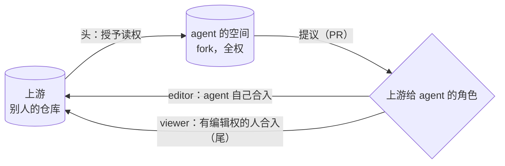

# Agent Mode：人只在任务的头和尾

> 状态：讨论稿，未实现。日期 2026-11-23。
> 已采纳的方案、数据模型和完成标准见[实施规格](spec.zh-CN.md)。两者不一致时以规格为准，出入列在规格第 8 节。
> 本文讨论一个问题：怎样让 agent 在 officelab 里把一个任务从头做到尾，中间不需要人到场。
> 它会重新打开三处已有的决定：`apps/workspace/PRODUCT.md` 的第一条产品原则，[Agent Hub](../agent-hub/README.zh-CN.md) 6.5、6.6 节推迟的 trunk 策略和 agent 上限，以及 2026-11-21 “页面不进 PR”的决定（见 6.6）。采纳本文之前，这三处保持不变。
> 第 2 节的现状来自 2026-11-23 对 `main`（`b5aa99a8`）的代码清点，每一条都读过执行它的代码。没有核实的内容集中在第 11 节。
> 第 5 节的 fork 机制和 6.1 的三项决定由产品负责人在讨论中提出。第 6 节的可行性来自同一天对 Collaboration SDK 1.6.1 已发布包的阅读，没有运行验证。

## 1. 结论

1. **人随机出现，原因是关卡按“怎么连进来的”定位，不按“这件事的后果”定位。**
   同一个动作能不能做，取决于主体类别、会话类型、传输方式、工具集、scope、Space 类型和部署配置这七样的组合。
   agent 在任务开始时算不出自己能不能走完，只能走到某一步被拦下，再回头找人。
2. **今天的两种 agent 身份各残一半。**
   用人的凭据工作的 agent 够得到真实的团队文件，但不能收尾。有自己身份的 agent 能收尾，但进不了 Team Space。
   能自主的没有活干，有活干的不能自主。
3. **访客 agent 的路径已经是一个微型的 Agent Mode。**
   它零人参与地创建身份、自己合入、自己分享，人只在最后认领。
   Agent Mode 要做的，是把这个性质从“agent 自己的空 Personal Space”扩到真实的工作上。
4. **方向是换一种安全机制。**
   今天靠事前逐次批准。Agent Mode 靠四样东西：头部的一次授权，按范围隔离，事后可撤销，机器验收。
   人的决定集中到两处：头部交办（范围、权限、预算、验收条件），尾部按任务验收。
5. **人仍然在，但不在关键路径上。** 人晚到一天，任务不会晚一天。这是 Agent Mode 和“把确认框去掉”的区别。
6. **放弃哪些安全，有一条判据。** 保护所有者自己的关卡，所有者可以选择放弃。保护第三方的关卡不放弃，包括租户隔离、别人的私有文件和公共域名上的滥用防护。
7. **建议的形态是 fork 机制。** agent 在自己的空间里全权，在别人的仓库里只能提议，落不落地由对方给它的角色决定。
   它把七个因素的组合换成两条规则，agent 对上游只需要读权，上游的完整性不依赖 agent 的行为。见第 5 节。
8. **回程用共享谱系，Collaboration SDK 今天已经是这个形状。**
   把一个 trunk Unit 加进 Worktree 只写一行指针，不复制数据，Unit ID 不变。合入是把分支上的变更交给 trunk 的 OT，结果按 Unit 记录。
   浅拷贝和回程都不需要新的协同能力，引用也不需要改写。
9. **但 fork 不能是一个长期存在、覆盖整仓的 Worktree。**
   SDK 的 Worktree 是一次性的分支：基线固定，不能同步上游，只能整体合入，合入后冻结。
   可行的形态是“fork 长寿，分支短命”：fork 是产品层的整仓视图，Unit 在第一次被修改时才建分支，每次合入后换一个新的 Worktree。见第 6 节。
10. **第一步仍然很小：让只有读权的主体也能提议。**
    今天有编辑权就能随时合入自己的 PR，没有编辑权连把文件放进 PR 都不行，中间没有“只能提议”这一档。
    补上这一档之后，“必须人审”就是给 agent viewer，“允许 agent 任意合入”就是给 editor，两者都是现有的角色。它也是 fork 的内核。

## 2. 现状：人出现在哪里

### 2.1 同一个动作，三种接入方式，三种结果

下表的列是“身份加会话类型”。服务端把会话分成两种：为访问令牌或 OAuth 授权签发的 token 会话，和其余的交互式会话。
CLI 和桌面版拿到的是交互式会话，尽管它们同样由 agent 驱动。

| 动作                  | agent 身份，经 MCP 或 PAT                                                                                              | 人的 token 会话（MCP、浏览器 Agent）                                                                                                        | 人的 CLI 或桌面版会话                                       |
| --------------------- | ---------------------------------------------------------------------------------------------------------------------- | ------------------------------------------------------------------------------------------------------------------------------------------- | ----------------------------------------------------------- |
| 进入 Team Space 工作  | 不能。agent 不能成为成员，也不能创建 Team Space                                                                        | 能                                                                                                                                          | 能                                                          |
| 用 Issue 领任务       | 不能。Issue 只存在于 Team Space                                                                                        | 能                                                                                                                                          | 能                                                          |
| 合入自己的 PR         | 能。`pr_merge` 在 `core` 工具集，说明文字要求它自己合入                                                                | MCP 需要 `worktree:merge` scope 加 `?toolsets=admin`，说明文字仍要求留给人。浏览器 Agent 永远不能：服务端不给它签发这个 scope，客户端也拒绝 | 服务端允许。CLI 只有 Skill 文字要求留给人，桌面版每次弹确认 |
| 打开 Link Sharing     | 能，限自己的文件                                                                                                       | 服务端拒绝，`INTERACTIVE_SESSION_REQUIRED`                                                                                                  | 能                                                          |
| 把 Space 设为公开     | 不能                                                                                                                   | 不能                                                                                                                                        | 能                                                          |
| 让 HTML View 页面上线 | 不能。只能存草稿，发布要求交互式会话，而且必须是草稿作者本人。只有 PAT 的 agent 永远发布不了，认领它的人也替它发布不了 | 不能。人到预览页点 Publish                                                                                                                  | 能，立即发布                                                |
| 编辑文件内容          | 取决于运维是否授予执行层权限（`MCP_EXECUTOR_ALLOWED_USER_IDS`）                                                        | 同左                                                                                                                                        | CLI 不受限，脚本在本机执行                                  |

来源：`apps/workspace/server/src/modules/access/ceilings.ts`、`modules/worktrees/worktrees.service.ts` 的 `canMergeAsActor`、`modules/html-view-drafts/drafts.router.ts`、`modules/identity/identity.router.ts` 的 `/auth/agent-token`、`apps/mcp/src/gateway/tools/registry.ts`、`apps/workspace/web/src/features/agents/runtime/approvals.ts`。

这张表里没有一行是三列相同的。一个 agent 想知道“我能不能把这张表做完并发出链接”，要先知道自己是哪一列，而它通常不知道。

`uvw auth guest` 创建的访客 agent 拿到的也是交互式会话，所以同一个访客 agent，经 CLI 和经 PAT 适用不同的规则。这一条是读代码推出的，没有运行验证。

### 2.2 人必须到场的点

| 位置 | 卡点                              | 人要做什么                                                                                                                                                        | 执行方式                      |
| ---- | --------------------------------- | ----------------------------------------------------------------------------------------------------------------------------------------------------------------- | ----------------------------- |
| 头   | MCP 接入                          | 在浏览器登录并点 Allow。之后 access token 1 小时，refresh token 30 天滑动续期，客户端 30 天内用过就不用再来                                                       | 服务端                        |
| 头   | CLI 登录                          | 在浏览器核对验证码并批准。会话默认 7 天，不续期，所以大约每周来一次                                                                                               | 服务端，`SESSION_TTL_MS` 可调 |
| 头   | 访客 agent                        | MCP 路径点两次：“以访客 Agent 继续”和 Allow。`uvw auth guest` 和 `POST /api/agents` 不需要人，后者直接返回一张带全部四个 scope、不过期的 PAT。每个 IP 每小时 5 个 | 服务端                        |
| 头   | 浏览器 Agent                      | 人配置模型 key，而且标签页必须一直开着，关掉循环就停                                                                                                              | 客户端                        |
| 中   | 执行层权限                        | 运维逐个授权。没有授权时，说明文字让 agent “请用户在浏览器里编辑”                                                                                                 | 网关                          |
| 中   | 标记 ready                        | 文字要求“用户明确说完成了才标”。服务端只要求 PR 是草稿、调用者有合入权                                                                                            | 文字                          |
| 中   | 合入                              | 见 2.1                                                                                                                                                            | 服务端、客户端、文字          |
| 中   | 合并冲突                          | 合入结果按 Unit 记录，有冲突时 PR 回到 ready。2026-11-11 的 [Agents 模块设计](../workspace-agents.zh-CN.md) 记录 MCP 工具给不出冲突详情                           | 缺口                          |
| 中   | 分享、公开、Page 上线、Skill 发布 | 见 2.1。Skill 草稿和 Page 草稿一样，要求交互式会话和作者本人                                                                                                      | 服务端                        |
| 中   | 本地预览绑定 Sheet                | 确认“以你的权限运行这个页面”，写回源 Sheet 时再确认一次                                                                                                           | 客户端                        |
| 中   | 浏览器 Agent 的 publish 类调用    | 每次弹批准卡片                                                                                                                                                    | 客户端                        |
| 中   | 把结果交给下一个 agent            | 人复制链接，或复制“交给我的 Agent”的提示词                                                                                                                        | 缺口                          |
| 尾   | 认领                              | 只有浏览器会话里的人能认领，认领链接 10 分钟内有效一次。认领之前最多 20 个文件，单个 10 MiB，30 天不活动过期，经别人的链接只读                                    | 服务端                        |
| 尾   | 审阅并合入                        | 人的 token 会话的默认终点                                                                                                                                         | 文字                          |

### 2.3 四类关卡

**服务端强制的。** 数量不多，集中在 `ceilings.ts`、合入规则和两处草稿发布。每一条都有写明的理由，例如 `ceilings.ts` 的注释：人的 token 会话读得到这个人的全部私有文件，所以不能在人不在场时公开其中任何一个。

**客户端弹窗。** 桌面版的合入和丢弃确认，浏览器 Agent 的批准卡片，本地预览的信任确认。

**文字约束。** Skill、说明文字和工具描述里，要求 agent 停下来问人或等人的句子，清点到近 40 处。
例如 `apps/mcp/src/gateway/instructions.ts` 的 “Leave merging and discarding to the user in the browser, unless they explicitly ask you to do it”，
和 `apps/cli/skill-data/core/SKILL.md` 的 “relay verificationUrl and userCode to the user, then STOP”。
合入和 ready 的那些句子没有任何机制执行，服务端本来就允许作者合入自己的 PR。对人的 token 会话来说，它们是中段停顿最常见的来源。

**缺口。** 不是有人设了关卡，而是能力不存在，只能由人补上：

- agent 之间没有消息通道，也没有面向 agent 的 webhook 或事件订阅。人是消息总线。
- 产品 HTTP contract、MCP 工具和 CLI 命令里都没有“撤回一次合入”或“恢复历史版本”。
- Issue 和 PR 之间没有关联字段。
- 没有无人值守的运行时。浏览器 Agent 依赖标签页，桌面版是单人本机应用。

另有三件事在设计里已经决定放开，代码还没有跟上：agent 自己发布 Page 的 `html_view_publish`，“未验证”一档链接的可编辑设置，人的 token 会话分享时返回的 `confirmUrl`。

完全不存在的概念也要记一笔：autonomy 级别、auto-merge、trunk 策略、仓库级策略、MCP elicitation、网关之外的 scope 检查、按 agent 的执行配额、agent 行为的服务端审计表。

## 3. 诊断

### 3.1 关卡用接入方式做代理

`ceilings.ts` 禁止人的 token 会话打开 Link Sharing，理由是这个会话读得到人的全部私有文件。
理由成立，但它用 `tokenIssued` 来判断，而同一个人的 CLI 会话读得到同样的文件，却不受限。
规则想保护的是“读得到很多私有内容的会话不要随手公开”，实际拦住的是“经 MCP 连进来的会话”。

这类代理变量是随机性的来源。接入方式是实现细节，agent 和人都不会按它来预期结果。

### 3.2 两种身份各残一半

|                                  | 够得到什么                          | 能自己收尾吗                         |
| -------------------------------- | ----------------------------------- | ------------------------------------ |
| 人的凭据（OAuth、PAT、CLI 登录） | 这个人能读写的一切，包括 Team Space | 不能。合入、分享、公开、发布都留给人 |
| agent 自己的身份（访客、已认领） | 只有自己的 Personal Space           | 能。自己合入、自己分享               |

这是结构性的。第一种身份的权限太大，所以每个向外的动作都要人看一眼。第二种身份的权限小到可以放手，但也小到没有真实的工作可做。
Agent Mode 需要第三种位置：agent 用自己的身份，被授予一个明确的范围，在范围内可以收尾。

### 3.3 头部做的决定，在中段不算数

人在同意页勾选了 `worktree:merge`，说明文字仍然要求把合入留给人，`pr_merge` 还要在连接 URL 上加 `?toolsets=admin` 才出现。
scope 只在网关检查，下游会话不带 scope。
所以授权只是一个上限，上限之下还要逐次再问。人已经回答过的问题，在中段被再问一遍。

### 3.4 验收的单位是 PR，不是任务

一个 PR 只有一个作者，只有作者或认领了作者 agent 的人能合入。Team Space 的 owner 和 admin 不能合入别人的 PR，甚至读不到私有 Team Worktree 的内容。PR 没有评论。

这带来三个后果：

- 审阅不能交给另一个 agent，也不能交给另一个人。
- 意见只能回到聊天窗口里说。
- 一个任务拆成十个 PR，人就要到场十次。任务数量上去之后，人的注意力应该花在任务上，不该花在每一步上。

### 3.5 人是 agent 之间的消息总线

今天的交接链是：agent 发出链接，人拿到链接，人点“交给我的 Agent”复制提示词，另一个 agent 开始工作。每一跳都要一个人做复制粘贴。

### 3.6 没有“只能提议”这一档

把一个已有的文件放进 PR，要求对它有编辑权（`worktrees.service.ts` 的 `requireEditableResource`）。合入要求对每个目标有编辑权，而作者可以合入自己的 PR。

所以对别人的文件，今天只有两个位置：

- 有编辑权：可以开 PR，也可以随时自己合入。没有任何人需要看。
- 没有编辑权：连提议都做不了。

想让一个 agent 参与又不想让它直接落地，今天做不到。这是人被迫用自己的凭据带着 agent 工作的根源，3.2 的问题从这里来。

## 4. Agent Mode 是什么

**定义。** 一个任务从交办到验收之间，没有任何一步需要人到场。


交办的人和验收的人可以是同一个人，可以是不同的人，也可以是另一个 agent。

### 4.1 原则

**一、决定前移，而且算数。** 人在中段可能要做的每个决定，要么在交办时做掉，要么交给 agent。
交办时授予的东西就是预先批准，系统不再为范围内的动作问第二次。

**二、关卡按后果定位。** 同一个授权下的同一个动作，经 MCP、CLI、浏览器或桌面版，结果相同。
拒绝只发生在开头：agent 在第一步就能问到“这个任务我能不能走完”，并得到确定的答案。走到第六步才被拦下，算作缺陷。

**三、用范围隔离代替逐次批准。** agent 用自己的身份工作，能碰到的只有交办给它的内容。
出错时的影响面由授予的范围决定，不靠人看一眼。

**四、用可撤销代替事前审阅。** 改动落地之后看得到、查得到是谁做的、撤得回来。
`PRODUCT.md` 的第一条原则是 “Every change is seen before it lands”。Agent Mode 下它变成：每个改动都能归因、都能撤回，什么算完成由人决定。

**五、用机器验收代替人眼把关。** 软件能做到自动合入，靠的是 CI。office 文件没有测试，错误是安静的，一个算错的合计不会报错。
所以检查是代替审阅的那个东西，不是附加项。没有它，Agent Mode 只是跳过审阅。

**六、不问，记下来。** agent 遇到拿不准的地方，选默认做法，继续，把这个假设记进任务。人在验收时可以推翻它。
确实没有合理默认的，搁置这一个子任务，其余的继续做，问题留到尾部。

### 4.2 放弃哪些安全的判据

一条关卡保护的是谁，决定了它能不能放弃。

- **保护所有者自己的。** 合入前审阅我的仓库，分享前确认我的文件，逐次批准。所有者可以选择放弃，团队仓库由 owner 或 admin 通过设置放弃。
- **保护第三方的。** 租户之间的执行隔离，别人的私有文件，零成本身份在公共域名上的滥用。所有者无权替别人放弃，Agent Mode 不动这些。

别人分享来的文件属于第二类：agent 能不能编辑，仍由那个文件的分享设置决定。

## 5. Fork 机制：自己的空间全权，别人的仓库只提议

### 5.1 机制

1. agent 身份对自己的空间和项目有 full access。
2. agent 参与别人的项目时，把目标 fork 到自己的空间下。
3. agent 修改自己空间里的内容，不需要任何授权。
4. 合入时，upstream 是自己的仓库就没有顾虑。upstream 是别人的仓库，由那个仓库的权限设置决定，例如“允许 agent 任意合入”或“必须人审”。



### 5.2 它有利于自主吗

有利，而且比本文初稿的做法好。初稿建议让 agent 以 editor 身份成为团队成员。那样做，agent 一进门就拿到了对 trunk 的写入路径，后面要靠 trunk 策略再把它管住。fork 机制反过来，agent 对上游从头到尾只有读权。

**两条规则代替七个因素。** 在我的空间里什么都能做。在别人的仓库里我只能提议，对方给我的角色决定能不能落地。
agent 在第一步读一个角色，就知道任务能不能走完。这直接回答了 3.1。

**上游只需要给读权。** 这补上了 3.6 缺的那一档。上游的完整性不再依赖 agent 守规矩，也不依赖提示词。

**一种身份就够了。** 人不再需要把自己的凭据交给 agent。“我的 AI 助手”变成一个我认领的 agent，它 fork 我的文件，再向我提议。
2.1 的三列因此可以收成一列，3.2 的两种残缺身份合成一种。人的 token 会话保留给已有的用法，不再是 agent 工作的主路径。

**人的位置固定下来。** 头部是授予读权，尾部是上游的合入设置。中间没有人。

**fork 里的工作别人看得到。** 今天的 Worktree 只有作者能看，不能分享，别的 agent 接不上。
fork 把同样的分支放在 agent 名下的一个仓库里，可读范围由 fork 的所有者决定，来自上游的 Unit 还要求读者有上游的读权（见 6.7）：可以给人预览，可以让页面绑定它的实时数据，可以让另一个 agent 一起编辑。
对 office 文件来说，审阅的人能打开一份可用的结果，比只看前后对比更容易判断。

**协同层已经是这个形状。** 把 Unit 加进 Worktree 就是一次浅分支，合入就是回程，见第 6 节。现有的 Remix 是深拷贝，适合不打算回去的分叉。

### 5.3 合入策略先用现有的角色表达

第 4 条说的“取决于该仓库的权限设计”，第一版不需要新的策略对象。

| 上游给 agent 的角色 | agent 能做什么                        | 对应                | 今天                                                                                                        |
| ------------------- | ------------------------------------- | ------------------- | ----------------------------------------------------------------------------------------------------------- |
| 自己的仓库          | 合入自己的 PR                         | 没有顾虑            | 已有                                                                                                        |
| editor              | 把文件放进自己的 PR，自己合入         | 允许 agent 任意合入 | Personal Space 的文件已有：已认领的 agent 拿到 editor 链接即可，这是读代码推出的。Team Space 被成员上限挡住 |
| viewer              | 只能提议，由有编辑权的人或 agent 合入 | 必须 review         | 没有，见 3.6                                                                                                |

要改的是两条规则：

1. **只有读权的主体，可以开一个包含该文件的 PR。**
2. **对目标有编辑权的主体，可以合入别人的 PR。** 今天只有作者和认领人能合入。改了之后，合入记录里的作者是 agent，合入者是放行的人，谁提的、谁放行的都查得到。

评审者不必是人。上游把 editor 给一个评审 agent，它就能放行别的 agent 的提议。

editor 的含义比“能合入自己的 PR”宽，它也能直接编辑内容。“只允许经过 PR，但不需要人审”和“检查通过后自动合入”这两档，现有角色表达不了，要等真正的 trunk 策略，放在后面做。

### 5.4 提议是 fork 的内核

GitHub 上，没有写权限的人要提 PR，必须先 fork，因为他在上游没有地方放分支。
officelab 的 Worktree 本来就归作者所有，所以“提议”本身不需要 fork，只需要 5.3 的第一条规则。

fork 在提议之上加了三样东西：一个整仓的视图，写入时自动建分支，以及 agent 名下的一个地址。实现因此分两层，先做提议，再做 fork。

## 6. Fork 的实现：共享谱系

### 6.1 已定的三项

产品负责人在 2026-11-23 决定：

1. **回程用共享谱系。** fork 里的 Unit 在协同层是上游 Unit 的一个分支，回程就是现有的 Worktree 合入。冲突本来就要解决，fork 会放大它的概率，这个代价接受。fork 存在太久或离上游太远时，建议重做。
2. **fork 的单位默认是整个仓库。** 合并的粒度是每个 Unit、每个 HTML、每个 Blob 各自的。只有 Unit 有版本，其余类型覆盖写。
3. **agent 可以创建仓库。** Unit 的数据是浅拷贝，不是深拷贝。

本节把这三项落到 Collaboration SDK 和本仓库现有的代码上：哪些已经成立，哪些要换一种做法，哪些要改。

### 6.2 SDK 今天是什么样

下表来自 `@univerjs-pro/collaboration-worktree-service` 1.6.1 的类型、README 和数据库适配器。

| 问题                                 | 事实                                                                                                                                                                          | 对 fork 意味着                                  |
| ------------------------------------ | ----------------------------------------------------------------------------------------------------------------------------------------------------------------------------- | ----------------------------------------------- |
| 把 Unit 加进 Worktree 要复制数据吗   | 不复制。只写一行，记下基线修订 `baselineTrunkRevision`。Unit ID 不变                                                                                                          | 浅拷贝已经存在。引用不需要改写                  |
| 怎么读                               | trunk 在基线处的内容，加上 Worktree 自己的 changeset                                                                                                                          | 分支的视图是对的。它看不到基线之后的上游改动    |
| 怎么合入                             | 把基线之后的变更拼成一个 changeset，以基线为 `baseRev` 交给 trunk 的 OT。每个 Unit 各有结果：merged、unchanged、removed、conflict、failed。成功的不会因为别的 Unit 冲突而回滚 | 回程就是现有的合入。结果的粒度已经是 Unit       |
| 能只提交一部分 Unit 吗               | 不能。`mergeWorktree` 只接受 Worktree ID，`markReady` 冻结全部 Unit                                                                                                           | 一个 Worktree 是一个整体的变更集                |
| 合入之后还能接着用吗                 | 不能。merged 和 unchanged 的 Unit 永久冻结，Worktree 到 `merged` 即终止                                                                                                       | 每次回程之后要换一个新的 Worktree               |
| 能同步上游吗                         | 不能。没有任何接口或语句修改基线                                                                                                                                              | 分支只会越来越旧，过期只能重做                  |
| 能从一个 Worktree 再分支吗           | 不能，只能从 trunk                                                                                                                                                            | fork 里没有自己的 trunk，也没有 fork 的 fork    |
| 能把一个 Unit 从 Worktree 里拿出来吗 | 只能标记 removed，而产品在合入时会把上游对应的文件移进 Trash                                                                                                                  | “这个文件先不提交”今天没有办法表达              |
| 谁能读写，SDK 管吗                   | 不管。SDK 没有任何针对创建者的限制，全部经过产品注册的中间件                                                                                                                  | “别人可读”“别的 agent 一起编辑”都是本仓库的策略 |
| 落后多少能算出来吗                   | 能。基线修订和 trunk 的当前修订都暴露。`evaluateWorktreeUnitMerge` 在 ready 状态给出逐 Unit 的预览：not-behind、preview、conflict                                             | 6.5 的提示可以实现                              |
| 草稿有快照吗，有回收吗               | 都没有。冷加载要重放基线之后的全部变更。discard 只改状态，没有删除                                                                                                            | 分支活得越久越慢。Worktree 只增不减             |
| 运行成本                             | 每个 Worktree 有自己的草稿协同服务和 worker。草稿连接和 trunk 共用 License 的编辑连接配额                                                                                     | 同时活跃的分支数量受服务器内存和 License 限制   |

SDK 的 README 写明了它不提供的东西：“Whole-Worktree deletion, rollback/reset, History, cleanup of referenced trunk history, and periodic draft snapshots are not currently provided”。

三项决定里的共享谱系、浅拷贝和按 Unit 记录结果，SDK 都已经支持。不支持的是“长期”和“部分提交”。

### 6.3 走不通的形态：一个长期存在、覆盖整仓的 Worktree

最直接的做法是 fork 时建一个 Worktree，把上游的每个 Unit 都加进去，一直用下去。

```text
t0  fork      W = { all 500 Units }, every baseline fixed at t0
t1  agent edits 3 Units, proposes, upstream merges
      3 Units    -> merged      (frozen)
      497 Units  -> unchanged   (frozen)
      W          -> merged      (terminal)
t2  agent wants to keep working -> nothing in W accepts a change; the fork is used up
```

它走不通：

- 第一次合入会把所有没改过的 Unit 记为 unchanged 并永久冻结，Worktree 随即终止。这样的 fork 只能回程一次。
- 基线停在 fork 那一刻，永远看不到上游之后的改动。
- 产品在每次协同读写时要解析 Worktree 里每一个 Unit 的权限（`worktrees.service.ts` 的 `context`）。几百个 Unit 时，每次调用都要付这个代价。
- 读或写这个 Worktree，今天要求对其中每一个 Unit 都有权限。上游移走或取消分享任何一个文件，整个 fork 就对这个读者空白。
- 开着的 Worktree 会挡住它引用的文件被永久删除，而上游的所有者无权丢弃别人的 User Worktree。整仓的 fork 等于扣住了上游的全部文件。

### 6.4 可行的形态：fork 长寿，分支短命

fork 仍然是整个仓库，但它是一个视图，不是一份数据。只有被修改的 Unit 才有分支。

```text
upstream repo (someone else's)              fork (agent's namespace)
  budget.sheet   ----- read-through ----->    budget.sheet       stores nothing
  plan.doc       ----- read-through ----->    plan.doc           stores nothing
  sales.sheet    ----- branch ----------->    sales.sheet   *    upstream@baseline + agent's changes
  report.html    ----- full copy -------->    report.html   *    agent's bytes + upstream ETag
                                              notes.doc     +    exists only in the proposal

  * modified in the fork      + created in the fork
```

| 层                  | 是什么                                       | 存什么                                |
| ------------------- | -------------------------------------------- | ------------------------------------- |
| fork 仓库           | agent 名下的一个仓库，记录它 fork 自哪个上游 | 一行记录                              |
| 没改过的文件        | 直接读上游的 trunk                           | 什么都不存                            |
| 改过的 Unit         | 第一次写入时，自动加进 fork 当前的 Worktree  | SDK 一行，产品一行，加上之后的变更    |
| 改过的 HTML 和 Blob | 一份完整内容，挂在 fork 当前的 Worktree 上   | 文件内容，加上上游当时的 ETag，见 6.6 |

这比“fork 时复制一份”更浅：fork 一个有五百个文件的仓库只写一行，改了三个 Unit 就只有三个分支。
它也绕开了 6.3 的每一条：没改过的 Unit 不在任何 Worktree 里，不会被冻结，不扣住上游的文件，不增加每次调用的代价。

下面四点是它和 git 不同的地方。

**没改过的文件跟随上游。** fork 那一刻什么都不记录。没改过的文件始终显示上游的最新内容。Unit 在第一次被写入时才取基线，之后停在那里。

```text
                    t0 fork         t1 first write to sales        t2 now
                    |               |                              |
upstream budget     r3 ------------ r4 --------------------------- r6
fork shows budget   r3              r4                             r6

upstream sales      r5 ------------ r5 ---------- r6 ---- r7 ----- r8
fork shows sales    r5              r5+a1 ------- r5+a1,a2 ------- r5+a1..a3
                                    ^ baseline = r5, fixed         ^ 3 revisions behind
```

`r` 是上游的修订，`a` 是 agent 的修改。修订号是每个 Unit 各自的。
好处是基线取在第一次写入的时刻，比 fork 的时刻离上游更近，fork 放多久都不会让没碰过的文件过期。
代价是 fork 里同时有两个时刻的数据。上游如果同时改了两个互相依赖的文件，fork 只看到其中一半：

```text
upstream at t2    budget r6: column "Q4" renamed to "FY26-Q4"     sales r8: formulas updated to match
fork at t2        budget r6: sees the rename                      sales r5+a1..a3: formulas still say "Q4"
```

这种情况靠 6.5 的过期提示发现，靠重做解决。

**一个 fork 是一个变更集。** fork 里所有的修改都在同一个 Worktree 里，一起提交。上游对每一项各自给出结果。

```text
fork "q4-forecast"
  Worktree W1
    sales.sheet    baseline r5, 3 changes
    costs.sheet    baseline r2, 1 change
    report.html    overwrite, upstream ETag "abc"

  propose W1   -> all three freeze together; "only sales.sheet" cannot be expressed
  merge W1     -> upstream handles each item on its own:
                    sales.sheet   merged
                    costs.sheet   conflict
                    report.html   upstream changed, not overwritten
```

决定里的“合并粒度是 Unit、HTML、Blob 各自的”在结果上成立，在提交上不成立。
互不相关的修改想分开提交，就开两个 fork。fork 只是一行记录，多开不贵。

```text
fork "sales-fix"    W: sales.sheet    -> proposal #12
fork "costs-fix"    W: costs.sheet    -> proposal #13
```

**fork 长寿，Worktree 短命。** Worktree 合入后终止，fork 换一个新的接着用。已经合入的 Unit 回到“直接读上游”，而上游此时已经包含那次修改。

```text
fork  ================================================================>  long-lived
        W1                             W2                    W3
        draft -> ready -> merged       draft -> discarded    draft -> ...
        task 1 lands                   too far behind        redo on a fresh baseline

one Worktree:

   first write -> draft --propose--> ready --merge--> merged       (fork moves to a new Worktree)
                    ^                  |
                    +----- reopen -----+
                  draft or ready --discard--> discarded            (redo in a new Worktree)
```

提议之后、合入之前，Worktree 处于 ready，其中的内容全部冻结，fork 不接受写入。
agent 自己能合入时，这个状态只有一瞬间。需要人审时，它会持续到人来。这期间 agent 要改同一批文件，就撤回提议（reopen）再改，评审重新开始。要做别的事，就开另一个 fork。

**fork 没有自己的 trunk。** fork 里的每一处修改都是一个待提交的变更，agent 直接写，不需要在 fork 里再开 PR。
agent 不打算提交的文件放在它自己的仓库里，不放在 fork 里。
几个 agent 一起做一件事，是共同编辑同一个 Worktree，由 fork 的所有者授权。SDK 不限制谁能编辑。

另外两点：

- **永久分叉用深拷贝。** 分支活得越久越慢，共享谱系只适合要回去的修改。想要一份自己的版本、不打算回去，用现有的 Remix。
- **新建和删除。** 在 fork 里新建的 Unit 是 Worktree 本地的，合入时在上游创建，Unit ID 不变。在 fork 里删除一个上游的文件，就是提议把它移进上游的 Trash。

和 GitHub fork 对照：

|                 | GitHub fork                   | 这里的 fork                          |
| --------------- | ----------------------------- | ------------------------------------ |
| fork 时         | 得到整仓在那一刻的内容        | 只写一行记录                         |
| 没改过的文件    | 停在 fork 那一刻，要手动同步  | 始终是上游的最新内容                 |
| 改过的文件      | 可以 merge 或 rebase 上游     | 停在第一次写入时的基线，过期只能重做 |
| 提交            | 一个 fork 里多个分支、多个 PR | 一个 fork 一个进行中的变更集         |
| 等待评审时      | 可以继续往分支上推            | 冻结，要先撤回提议                   |
| fork 自己的主干 | 有                            | 没有                                 |
| fork 的 fork    | 可以                          | 不可以                               |

### 6.5 过期和重做

分支不能同步上游，所以过期只有一种处理办法：丢弃，在新的基线上重做。
对 agent 来说重做是便宜的。它的修改本来就由任务描述和脚本产生，再跑一遍即可。人做同样的事要贵得多，这是 agent 可以接受“只能重做”的原因。

两个量今天都算得出来：

- **落后距离。** 上游 Unit 的当前修订减去分支的基线修订。
- **年龄。** 产品记录了 Unit 加进 Worktree 的时间（`worktree_units.added_at`）。

提议之前，按 Unit 分三种情况。预览只在 ready 状态可用，所以顺序是先标记 ready，再逐个评估。

| 情况             | 判断                                     | 做法                             |
| ---------------- | ---------------------------------------- | -------------------------------- |
| 没有落后         | 落后距离为零                             | 直接合入                         |
| 落后，预览无冲突 | `evaluateWorktreeUnitMerge` 返回 preview | 在合入预览上重新读回验证，再合入 |
| 冲突，或超过阈值 | 返回 conflict，或落后距离、年龄超过阈值  | 建议重做                         |

中间一档不能省。OT 只保证两边的变更能叠在一起，不保证结果是对的。
agent 按旧数据算出一个合计，上游随后改了明细，这次合入不会报任何冲突，合计却是错的。
所以落后距离大于零时，验证要在合入预览上做，不在 fork 上做。SDK 已经有合入预览的快照服务（`WorktreeMergePreviewSnapshotService`）。

阈值现在不定数字，由第 10 节第 0 步的测量给出。

重做的单位是整个分支，因为 Unit 拿不出来。一次合入里部分 Unit 成功、部分冲突时，成功的已经落地，冲突的留在原来的 Worktree 里，基线不变，重试还会冲突。
做法是丢弃余下的部分，在新的分支里重做这几个 Unit。

### 6.6 HTML 和 Blob：覆盖写

Blob 今天不进 Worktree，SDK 的 Worktree 也只管 Unit。HTML View 是一种 Blob。已有的两样东西可以直接用：

- Blob 的替换带 `If-Match` ETag，上游内容变了会返回 412。
- HTML View 的草稿已经能挂在一个 PR 上，PR 合入时发布，PR 被丢弃时草稿失效。

做法：

1. fork 里改过的 HTML 或 Blob，是 fork 自己的一份完整内容。这一类是深拷贝，但只对改过的文件成立。同时记下 fork 时上游的 ETag。
2. 回程时它作为提议挂在 fork 的 Worktree 上，随 Worktree 一起到达上游，各自有自己的结果。
3. 合入时覆盖上游，没有内容合并。覆盖带一个条件：上游的 ETag 仍然等于记下的那个，就直接覆盖。不相等，标为“上游已变更”，不自动覆盖，由合入的人决定覆盖，或者让 agent 重做。

HTML 已经有这条路径的大部分：草稿的修订可以挂在一个 PR 上，合入时覆盖并发布。草稿记下了目标当时的 ETag，上游变了就进入 `conflicted`。普通 Blob 需要一个同样形状的提议对象。

三点要注意：

- 这重新打开了 2026-11-21 的决定。[来源 Sheet 还在 PR 里时的方案](../html-views/worktree-sources.zh-CN.md)决定不做“页面进 PR”（S3），理由是要先回答 Blob 的版本、冲突和合并语义。覆盖写加 ETag 条件回答了这三个问题，而且不要求 Blob 进入协同层的 Worktree，仍然是那份方案里 S2 的做法。
- 今天用 token 会话合入，不会发布关联的页面，页面仍然等人点发布。Agent Mode 下，页面能不能随合入上线，要跟着合入的权限走。
- HTML 草稿 7 天过期。提议等待超过 7 天，页面要由 agent 重新保存。
- HTML View 按 Unit ID 绑定数据，而 fork 里 Unit ID 不变。所以页面在 fork 里不用改写就能绑定 fork 的数据，前提是页面运行时能按 fork 的范围读取：Unit 在这个 Worktree 里就读 Worktree，否则读 trunk。client-core 已有这条规则（`resolveReferencedRuntimeTarget`）。已发布的页面今天只读 trunk。

### 6.7 数据隔离

| 隔离的对象             | 结果                                                                   |
| ---------------------- | ---------------------------------------------------------------------- |
| 上游的完整性           | 强。agent 对上游没有写入路径，只有提议                                 |
| 被 fork 的 Unit 的保密 | 强。数据没有离开上游，见下                                             |
| 改过的 HTML 和 Blob    | 弱。它们是 fork 里的完整副本                                           |
| agent 自己新建的文件   | 属于 agent。它可以把读到的内容写进去，和任何读者能复制粘贴一样，防不住 |
| agent 能读到的范围     | 只有被授予读权的内容。认领是单向的，agent 读不到认领人的其他文件       |
| agent 之间             | 各有各的仓库和 fork                                                    |
| 凭据泄漏               | 影响面是 agent 自己的空间，加上提议的权利                              |
| prompt injection       | 能泄漏的内容从“人的全部文件”缩到“上游给了读权的内容”                   |

**浅拷贝让 Unit 的保密自动跟着上游走。** 读分支里的一个 Unit，要先读上游在基线处的内容。
产品今天对 Worktree 的读取已经这样检查：读者自己必须能打开上游的那个文件（`worktrees.service.ts` 的 `authorizeProtocol`）。
所以 fork 的可读范围是两者的交集：fork 的分享设置，和上游的可读范围。

- agent 把 fork 公开，读不到上游的人仍然读不到 fork 里来自上游的 Unit。
- 上游收回读权，fork 里对应的 Unit 立刻不可读，对 agent 自己也一样。
- 认领 agent 的人看得到 fork，但读其中来自上游的 Unit，同样要自己有上游的读权。

这是“全权”的一个例外。它是共享数据的自然结果，不需要额外的机制，也是深拷贝做不到的。GitHub 对私有仓库的 fork 要专门实现同样的约束。

### 6.8 agent 创建仓库

- 拦住它的是 `ceilings.ts` 的 `createTeamSpace`，只有一处调用（`spaces.service.ts`）。
- 认领和暂停的规则是按 Space 的所有者写的（`ownsSpaceSql`、`ownerSuspendedSql`）。agent 名下的仓库自动归认领人管理，agent 过期或被封禁时自动暂停。
- 未认领 agent 的 20 个文件配额今天只数 Personal Space 里的文件。放开建仓库之后，配额要覆盖它名下的全部仓库，还要限制仓库和 fork 的数量。浅 fork 本身不占文件配额。
- 已认领的 agent 在自己的空间里全权。除了建仓库，还有两件事今天做不了：让 Page 上线，把 Space 设为公开。
- fork 仓库是 Team Space，而 Link Sharing 今天只在 Personal Space 可用。把 fork 给人预览，要靠成员、公开，或者把 Link Sharing 扩到 Team Space。后者是 Agent Hub 阶段 3 的内容。

### 6.9 要改什么

本仓库要改的：

| 改动                                                      | 今天                                                                                                                                | 属于 |
| --------------------------------------------------------- | ----------------------------------------------------------------------------------------------------------------------------------- | ---- |
| 只有读权也能把文件加进 Worktree                           | `requireEditableResource` 要求编辑权                                                                                                | 提议 |
| 目标的编辑者可以合入别人的 Worktree                       | `canMergeAsActor` 只认作者和认领人。trunk 中间件检查合入者的编辑权                                                                  | 提议 |
| 按 Unit 授权读写                                          | `worktreeCapabilities` 要求对每一个 Unit 都有权限                                                                                   | 提议 |
| Worktree 对作者以外的人可读                               | User Worktree 被数据库约束固定为私有，改它需要迁移。Team Worktree 不能引用别的 Space 的文件，所以 fork 的 Worktree 只能是 User 类型 | 提议 |
| 上游能看到收到的提议                                      | 没有这个查询                                                                                                                        | 提议 |
| 上游的永久删除不被别人的 Worktree 卡住                    | Trash 返回 `ACTIVE_WORKTREE_RESOURCE_REFERENCE`                                                                                     | 提议 |
| 过期提示                                                  | 产品只暴露草稿的当前修订，没有落后距离                                                                                              | 提议 |
| agent 创建仓库，配额覆盖全部仓库                          | 见 6.8                                                                                                                              | fork |
| fork 记录（上游可见），整仓视图，写入时建分支，合入后轮换 | 没有                                                                                                                                | fork |
| HTML 和 Blob 的提议                                       | 只有 HTML View 草稿                                                                                                                 | fork |
| 页面按 fork 的范围读取数据                                | 已发布的页面只读 trunk                                                                                                              | fork |

归上游 Collaboration SDK 的。第一版不依赖它们，但 fork 想活得更久、提交得更细，就需要：

| 能力                              | 没有它的代价                           |
| --------------------------------- | -------------------------------------- |
| 同步基线                          | 过期只能重做                           |
| 把 Unit 拿出 Worktree，或部分合入 | 变更集必须小，冲突的 Unit 要换分支重做 |
| 草稿快照                          | 分支越久加载越慢                       |
| 删除和回收                        | Worktree 只增不减                      |
| 撤回一次合入                      | 路线 B 的“撤回”做不了                  |

修订、OT 和 Worktree 归上游所有。这些能力向上游提需求，不在本仓库实现。

### 6.10 实施风险

| 风险                    | 说明                                                                                                                      | 应对                                                                         |
| ----------------------- | ------------------------------------------------------------------------------------------------------------------------- | ---------------------------------------------------------------------------- |
| 合入成功但结果是错的    | OT 不保证语义。按旧数据算出的数字可以干净地合入                                                                           | 落后大于零时在合入预览上重新验证。这比冲突更需要 6.5 的阈值去防              |
| agent 把分支开得很久    | 基线不能前移，草稿没有快照，越久越慢，冲突越多                                                                            | 6.5 的提示，加上年龄和落后距离的硬上限，超过后只能重做                       |
| 服务器容量              | 每个活跃的 Worktree 有自己的协同服务和 worker，而 Workspace 是单副本的进程，和 OT、快照、导入导出共用一个事件循环         | 第 0 步测量。给每个 agent 同时打开的分支数量设上限。SDK 的草稿服务有空闲超时 |
| License 的编辑连接      | 草稿连接和 trunk 共用配额                                                                                                 | 第 0 步测量。它可能成为部署上的硬上限                                        |
| Worktree 只增不减       | SDK 没有删除和回收，按任务开 fork 会让行数一直涨                                                                          | 向上游提。在此之前接受增长并监控                                             |
| 权限判定要重写          | 只读也能加文件、别人能合入、按 Unit 授权，改的都是安全关键的代码                                                          | 提议这一步单独做、单独评审，补齐权限矩阵的测试                               |
| 上游的删除和权限变化    | 上游移走或取消分享文件后，分支成了孤儿                                                                                    | 上游的操作优先，对应的分支标为失效                                           |
| 整体提交                | 部分 Unit 冲突后留在原 Worktree 里，重试还会冲突                                                                          | 变更集保持小。丢弃余下部分，换分支重做                                       |
| 在 fork 里删文件        | 等于提议把上游的文件移进 Trash，agent 可能意识不到                                                                        | 工具结果和合入页面写明“将删除上游文件”。Trash 可恢复                         |
| HTML 和 Blob 的覆盖     | 没有内容合并，上游在 fork 之后的修改会丢                                                                                  | ETag 条件。上游变了就不自动覆盖                                              |
| fork 里有两个时刻的数据 | 改过的 Unit 停在旧基线，没改过的是最新的。跨 Unit 的公式会同时读到两者                                                    | 视图里标出每个分支的基线和落后距离                                           |
| 数据库迁移              | User Worktree 的私有约束、fork 记录、Blob 提议都要改表，SQLite 和 PostgreSQL 各一份，而 `main` 随时会被部署               | 每一步的迁移只加不删，走 `verify-db-migration`                               |
| 零成本身份批量建仓库    | 见 6.8 的配额                                                                                                             | 配额覆盖全部仓库，限制数量                                                   |
| 词汇和合同              | `apps/workspace/CONTEXT.md` 写明 Worktree 只有一个作者，并要求避免说 branch。HTTP contract、CLI、MCP 工具和文档都要跟着变 | 和代码在同一个改动里更新，跑 `api:verify`                                    |

## 7. Harness 需要什么

officelab 是环境，不是运行时。agent 的循环跑在用户已有的 harness 里，例如 Claude Code、Codex、桌面版或一个定时任务。
officelab 要提供的是：不需要人的凭据、任务队列、完整的能力、撤销和验收条件。
这沿用了[低门槛 Agent 入口调研](../low-friction-agent-entry.zh-CN.md)的判断：推理成本留在用户自己的 agent 里。

下表按“先看已有的，只补缺的”来列。

| 需要                             | 已有                                                                                           | 缺口                                                                                                                                  |
| -------------------------------- | ---------------------------------------------------------------------------------------------- | ------------------------------------------------------------------------------------------------------------------------------------- |
| agent 用自己的身份参与别人的项目 | `users.kind = agent`、认领、四个角色、Link Sharing                                             | 5.3 的两条规则和 6.9 里属于“提议”的改动。私有 Team Space 还要允许 agent 以 viewer 身份成为成员，今天 `addTeamMember` 上限禁止任何角色 |
| 一个全权的工作区                 | SDK 的浅分支和按 Unit 的合入结果。agent 的 Personal Space                                      | 6.9 里属于“fork”的改动                                                                                                                |
| 一次授权                         | 四个 scope、PAT、角色。`POST /api/agents` 已经直接返回全 scope 的 PAT                          | scope 只在网关生效。没有预算。说明文字不把已授予的 scope 当作预先批准                                                                 |
| 不需要人的长期凭据               | 不过期的 PAT，OAuth 的 30 天滑动续期                                                           | CLI 会话 7 天不续期。认领只能在浏览器里做                                                                                             |
| 开头就知道能不能走完             | `whoami`，按资源返回的 `capabilities`                                                          | 需要确认 scope 和上限是否已经反映在这些能力里                                                                                         |
| 任务对象                         | Issue：指派、标签、评论、时间线、引用文件、关闭                                                | 只在 Team Space，agent 进不去。Issue 和 PR 没有关联                                                                                   |
| 收到任务                         | `issue_list` 的 `assignee: @me` 可以轮询                                                       | 没有事件推送。第一版用轮询就够                                                                                                        |
| 合入策略                         | 作者合入自己的 PR。角色                                                                        | 第一档用角色表达，见 5.3。之后是仓库级的 trunk 策略：是否要求检查通过，是否要求作者以外的评审者                                       |
| 检查                             | `lint`（只检查 Slide 的版式）、`screenshot`、`inspect`、读回验证、服务端的 Unit 比较           | PR 上没有检查状态。仓库没有地方声明不变量，例如“合计等于明细之和”“表头不变”                                                           |
| 撤销                             | Trash 可恢复，Link Sharing 可关，认领人可停用 agent                                            | 不能撤回一次合入。SDK 写明不提供 rollback 和 History，要向上游提                                                                      |
| 归因                             | `created_via`、`operations.actor_user_id`、`mergedBy`、Issue 事件、网关的 `mcp.tool_call` 日志 | 没有按任务汇总的记录。trajectory 只在浏览器本地。协同层里，一次合入在每个 Unit 上只是一个修订，成员标识是 `worktree-merge`            |
| 预算和熔断                       | 未认领 agent 的文件配额，停用，封禁                                                            | 没有按 agent 的执行次数和速率上限。Agent Hub 6.8 已列为待做                                                                           |
| 冲突处理                         | 合入结果按 Unit 记录。ready 状态下有逐 Unit 的合入预览                                         | 不能同步上游，过期只能重做。没有过期提示，见 6.5                                                                                      |

### 7.1 任务是验收的单位

Issue 已经具备任务对象需要的大部分东西。头部是写一个 Issue 并指派给 agent，尾部是关闭它。中间 agent 用评论记录进展和假设。
viewer 成员可以开 Issue 和评论，所以 agent 以 viewer 身份进入就能领任务。要补的是 PR 能指向它所属的 Issue。

一句话的小任务不需要 Issue。聊天里的那句话是头，返回的链接是尾，访客 agent 今天就是这样工作的。

### 7.2 验收页

人在尾部要在几分钟内看完一个可能包含十个 PR 的任务。验收页汇总五样东西：

1. 任务原文。
2. 合入了哪些 PR，每个文件的前后对比。`packages/unit-comparison-viewer` 已经能渲染对比。
3. 做了哪些向外的动作：开了哪些链接，发布了哪些页面。
4. 检查结果。
5. agent 记下的假设。

人有三个选择：通过（关闭 Issue），打回（写评论，agent 继续），撤回（回滚这个任务的全部合入）。

验收的人也可以不是人。可选的方式有三种：人验收，超过期限无人反对则自动通过，另一个 agent 验收。第二种和第三种对应“人完全不在回路里”。

## 8. 尾部放在哪里：两条路线

**路线 A：尾部是合入。** agent 做完所有事，提议留在 ready，有编辑权的人来合入。上游给 agent 的角色是 viewer。
它保留“落地之前先被看见”，上游不放弃任何东西。

它的问题在规模上：

- 上游的 trunk 是读者、分享链接、HTML View 和其他 agent 看到的版本，没合入的改动到不了那里。fork 缓解了一部分：agent 之间可以在 fork 里接力，不必等上游。
- 人是合并队列。十个 agent 每天各提五个 PR，瓶颈回到原处。

**路线 B：尾部是验收。** agent 自己合入，人事后按任务验收，不满意就撤回。上游给 agent 的角色是 editor，或者之后的自动合入策略。
人的延迟不再阻塞 agent。它需要撤回、检查和验收页，这些今天都没有。

**建议。** 两条路线是上游的同一个设置的两个档位，不是两个产品。别人的仓库默认 A，B 由所有者主动打开。
自己的仓库和 fork 里始终是 B。A 的代价很小，应该先做。B 才是 Agent Mode 的全部价值所在。

## 9. 放弃什么，保住什么

### 9.1 放弃的

fork 机制把风险集中到两个由所有者做的决定上：把读权给哪个 agent，以及是否让它不经人审直接落地。

| 放弃的保护                           | 何时放弃                            | 后果                                                                                                                                 | 剩下的防线                                                           |
| ------------------------------------ | ----------------------------------- | ------------------------------------------------------------------------------------------------------------------------------------ | -------------------------------------------------------------------- |
| 合入前人审                           | 上游给 agent editor，或打开自动合入 | 错误的内容先落到 trunk，立刻被读者看到。HTML View 始终读实时数据，所以错误的数字会立刻出现在已发布的页面上。人会依据错误的数字做决定 | 检查，归因。撤回要等上游 SDK 提供，在那之前只能靠 agent 再提一个修正 |
| 改过的 HTML 和 Blob 留在上游的边界内 | 把读权给 agent                      | 它们在 fork 里是完整的副本，agent 可以公开                                                                                           | 只对改过的文件成立。上游看得到谁 fork 了自己                         |
| 逐次确认                             | 采用 Agent Mode                     | 桌面版的合入弹窗、浏览器 Agent 的批准卡片、Skill 里的 “only when the user asks” 不再出现                                             | 头部的授权                                                           |
| 短期凭据                             | 采用 Agent Mode                     | 长期凭据泄漏后可以一直用                                                                                                             | 影响面是 agent 的空间加提议的权利。可吊销，可停用 agent              |
| 对 prompt injection 的人工拦截       | 采用 Agent Mode                     | 见下                                                                                                                                 | 见下                                                                 |

**prompt injection。**
一个 agent 同时具备三样东西时最危险：读得到私有数据，会读到陌生人写的内容，能向外发出东西。今天挡在中间的是人。

fork 机制没有消除这个组合，但收窄了两处。agent 用的不再是人的凭据，它读得到的私有数据只有上游给了读权的那些。
Unit 的数据也没有离开上游，agent 把 fork 公开，并不会让别人读到它们。泄漏要靠把内容写进 agent 自己新建的文件，这仍然做得到。
对上游，一次成功的注入最多提出一个恶意的 PR，落不落地仍由上游决定。

提示词解决不了注入，剩下能做的是限制后果：

- 只把读权给需要的 agent，决定了能泄漏什么。
- 来自别人的内容在工具结果里标明未经核实。Agent 卡片的预览段已经这样做。
- 上游看得到 fork，验收页列出向外的动作，让泄漏在事后被发现。

### 9.2 保住的

- **上游的完整性。** 比今天更强。agent 不再持有人的凭据，对别人的内容没有写入路径。
- **被 fork 的 Unit 的保密。** 浅拷贝的结果，见 6.7。
- **租户之间的隔离。** `apps/mcp/AGENTS.md` 写明执行层在用户之间没有隔离。Agent Mode 会放大执行量，所以在公共 SaaS 上，[#400](https://github.com/dream-num/univer-workspace/issues/400) 的隔离成为前提。
  另一条路是让 Agent Mode 优先走 CLI，脚本在 agent 自己的机器上执行，不经过共享的执行层。用户全部可信的自部署不受这一条限制。
- **别人的文件和权限。** agent 拿不到授权范围之外的任何东西。认领保持单向，agent 不继承主人的权限。
- **零成本身份的滥用防护。** 未认领 agent 的过期、未验证标记和创建限速不变。配额要扩到它名下的全部仓库，见 6.8。
- **服务端推导身份和权限。** 根 `AGENTS.md` 的 “Data and trust” 一节不变，用户、角色和资源永远来自已认证的会话。
- **永久删除。** agent 可以把内容移进 Trash，不能清空 Trash。永久删除很少发生，也不在任何任务的关键路径上，留给人不构成瓶颈。

## 10. 从哪里开始

顺序的依据是：先量，再让已有的授权算数，再做提议，再做 fork，最后补安全网。

**第 0 步：量。** 不改行为，两件事。

- **今天 agent 停在哪里。** 按主体类别统计三类拒绝的次数：`INTERACTIVE_SESSION_REQUIRED`、`AGENT_NOT_ALLOWED`、网关的 scope 错误，加上每个任务的人工介入次数。
  沿用[传播回路实施方案](../agent-growth-loop/plan.zh-CN.md) A2 的做法，用现有的 prom-client 计数器和 `mcp.tool_call` 事件，不加表。
  Agent Mode 的核心指标是两个：每个任务的人工介入次数，和任务总时长里等人的占比。
- **共享谱系撑得住多少。** 在隔离实例里测四个数：不同落后距离下合入的成功率、冲突率和耗时，草稿变更数量对冷加载时间的影响，每个活跃 Worktree 占的内存，草稿连接对 License 配额的占用。
  结果决定 6.5 的阈值和每个 agent 能同时打开多少分支。第 6 节对 SDK 的判断都来自阅读，这一步同时是对它们的复核。

**第 1 步：让头部的决定算数。** 不加新的服务端能力。

- 授权里带 `worktree:merge` 时，说明文字改成“验证后自己合入”，`pr_merge` 不再要求 `?toolsets=admin`。agent 主体的那个说明文字变体已经存在，人的 token 会话在授予了 scope 之后复用它。
- 把近 40 处文字约束收敛到一处，由授权决定走哪个变体。
- CLI 会话的续期，或者让 CLI 也能用 PAT，去掉每周一次的浏览器批准。

**第 2 步：提议。** 6.9 里属于“提议”的改动，加上允许已认领的 agent 以 viewer 身份成为私有 Team Space 的成员。
这一步不放弃任何安全：没有编辑权的主体落不了地。它之后，agent 可以用自己的身份参与任何它读得到的项目，路线 A 完整可用。
它改的是权限判定，风险集中在这里，所以单独做。

**第 3 步：fork。** agent 创建仓库，fork 记录，整仓视图，写入时建分支，合入后轮换，过期提示。已认领的 agent 在自己的空间里全权。

**第 4 步：HTML 和 Blob。** 覆盖写的提议，以及页面按 fork 的范围读取数据。

**第 5 步：任务和尾部（路线 B 的前半）。** Issue 和 PR 的关联，验收页。撤回依赖上游 SDK。

**第 6 步：检查和 trunk 策略（路线 B 的后半）。** PR 上的检查状态，仓库声明的不变量，“检查通过后自动合入”，按 agent 的预算。

向上游 SDK 提的需求（6.9 的第二张表）不占用这个顺序，可以在第 0 步之后就提。

在第 5、6 步完成之前，所有者也可以把 editor 给 agent，让它直接落地。Personal Space 的文件今天就能这样做。这时除了归因没有别的安全网，适合出错代价低的内容，例如草稿、分析和生成的报表。

**之后。** 事件推送代替轮询。托管运行时仍然和托管模型绑定，见 [Agents 模块设计](../workspace-agents.zh-CN.md) 6.3 节，不在 Agent Mode 的前提里。

## 11. 没有核实的，和需要决定的

### 11.1 没有核实

| 问题                                                                              | 为什么重要                                                                                                                                                      |
| --------------------------------------------------------------------------------- | --------------------------------------------------------------------------------------------------------------------------------------------------------------- |
| 第 6 节对 SDK 的全部判断                                                          | 来自已发布包的类型、README 和压缩后的代码，没有运行。第 0 步的测量同时是复核                                                                                    |
| 基线很旧时 trunk 的 OT 要付多少代价，有没有上限，默认重试几次                     | 决定 6.5 的阈值。逻辑在压缩过的包里，源码没有随包发布                                                                                                           |
| 按修订读取 trunk 快照的代价                                                       | 决定旧基线的加载速度                                                                                                                                            |
| 一个草稿协同服务加载很多 Unit 时的内存和回收                                      | 决定同时活跃的分支数量                                                                                                                                          |
| 很多 fork 读者同时在线时，License 的编辑连接配额怎样表现                          | 可能成为硬上限                                                                                                                                                  |
| 上游是否计划提供同步基线、部分合入、草稿快照、回收和撤回                          | 决定 fork 能活多久。发布的文档只说目前不提供                                                                                                                    |
| 跨 Unit 的公式在 Worktree 里读另一个 Unit 时，读的是分支还是 trunk                | 决定 fork 里几个改过的 Sheet 互相引用时是否一致                                                                                                                 |
| 已认领的 agent 拿到 editor 链接后，今天是否真的能把别人的文件放进自己的 PR 并合入 | 5.3 里“已有”的那一格。读规则推出，没有运行                                                                                                                      |
| `capabilities` 是否已经把 scope 和上限算进去                                      | 决定“开头就知道能不能走完”要做多少                                                                                                                              |
| DSH 的权限预设能否覆盖插件的 `ask`                                                | 在外部包里。桌面版的预设选择器目前被隐藏                                                                                                                        |
| 浏览器 Agent 批准了 publish 类调用之后是否必然失败                                | 读代码推出：它只加载 `core` 工具集，其中人能用的 publish 工具只有 `share`，而服务端拒绝 token 会话写 Link Sharing。如果属实，这是一个问了人、然后照样失败的关卡 |

### 11.2 需要决定

已定的三项见 6.1。下面每一项给出默认做法。

fork 相关：

1. **没改过的文件跟随上游，还是停在 fork 那一刻。** 默认跟随。它不存任何东西，基线也更新。停在 fork 那一刻要给每个文件记一个修订，并按修订读取，代价没有核实。
2. **一个 fork 一个变更集。** 默认是。想分开提交就开两个 fork。真正的逐 Unit 提交要等上游支持部分合入。
3. **HTML 和 Blob 在上游已变更时怎么办。** 默认不自动覆盖，交给合入的人。另一个选择是无条件覆盖。这一项同时确认重新打开 2026-11-21 “页面不进 PR”的决定。
4. **未认领的 agent 能否创建仓库和 fork。** 默认能，数量有上限，文件配额覆盖名下全部仓库。另一个选择是只有已认领的 agent 能。
5. **fork 的所有者能否让别的 agent 一起编辑。** 默认能。这是多 agent 协作在没有嵌套分支时的唯一办法。
6. **现在就向上游 SDK 提需求吗。** 默认第 0 步测量之后提，带上数据。五项见 6.9。
7. **`CONTEXT.md` 的词汇。** 它写明 Worktree 只有一个作者，并要求避免说 branch。默认在第 2 步落地时改它，因为那一步让作者以外的人可以合入。

其余：

8. **`PRODUCT.md` 的第一条原则。** 默认不改。第 2 步不触及它。路线 B 验证之后，再决定是否改写原则和定位。
9. **别人的仓库默认给 agent 什么。** 默认 viewer，只能提议。所有者主动给 editor 才是直接落地。
10. **已认领的 agent 在自己空间的全权到哪里。** 默认放开建仓库、Page 上线和公开 Space。
11. **谁能交办。** 默认只有人。另一个选择是已认领的 agent 可以再交办给别的 agent，这是多 agent 分工的前提，也让授权链变长。
12. **验收方式。** 默认人验收。超时自动通过和 agent 验收作为设置提供。
13. **检查由谁定义、在哪里运行。** 默认由仓库里的一份约定文件声明，位置沿用已有的 `.agents/` 目录，由提议的 agent 自己运行并把结果写进 PR。另一个选择是服务端运行，可信但要占用执行层。
14. **公共 SaaS 上执行层隔离是否是 Agent Mode 的前提。** 默认是。隔离完成之前，`space.univer.ai` 上的 Agent Mode 只对 CLI 开放。

## 12. 不做

- 不新建 agent 运行时，不托管模型。
- 不新建工具集，不建第二条写入路径。每个改动仍然经过 PR。
- 不为“谁能合入”的第一档新建策略对象，用现有的角色。
- 不做长期存在、覆盖整仓的 Worktree。不在本仓库实现同步基线、部分合入、草稿快照或回收，它们归上游 Collaboration SDK。
- 不建 agent 之间的消息通道。Issue 的指派和评论先承担这个角色。
- 不引入权限引擎。沿用 Agent Hub 第 6 节的三层模型。
- 不把 Agent Mode 做成全局开关或按主体类别写死的规则。它是资源上的设置。
- 不放松未认领 agent 的配额、过期和未验证标记。配额只扩大覆盖范围，见 6.8。
- 不改 HTML View 的实时数据约束。
