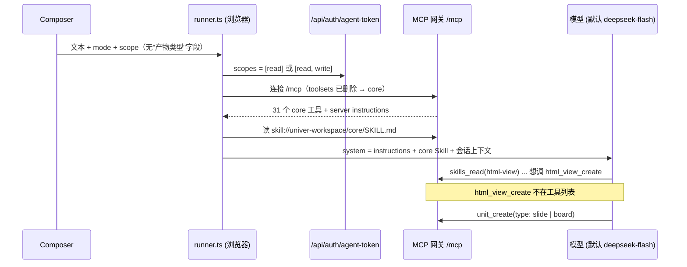

# 浏览器 Agents 把「页面」做成了 Slide 或 Board：原因与修复方案

状态：已对齐，采用方案 A2（发布前由用户在会话里批准，全屏草稿预览，第一版支持修订页面）。实现见同一 PR stack。

## 1. 结论

用户在 `space.univer.ai/agents` 让 Agent 用 html-view Skill 做一个页面（`.univer.html`），
Agent 最后建了 Slide 或 Board。

根因不是模型"走神"，而是浏览器 Agents 在结构上就**不能**发布 HTML View：

1. 浏览器 runner 连接 MCP 网关时删掉了 `toolsets` 参数，网关回落到只有 `core` 工具集。
   `html_view_validate` 和 `html_view_create` 属于 `files` 工具集，不在 Agent 的工具列表里。
2. 即使加上 `files`，`html_view_create` 要求 `publish` scope，而浏览器 Agent 的令牌只能是
   `read` 或 `read,write`，网关会拒绝调用。
3. 模型能读到 html-view Skill，Skill 和 core Skill 都让它去调 `html_view_create`。工具不存在时，
   工具列表里唯一"新建文件"的工具是 `unit_create`，它的类型只有 sheet、doc、slide、base、board。
   系统提示又反复强调"新文件用 unit_create 在 PR 里创建"。于是"页面"最近的替身就是 Slide
   （slide Skill 通篇把幻灯片叫 page）或 Board（html-view 自己就有名为 Brutalist Board「新粗野看板」
   和 Meeting Slides「周会幻灯」的模板）。

这两个限制是 Agents Phase 1 的有意设计（只加载 `core`，令牌不带 `publish`），但同一份设计又放了一张
起步卡片"把这份数据做成一个 Page"。两个决定没有对齐，产品入口承诺了一个运行时被刻意拿掉的能力。

修复分两部分，需要你拍板的是第一部分：

- **让浏览器 Agent 真的能发布页面**，并决定"发布"是否需要人点一下确认（第 5 节，方案 A1 或 A2）。
- **能力缺失时不许替换产物**：去掉噪音词汇，并明确告诉模型"做不了页面就说做不了，不要改做 Slide 或 Board"。
  这部分无论选哪个方案都要做。

## 2. html-view 是怎么工作的

### 2.1 产物

HTML View 是一个名字以 `.univer.html` 结尾的 **Blob**，不是 Univer Unit。它绑定实时 Sheet 数据，
在仓库的 Pages tab 里展示（`apps/workspace/web/src/features/html-views/app-tree.ts:1`）。
它不进 Worktree，`html_view_create` 校验通过后直接发布，不经过 PR 评审。

### 2.2 Skill 与工具

- Skill 正文在 `apps/cli/skill-data/html-view/`，CLI 和 MCP 共用。MCP 构建时由
  `apps/mcp/scripts/assemble-skills.mjs` 复制到 `apps/mcp/dist/skill-data`。只有 core Skill 有
  MCP 专用版本 `apps/mcp/skills/core/SKILL.md`。
- html-view Skill 的流程：先问用户选哪种风格并结束本轮（`SKILL.md:10-19`），读模板和
  `references/authoring.md`，读源 Sheet，再调 `html-view validate` 和 `html-view create`。
  core Skill 的操作表把它们映射到 `html_view_validate`、`html_view_create`（`apps/mcp/skills/core/SKILL.md:76`）。
- 两个工具都在 `files` 工具集。`html_view_validate` 是 `read` scope，`html_view_create` 是
  `publish` scope（`apps/mcp/src/gateway/tools/files/html-view-create.ts:10-11`）。

### 2.3 浏览器 Agents 的装配

关键位置：

| 环节 | 位置 | 行为 |
| --- | --- | --- |
| 删除工具集参数 | `apps/workspace/web/src/features/agents/runtime/runner.ts:89` | `mcpUrl.searchParams.delete("toolsets")` |
| 网关默认工具集 | `apps/mcp/src/gateway/tools/registry.ts:120` | `(value ?? "core")` |
| 令牌 scope | `apps/workspace/web/src/features/agents/mcp-token.ts:21`；`apps/workspace/server/src/modules/identity/identity.router.ts:143-147` | 只允许 `[read]` 或 `[read, write]` |
| scope 校验 | `apps/mcp/src/gateway/server.ts:168-173` | 缺 scope 返回 `workspace-scope-required` |
| 系统提示 | `runner.ts:155` | `[client.instructions, core Skill, 上下文]` |
| 起步卡片 | `apps/workspace/web/src/features/agents/ui/messages.ts:18,43` | "Turn this data into a Page" / "把这份数据做成一个 Page" |

`apps/space-plugin`（DSH 里的 Space 浮窗）有自己的 html-view 工具，不走这条链路，本文不涉及。

## 3. 为什么会漂移

### 3.1 能力缺失（主因）

在 `core` 工具集下，网关给出的系统提示最后一段是：

> PDF, Markdown, Typst, SVG, HTML View, Blob work needs ?toolsets=files (alone or with other toolsets), or ?toolsets=all.

模型无法修改连接 URL，这句话对它来说只是"这里做不了"。可它同时读到：

- server instructions：`Create new files inside the pull request with unit_create.`（`apps/mcp/src/gateway/instructions.ts:23`）
- 会话上下文（Auto mode）：`Call pr_create before the first write`（`runner.ts:54`）
- core Skill：`For a new file, create the Worktree first. Use unit_create for an empty Unit ...`（`apps/mcp/skills/core/SKILL.md:183`），列表里没有 HTML View
- `unit_create` 的描述：`Create a new empty file (sheet, doc, slide, base or board)`（`apps/mcp/src/gateway/tools/core/unit-create.ts:26`）

"工具不在列表里就告诉用户"（`core/SKILL.md:24`）是一条软规则，而"把任务做完"的压力更大。
当一个用户明确要了产物，最近似的可用产物就会被选中。

### 3.2 词汇噪音（放大因素）

| 词 | html-view 里的含义 | 别处的含义 |
| --- | --- | --- |
| page / 页面 | 整个 `.univer.html` | slide Skill 把每张幻灯片叫 page（"Operation page indices are 1-based"） |
| slides / 幻灯 | 模板 `meeting-slides`「周会幻灯」，"an assured presentation" | Slide Unit |
| board / 看板 | 模板 `brutalist-board`「新粗野看板」 | Board Unit（UI 叫「画板」） |
| Page | 起步卡片"把这份数据做成一个 Page" | 卡片没有提 `.univer.html` 或 html-view |

html-view 要求先展示十种风格让用户选，Meeting Slides 和 Brutalist Board 就在这份清单里。
用户回一句"用周会幻灯"之后，"幻灯"这个词再碰上一个缺失的发布工具，漂移到 Slide 的可能性更高。
这一条是推断，尚未用实验分离出它单独的影响。

### 3.3 设计历史

- `docs/design/workspace-agents.zh-CN.md`（#317）第 162 行把"把这份数据做成一个 Page"定为起步卡片之一。
- 同一文档第 264 行："Phase 1 只加载默认的 `core` 工具集……需要 PDF、Markdown、HTML View 时按需加
  `?toolsets=core,files`。"第 294 行："token 不带 `worktree:merge` 和 `publish`"。
- #320 实现 runner 时按 Phase 1 删除了 `toolsets`；#321 按设计加了 Page 起步卡片。
  两个 PR 各自符合设计，但合起来，入口承诺的能力在运行时不存在。
- html-view 与 core Skill 的发布流程是为 CLI 和外部 MCP 客户端写的，这些客户端可以选
  `?toolsets=all` 并持有 `publish`，所以 Skill 本身没有"做不了时怎么办"的分支。

## 4. 复现

### 4.1 已复现：工具面

用网关自己的 `selectTools` 和 `buildServerInstructions` 导出浏览器 Agent 实际看到的工具和系统提示
（脚本 `apps/mcp/.repro/dump.ts`，未提交）：

- `core`（浏览器 Agent 现状）：31 个工具，有 `unit_create`，没有任何 `html_view_*`，系统提示末尾是上面那句 `needs ?toolsets=files`。
- `core,files`：44 个工具，含 `html_view_validate`、`html_view_create`。

这是确定性的结论，不依赖模型。

### 4.2 部分复现：模型行为

我用一个最小 harness（`/tmp/html-view-repro/harness/eval.mts`）把上面导出的系统提示和工具
原样发给 DeepSeek `deepseek-flash`（浏览器 Agent 的默认模型），工具结果用固定的 Sheet 样例数据桩出，
Skill 读取返回真实的 `dist/skill-data` 内容。提示词为"用 html-view skill 把「销售周报」这张表做成一个 page。风格用默认的 Night Gauge。"

冒烟测试 2 次（样本太少，只能说明路径存在，不能给出比例）：

- 1 次读完 core、html-view、design.md、模板和 authoring.md 后，停下来告诉用户 files 工具集没开，页面没法校验和发布。这是正确行为。
- 1 次直接调用了工具列表里**没有**的 `html_view_validate`、`html_view_create`。真实浏览器里 AI SDK 会把这次调用作为错误返回给模型，模型接下来要么告诉用户，要么改用可用的创建工具。

这次冒烟里还没有观察到 Slide 或 Board，原 bad case 会话（存在你浏览器的 IndexedDB 里）我无法读取。
完整矩阵（3 种工具面 × 3 种提示词 × 6 次）被自动模式拦截，原因是它会批量消耗你的 DeepSeek 额度，需要你同意后再跑。

## 5. 修复方案

### 5.1 必做：能力缺失时不许替换产物（去噪）

不论 5.2 选哪个，下面几条都要做，改动都在文本和一处 UI 文案：

1. server instructions 在 HTML View 不可用时，把"needs ?toolsets=files"改成对模型可执行的话：
   "此连接不能创建 HTML View 页面（.univer.html）。用户要页面时，说明原因并停止；不要改建 Slide、Board 或其他 Unit 代替。"
2. MCP core Skill 的 "For a new file" 列表加上 HTML View：页面、仪表盘、表单这类绑定 Sheet 的产物用 `html_view_create`，它不是 Unit，不进 PR。
3. 起步卡片文案明确产物："把这份数据做成一个页面（.univer.html）"，让用户的话和 Skill 的词对上。
4. 模板命名：`meeting-slides`、`brutalist-board` 的显示名改成不与 Unit 类型撞名的词（例如「周会简报」「新粗野任务墙」），id 保留以免破坏已有引用。这一条要等 5.4 的实验证明它有独立影响再做。

### 5.2 需要你决定：让浏览器 Agent 能发布页面

核心矛盾是：HTML View 发布即生效、不经过 PR 评审；而 Agents 的产品承诺是"每次写入都进 PR，由人评审"。

| 方案 | 做法 | 改动面 | 代价 |
| --- | --- | --- | --- |
| A1 直接放开 | runner 连接 `?toolsets=core,files`；Auto mode 令牌加 `publish`；服务端 agent-token 校验允许 `publish` | 小：runner 一行、mcp-token 一行、identity.router 校验、HTTP contract 与 `api:verify` | 打破"每次写入都经人评审"。`publish` 同时放开 `blob_upload`、`blob_replace`，Agent 能直接覆盖已有 Blob |
| A2 人点发布 | 加 `files` 工具集让 Agent 能 `html_view_validate`（read scope）；`html_view_create` 在浏览器里标记为需要用户批准，批准时才申请一次带 `publish` 的短期令牌执行这一次调用 | 中：runner 的工具包装、会话页的批准卡片、agent-token 支持按次 `publish`、HTTP contract | 多一次点击。能否用 AI SDK v7 的工具批准机制直接实现，需要先验证（推测可行，未验证） |
| A3 页面进 PR | 让 HTML View 也走 Worktree 评审 | 大：Blob 目前不进 Worktree，涉及协同与产品数据模型 | 超出这次修复范围 |
| 只做 5.1 | 不给能力，只让 Agent 诚实说做不了；把 Page 起步卡片换掉或指向桌面版 | 最小 | 浏览器里仍然做不出页面 |

**我的建议是 A2 加 5.1。** 理由：A2 是唯一既让页面做得出来、又不改写"人来把关"承诺的方案；
发布前用户能看到 Agent 准备发布的名称和目标仓库，对新建页面这类立即生效的写入，一次确认是合理的成本。
如果你认为新建页面风险足够低、可以不经确认，A1 改动最小，但要接受它连带放开 `blob_replace`。

### 5.2.1 A2 的具体做法

用户故事：用户在会话里说"把这份数据做成一个页面"。Agent 问风格、读数据、写页面、校验，然后停下来，
在会话里弹出一张批准卡片，写明名称、位置、数据来源和谁能打开，并附带只读预览。用户点"发布"，
页面立即上线，Agent 回复分享链接；用户点"拒绝"，什么都不写，Agent 问要改哪里。
可点击原型：`/tmp/a2-prototype/index.html`（一次性，不进仓库）。

改动分三块，约 2 到 3 个 PR：

1. **连接与令牌。** runner 连接 `/mcp?toolsets=core,files`，工具列表多出 `html_view_validate`
   （read）和 `html_view_create`（publish）等。会话令牌仍是 `[read, write]`。用户点发布时，页面向
   `/api/auth/agent-token` 申请一张只用于这一次调用的短期令牌，scope 含 `publish`，用完即弃。
   服务端 agent-token 接口要允许 `publish`，仍只对交互式登录会话签发；这是 HTTP contract 变更，走 `api:verify`。
   `blob_upload`、`blob_replace` 不包装批准，它们继续因缺 `publish` 被网关拒绝。
2. **批准与预览。** runner 把 `html_view_create` 包装成"执行前等待用户决定"：模型发出调用后运行暂停，
   会话显示批准卡片；批准走一次性令牌执行，拒绝作为 `output-denied` 结果追加进历史。是否能直接用
   AI SDK v7 的工具批准机制，要先在 `ToolLoopAgent` + `DirectChatTransport` 下验证；不行就在包装的
   `execute` 里等待界面决定。预览直接把草稿 HTML 字符串交给现有 `HtmlView`，强制 `canEdit: false`，
   预览里的操作走只读试算，不写入源 Sheet。
3. **提示与去噪。** 5.1 的全部改动；server instructions 补一句"HTML View 页面不进 PR，发布前由用户在客户端批准"，
   消除与"每次写入都进 PR"的冲突；Ask mode 下不弹卡片，直接拒绝。

风险：

- 等待批准时关闭标签页，会话变为"已中断"，继续时这次调用按中断修复，模型需要重新发起。
- 一次性令牌只能给批准的那一次调用使用；同一步里有并行工具调用时要避免串用。
- 第一版只支持新建页面。修订已有页面（`blob_replace`）仍不可用，Agent 应如实告知。
- 工具列表和系统提示在网关部署后变化一次，已有会话有一次缓存未命中；会话内仍保持不变。

### 5.3 需要你回答的问题

1. 浏览器 Agent 新建页面，是否必须经过人确认？（决定 A1 还是 A2）
2. 是否允许 Agent 修订已有页面（`blob_replace`，同样立即生效）？还是这一版只允许新建？
3. bad case 会话里你用的是哪种 mode（Ask / Auto）和 scope（全局 / 某仓库）？如果是 Ask mode，令牌只有 `read`，连 `unit_create` 都应该被拒绝，那就还有另一处问题。

### 5.4 验证计划

把第 4 节的 harness 作为杠杆，先在现状下跑出基线，再在每个改动后重跑同一矩阵：

- 工具面：`core`（现状）、`core,files` 但发布被拒（只加工具集、不给 scope 的半修复）、`core,files` 且可发布（A1/A2 的终态）。
- 提示词：明确说 html-view、只说"页面"、起步卡片原文。
- 每格至少 6 次，统计产物：page、slide、board、诚实拒绝、其他。

通过标准：

- 现状加 5.1 之后，slide 和 board 为 0，全部变成诚实拒绝。
- A2 或 A1 之后，"页面"类提示词全部产出 page。

最后在 `verify-uvw` 起的隔离实例里，用真实浏览器 Agent 和 DeepSeek 跑一遍起步卡片，确认页面出现在 Pages tab。

## 附录：复现方法

复现脚本是一次性工具，未提交。做法是：用网关自己的 `selectTools` 和 `buildServerInstructions` 导出指定工具集下的
工具与系统提示，再把它们原样发给 DeepSeek，工具结果用固定的 Sheet 样例桩出，统计每次运行产出的产物类型。
