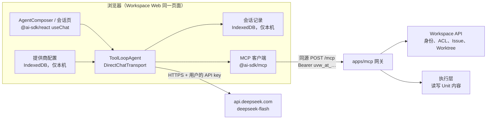
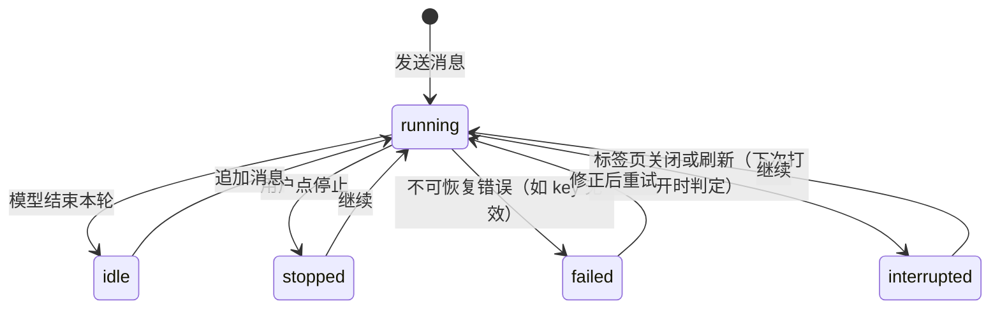

# Agents 模块设计：浏览器内运行的 Workspace Agent

> 状态：设计草案，待产品负责人对齐，未实现。日期 2026-11-11。
> 范围：Workspace Web 的 Agents 模块，按三个阶段交付。
> 相关文档：[低门槛 Agent 入口调研](low-friction-agent-entry.zh-CN.md)、
> [Workspace 远程 MCP Server](workspace-mcp/README.zh-CN.md)、[MCP 阶段计划](workspace-mcp/stages.zh-CN.md)。
> 外部信息标注了来源；标“未核实”的条目只有二手来源，决策前需要复核。

## 一句话结论

在 Workspace Web 里加一个 `features/agents` 模块。agent 循环用 Vercel AI SDK v7 的 `ToolLoopAgent` 在浏览器里跑。
模型请求从浏览器直连 DeepSeek（`deepseek-flash`），API key 只存在用户浏览器。
仓库数据走同源的 `/mcp`，也就是现有的 Workspace MCP 网关。
agent 的所有写入都落在一个 Worktree 里，以 Pull request 的形式交给人审阅和合并。

交付分三个阶段。Phase 1 做两个必做入口和它们依赖的全部地基，Phase 2 在地基上加四个亮点功能，Phase 3 是待考虑的其余场景。

## 怎么读这份文档

- 第 1 节是所有阶段共用的目标和约束，第 2 节是 24 个场景的编号和阶段归属。场景编号（#1 至 #24）在全文中固定不变。
- 第 3、4、5 节各对应一个阶段。每节开头列出范围、前置条件和验收标准，可以单独阅读。
- Phase 1 定义的类型、模块和接口是后续阶段的地基。后续阶段只扩展它们，不另起一套。扩展点在第 3 节标为“扩展点”。
- 第 6 节讨论 agent 循环放在浏览器还是服务端。已采纳方案一（纯浏览器），其余方案作为以后的升级路径保留。
- 第 7 节记录已经做出的决定，第 8 节是尚未决定的问题。实现前先查这两节。决定与正文冲突时，以第 7 节为准。

## 目录

1. 目标与约束
2. 场景总览与阶段划分
3. Phase 1：核心能力与地基（#1 至 #5）
4. Phase 2：亮点功能（#6 至 #9）
5. Phase 3：待考虑（#10 至 #24）
6. 运行时位置：浏览器还是服务端
7. 决策记录
8. 待决定的问题
9. 参考资料

## 1. 目标与约束

### 1.1 目标与硬约束

目标是让用户在 Web 页面上用一句话让 agent 开始干活，参考 GitHub Copilot 的入口设计。

| 约束 | 来源 | 本设计的处理 |
| --- | --- | --- |
| agent 运行在浏览器内 | 产品要求 | agent 循环、模型调用、MCP 客户端都在页面内执行，服务端不新增 agent 运行时 |
| 借助 MCP 访问仓库数据 | 产品要求 | 复用 `apps/mcp` 网关，同源访问 `/mcp` |
| 框架主流、不过时 | 产品要求 | 第 3.3.2 节对比 9 个候选，推荐 AI SDK v7 |
| 模型提供商由用户配置，只存浏览器本地，禁止存服务端 | 产品要求 | key 只在浏览器存储中，请求直连提供商，不经过任何 Workspace 接口 |
| 默认 DeepSeek 官方 `deepseek-flash` | 产品要求 | 已确认是 DeepSeek 当前的正式模型名，浏览器可直连（第 3.5.3 节） |
| 预留更多提供商与服务端托管模型 | 产品要求 | 提供商配置是带 `kind` 的联合类型，托管模型是其中一种来源（第 3.5.4 节） |
| 每个改动都要先被看见再落地 | `apps/workspace/PRODUCT.md` | agent 只写 Worktree，合并由人完成 |
| 人和 agent 都是贡献者，界面要显示谁做了什么 | `apps/workspace/PRODUCT.md` | 复用现有的 `agents` 角色样式（`modes/repository/data/actor.ts`） |

### 1.2 浏览器内运行的后果：没有后台任务

**没有真正的后台任务。** GitHub 的 Agents tab 写着“Give Copilot a background task”。
它的任务跑在 GitHub 的云端沙箱里，用户关掉页面后任务继续。
我们的循环跑在用户的标签页里，关掉标签页、电脑休眠或刷新页面，循环就停了。
本设计的处理方式：

- 会话记录实时写入浏览器 IndexedDB。页面重新打开时，上次正在运行的会话标为“已中断”，用户点“继续”从最后一步接着跑。
- 运行中的会话在标签页标题和页面上有明显标记，离开页面前浏览器弹出确认。
- 同一会话只允许一个标签页运行，用 Web Locks API 加锁，其他标签页只读展示。
- 依赖“用户不在场也能跑”的场景（定时自动化、IM 机器人、无人值守地处理 Issue）需要服务端运行时，归入 Phase 3。

### 1.3 内容读写对所有用户开放

MCP 网关里读写 Unit 内容的工具（`execute`、`inspect`、`screenshot`、`import`、`export`、`compile_*` 等）都在执行层运行。
阶段 G0 曾经只对 `MCP_EXECUTOR_ALLOWED_USER_IDS` 里的用户开放执行层（[阶段计划](workspace-mcp/stages.zh-CN.md) 第 G0 节）。
产品负责人 2026-11-11 确认执行层已对全部用户放开（第 7 节），所以本设计不再区分白名单用户。
agent 仍然在每次会话开始时读 `tools/list`，不假设某个工具一定存在。

## 2. 场景总览与阶段划分

场景来自 GitHub 官方文档和 changelog（第 9 节），截至 2026-11。
GitHub 在 2026-10-28 把 coding agent 改名为 Copilot cloud agent（“Copilot in the cloud”），所有入口共享同一个会话列表。

| # | 场景 | GitHub 的做法 | Workspace 对应 | 阶段 |
| --- | --- | --- | --- | --- |
| 1 | 首页全局入口 | 首页和 `github.com/copilot` 的输入框，可跨仓库提问，也可选一个仓库开始任务 | `/home` 主栏的输入框，不绑定仓库 | Phase 1 |
| 2 | 仓库 Agents tab | `/<owner>/<repo>/agents`，新任务表单加该仓库的会话列表 | 仓库页新增 Agents tab，范围固定为当前仓库 | Phase 1 |
| 3 | 会话详情与日志 | 显示推理、工具调用、diff、token 用量；可追加指令（steer）和停止 | 会话页显示消息、工具调用、产生的 PR；可追加指令、停止、继续 | Phase 1 |
| 4 | 起步建议卡片 | Agents tab 的 “Get started with agents” 卡片（卡片文字未核实） | 3 张按仓库内容给出的建议卡片 | Phase 1 |
| 5 | 模型与模式选择 | 模式 Interactive / Autopilot，模型 Auto 或指定 | 模式“提问（Ask）/ 执行（Auto）”，模型来自用户配置的提供商 | Phase 1 |
| 6 | 文件页侧栏 | 在任何页面打开 Copilot，自动带上当前页面作为上下文 | 打开 Sheet、Doc、Slide 时右侧的 Agent 面板 | Phase 2 |
| 7 | 输入框 @ 引用 | `@` 或 `+` 附加文件、目录、仓库、Space | `@` 选择文件、目录、Issue、PR、仓库 | Phase 2 |
| 8 | 把 Issue 交给 agent | Issue 指派给 Copilot，agent 开 draft PR | Issue 页“交给 Agent”按钮 | Phase 2 |
| 9 | 用量显示 | 会话显示 token 用量，`/usage` 命令 | 会话 token 用量和估算费用 | Phase 2 |
| 10 | PR 中 `@copilot` 评论迭代 | 在 PR 评论里 @copilot | Workspace 的 PR 没有评论功能 | Phase 3 |
| 11 | 审阅时“用 Copilot 修复” | diff 评论上的 “Fix with Copilot” | Worktree 审阅面板上“让 Agent 修改” | Phase 3 |
| 12 | 修复合并冲突 | PR 合并框的 “Fix with Copilot” | Worktree 合并冲突时让 agent 尝试解决 | Phase 3 |
| 13 | Agent 审阅 PR | 把 Copilot 加为 reviewer | 只读审阅：公式错误、数据不一致、格式问题 | Phase 3 |
| 14 | PR 描述生成 | PR 描述框的 Copilot 按钮 | 创建 PR 时生成描述 | Phase 3 |
| 15 | 用 prompt 新建仓库 | 新建仓库时 agent 生成初始内容 | 新建仓库后用 prompt 生成初始表格和文档 | Phase 3 |
| 16 | 仓库级自定义指令 | `.github/copilot-instructions.md`、`AGENTS.md` | 仓库根目录的 `AGENTS.md` 文件 | Phase 3 |
| 17 | 自定义 agent | `.github/agents/*.agent.md` | 预设角色及其提示词 | Phase 3 |
| 18 | 交接到其他客户端 | “Continue in Copilot CLI”“Open in VS Code” | 用 `uvw` 或 Workspace Agent 桌面版继续同一个 PR | Phase 3 |
| 19 | 移动端 | GitHub Mobile 的会话列表和新建会话 | 响应式页面 | Phase 3 |
| 20 | 自动化 | 定时或事件触发的任务 | 定时汇总、Issue 创建时自动处理 | Phase 3 |
| 21 | IM 集成 | Slack、Teams、Jira、Linear | 飞书、企业微信、Slack | Phase 3 |
| 22 | 第三方 agent | Agent HQ 里选 Claude、Codex | 无对应 | Phase 3 |
| 23 | 用户自带 MCP 和 connectors | 仓库设置里配置 MCP server | 用户在浏览器里再接其他 MCP | Phase 3 |
| 24 | Copilot Spaces | 跨仓库的知识集合 | 无对应 | Phase 3 |

## 3. Phase 1：核心能力与地基（#1 至 #5）

### 3.0 范围、前置条件与验收

**范围。** #1 首页全局入口、#2 仓库 Agents tab、#3 会话页、#4 起步卡片、#5 模型与模式选择。
以及它们依赖的全部地基：agent 运行时、MCP 连接与认证、写入安全、会话模型与存储、模型提供商配置。

**前置条件。** 无。PoC 用短期 PAT（方案 A）连接 MCP，正式交付用第一方 token 接口（方案 B），见第 3.3.4 节。

**交付顺序。**

1. 第 0 步 PoC：证明技术路线可行（第 3.7 节）。任何一条不通过，先回来调整本设计。
2. 地基：`features/agents` 的运行时、存储、提供商配置、MCP 认证。
3. 界面：输入框、首页区块、Agents tab、会话页、起步卡片、模型设置对话框。

**验收。** 用 `verify-uvw` 在隔离实例里走通：配置 DeepSeek key，在首页发起一次提问，在 Agents tab 发起一次执行，
在 Pull requests tab 看到 agent 作者的 PR，审阅并合并。刷新页面后会话可恢复为“已中断”并能继续。

### 3.1 入口与交互

#### 3.1.1 共用的输入框（#5）

两个入口用同一个 `AgentComposer` 组件，只是范围不同。

```text
┌──────────────────────────────────────────────────────────────┐
│ 让 Agent 处理一件事                                           │
│                                                              │
│ ＋   提问 ▾    deepseek-flash · 高 ▾                      ➤  │
└──────────────────────────────────────────────────────────────┘
  仓库: mini-crm ▾   基于: 新建 PR ▾                      ⚙ 模型设置
```

- 模式只有两种：“提问”（英文 Ask）只读，不会产生任何写入；“执行”（英文 Auto）可以写入，写入落在 PR 里。对应 GitHub 的 Interactive 和 Autopilot，但我们按权限划分，不按是否打断用户划分，因为对文档用户来说“会不会改我的文件”比“会不会中途问我”更重要。
- 模型：列出用户配置的提供商和模型。DeepSeek 额外显示思考强度（关闭、高、最高）。
- 范围行：全局入口显示“仓库”选择（默认“自动”）；Agents tab 固定为当前仓库，只显示“基于”选择：新建 PR，或已有的某个未合并 PR。
- 没有配置模型时，发送按钮变成“配置模型”，点击打开第 3.5 节的设置对话框，配置完回到输入框，输入内容不丢。
- 快捷键沿用 `IssueComposer`：Ctrl/Cmd+Enter 发送。
- `＋` 按钮在 Phase 1 不显示。扩展点：Phase 2 的 @ 引用（#7）从这里和 `@` 键进入。

#### 3.1.2 全局入口：首页（#1）

位置是 `modes/repository/shell/home-frame.tsx` 的主栏（`rd-homemain`）顶部，替换现在问候语的位置。
下方显示“最近的会话”（最多 5 条，链接到会话页），再往下是现有的 Pull requests、Continue、Issues 区块。

左栏现有的 `rd-agent-card`（“Work with Agents”，链接到桌面版下载）保留，但文案改为“在桌面或终端中使用”，
避免和新的页面内 Agent 混淆。

全局入口不预设仓库。agent 先用 `repo_list`、`search` 确定目标，需要写入时用 `pr_create` 建一个 PR。
这对应 GitHub 首页的 “Ask anything across repositories”。

#### 3.1.3 仓库入口：Agents tab（#2、#4）

在 `repository-masthead.tsx` 的 tab 列表中，Pull requests 后面加 Agents tab，所有 Space 都显示。
页面结构参考 GitHub：左侧导航只有 “Sessions”，右侧上方是输入框，下方是起步卡片和该仓库的会话列表。

起步卡片（#4）固定 3 张，例如“汇总这个仓库的表格”“检查公式错误”“把这份数据做成一个 Page”。
点击卡片把预设文字填进输入框，不直接发送。卡片文字是静态文案，Phase 1 不按仓库内容动态生成。

会话列表的列：标题（取第一条消息）、状态、模式、产生的 PR、模型、开始时间。状态取值见第 3.4 节。
GitHub 的会话列表能看到其他成员的会话，我们 Phase 1 只能看到自己在本浏览器的会话，
因为会话记录只存在本地（第 7 节，已决定）。其他成员能看到的是 agent 产生的 PR，它在 Pull requests tab 里以 agent 作者显示。

#### 3.1.4 会话页（#3）

路由 `/agents/$sessionId`，全局和仓库会话共用。仓库会话在仓库外壳内显示（带 tab 栏），全局会话在全局外壳内显示。

- 主列是消息流：用户消息、模型回复（Markdown，复用 `issue-markdown.tsx` 的渲染和安全策略）、折叠的思考过程、工具调用卡片。
- 工具调用卡片显示工具名、参数摘要、结果摘要、耗时；写入类工具额外显示目标文件和 PR 链接。
- 右栏显示会话信息：范围、模式、模型、产生的 PR（带“去审阅”按钮）。扩展点：Phase 2 的用量显示（#9）放在这里。
- 底部是追加指令的输入框。运行中追加的指令在当前工具调用结束后生效，和 GitHub 的 steer 行为一致。
- 运行中显示“停止”按钮；已中断或已停止的会话显示“继续”按钮。

#### 3.1.5 与现有 Agent 入口的关系

今天界面里的“Agent”指 `apps/agent`，即基于 DSH 的本地 Workspace Agent 桌面版。
顶栏的 `openChat` 按钮在设置了 `VITE_UNIVER_WORKSPACE_HARNESS_ORIGIN` 时出现，会新开标签页跳到桌面版。

新模块上线后，顶栏按钮改为打开页面内 Agent 的首页输入框。桌面版入口移到首页左栏卡片。
命名已决定（第 7 节）：页面内功能叫 “Agents”，桌面版叫 “Workspace Agent 桌面版”。

### 3.2 运行架构总览



API key 只出现在浏览器到模型提供商的那条线上。Workspace 的服务端（网关、Workspace API）永远收不到它。

### 3.3 agent 运行时

#### 3.3.1 运行时的职责

`features/agents` 的运行时负责四件事：用提供商配置创建模型；用 MCP token 连接网关并读取工具列表；
用 `ToolLoopAgent` 跑循环；把每一步写入会话存储。界面只通过 `useChat` 和会话存储读取状态，不直接调用模型或 MCP。

扩展点：运行时通过 AI SDK 的 transport 接入界面。把 `DirectChatTransport` 换成指向服务端的 `DefaultChatTransport`，
循环就从浏览器搬到服务端，界面不变。Phase 3 的服务端场景（#20、#21）走这条路。

#### 3.3.2 框架选型

评估日期 2026-11-11。版本和发布日期来自 `npm view`，周下载量来自 npm downloads API，
包体积是用 `esbuild --platform=browser --minify` 打包最小导入的实测值。

| 候选 | 最新版本（日期） | 周下载 | 浏览器内跑循环加 MCP 客户端 | DeepSeek | 浏览器包体积（gzip） | 结论 |
| --- | --- | --- | --- | --- | --- | --- |
| Vercel AI SDK：`ai`、`@ai-sdk/react`、`@ai-sdk/mcp`、`@ai-sdk/deepseek` | 7.0.169（2026-11-10） | `ai` 4540 万 | 可以。`ToolLoopAgent` 通过 `DirectChatTransport` 在页面内运行；MCP 客户端支持 HTTP 传输、自定义 header 和 OAuth | 官方提供商包，已识别 `deepseek-flash` | 213 KB（含 zod） | **推荐** |
| pi：`@earendil-works/pi-ai`、`pi-agent-core` | 1.5.2（2026-11-10） | 旧包名 55 万 | 可以，README 有浏览器用法章节；MCP 在单独的 `pi-mcp` 包，未评估 | 内置 | 43 KB | 备选。体积小，但 1.x 线 2026-10 才发布，没有 React 集成 |
| OpenAI Agents SDK `@openai/agents` | 0.21.0（2026-10-20） | 235 万 | 能打包，但文档只把浏览器用于 Realtime 语音，文本 agent 建议走服务端 | 需要适配层 | 457 KB | 不推荐，1.0 之前，非 OpenAI 模型是二等公民 |
| LangGraph.js 加 `@langchain/mcp-adapters` | 1.7.3 / 2.0.2 | 485 万 / 46 万 | `mcp-adapters` 浏览器打包失败（引入了 `node:process`） | 通过社区包 | 打包失败 | 不推荐 |
| Mastra `@mastra/core` | 1.82.0（2026-11-04） | 319 万 | 不行，打包失败（`stream/web`），官方模式是服务端加 `client-js` | 通过 AI SDK | 打包失败 | 不适用 |
| CopilotKit 与 AG-UI | 1.86.0 / 1.0.4 | 71 万 / 215 万 | 设计上假设有 agent 后端 | 不适用 | 未测 | 不适用 |
| assistant-ui `@assistant-ui/react` | 0.15.35 | 316 万 | 只是 UI 层，没有自己的循环和 MCP | 不适用 | 未测 | 以后如需更丰富的聊天 UI，可叠加在 AI SDK 之上 |
| Google ADK `@google/adk` | 2.4.0（2026-10-28） | 41 万 | 能打包，偏 Gemini 和 Node | 非一等支持 | 320 KB | 不推荐 |
| 官方 MCP SDK `@modelcontextprotocol/client` | 2.4.0 | `sdk` 8810 万 | 只是 MCP 客户端；导入路径碰到 stdio 时浏览器打包会失败 | 不适用 | 88 KB | 作为 `@ai-sdk/mcp` 不够用时的后备 |

推荐 AI SDK 的理由：

- 它是下载量最大、几乎每天发布的方案，v7 是当前主线。
- 浏览器内运行 `ToolLoopAgent` 有 Chrome 团队的公开示例（第 9 节）。`useChat` 换一个 transport 就能在浏览器循环和服务端循环之间切换。
- `@ai-sdk/react@4.0.173` 的 peer 依赖是 `react ^19.2.1` 等，仓库 lockfile 解析出的 React 是 19.2.8 和 19.3.0，兼容。
- 它不属于根 `AGENTS.md` 禁止的 `@deepseek-ai/*` React 18 依赖，不影响 React 和 Redi 的隔离约束。

选型时列出的三个风险，2026-11-11 的原型（第 6.1 节）已经回答了两个：

1. 浏览器内运行没有官方端到端示例。原型在真实 Chrome 里跑通了 `ToolLoopAgent` 加 `DirectChatTransport` 加 `@ai-sdk/mcp` 加 DeepSeek 的完整组合，`DirectChatTransport` 也是维护者为“不经服务端直连模型”专门加的。已解决。
2. `@ai-sdk/mcp` 不保存 MCP 会话，不处理服务端通知。我们的网关是无状态的，原型的假网关也是无状态的，工具调用正常。仍需对真实网关验证协议版本协商（第 3.7 节）。
3. DeepSeek 带工具调用时必须回传 `reasoning_content`。`@ai-sdk/deepseek` 对 `deepseek-flash` 的每个 assistant 轮次都会回传，原型抓到的第 2 至 4 次请求都带着非空的 `reasoning_content`，4 次请求全部返回 200。已解决，不需要关闭思考模式。

包体积：原型整页（agent、提供商、MCP 客户端、React）打包后 209 KB gzip，没有 Node 内置模块被外部化的警告。
这个体积不能进首屏。agent 相关代码放在动态 `import()` 的独立 chunk 里，用户第一次点开输入框时才加载。

#### 3.3.3 连接 MCP 网关

网关对浏览器只接受同源请求。`Host` 必须等于 `MCP_PUBLIC_URL` 的 host；请求带 `Origin` 头时，它必须等于 `MCP_PUBLIC_URL` 的 origin，否则返回 403（`apps/mcp/src/gateway/server.ts:374-379`）。
不带 `Origin` 的请求不受这条限制，但浏览器发跨域 POST 时总会带 `Origin`。网关也不处理 CORS 预检。生产部署按设计是同源的，入口按路径把 `space.univer.ai/mcp` 转给网关，
所以页面直接访问 `/mcp` 就行，网关不需要改。

需要补的是本地开发：`apps/workspace/vite.config.ts` 的代理目前没有 `/mcp`，要加一条，并把开发环境的 `MCP_PUBLIC_URL` 设成 Vite 的 origin。

其他约定：

- 网关无状态，每次 `tools/list`、`tools/call` 都是独立的 POST。
- Phase 1 只加载默认的 `core` 工具集，不加载 `admin` 工具集，所以 agent 碰不到 `pr_merge`、`repo_edit` 这类工具。扩展点：需要 PDF、Markdown、HTML View 时按需加 `?toolsets=core,files`。
- 工具列表随部署配置变化（例如执行层或渲染服务不可用时会少一批工具），agent 每次会话开始时读 `tools/list`，代码里不写死工具名。
- 网关的 server instructions 和 `skill://univer-workspace/core/SKILL.md` 资源直接拼进系统提示词，和外部 MCP 客户端拿到的指引一致。
- 工具错误以 `isError: true` 和 `structuredContent.code` 返回，交给模型处理；HTTP 401 由页面处理（重新取 token，见 3.3.4 节）。

#### 3.3.4 MCP 认证

网关只接受 `uvw_pat_`（个人访问令牌）和 `uvw_at_`（MCP OAuth 访问令牌），不接受浏览器的 `workspace_session` cookie。
那个 cookie 是 httpOnly 的，页面脚本也读不到。今天没有“用登录态换一个 MCP token”的接口。

| 方案 | 做法 | 服务端改动 | 问题 |
| --- | --- | --- | --- |
| A. 页面签发短期 PAT | 页面调用现有 `POST /api/auth/tokens`，按模式只给 `read` 或 `read,write`，有效期 1 小时，用完调用 `DELETE` 撤销 | 无 | PAT 会出现在用户的“访问令牌”列表里；页面崩溃时令牌留到过期；令牌没有绑定 MCP resource |
| B. 新增第一方 token 接口 | cookie 认证的 `POST /api/auth/agent-token`，签发绑定 MCP resource 的 `uvw_at_`，有效期 1 小时，scope 由模式决定；网关沿用现有交换流程 | Workspace 加一个接口和一个第一方 client 身份；是否需要 schema 变更待确认 | 新增 HTTP contract，要走 `api:verify` |
| C. 网关接受同源 cookie | 网关在同源请求上直接用 `workspace_session` | 改网关认证模型 | 网关会持有完整的交互式 session，违背“网关只拿交换后的下游 session”的现有设计。不推荐 |
| D. 标准 OAuth PKCE | 页面走一次授权码流程，用户在同意页点“允许” | 无 | 让用户对自家产品点“同意授权”，体验差。不推荐 |

PoC 用 A，Phase 1 正式交付用 B（均已决定，第 7 节）。令牌只放在内存里，不落盘，过期后重新获取。

这个令牌不会扩大 XSS 的影响。XSS 本来就能带着 cookie 直接调用 `/api`。
本模块真正新增的高价值数据是用户的模型 API key，第 3.5.2 节单独处理。

#### 3.3.5 写入安全

GitHub 的安全模型在 Workspace 里都有现成对应：

| GitHub | Workspace Agents |
| --- | --- |
| 只有有写权限的人能触发 | MCP token 继承当前用户的权限，Workspace 按 ACL 校验每个请求 |
| agent 只能推送到自己的 `copilot/*` 分支 | 写入只落在会话自己的 Worktree，`unit_create`、`execute` 等工具都以 PR 为目标 |
| 只开 draft PR，不能批准和合并自己的 PR | token 不带 `worktree:merge` 和 `publish`，不加载 admin 工具集，合并只能由人在 PR 页面完成 |
| commit 记录 Copilot 为作者 | PR 的 `createdVia` 记为 agent，界面用 agent 角色样式显示（MCP 路径产生的 `createdVia` 值待 PoC 确认） |

“提问”模式的 token 只有 `read` scope。即使模型试图写入，网关也会返回 `workspace-scope-required`。
只读由权限保证，不靠提示词约束。

“执行”模式不对每次写入弹确认框，因为写入只进 PR，合并前人一定会看到。
扩展点：如果以后加载了会直接影响主线的工具，再用 AI SDK 的 `toolApproval` 对这些工具单独确认。

### 3.4 会话模型与存储

```ts
type AgentScope =
	| { kind: "global" }
	| { kind: "repository"; spaceId: SpaceId; baseWorktreeId: WorktreeId | null };

type AgentMode = "ask" | "auto";

type AgentSessionStatus =
	| "running"
	| "idle"
	| "interrupted"
	| "stopped"
	| "failed";

interface AgentSession {
	id: AgentSessionId;
	userId: UserId;
	scope: AgentScope;
	mode: AgentMode;
	model: { providerId: ProviderId; modelId: string };
	status: AgentSessionStatus;
	worktreeIds: WorktreeId[];
	messages: UIMessage[];
	createdAt: string;
	updatedAt: string;
}
```

扩展点：Phase 2 给 `AgentScope` 增加 `node` 分支（#6），给 `AgentSession` 增加 `usage`（#9），
给消息增加引用部件（#7）。都是在联合类型或接口上加字段，现有分支不变。

状态转换：



`interrupted` 不需要在关闭时写入。页面打开时，存储里是 `running` 但没有标签页持有该会话的 Web Lock，就判定为 `interrupted`。

`messages` 用 AI SDK 的 `UIMessage` 原样保存，不另造一套消息格式。
存储用 IndexedDB，库名带用户 ID，切换账号后看不到别人的会话。
会话记录里有文档内容，但没有 API key。

### 3.5 模型提供商

#### 3.5.1 配置的数据形状

```ts
type ProviderKind = "deepseek" | "openai-compatible" | "anthropic";

interface ProviderConfig {
	id: ProviderId;
	kind: ProviderKind;
	label: string;
	baseURL: string;
	apiKey: string;
	models: string[];
	defaultModel: string;
}

type ModelSource =
	| { kind: "byok"; providerId: ProviderId }
	| { kind: "workspace-hosted"; planId: string };
```

`kind` 决定用哪个 AI SDK 提供商包创建模型：`deepseek` 用 `@ai-sdk/deepseek`，`openai-compatible` 用 `@ai-sdk/openai-compatible`，
`anthropic` 用 `@ai-sdk/anthropic`。一张 `kind` 到工厂函数的表就够了，不需要插件机制。
Phase 1 的界面只开放 `deepseek` 和 `openai-compatible`。

`ModelSource` 的 `workspace-hosted` 分支只在类型里预留，Phase 1 不实现，见 3.5.4 节。

#### 3.5.2 只存本地：存储方式与威胁模型

设置入口放在账号菜单，紧挨现有的“访问令牌”（`AccessTokensDialog` 是最接近的先例），输入框里的齿轮也能打开。

- 存储在 IndexedDB，键名带 Workspace 用户 ID（沿用 `univer-workspace-*` 前缀和按用户分键的惯例）。
- 每个提供商有“在此设备上记住”开关，默认开启（已决定）。关闭时 key 只存在 `sessionStorage`，关掉标签页就清除。OWASP 对不需要持久化的敏感数据推荐这种做法。
- 退出登录时提供“同时清除模型密钥”选项。今天的退出流程只清 TanStack Query 缓存，不清 localStorage。
- key 不进日志、不进 URL、不进会话记录，任何发往 Workspace 同源接口的请求都不带它。在 `test/unit/web-architecture.test.ts` 加一条规则：只有 `features/agents` 的提供商模块能导入 key 存储，`shared/api` 不能导入它。

需要向用户说清楚的残余风险：任何在 Workspace 页面里运行的脚本都能读到浏览器存储的 key，加密存储也挡不住，因为脚本可以调用解密。
所以真正的防线是不让恶意脚本进页面。用户上传的 HTML View 已经在独立的 sandbox CSP 下运行，读不到主页面存储。
agent 输出的 Markdown 走现有的安全渲染。
设置页文案建议写明“密钥只保存在这台设备的浏览器里，Workspace 服务器不会收到它”，并建议用户在 DeepSeek 后台给这个 key 设置用量上限。

#### 3.5.3 默认提供商：DeepSeek

以下事实来自 DeepSeek 官方文档（2026-11-11 读取）和实测：

- 模型名就是 `deepseek-flash`，当前由 DeepSeek-V4.1-Flash-1017 提供服务。另一个模型是 `deepseek-v4-pro`。旧名 `deepseek-v4-flash` 仍然可用。
- `deepseek-flash` 上下文 1M，支持工具调用、JSON 输出和图片输入。思考模式默认开启，默认强度 `high`。
- 价格（每百万 token，美元）：缓存未命中输入高峰 0.30、低峰 0.15，输出高峰 1.20、低峰 0.60。
- 浏览器直连可行。从 `Origin: https://space.univer.ai` 发预检请求，`api.deepseek.com/chat/completions` 返回 200，
  `access-control-allow-origin` 回显请求的 origin，允许 `authorization,content-type` 头。没有 `Access-Control-Max-Age`，所以每次请求前都会预检，代价是多一次往返。
- 已知坑：带工具调用时必须回传 `reasoning_content`（3.3.2 节风险 3）。

默认配置：`kind: "deepseek"`，`baseURL: "https://api.deepseek.com"`，`models: ["deepseek-flash", "deepseek-v4-pro"]`，`defaultModel: "deepseek-flash"`。用户只需要填 key。

#### 3.5.4 预留：其他提供商与服务端托管模型

其他提供商的浏览器直连情况（2026-11-11 预检实测）：OpenAI、OpenRouter 允许跨域；
Anthropic 允许跨域，但请求必须带 `anthropic-dangerous-direct-browser-access: true` 头。
“OpenAI 兼容”覆盖 OpenRouter 和大多数国内提供商。
用户自定义 `baseURL` 时，对方必须允许跨域，否则请求会失败；设置页提供“测试连接”按钮，当场暴露这个问题。

服务端托管模型（商业化）要分清两件事：

- **托管模型。** 我们提供一个 OpenAI 兼容的代理接口，用 Workspace 登录态认证、按套餐计费。浏览器里的 agent 循环不变，只是 `ModelSource` 从 `byok` 换成 `workspace-hosted`，提供商的 `baseURL` 指向我们的接口，不需要 key。
- **托管运行时。** agent 循环本身在服务端跑。这是 Phase 3 服务端场景（#20、#21）的前提，见 3.3.1 节的扩展点。

两者可以分别做。Phase 1 只保证类型和 transport 的位置留好，不写任何服务端代码。

#### 3.5.5 内容安全策略（CSP）

Workspace 主页面今天没有 CSP（`server/src/app.ts` 只关闭了 `x-powered-by`），所以浏览器直连 DeepSeek 不会被拦。
如果以后加 CSP 加固 key 的安全，`connect-src` 必须包含所有提供商的 origin。
用户自定义 `baseURL` 和静态 CSP 天然冲突：要么只允许预置提供商列表，要么放宽到 `https:`。
本模块不加 CSP，CSP 加固另开任务（已决定，第 7 节）。

### 3.6 代码落点

Web 的分层由 `test/unit/web-architecture.test.ts` 强制：`shared → features → modes → routes → app`。

| 位置 | 内容 |
| --- | --- |
| `web/src/features/agents/` | 会话存储、提供商配置与 key 存储、MCP token 获取、agent 运行时（动态导入）、`AgentComposer`、会话视图组件 |
| `web/src/modes/repository/pages/` | 首页输入框区块、Agents tab 页、会话页的 Repository 外壳 |
| `web/src/modes/repository/repository-tabs.ts` | `RepositoryTab` 增加 `"agents"`；`top-bar.tsx` 的 tab 映射和 `shell/frame.ts` 的 `resolveFrame` 随之更新 |
| `web/src/modes/registry.ts` | `ModeDefinition.pages` 增加 `agents` 和 `agentSession`；Wiki 模式需要对应页面或占位页，否则类型检查失败 |
| `web/src/routes/` | `spaces_.$spaceId.agents.tsx`（仿 Issues 的独立路由，便于以后加子路由）和 `agents.$sessionId.tsx` |
| `web/src/shared/i18n.tsx`、`modes/repository/messages.ts` | 中英文案 |
| `apps/workspace/vite.config.ts` | 开发代理增加 `/mcp` |
| `apps/workspace/server`、`contracts/http` | 方案 B 的 `POST /api/auth/agent-token`，改 contract 后跑 `api:verify`；如需 schema 变更，按 `apps/workspace/AGENTS.md` 走迁移流程 |

新增依赖 `ai`、`@ai-sdk/react`、`@ai-sdk/deepseek`、`@ai-sdk/openai-compatible`、`@ai-sdk/mcp` 和 `zod`，只加在 `apps/workspace`，使用精确版本，同时提交 `pnpm-lock.yaml`。

### 3.7 第 0 步：PoC

在一个开发分支上做最小页面，不做设计稿。第 1 条已由 2026-11-11 的独立原型验证（第 6.1 节），其余各条要接真实的 Workspace 和 MCP 网关。通过标准：

1. 已通过。浏览器内的 `ToolLoopAgent` 用 `deepseek-flash` 在思考模式开启时完成 3 步连续工具调用，没有 400 错误，`reasoning_content` 由提供商包自动回传。
2. 页面经 Vite 代理同源访问 `/mcp`，用方案 A 的短期 PAT 完成 `tools/list` 和 `repo_list`、`browse`、`pr_create`。同时确认两件原型里看到的事：`@ai-sdk/mcp` 先用 2026-07-28 协议发 `server/discover`，失败后退回 2025-11-25 的 `initialize`；它还会发一个不带 `Origin` 的后台 GET。真实网关对这两者的响应要不影响工具调用。
3. agent 通过 `execute` 或 `inspect` 读到一张表的数据，答案和表里的值一致。
4. 刷新页面后会话从 IndexedDB 恢复，状态为 `interrupted`，点“继续”能接着跑。
5. 通过 MCP 创建的 PR，`createdVia` 为 agent，在 Pull requests tab 以 agent 作者显示。
6. 首屏 JS 体积不增加，agent chunk 只在打开输入框时加载。

这些都是可以运行观察的事实，跑一遍就有答案。任何一条失败都先回来调整本设计。

## 4. Phase 2：亮点功能（#6 至 #9）

### 4.0 范围、前置条件与验收

**范围。** #6 文件页侧栏、#7 @ 引用、#8 Issue 交给 Agent、#9 用量显示。四项互相独立，可以并行开发，按价值排序是 #6、#7、#8、#9。

**前置条件。** Phase 1 验收通过。

**验收。** 每项单独用 `verify-uvw` 走通下文各自的验收步骤。

### 4.1 #6 文件页侧栏

**用户价值。** 打开表格就能问，不需要先去首页或 Agents tab，也不需要描述“我说的是哪个文件”。
这是 Workspace 和 GitHub 差异最大、价值最高的入口：GitHub 的用户在读代码，我们的用户在看数据。

**交互。** 文件页（`routes/nodes.$nodeId.tsx`）右上角加 Agent 按钮，打开右侧面板，复用 `shared/resizable-sidebar.tsx`。
面板是一个精简的会话页：输入框加消息流，没有右栏，顶部显示“当前文件：<文件名>”。
面板里的会话同样出现在 Agents tab 的列表里，可以点“在会话页打开”展开。

**对地基的扩展。**

- `AgentScope` 增加 `{ kind: "node"; spaceId: SpaceId; nodeId: NodeId; worktreeId: WorktreeId | null }`。`worktreeId` 是用户正在看的版本：在主线上看就是 `null`，在某个 PR 的版本里看就是该 PR。
- 系统提示词带上当前文件的 Node ID、Unit 类型和版本，agent 用 `inspect` 或 `execute` 读取内容。
- “执行”模式写入时：用户在主线上看，就新建 PR；用户在某个 PR 的版本里看，就写进这个 PR。写入后页面通过协同实时显示变化。

**验收。** 在一张 Sheet 上问“B 列的平均值是多少”，得到正确数字；切到“执行”模式要求“新增一列合计”，
得到一个 PR，打开 PR 能看到新增的列。

### 4.2 #7 输入框 @ 引用

**用户价值。** 精确告诉 agent 要处理哪些文件、Issue 或 PR，减少 agent 自己搜索的步骤和 token。

**交互。** 在输入框里输入 `@` 或点 `＋`，弹出选择器，分组显示文件和目录、Issue、PR、仓库。选中后在输入框里显示为一个标签。
选择器基于现有的 `SearchSelect`（`shared/ui/combobox.tsx`），数据复用 `spaceNodesQueryOptions` 和 Issue、Worktree 的查询。
现有的 `IssueReferencesDialog` 是弹窗式的目录浏览器，适合“浏览后选择”，可以作为选择器里“浏览全部”的入口。

**对地基的扩展。** 引用以 `UIMessage` 的自定义数据部件保存，只存 ID 和显示名，例如
`{ type: "data-reference", data: { kind: "node", id, label } }`。发给模型时转成一行说明文字，
agent 需要内容时自己调用工具读取。引用不把文件内容塞进消息，避免一次引用十个大表格就撑爆上下文。

**验收。** 在 Agents tab 里 @ 两个文件并要求“对比这两张表的列名”，工具调用记录里出现这两个文件的读取，没有对其他文件的搜索。

### 4.3 #8 Issue 交给 Agent

**用户价值。** Issue 是团队已经在用的任务载体。“交给 Agent”把描述好的任务直接变成一个会话和一个 PR。

**交互。** Issue 详情页（`spaces_.$spaceId.issues.$number.tsx`）的操作区加“交给 Agent”按钮，只在 Team Space 显示（`spaceSupportsIssues`）。
点击后打开会话页，Issue 作为引用（复用 #7 的引用部件），模式默认“执行”，用户可以在发送前补充说明。
会话结束后，agent 用 `issue_comment` 在 Issue 下评论 PR 链接和改动摘要。

和 GitHub 的区别要写进界面文案：GitHub 指派后可以离开，我们需要用户留在页面上直到会话结束（第 1.2 节）。

**对地基的扩展。** 无新类型，复用 `repository` 范围和 #7 的引用部件。所以 #8 应在 #7 之后做。

**验收。** 在一个 Issue 上点“交给 Agent”，会话完成后 Issue 下出现 agent 的评论，评论里的 PR 链接可以打开。

### 4.4 #9 用量显示

**用户价值。** 用户用的是自己的 key，花了多少钱应该一眼看到。

**交互。** 会话页右栏显示本会话的输入、输出、缓存命中 token 数和估算费用。模型设置对话框里显示本设备本月的累计用量。

**对地基的扩展。**

- `AgentSession` 增加 `usage: { inputTokens; cachedInputTokens; outputTokens }`，每一步结束时用 AI SDK 返回的用量累加。
- `ProviderConfig` 的每个模型可以带一张价格表。DeepSeek 预置官方价格，区分缓存命中、高峰和低峰；其他提供商由用户填写，不填就只显示 token 数。
- 费用是估算值，界面写明“以提供商账单为准”。

**验收。** 跑一次会话后，右栏的 token 数与 DeepSeek 响应中的 `usage` 字段一致。

## 5. Phase 3：待考虑（#10 至 #24）

Phase 3 的场景暂不排期。下表按前提条件分组，写明每项缺什么，供以后挑选。

### 5.1 浏览器运行时就能做的

| # | 场景 | 前提或缺口 | 初步判断 |
| --- | --- | --- | --- |
| 11 | 审阅时“让 Agent 修改” | 在 Worktree 审阅面板（`worktree-review-panel.tsx`）上选定一处改动发起会话，范围是该 PR | 价值高，依赖 #6 的 `node` 范围 |
| 12 | 修复合并冲突 | 需要 MCP 暴露冲突详情；当前工具集里没有 | 先确认网关能提供冲突信息 |
| 13 | Agent 审阅 PR | 只读，“提问”模式即可；需要读 PR 的 diff，当前工具能否给出逐单元格差异待确认 | 成本低，适合作为下一个亮点 |
| 14 | PR 描述生成 | 同 #13，需要读 diff | 成本低 |
| 15 | 用 prompt 新建仓库 | `repo_create` 在 admin 工具集，需要 `publish` 权限，和 Phase 1 不给 `publish` 的规则冲突 | 需要单独设计权限 |
| 16 | 仓库级 `AGENTS.md` | 约定文件名和位置，会话开始时读取 | 成本低 |
| 17 | 自定义 agent | 预设角色和提示词的存储位置（仓库内文件还是用户本地） | 待需求 |
| 18 | 交接到 `uvw` 或桌面版 | 会话页给出命令或链接，在那边继续同一个 PR | 成本低 |
| 19 | 移动端 | 响应式布局；长任务要求页面一直在前台 | 体验受限 |

### 5.2 需要服务端运行时的

| # | 场景 | 缺口 |
| --- | --- | --- |
| 20 | 自动化（定时、事件触发） | 用户不在场时循环必须在服务端跑，模型 key 也必须在服务端可用。这和“key 不存服务端”冲突，只能搭配托管模型（3.5.4 节） |
| 21 | IM 集成 | 同 #20，另需 IM 平台的机器人接入 |

这两项和商业化的托管模型绑定，等托管模型立项时一起设计。

### 5.3 当前不成立的

| # | 场景 | 原因 |
| --- | --- | --- |
| 10 | PR 中 @agent 评论 | Workspace 的 PR 没有评论功能。PR 评论上线后可以复用 #11 的设计 |
| 22 | 第三方 agent | Workspace 没有对应的生态 |
| 23 | 用户自带 MCP | 浏览器访问第三方 MCP 受对方 CORS 限制，多数不可行 |
| 24 | 知识集合（Copilot Spaces） | Workspace 没有对应概念，仓库本身已经是知识集合 |

## 6. 运行时位置：浏览器还是服务端

起因：AI SDK 的 agent 文档示例都跑在服务端路由里，浏览器内运行缺少官方端到端示例。
如果“在浏览器里跑”和框架的设计方向冲突，就值得重新考虑运行时放在哪里。
本节先回答冲突是否存在，再列出服务端运行的真实成本，最后给出四个方案。

### 6.1 浏览器运行和框架不冲突

**来源证据。**

- `DirectChatTransport` 是维护者 lgrammel 在 [PR #11528](https://github.com/vercel/ai/pull/11528) 里加的，随 `ai@6.0.9`（2026-01-05）发布，v7 保留。PR 写明动机是“调用浏览器内、本机或本地模型时，不经过中间服务器直接调用 LLM API”。它关闭的 [issue #5140](https://github.com/vercel/ai/issues/5140) 要的正是“不用 API 路由使用 `useChat`，使用用户自己提供的 API key，适用于 Vite 项目、浏览器扩展、静态站点”。
- 官方仓库有一个客户端示例（`examples/ai-e2e-next/app/chat/openai-direct/page.tsx`）：`'use client'` 页面里构造 `ToolLoopAgent` 和 `DirectChatTransport`。它的注释警告“不要在生产中把你的 OpenAI key 暴露在客户端代码里”。这个警告针对的是开发者把自己的 key 打进前端；我们的场景是用户在自己的浏览器里用自己的 key，正是 #5140 描述的情况。
- 包代码（读取 npm 发布包）：`ai`、`@ai-sdk/mcp`、`@ai-sdk/deepseek`、`@ai-sdk/react` 都没有静态的 `node:` 导入。Node 专用功能藏在运行时判断后面，浏览器里不会执行。`@ai-sdk/mcp` 的主入口只用 `fetch`，stdio 传输在单独的 `./mcp-stdio` 入口。
- `DirectChatTransport` 的单元测试覆盖了中止信号传递和工具确认后继续执行。

**原型证据（2026-11-11）。** 一个独立原型（不在仓库代码里）用 `ai@7.0.169`、`@ai-sdk/react@4.0.173`、`@ai-sdk/deepseek@3.0.84`、`@ai-sdk/mcp@2.0.96`、React 19.2.8，
接一个仿 Workspace 网关的假 MCP 服务器（无状态、bearer 认证、只收同源请求，经 Vite 代理在 `/mcp`），在真实的 Chrome 里运行：

| 检查 | 结果 |
| --- | --- |
| 三步连续工具调用（列仓库、读表、建 PR），思考模式默认开启 | 通过。3 个工具依次完成，DeepSeek 4 次请求全部 200，答案正确（合计 69，PR-074）。我另外独立复跑一次，结果相同 |
| `reasoning_content` 回传 | 通过。第 2 至 4 次请求里，之前每个 assistant 轮次都带非空的 `reasoning_content`，由提供商包自动完成 |
| 停止 | 通过。点击停止后 21 秒内没有任何新的 DeepSeek 或 `/mcp` 请求，界面回到就绪状态 |
| 浏览器打包 | 通过。没有 Node 内置模块警告，整页 209 KB gzip |
| key 泄露检查 | 通过。请求日志只记录 body，原型目录里扫描不到 key |

**仍然缺的。** 官方没有“浏览器加工具加 MCP 加用户 key”的文档页面；`reconnectToStream` 永远返回 `null`，
刷新后不能接上正在进行的流（我们本来就用 IndexedDB 保存会话并标记“已中断”）；
客户端包里带着约 59 KB 用不到的 gateway 代码（[issue #21501](https://github.com/vercel/ai/issues/21501)，未关闭）。
真实网关上的协议协商留在第 3.7 节第 2 条验证。

**结论。** 浏览器运行是 AI SDK 有意支持的用法，没有官方的完整示例，但原型证明完整链路能跑通。
更重要的是，agent 本身（`ToolLoopAgent` 对象、工具、提示词）在浏览器和 Node 里是同一份代码，两种运行方式只差 transport。
所以运行时位置不是一次定死的决定：Phase 1 放在浏览器，以后需要时可以把同一个 agent 模块搬到服务端。

### 6.2 服务端运行的真实成本

放到服务端，要付出的不只是一个 agent 进程。

**AI SDK 自己要求的部件。** 服务端循环需要一个数据库保存会话和消息（官方的消息持久化指南）。
如果要在用户关闭标签页后把当前这一轮跑完，需要调用 `consumeStream` 解除流和连接的绑定。
如果要在刷新后接上正在进行的流，需要 Redis、`resumable-stream` 包、记录 `activeStreamId`，以及单独的停止接口（官方的流恢复指南）。

**放在本仓库的哪里。**

| 位置 | 可复用的 | 新增的 | 主要负担 |
| --- | --- | --- | --- |
| Workspace server | 登录态和 ACL 已在服务端；Operation 的租约与重试模式；`worktree-events` WebSocket 可参考 | agent 循环模块、流式通道（现有 WebSocket 只推刷新提示）、模型请求客户端、会话表 | Workspace 是单副本 SQLite 进程，长时间运行的循环和 OT、快照、Office 导入导出抢同一个事件循环和内存。拆出 MCP 本来就是为了避免这一点（`workspace-mcp/architecture.zh-CN.md`）。每次部署都会杀掉进行中的循环 |
| MCP 新角色（如 `MCP_ROLE=agent`） | 同一镜像、角色切换、token 交换、用量事件、Prometheus | 会话存储（MCP 按设计不连数据库，只能放回 Workspace 或新的共享卷）、SSE 接口 | `dream-num/helm-chart-private` 里要加新的 Deployment 和入口规则（不在本仓库）；内存需求要重新测量（2026-11 生产 OOM 事故就是 MCP 上线后节点内存耗尽）；循环超过 1 小时要刷新 token |
| 托管 `apps/agent`（DSH） | 现成的 agent 产品 | 每用户一个 Pod 或改造 DSH 的单账号模型、每用户持久卷、路由与空闲回收 | 设计上是单用户应用，模型凭据是全局配置，DSH 上游不归我们改。成本最高，不考虑 |

**存储负担。** 只要会话进服务端（无论循环在哪），都要在 Workspace 产品数据库加表。
按 `apps/workspace/AGENTS.md`，这意味着 schema 从 v18 升到 v19、写带备份和回滚的迁移、跑 `verify-db-migration` 的完整矩阵、
新增 HTTP contract 并跑 `api:verify`。消息里有文档内容和工具结果，还要定容量上限和保留期限。

**和“key 不存服务端”的冲突。** 服务端循环必须在运行期间拿到模型 key。
key 只能随请求进入服务端内存、用完即弃，这是灰色地带：没有存储，但经过了服务端。
真正的后台任务（用户离开后开始新的一轮、定时任务、IM 机器人）要求用户不在场时 key 仍然可用，也就是必须存储，这和硬约束直接冲突。
所以在“用户自带 key”的前提下，把循环搬到服务端也得不到后台任务。后台任务只能和托管模型（key 是我们的）一起出现。

### 6.3 四个方案

| | 方案一：纯浏览器 | 方案二：浏览器循环加服务端会话记录 | 方案三：服务端循环，用户 key 随请求传入 | 方案四：服务端循环加托管模型 |
| --- | --- | --- | --- | --- |
| 循环在哪 | 浏览器 | 浏览器 | 服务端（推荐 MCP 新角色，不放 Workspace server） | 服务端 |
| 模型 key | 只在浏览器 | 只在浏览器 | 每次运行随请求进入服务端内存，不落盘 | 我们的 key，用户不需要 key |
| 关掉标签页 | 循环停止，可继续 | 循环停止，可继续 | 当前这一轮能跑完；新的一轮仍要用户在场 | 继续运行 |
| 后台任务、定时、IM（#20、#21） | 不能 | 不能 | 不能 | 能 |
| 团队成员看到彼此的会话 | 不能，只看到 PR | 能 | 能 | 能 |
| 跨设备继续会话 | 不能 | 能 | 能 | 能 |
| 新增存储 | 无（IndexedDB） | 会话表，走完整迁移流程 | 同方案二；要流恢复还需 Redis | 同方案三，另加用量计量和额度 |
| 部署与运维 | 无 | 只改 Workspace | 新 Deployment、SSE 入口、内存测量、token 刷新 | 同方案三，另加计费 |
| 和硬约束的关系 | 完全符合 | 完全符合 | key 经过服务端，需要你确认是否接受 | 不涉及用户 key |
| 适合的时机 | Phase 1 | 需要团队可见或跨设备时（Phase 2 或 3） | 只有出现浏览器做不到、又不需要后台的需求时 | 商业化立项时，和 #20、#21 一起 |

我的建议：

- **Phase 1 用方案一（已采纳，2026-11-11）。** 原型已经证明框架支持，它的成本最低，完全符合约束。
- **为方案二留好位置，不提前做。** 会话的读写集中在 `features/agents` 的一个模块里，界面不直接碰 IndexedDB。以后换成服务端存储只改这个模块。
- **为方案四留好位置，不提前做。** agent 模块不依赖 DOM 和 `window`，`fetch`、存储、key 都从外面传入。以后搬到服务端时，同一个 agent 模块换成 `DefaultChatTransport` 即可。
- **不建议方案三。** 它要付出方案四的大部分部署和存储成本，却拿不到方案四最主要的好处（后台任务），还要让用户 key 经过服务端。

## 7. 决策记录

| 日期 | 决定 | 决定人 |
| --- | --- | --- |
| 2026-11-11 | agent 在浏览器内运行，通过 MCP 访问仓库数据；模型 key 只存浏览器本地；默认 DeepSeek `deepseek-flash`；服务端托管模型只预留 | 产品负责人（初始要求） |
| 2026-11-11 | 场景分三个阶段：Phase 1 为 #1 至 #5，重点是核心能力与地基；Phase 2 为 #6 至 #9 亮点功能；Phase 3 为其余场景，待考虑 | 产品负责人 |
| 2026-11-11 | 执行层已对全部用户放开，本设计不区分白名单用户 | 产品负责人 |
| 2026-11-11 | MCP 认证：PoC 用页面签发的短期 PAT（第 3.3.4 节方案 A），Phase 1 正式交付用第一方 token 接口（方案 B） | 产品负责人 |
| 2026-11-11 | 会话记录只存浏览器本地（IndexedDB），不做服务端会话记录 | 产品负责人 |
| 2026-11-11 | 只支持两种模式：提问（Ask，只读）和执行（Auto，写入 PR）。代码里是 `AgentMode = "ask" \| "auto"` | 产品负责人 |
| 2026-11-11 | 页面内功能叫 “Agents”，桌面版叫 “Workspace Agent 桌面版”，顶栏聊天按钮改为打开页面内 Agent | 产品负责人 |
| 2026-11-11 | 本模块不加 CSP，CSP 加固另开任务 | 产品负责人 |
| 2026-11-11 | 模型 key 默认“在此设备上记住”，设置页写明风险 | 产品负责人 |
| 2026-11-11 | 运行时位置采纳第 6.3 节方案一（纯浏览器）；为方案二、方案四留好位置，不做方案三 | 产品负责人 |

## 8. 待决定的问题

暂无。Phase 1 所需的决定都已记录在第 7 节。PoC 中出现需要产品决定的问题时，追加到这里。

## 9. 参考资料

GitHub Copilot（2026-11-11 读取）：

- [Use Copilot cloud agent on GitHub](https://docs.github.com/en/copilot/how-tos/use-copilot-agents/cloud-agent/use-cloud-agent-on-github)
- [Kick off a task](https://docs.github.com/en/copilot/how-tos/copilot-on-github/use-copilot-agents/kick-off-a-task)
- [Agent management](https://docs.github.com/en/copilot/concepts/agents/cloud-agent/agent-management)
- [Track Copilot sessions](https://docs.github.com/en/copilot/how-tos/use-copilot-agents/coding-agent/track-copilot-sessions)
- [Risks and mitigations](https://docs.github.com/en/copilot/concepts/agents/coding-agent/risks-and-mitigations)
- [Copilot code review](https://docs.github.com/en/copilot/concepts/agents/code-review)
- [Create custom agents](https://docs.github.com/en/copilot/how-tos/copilot-on-github/customize-copilot/customize-cloud-agent/create-custom-agents)
- [Extend cloud agent with MCP](https://docs.github.com/en/copilot/how-tos/copilot-on-github/customize-copilot/customize-cloud-agent/extend-cloud-agent-with-mcp)
- [Integrate cloud agent with Slack](https://docs.github.com/en/copilot/how-tos/copilot-integrations/integrate-cloud-agent-with-slack)
- [Introducing the Agents tab in your repository（2026-01-26）](https://github.blog/changelog/2026-01-26-introducing-the-agents-tab-in-your-repository/)
- [A new connected Copilot cloud experience（2026-10-28）](https://github.blog/changelog/2026-10-28-work-from-anywhere-with-a-new-connected-copilot-cloud-experience/)
- [Agentic Autofix for code scanning alerts GA（2026-10-15）](https://github.blog/changelog/2026-10-15-agentic-autofix-for-code-scanning-alerts-general-availability/)

框架与提供商（2026-11-11 读取）：

- [AI SDK：Building agents](https://ai-sdk.dev/docs/agents/building-agents)
- [AI SDK：MCP tools](https://ai-sdk.dev/docs/ai-sdk-core/mcp-tools)
- [AI SDK：Transport](https://ai-sdk.dev/docs/ai-sdk-ui/transport)
- [AI SDK：DirectChatTransport 参考](https://ai-sdk.dev/docs/reference/ai-sdk-ui/direct-chat-transport)
- [AI SDK：消息持久化](https://ai-sdk.dev/docs/ai-sdk-ui/chatbot-message-persistence)
- [AI SDK：流恢复](https://ai-sdk.dev/docs/ai-sdk-ui/chatbot-resume-streams)
- [vercel/ai PR #11528：add DirectChatTransport](https://github.com/vercel/ai/pull/11528)
- [vercel/ai issue #5140：useChat without an API route](https://github.com/vercel/ai/issues/5140)
- [vercel/ai issue #21501：客户端包体积](https://github.com/vercel/ai/issues/21501)
- [AI SDK：DeepSeek provider](https://ai-sdk.dev/providers/ai-sdk-providers/deepseek)
- [Chrome：Prompt UI with AI Elements and Vercel AI](https://developer.chrome.com/blog/prompt-ui-ai-elements-with-vercel-ai)
- [MCP TypeScript SDK](https://github.com/modelcontextprotocol/typescript-sdk)
- [pi](https://github.com/earendil-works/pi)
- [DeepSeek 模型与价格](https://api-docs.deepseek.com/quick_start/pricing)
- [DeepSeek 思考模式](https://api-docs.deepseek.com/guides/thinking_mode)
- [OWASP HTML5 Security Cheat Sheet](https://cheatsheetseries.owasp.org/cheatsheets/HTML5_Security_Cheat_Sheet.html)
- [MDN：CSP connect-src](https://developer.mozilla.org/en-US/docs/Web/HTTP/Reference/Headers/Content-Security-Policy/connect-src)

本仓库：

- `apps/mcp/README.md`、`apps/mcp/src/gateway/server.ts`、`apps/mcp/src/gateway/auth.ts`
- `apps/workspace/server/src/modules/identity/`（OAuth、访问令牌、token 交换）
- `apps/workspace/web/src/modes/repository/`（首页、仓库 tab、顶栏）
- `apps/workspace/PRODUCT.md`、`apps/workspace/DESIGN.md`、`apps/workspace/CONTEXT.md`
