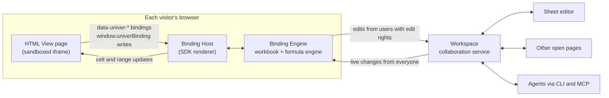
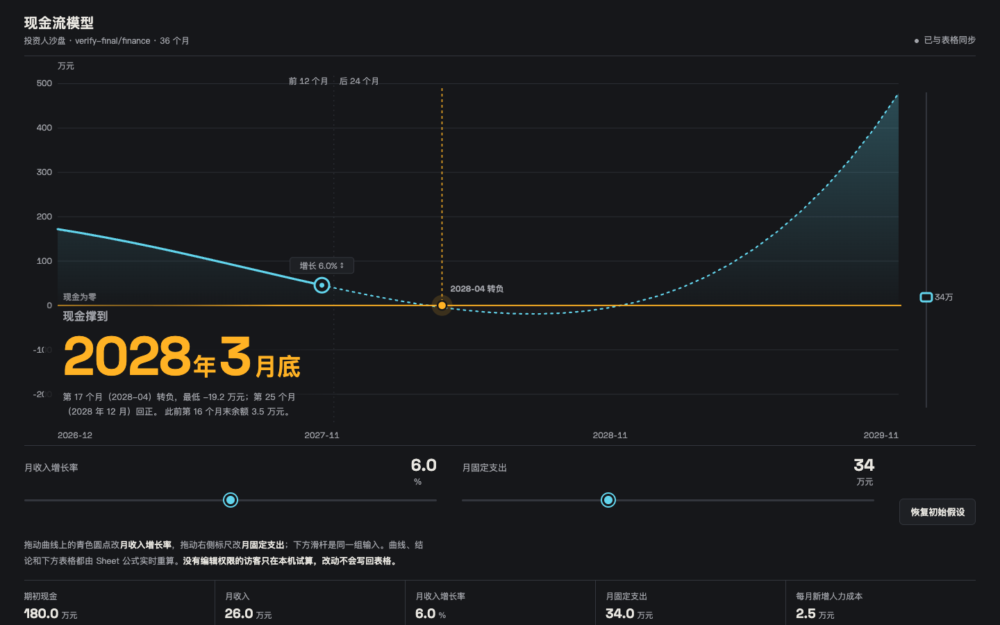
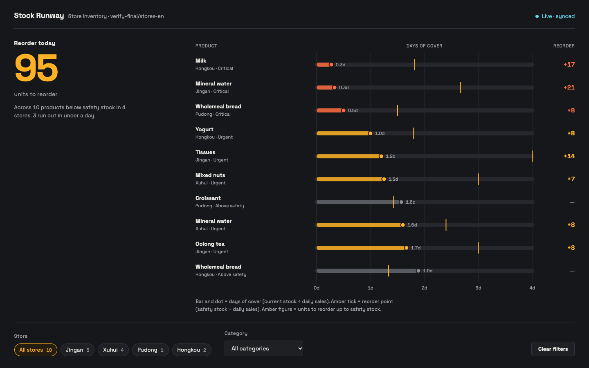
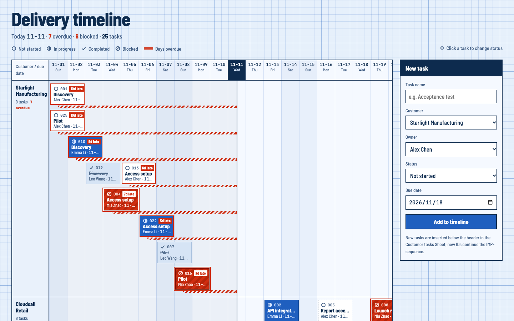
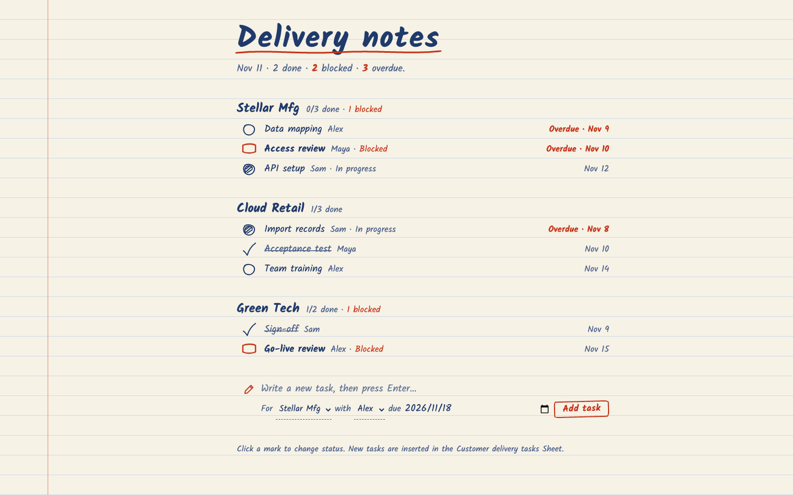
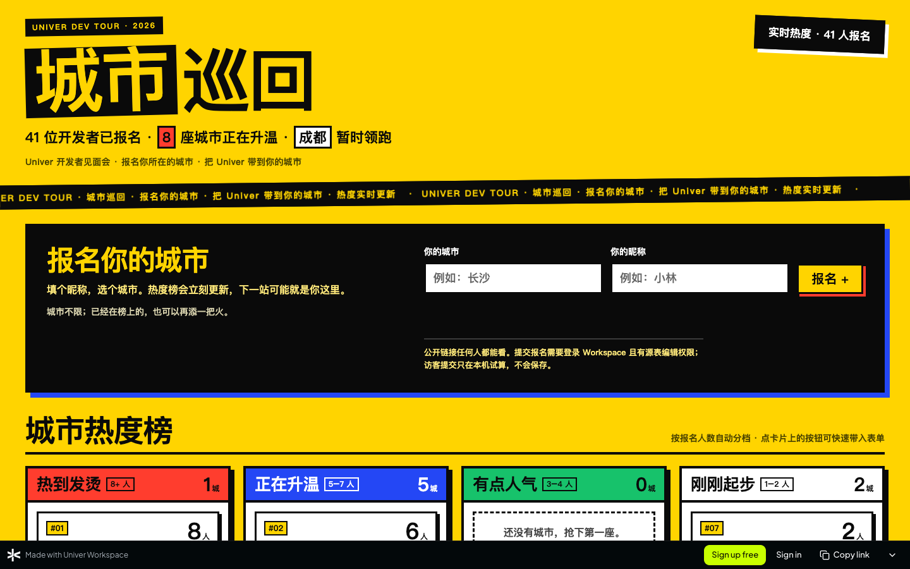
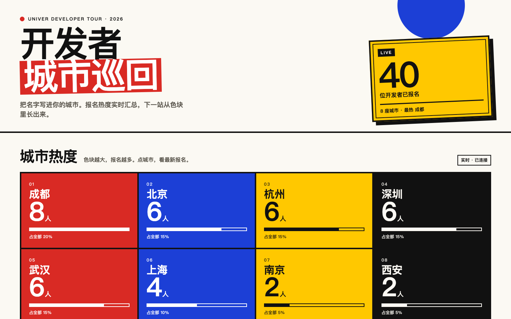
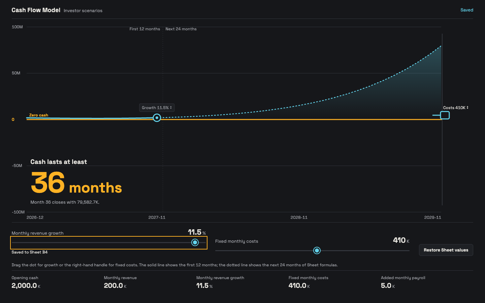
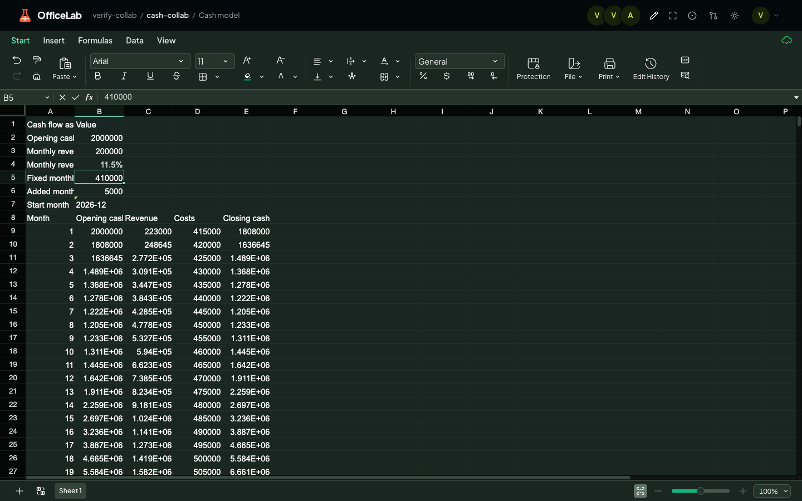
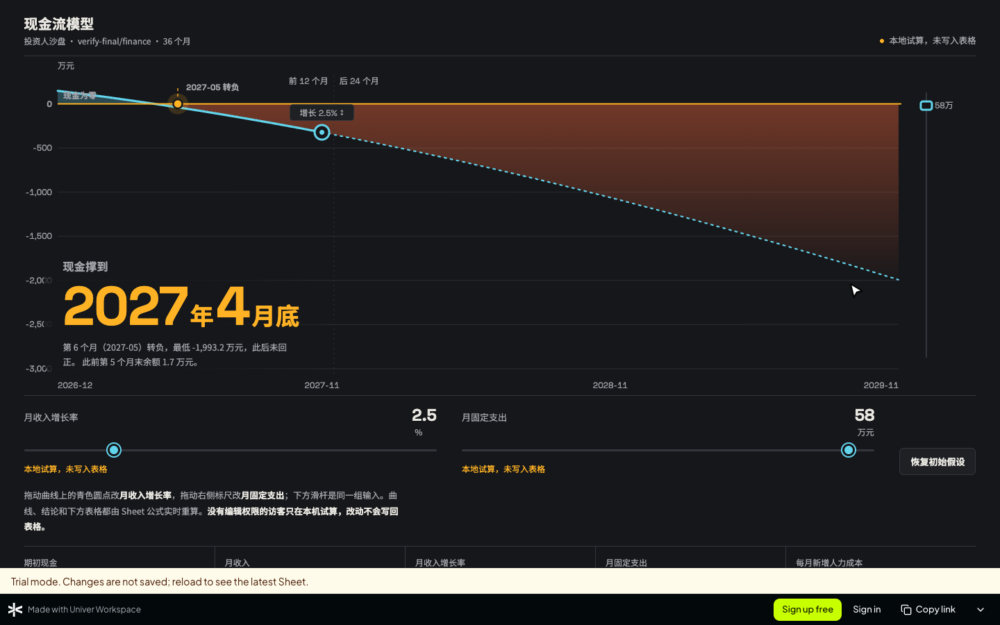

# HTML View showcase

[中文](html-view-showcase.zh-CN.md)

An HTML View is a small web app that an Agent builds on top of spreadsheet data already in a Workspace repository. Its metrics, charts and controls are bound to Sheet cells. When someone with edit rights moves a slider or changes a status on the page, the change is written to the Sheet and every open view updates in real time. You can share the page by link. In a public repository, anyone can open it without an account.

Most screenshots below show pages that an Agent (opencode with DeepSeek Flash, working only through the Workspace MCP server) built during acceptance testing. The Ink Notebook page and the collaboration pair show templates published directly during template checks. Every page reads a real Sheet that was seeded with sample data.

## How a page gets built

1. You ask an Agent for a page in plain language, for example "a page for investors where they can drag the growth rate and monthly costs to see how long the cash lasts".
2. Unless you already named a style, the Agent replies with the ten built-in styles below and asks which one you want, or you can describe your own. If you leave the choice to it, it uses Night Gauge.
3. The Agent starts from that style's template, binds it to your Sheet, writes the page in the language you are using, validates the bindings and publishes it.
4. It returns a share link and tells you who can open it. It asks before making a repository public, because that publishes everything in the repository.

The CLI does the same with `uvw html-view validate` and `uvw html-view create`. MCP clients use `html_view_validate` and `html_view_create`, available with `?toolsets=files` or `all`.

## How data binding works

HTML Views are built on the Univer data-binding SDK (`@univerjs-labs/html-view`, `html-view-renderer` and `binding-engine`). The page is plain HTML, CSS and JavaScript. It never stores a copy of the data. It declares which cells each element shows or edits, and the SDK keeps those elements and the Sheet in sync in both directions.



- **Declare what each element shows or edits.** `data-univer-cell-text` shows a cell. `data-univer-cell-model` binds a native input, select, slider or checkbox in both directions. Charts and custom components declare `data-univer-cell-subscribe` or `data-univer-range-subscribe` and receive values through `subscribeCellById()` and `subscribeRangeById()`. Buttons and forms write with `window.univerBinding.setCellValue()` or `insertRowsWithValues()`, followed by `flush()`.

  ```html
  <input type="range" min="0" max="0.12" step="0.005"
         data-univer-cell-model="UNIT_ID:SHEET_ID:B4">
  <strong data-univer-cell-text="UNIT_ID:SHEET_ID:E20"></strong>
  ```

- **Page to Sheet.** When someone with edit rights moves the slider above, the Binding Engine writes B4 into its workbook. The formula engine recalculates every dependent cell, and the change goes to the collaboration service. The Sheet editor, other open pages and Agents see it within moments.
- **Sheet to page.** When anyone changes the Sheet, whether in the Sheet editor, on another page or through an Agent, the collaboration service pushes the change to every open page's engine. The subscribed elements update in place, without a reload.
- **Formulas stay in the Sheet.** The page shows computed results; it never re-implements the model. Cell E20 above is a formula result that changes when B4 changes.
- **Every source is authorized per visitor.** The page runs in an opaque-origin iframe with no Workspace credentials. Workspace Browser authorizes each source Sheet for the current visitor before loading it. Users without edit rights cannot change the Sheet. Their page edits stay in their own engine as a local trial.

## Ten built-in styles, or your own

These ten styles are built-in templates: starting points, not a limit. You can describe your own style instead, such as your brand colors, fonts or mood. The Agent then starts from the template whose structure best fits your data and restyles it to match. You can also write or upload your own `.univer.html` that uses the same bindings.

The templates are written in English. The Agent adapts copy, units and dates to the user's language, and it can apply any style to a scenario the style was not designed for.

| Style | Mood | Designed for |
| --- | --- | --- |
| Night Gauge (default) | Charcoal with amber and cool cyan; the chart is the hero and you drag handles on it | Cash runway and planning models |
| Swiss Report | Black, white and signal red; one oversized answer on a strict grid | Cash runway and planning models |
| Broadsheet | Salmon newsprint and serif type; an editable sentence carries the inputs | Cash runway and planning models |
| Bauhaus Blocks | Primary red, blue and yellow blocks with oversized figures | Sales and performance reviews |
| Trading Desk | Dense dark matrix with monospace figures | Sales and performance reviews |
| Meeting Slides | One statement per screen, large serif type, keyboard paging | Sales and performance reviews |
| Brutalist Board | Bright yellow, thick black borders, draggable cards | Task and delivery tracking |
| Blueprint Timeline | Engineering grid with a today line and overdue tails | Task and delivery tracking |
| Ink Notebook | Ruled paper and handwriting; tick or stamp a task to change it | Task and delivery tracking |
| Citron Poster | Lemon yellow and bold type for pages meant to be shared | Public sign-ups and polls |

## Gallery

### Night Gauge: investor cash runway

Prompt (Chinese): an investor page where people drag the growth rate and monthly costs to see when cash runs out, style left to the Agent. The curve, the run-out month and the table all come from the Sheet's formula rows. Dragging a handle writes the assumption cell, and the Sheet recalculates.



### Night Gauge adapted to inventory

Prompt (English): a page for store managers showing which products are about to run out and how many to reorder. The Agent asked for a style, the user answered "You pick.", and the Agent adapted the default style to inventory.



### Meeting Slides: weekly sales review

Prompt (Chinese): a weekly sales dashboard filtered by region. The Agent first asked for a style, and the user chose Meeting Slides. Each screen carries one statement. The up and down arrow keys turn pages, and the left and right keys switch regions.


### Blueprint Timeline: delivery tracker

Prompt (English): a delivery tracker in the Blueprint Timeline style where the team changes task status and adds tasks. Overdue and blocked tasks trail red hatching back to the today line. Status changes and new tasks are written to the Sheet.



### Ink Notebook: delivery tracker

The tracker template in the Ink Notebook style, published against an English Sheet. Clicking the mark at the start of a row cycles the task's status in the Sheet.



### Brutalist Board: public city sign-up

Prompt (Chinese): a shareable sign-up page for a developer city tour, in the Brutalist Board style, open to anyone. This style was designed for task boards, and the Agent applied it to a sign-up page. The Agent made the repository public itself, because the prompt allowed it.



### Bauhaus Blocks: city sign-up heat

The same sign-up data in the Bauhaus Blocks style, which was designed for sales reviews. Each city gets a primary-color block with its sign-up count and share of the total.



## Page and Sheet in sync, in practice

In this check, a repository member with the editor role moved the growth slider to 11.5%. The page reports "Saved to Sheet B4", and the owner's open Sheet editor shows the new value with every formula row recalculated.

| Page (editor) | Sheet (owner, separate session) |
| --- | --- |
|  |  |

## Share with anyone

- **Who can open the link.** In a public repository, anyone with the link can open the page and see live data. Users without edit rights follow the repository's permissions: signed-out visitors and read-only members cannot change the source data.
- **Visitors can still play.** In Workspace Browser, a visitor's page edits run as a local trial. The real formula engine recalculates in their own browser, nothing is saved or sent, and reloading the page brings back the latest Sheet. The page says "trial, not saved" next to the control, and a notice under the page says the same.
- **A path to sign up.** A sign-up bar outside the page offers Sign up free, Sign in and Copy link to signed-out visitors.
- **Link previews.** When a public page link is pasted into chat, the preview shows the page's own title.



## Learn more

- [HTML View Skill](../apps/cli/skill-data/html-view/SKILL.md) and its [style guide](../apps/cli/skill-data/html-view/references/design.md): what Agents read before building a page.
- [Sharing and design direction](design/html-views/sharing-and-design-floor.md) (Chinese): why pages stay live, how sharing works and how the styles were chosen.
- [Browser integration](design/html-views/browser-integration.md) (Chinese): rendering, authorization and the visitor trial.
