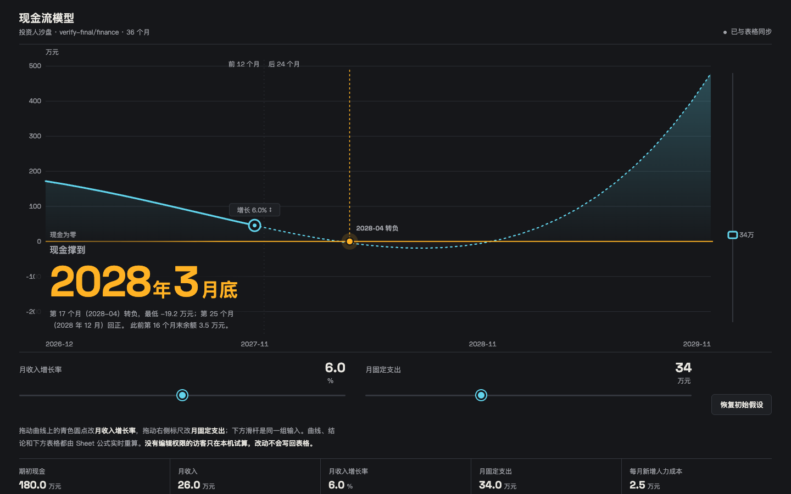
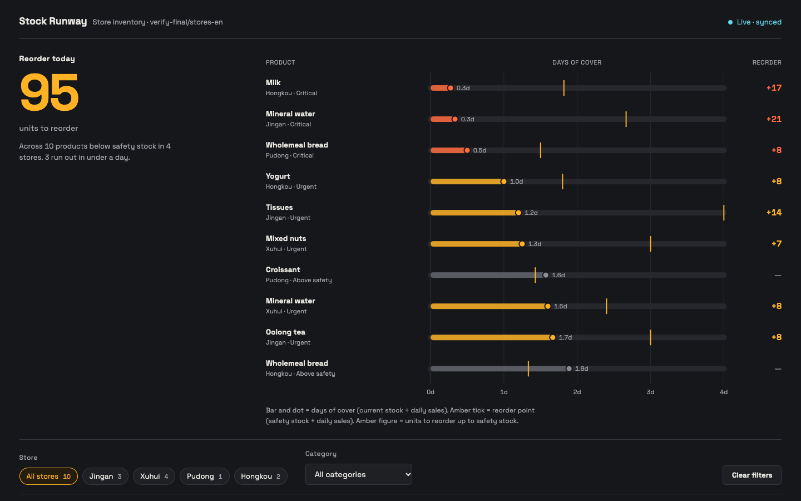
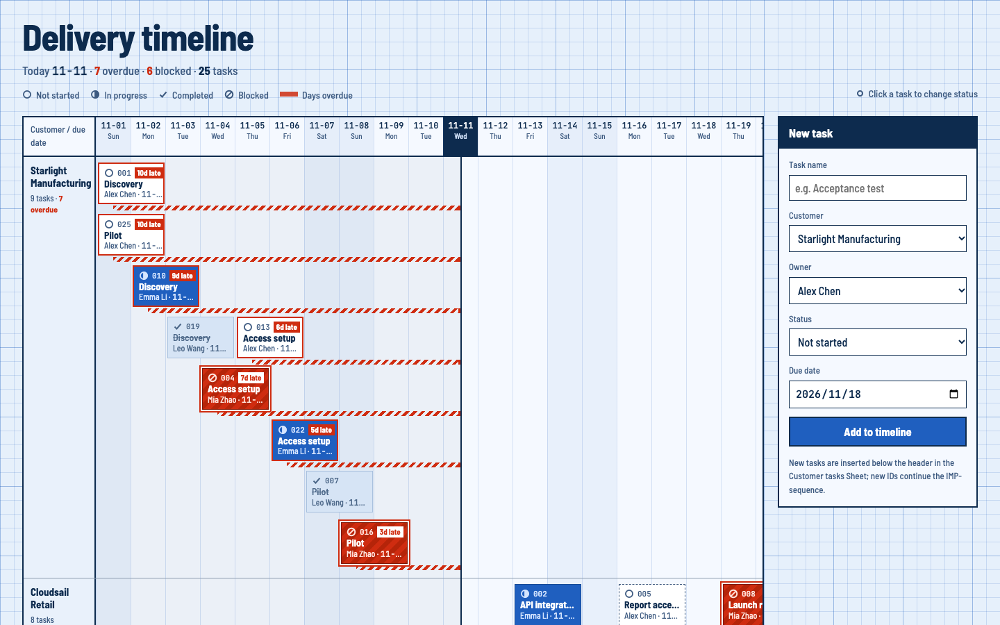
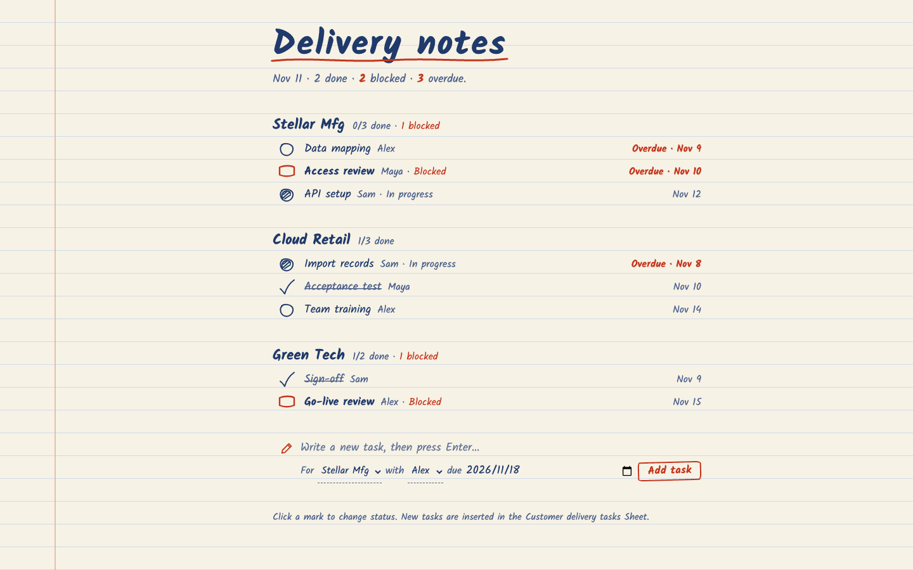
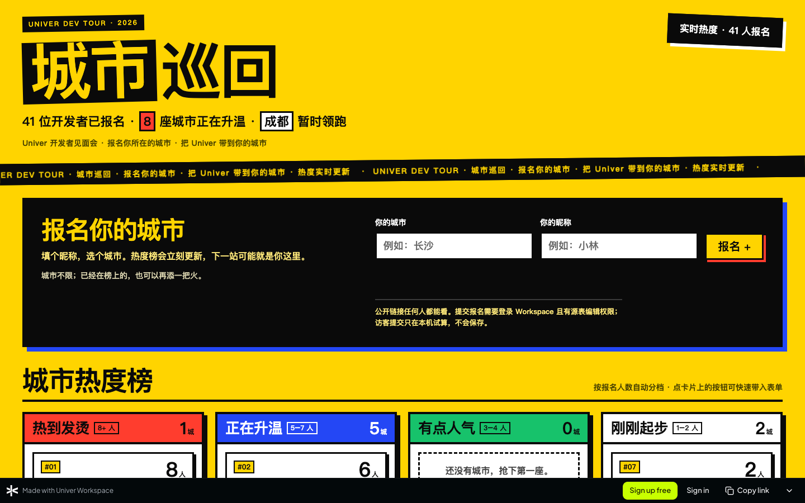
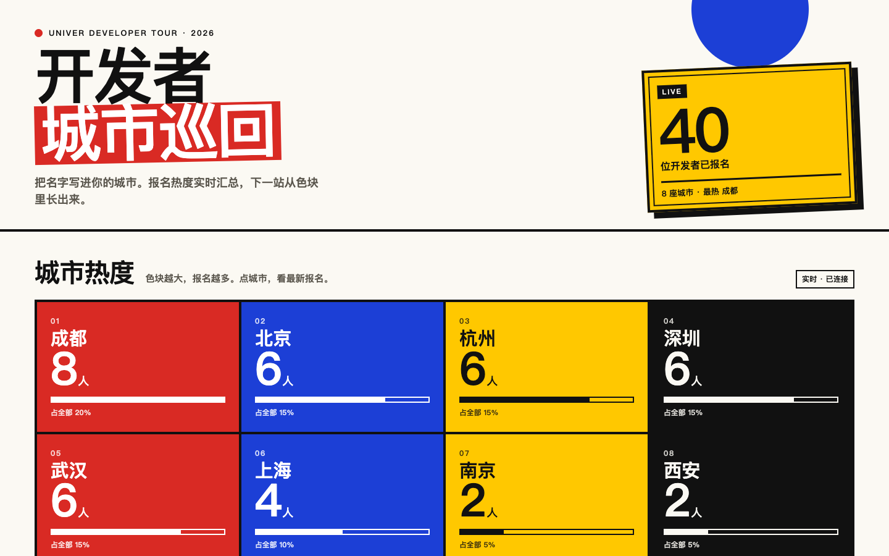
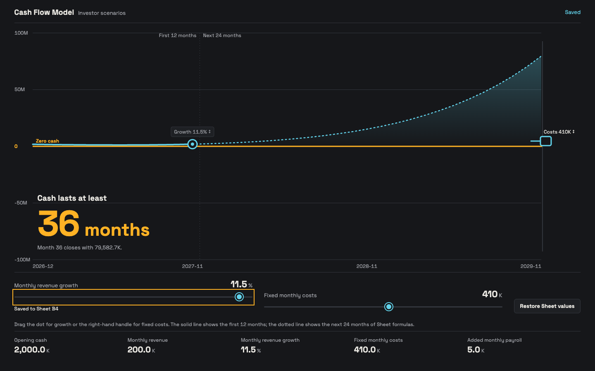
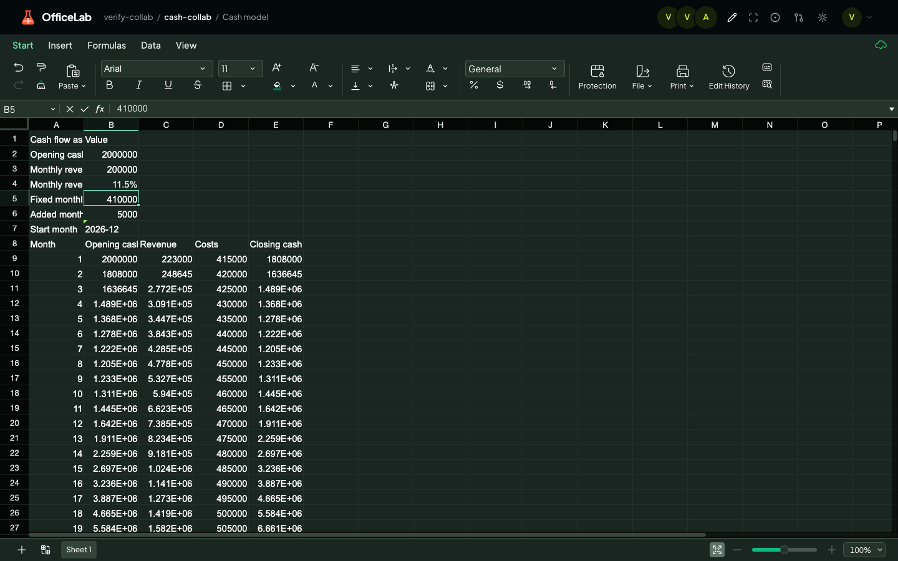
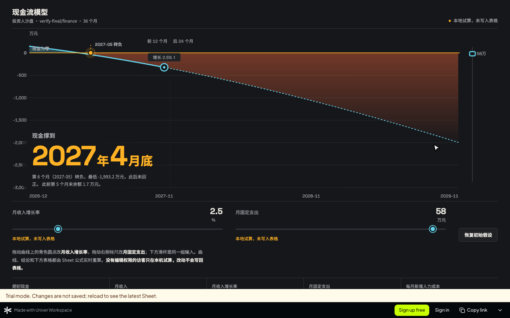

# HTML View 效果展示

[English](html-view-showcase.md)

HTML View 是 Agent 基于 Workspace repository 里已有表格数据构建的小型网页应用。页面上的指标、图表和控件都绑定到 Sheet 单元格。有编辑权限的人在页面上拖动滑块或修改状态时，改动会写入表格，所有打开着的视图都会实时更新。页面可以通过链接分享；在公开 repository 中，任何人不登录也能打开。

下面多数截图来自验收测试：页面由 Agent（opencode 加 DeepSeek Flash，只通过 Workspace MCP 服务器操作）构建。文楷手账页面和协同那一组截图，是模板检查时直接发布的模板效果。所有页面读取的都是预置了示例数据的真实表格。

## 页面是怎么做出来的

1. 你用自然语言向 Agent 提需求，例如"给投资人做一个页面，可以拖动增长率和月支出，看现金能撑多久"。
2. 如果你没有指定风格，Agent 会先列出下面 10 种风格，问你想要哪一种。你让它决定时，它使用仪表夜航。
3. Agent 从所选风格的模板开始，绑定到你的表格，用你正在使用的语言撰写页面，校验绑定后发布。
4. Agent 返回分享链接，并说明谁能打开。把 repository 设为公开会立即公开库里的全部内容，所以它会先征求你的同意。

CLI 用 `uvw html-view validate` 和 `uvw html-view create` 完成同样的流程。MCP 客户端使用 `html_view_validate` 和 `html_view_create`，需要在连接地址上加 `?toolsets=files` 或 `all`。

## 10 种风格

模板用英文编写。Agent 会把文案、单位和日期改成用户的语言和习惯，也可以把任何风格用到它原本不是为之设计的场景上。

| 风格 | 气质 | 原本为哪类场景设计 |
| --- | --- | --- |
| 仪表夜航 Night Gauge（默认） | 炭黑底配琥珀与冷青；图表是主角，直接在图上拖动手柄 | 现金跑道与规划模型 |
| 瑞士财报 Swiss Report | 黑白加一抹信号红；严整网格上一个巨大的结论 | 现金跑道与规划模型 |
| 粉色报纸 Broadsheet | 桃粉报纸与衬线字；输入值嵌在一句可编辑的话里 | 现金跑道与规划模型 |
| 包豪斯色块 Bauhaus Blocks | 红蓝黄原色色块加超大数字 | 销售与业绩复盘 |
| 交易台 Trading Desk | 深色高密度矩阵，等宽数字 | 销售与业绩复盘 |
| 周会幻灯 Meeting Slides | 一屏一个结论，大号衬线字，键盘翻页 | 销售与业绩复盘 |
| 新粗野看板 Brutalist Board | 亮黄底、粗黑边框、可拖动卡片 | 任务与交付跟踪 |
| 蓝图时间线 Blueprint Timeline | 工程网格，标出今天，逾期任务拖着红色尾巴 | 任务与交付跟踪 |
| 文楷手账 Ink Notebook | 横线纸与手写体，打勾或盖章即可改状态 | 任务与交付跟踪 |
| 柠檬海报 Citron Poster | 柠檬黄与粗体大字，适合用来传播的页面 | 公开报名与投票 |

## 效果

### 仪表夜航：投资人现金跑道

提示词（中文）：给投资人做一个页面，可以拖动增长率和月支出，看现金能撑到几月，风格由 Agent 决定。曲线、见底月份和下方表格都来自表格的公式行。拖动手柄会写入假设单元格，由表格重新计算。

### 仪表夜航改编为库存看板

提示词（英文）：让店长一眼看出哪些商品快断货、该补多少。Agent 先问风格，用户回答 "You pick."，Agent 便把默认风格改编成库存页面。

### 周会幻灯：销售周会

提示词（中文）：做一个能按区域筛选的销售周会看板。Agent 先问风格，用户选了周会幻灯。每屏一个结论，上下方向键翻页，左右方向键切换区域。

### 蓝图时间线：交付跟踪

提示词（英文）：用 Blueprint Timeline 风格做一个交付跟踪页面，团队可以修改任务状态并新增任务。逾期和阻塞的任务拖着红色斜纹，一直延伸到"今天"那条线。状态修改和新任务都写入表格。

### 文楷手账：交付跟踪

文楷手账风格的任务跟踪模板，绑定一份英文表格后直接发布的效果。点击每行开头的记号，就会在表格里轮换该任务的状态。

### 新粗野看板：公开的城市报名页

提示词（中文）：为开发者城市巡回活动做一个适合发朋友圈的公开报名页，使用新粗野看板风格，任何人都能打开。这个风格原本为任务看板设计，Agent 把它用到了报名页上。因为提示词允许，Agent 自己把 repository 设成了公开。

### 包豪斯色块：城市报名热度

同一份报名数据，换成原本为销售复盘设计的包豪斯色块风格。每个城市一块原色色块，显示报名人数和占比。

## 实时数据与协同

页面显示的是实时的表格数据，不是副本。有编辑权限的用户修改控件时，页面写入对应单元格；其他打开着的页面和表格编辑器无需刷新就会更新；在表格里做的修改也会实时反映到页面上。

在这次验证中，一位 editor 角色的库成员把增长率滑块拖到了 11.5%。页面显示 "Saved to Sheet B4"，owner 在另一个会话里打开的表格编辑器同时显示了新值，所有公式行也已重新计算。

| 页面（editor） | 表格（owner，另一个会话） |
| --- | --- |
|  |  |

## 分享给任何人

- **谁能打开链接。** 在公开 repository 中，任何拿到链接的人都能打开页面并看到实时数据。没有编辑权限的用户遵循 repository 的权限：未登录访客和只读成员不能修改来源数据。
- **访客也能动手玩。** 在 Workspace Browser 中，访客在页面上的编辑会以本地试算运行：真正的公式引擎在访客自己的浏览器里重算，不保存也不发送，刷新页面即恢复最新表格。控件旁边会标注"试算，不保存"，页面下方的提示条也会说明这一点。
- **注册入口。** 页面外有一条注册栏，为未登录访客提供"免费注册""登录"和"复制链接"。
- **链接预览。** 把公开页面的链接贴到聊天工具里时，预览会显示页面自己的标题。

## 了解更多

- [HTML View Skill](../apps/cli/skill-data/html-view/SKILL.md) 和[风格指南](../apps/cli/skill-data/html-view/references/design.md)：Agent 构建页面前阅读的内容（英文）。
- [分享与观感改进方案](design/html-views/sharing-and-design-floor.md)：为什么页面保持实时、分享如何工作、风格如何选定。
- [Browser 集成](design/html-views/browser-integration.md)：渲染、授权与访客试算。
